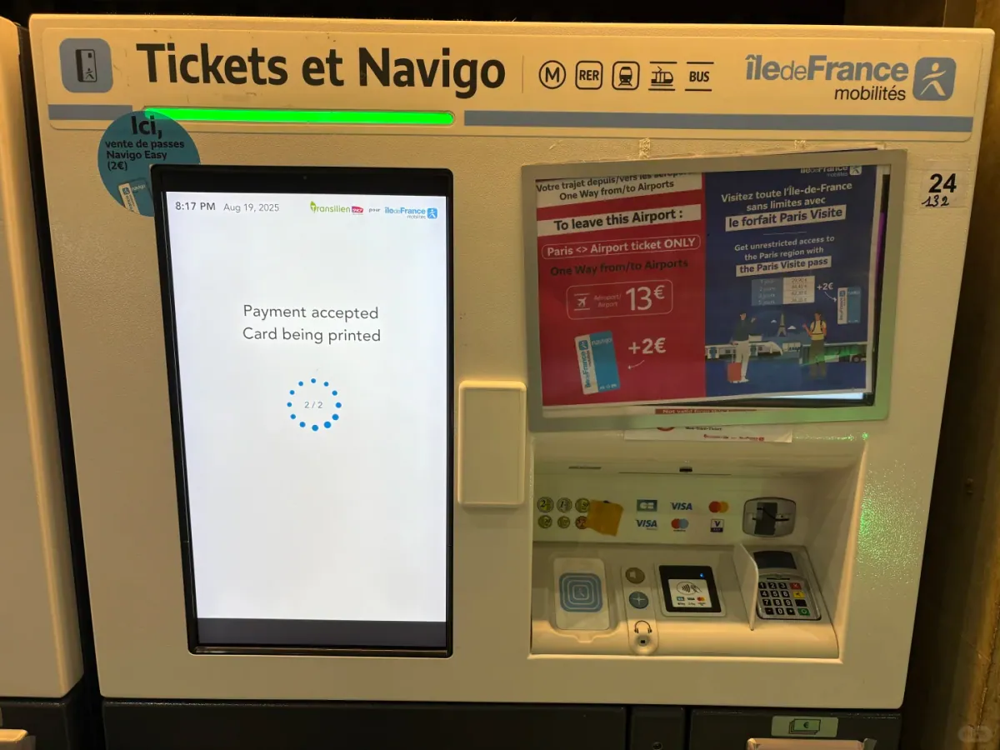

CDG leží asi 25 km severovýchodně od Paříže a cesta do města je jednoduchá: následujte značky Train / RER dolů k nádraží a nastupte do RER B. Zmatek začíná v jízdenkové hale, kde žluté automaty „Tickets et Navigo“ nabízejí Jízdenky, Kupony a Letištní jízdenky, zatímco plakát slibuje „Paris ↔ Airport 13€ +2€“.

Tento průvodce sleduje jeden přílet: nástupiště, pět typů jízdenek, pravidla, kvůli kterým lze u týdenního kuponu snadno vyhodit peníze, automat obrazovku po obrazovce a to, ze kterého nádraží odjíždí váš vlak do vnitrozemí. Ceny odpovídají tomu, co cestovatel zaplatil v srpnu 2026.

RER B není žádný samostatný „letištní expres“, ale linka B pařížské regionální sítě, která projíždí městem se zastávkami na Gare du Nord a Châtelet; Google Maps ji označuje jako RER B a bílé B na modrém podkladu je značka, kterou je třeba sledovat.

## 1. Cesta z CDG do Paříže

Za výdejem zavazadel hledejte Train / RER nebo Gares, ne Métro. Nádraží je pod terminálem 2, o jedno patro níž než přílety; z terminálů 1 nebo 3 nejprve jeďte bezplatným shuttle CDGVAL do T2.

Dole jsou dvě možnosti: řada žlutých automatů a prosklená kancelář SNCF s nápisem „Services Navigo / Tickets Paris et Île-de-France“ a přepážkami 01 až 03. Automat je nejrychlejší pro jednu letištní jízdenku; přepážka řeší otázky k týdennímu kuponu, změny a vlakové jízdenky.

Za turnikety označuje nástupiště tmavě modrý nápis s bíle orámovaným RER, modrým B a dvěma šipkami dolů, pod ním Voie 11, 12 a Paris. Jízda na Gare du Nord nebo Châtelet-Les Halles trvá asi 25–30 minut. S velkými kufry se vyhněte ranní špičce.

Letištní jednotlivá jízdenka stojí **13 €**, je nejdražší jízdenkou celé cesty a jedinou platnou v RER B mezi letištěm a městem. Kryje pouze tento úsek, takže jízdy pařížským metrem a autobusem potřebují městskou jízdenku. I když máte v plánu týdenní kupon, tuto jízdenku za 13 € kupujete na letišti — viz část 3.

## 2. Druhy jízdenek a ceny v Paříži

Existuje pět jízdenek: jednotlivá jízda, letištní jízdenka, carnet o deseti jízdách, jednodenní jízdenka a týdenní kupon. První karta stojí **2 €** a stejná karta se pak dobíjí. Rozhodujte se podle počtu dní a jízd: dva dny se třemi nebo čtyřmi jízdami znamenají jednotlivé jízdenky nebo carnet; pět dní během jednoho týdne ukazuje na týdenní kupon.

| Jízdenka | Cena | Nejvhodnější pro | Kryje letištní linku? |
| --- | --- | --- | --- |
| Jednotlivá jízda (metro / RER ve městě) | 2,50 € | Dvě nebo tři jízdy denně | Ne |
| Jednotlivá jízda (autobus) | 2 € | Krátké přejezdy, prohlídka cestou | Ne |
| Letištní jízdenka | 13 € | Den příletu nebo odletu | Ano |
| Carnet o deseti | 25 € | Tři až pět dní, bez fronty | Ne |
| Jednodenní jízdenka | 12 € | Několik památek za jeden den | Ne |
| Týdenní Navigo | 31,50 € plus karta za 5 € | Pobyty přes týden, každodenní cestování | Ano |

Jízdenka na metro stojí **2,50 €**, autobusová **2 €**. Carnet stojí **25 €**, tedy 2,50 € za jízdu — stejně jako jednotlivé jízdenky, takže kupuje čas ve frontě, ne slevu. Denní jízdenka stojí **12 €** a platí do **24:00** téhož dne, ne 24 hodin, takže ji kupujte ráno.

Důležité jsou dva detaily. Jakmile je na kartě letištní jízdenka, cestovatel zjistil, že karta později nemůže přijmout jednotlivé jízdenky na metro, pouze autobusové. A denní jízdenka vylučuje letištní linku — na obrazovce stojí „kromě letišť“ — takže RER B potřebuje samostatnou jízdenku za 13 €.

Týdenní kupon stojí **31,50 €** plus karta za **5 €** a je jedinou dlouhodobou jízdenkou, která kryje letištní linku.

## 3. Čtyři pravidla týdenního kuponu

Kupon končí ve **24:00 v neděli** týdne, ve kterém jste ho koupili, ne o sedm klouzavých dní později. Pondělí dává sedm dní, čtvrtek čtyři, neděle téměř žádný; je to produkt kalendářního týdne, na rozdíl od denní jízdenky nebo carnetu. Karta potřebuje **fotografii velikosti pasu**, bez ní může být považována za neplatnou. Prodává se **pouze na přepážkách s personálem a v aplikaci Île-de-France Mobilités**, nikdy v automatu. A **letiště ho prodat nemůže**: při příletu kupte jednotlivou jízdenku za 13 € (plus 2 €, pokud nemáte kartu) a týdenní kupon pak kupte na přepážce městského nádraží.

Kupon kryje letištní linku, na rozdíl od jednotlivých a denních jízdenek: přileťte uprostřed týdne a odjeďte o víkendu a zpáteční cesta za 13 € je zahrnuta, zatímco odlet po nedělní 24:00 znamená další jednotlivou jízdenku.

Aplikace se vyhne poplatku za kartu, pokud jízdenku přidáte do Apple Wallet, ale registrace obvykle vyžaduje evropské telefonní číslo. S kartou stojí kupon 31,50 € + 5 € = **36,50 €** oproti 12 € na den: čtyři denní jízdenky jsou 48 €, tři jsou 36 € a téměř se vyrovnají, i když kupon kryje jednu cestu na letiště.

| Koupě v | Dny, které skutečně získáte | Verdikt |
| --- | --- | --- |
| Pondělí | 7 | Nejlepší hodnota; prostě ho kupte |
| Úterý | 6 | Dobrá hodnota |
| Středa | 5 | Dobrá hodnota |
| Čtvrtek | 4 | Na úrovni čtyř denních jízdenek, plus jedna cesta na letiště |
| Pátek | 3 | Vyplatí se jen v případě, že i zpáteční cesta bude RER |
| Sobota | 2 | Denní jízdenka je lepší |
| Neděle | 1 | Vyprší tu noc; nekupujte |

## 4. Nákup jízdenky u automatu

Dva automaty mají společnou skříň: jeden označený **ticket** prodává a dobíjí karty, jeden označený **recharge** pouze dobíjí. Pokud kartu nemáte, zvolte ticket. Přijímají Visa, Mastercard a mince.

Červený plakát napravo hlásá „To leave this Airport: Paris ↔ Airport ticket ONLY“ s **13 €** a **+2 €** — oficiální podoba jízdného a poplatku za novou kartu.

První obrazovka nabízí „Přiložte kartu Navigo“ pro dobití existující karty nebo „Nemáte Navigo Pass: klepněte zde“ pro nákup nové.

Druhá obrazovka vypisuje **Jízdenky**, **Kupony** a **Letištní jízdenky**. Letištní jízdenky sčítají jízdné a poplatek za kartu dohromady.

Jízdenky vedou na **Metro–vlak** nebo **Autobus–tramvaj** (2,50 € proti 2 €), pak na **plné jízdné** nebo **snížené jízdné**; snížené je pro děti od 4 do méně než 10 let nebo držitele slevových karet, takže návštěvníci chtějí plné jízdné.

Kupony vedou na **Forfait Day Pass** (kromě letišť) nebo **Forfait Paris Visite** (1, 2, 3 nebo 5 dní). Denní jízdenka se pak ptá na datum začátku, vypsané ode dneška do sedmi dnů dopředu; neklepejte na dnešek ze zvyku.

Plaťte kartou nebo mincemi; nová karta na konci přidá 2 €. Týdenní kupon se tu vůbec neprodává.

1. Vyberte automat: ticket prodává nové karty, recharge pouze dobíjí.
2. První obrazovka: přiložte kartu, nebo klepněte na „Nemáte Navigo Pass“.
3. Druhá obrazovka: Jízdenky, Kupony nebo Letištní jízdenky.
4. Třetí obrazovka (u jednotlivých jízdenek): Metro–vlak nebo Autobus–tramvaj.
5. Čtvrtá obrazovka: plné nebo snížené jízdné.
6. U denní jízdenky: Kupony → Forfait Day Pass → datum začátku.
7. Zaplaťte; nová karta automaticky přidá 2 €.

## 5. Odjezd z Paříže: znejte své nádraží

Paříž má šest nádraží pro dálkové vlaky, každé obsluhuje jiné směry, podobně jako několik pekingských nádraží: špatná volba znamená zmeškaný vlak.

Rezervační aplikace překládají názvy nádraží, takže „Paris Est“ i „Paris Gare de Lyon“ se zobrazují jako Paříž, přitom leží kilometry od sebe. Snímky obrazovky ukazují vlak do Remeše odjíždějící z **Paris Est v 09:58** a přijíždějící do Remeše v 11:22 a vlak do Lyonu odjíždějící z **Paris Gare de Lyon v 11:52** a přijíždějící na Lyon Part-Dieu ve 13:56.

Třetí možnost: jízdenka s názvem **Aéroport Charles de Gaulle 2 TGV**, nádraží pod terminálem 2, kde můžete jít dolů, místo abyste jeli do města.

| Nádraží | Hlavní směry | Metro / RER |
| --- | --- | --- |
| Gare du Nord | Severní Francie, Belgie, Británie (Eurostar) | Linky 4, 5; RER B, D |
| Gare de l'Est | Východní Francie, Německo, Lucembursko | Linky 4, 5, 7 |
| Gare de Lyon | Jihovýchodní Francie, Švýcarsko, Itálie | Linky 1, 14; RER A, D |
| Gare d'Austerlitz | Jihozápadní Francie, Španělsko, Portugalsko | Linky 5, 10; RER C |
| Gare Montparnasse | Západní Francie, Bretaň | Linky 4, 6, 12, 13 |
| Gare Saint-Lazare | Normandie | Linky 3, 12, 13, 14 |

Stará nádraží jsou většinou koncová: zkontrolujte tabuli s vlakem a jeho nástupištěm (voie), pak dojděte ke koleji. Starší linky metra znamenají schody a málo výtahů, takže s těžkým kufrem počítejte s časem; 45–60 minut před odjezdem je rozumná rezerva.

V tomto pořadí je pařížská doprava jednoduchá: kupte letištní jízdenku za 13 €, zvažte denní jízdenku proti týdennímu kuponu, běžné jízdenky kupte v automatu a týdenní kupon na přepážce nebo v aplikaci a zkontrolujte si nádraží. Jízdné a uspořádání se mění, takže si v den cesty ověřte aktuální informace u Île-de-France Mobilités a SNCF.

## Související odkazy

- **Na tomto webu**: [Letiště Paris Charles de Gaulle (CDG)](/airport/CDG), [Francie (FR)](/country/FR)
- **Wikipedie**: [Letiště Paris Charles de Gaulle](https://en.wikipedia.org/wiki/Paris_Charles_de_Gaulle_Airport)
- **Baidu Baike**: [Letiště Paris Charles de Gaulle](https://baike.baidu.com/item/%E5%B7%B4%E9%BB%8E%E5%A4%8F%E5%B0%94%C2%B7%E6%88%B4%E9%AB%98%E4%B9%90%E6%9C%BA%E5%9C%BA)
