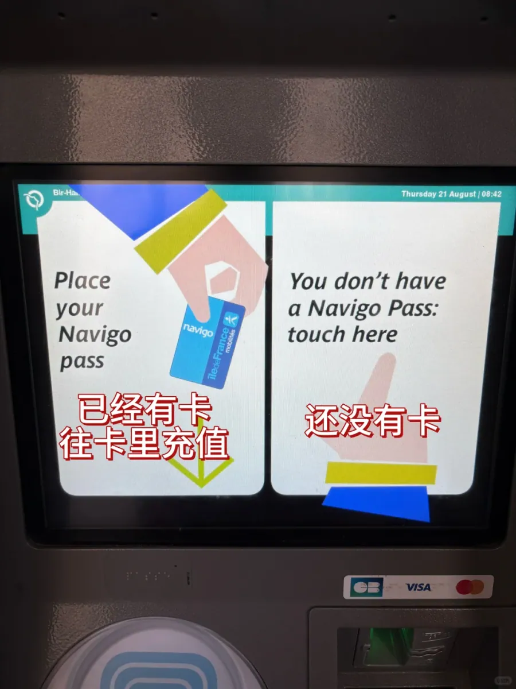
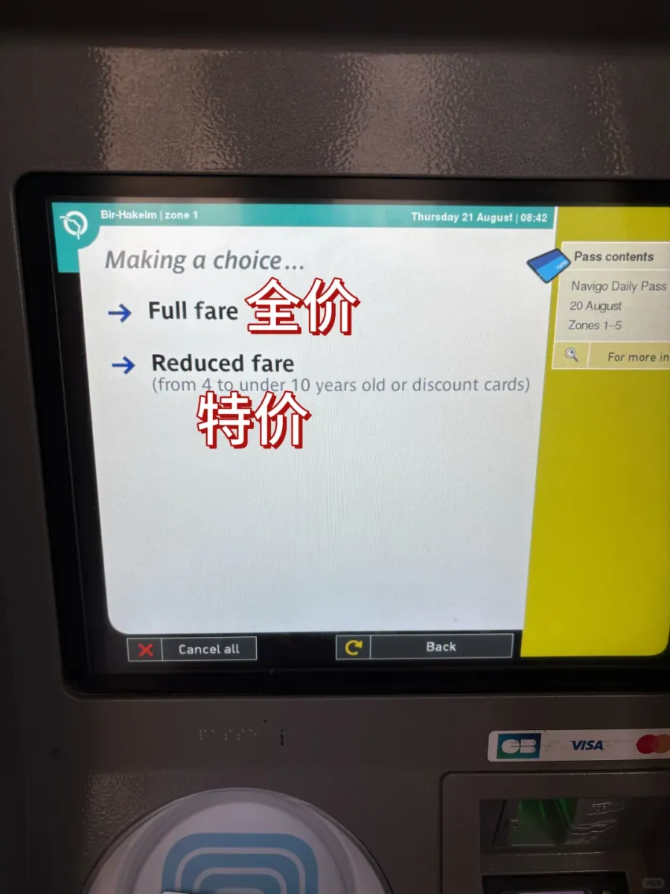

El CDG está a unos 25 km al noreste de París, y la forma de entrar en la ciudad es sencilla: sigue los carteles de Train / RER hasta la estación y toma el RER B. La confusión empieza en el vestíbulo de billetes, donde las máquinas amarillas “Tickets et Navigo” ofrecen Tickets, Passes y Airport Tickets mientras un póster promete “Paris ↔ Airport 13€ +2€”.

Esta guía sigue una llegada: el andén, los cinco tipos de billete, las reglas que hacen fácil tirar el dinero con el abono semanal, la pantalla de la máquina paso a paso y de qué estación sale tu tren a las provincias. Los precios son los que pagó el viajero en agosto de 2026.

El RER B no es un “expreso del aeropuerto” aparte, sino la línea B de la red regional de París, que atraviesa la ciudad con paradas en Gare du Nord y Châtelet; Google Maps la etiqueta como RER B, y la B blanca sobre azul es la marca que hay que seguir.

## 1. Entrar en París desde el CDG

Al salir de la recogida de equipajes, busca Train / RER o Gares, no Métro. La estación está bajo la Terminal 2, un nivel por debajo de las llegadas; desde las terminales 1 o 3, toma primero la lanzadera gratuita CDGVAL hasta la T2.

Abajo hay dos opciones: una fila de máquinas amarillas y una oficina de SNCF con paredes de cristal que dice “Services Navigo / Tickets Paris et Île-de-France”, con mostradores del 01 al 03. La máquina es lo más rápido para un billete de aeropuerto sencillo; el mostrador resuelve dudas del abono semanal, cambios y billetes de tren.

Pasados los tornos, un cartel azul oscuro con un RER enmarcado en blanco, una B azul y dos flechas hacia abajo señala los andenes, con Voie 11, 12 y Paris debajo. El trayecto a Gare du Nord o Châtelet-Les Halles dura unos 25–30 minutos. Con maletas grandes, evita la hora punta de la mañana.

El sencillo del aeropuerto cuesta **13 €**, el billete más caro del viaje y el único válido en el RER B entre el aeropuerto y la ciudad. Cubre solo ese tramo, así que los trayectos en metro y autobús de París necesitan un billete urbano. Aunque tengas en mente el abono semanal, este billete de 13 € se compra en el aeropuerto; ver la sección 3.

## 2. Tipos de billete y precios en París

Existen cinco billetes: un sencillo, el billete de aeropuerto, un carnet de diez, un abono de un día y el abono semanal. La primera tarjeta lleva una **comisión de 2 €**, y la misma tarjeta se recarga después. Decide por días y trayectos: dos días con tres o cuatro trayectos son sencillos o un carnet; cinco días repartidos en una semana apuntan al abono semanal.

| Billete | Precio | Mejor para | ¿Cubre la línea del aeropuerto? |
| --- | --- | --- | --- |
| Sencillo (metro / RER en la ciudad) | 2,50 € | Dos o tres trayectos al día | No |
| Sencillo (autobús) | 2 € | Trayectos cortos, ver la ciudad de camino | No |
| Sencillo de aeropuerto | 13 € | El día de llegada o de salida | Sí |
| Carnet de diez | 25 € | Tres a cinco días, sin colas | No |
| Abono de un día | 12 € | Varios sitios en un día | No |
| Navigo semanal | 31,50 € más una tarjeta de 5 € | Estancias que cruzan una semana, viaje diario | Sí |

Un sencillo de metro cuesta **2,50 €** y uno de autobús **2 €**. El carnet es de **25 €**, o 2,50 € por trayecto: lo mismo que los sencillos, así que compra tiempo de cola, no un descuento. El abono de día cuesta **12 €** y caduca a las **24:00** de ese día, no 24 horas después, así que cómpralo por la mañana.

Dos detalles importan. Una vez que hay un billete de aeropuerto en una tarjeta, el viajero comprobó que la tarjeta no admitía después sencillos de metro, solo billetes de autobús. Y el abono de día excluye la línea del aeropuerto: la pantalla dice “excluding airports”, así que el RER B necesita un billete aparte de 13 €.

El abono semanal cuesta **31,50 €** más una tarjeta de **5 €**, el único billete de larga duración que cubre la línea del aeropuerto.

## 3. Las cuatro reglas del abono semanal

El abono termina a las **24:00 del domingo** de la semana en que lo compraste, no siete días móviles después. El lunes da siete días, el jueves cuatro, el domingo casi ninguno; es un producto de semana natural, a diferencia del abono de día o del carnet. La tarjeta necesita una **foto tamaño carné**, sin la cual puede considerarse inválida. Solo se vende **en mostradores atendidos y en la app de Île-de-France Mobilités**, nunca en máquina. Y **el aeropuerto no puede venderlo**: compra el sencillo de 13 € a la llegada (más 2 € si no tienes tarjeta) y luego compra el abono semanal en un mostrador de una estación de la ciudad.

El abono cubre la línea del aeropuerto, a diferencia de los sencillos y los abonos de día: si aterrizas entre semana y sales el fin de semana, el regreso de 13 € está incluido, mientras que salir después de las 24:00 del domingo significa otro sencillo.

La app evita la comisión de la tarjeta si añades el billete a Apple Wallet, pero el registro normalmente necesita un número de teléfono europeo. Con tarjeta, el abono cuesta 31,50 € + 5 € = **36,50 €** frente a 12 € al día: cuatro abonos de día son 48 €, tres son 36 € y casi empatan, aunque el abono cubre un viaje al aeropuerto.

| Comprado el | Días que obtienes | Veredicto |
| --- | --- | --- |
| Lunes | 7 | La mejor relación; cómpralo sin más |
| Martes | 6 | Buena relación |
| Miércoles | 5 | Buena relación |
| Jueves | 4 | Empata con cuatro abonos de día, más un viaje al aeropuerto |
| Viernes | 3 | Solo vale la pena si la vuelta también es en RER |
| Sábado | 2 | Mejor un abono de día |
| Domingo | 1 | Caduca esa noche; no lo compres |

## 4. Comprar un billete en la máquina

Dos máquinas comparten carcasa: una marcada **ticket** vende y recarga tarjetas, otra marcada **recharge** solo recarga. Sin tarjeta, elige ticket. Aceptan Visa, Mastercard y monedas.

El póster rojo de la derecha dice “To leave this Airport: Paris ↔ Airport ticket ONLY”, con **13€** y **+2€**: la versión oficial de la tarifa y de la comisión de tarjeta nueva.

La primera pantalla ofrece “Place your Navigo pass” para recargar una tarjeta existente, o “You don't have a Navigo Pass: touch here” para comprar una.

La segunda pantalla enumera **Tickets**, **Passes** y **Airport Tickets**. Airport Tickets suma la tarifa y la comisión de la tarjeta.

Tickets lleva a **Metro-Train** o **Bus-Tram** (2,50 € frente a 2 €), y luego a **tarifa completa** o **tarifa reducida**; la reducida es para niños de 4 a menos de 10 años o titulares de tarjetas de descuento, así que los visitantes quieren la completa.

Passes lleva a **Forfait Day Pass** (excluye aeropuertos) o **Forfait Paris Visite** (1, 2, 3 o 5 días). El abono de día pide luego una fecha de inicio, listada desde hoy hasta siete días después; no toques hoy por costumbre.

Paga con tarjeta o monedas; una tarjeta nueva añade 2 € al final. El abono semanal no se vende aquí en absoluto.

1. Elige la máquina: ticket vende tarjetas nuevas, recharge solo recarga.
2. Primera pantalla: presenta una tarjeta o toca “You don't have a Navigo Pass”.
3. Segunda pantalla: Tickets, Passes o Airport Tickets.
4. Tercera pantalla (para sencillos): Metro-Train o Bus-Tram.
5. Cuarta pantalla: tarifa completa o reducida.
6. Para un abono de día: Passes → Forfait Day Pass → fecha de inicio.
7. Paga; una tarjeta nueva añade 2 € automáticamente.

## 5. Salir de París: conoce tu estación

París tiene seis estaciones principales, cada una al servicio de sus direcciones, muy parecido a las varias estaciones terminales de Pekín: la equivocada significa perder el tren.

Las apps de reserva traducen los nombres de las estaciones, así que “Paris Est” y “Paris Gare de Lyon” se leen ambos como París aunque estén a kilómetros de distancia. Las capturas muestran el tren a Reims saliendo de **Paris Est a las 09:58** y llegando a Reims a las 11:22, y el tren a Lyon saliendo de **Paris Gare de Lyon a las 11:52** y llegando a Lyon Part-Dieu a las 13:56.

Una tercera posibilidad: un billete que indica **Aéroport Charles de Gaulle 2 TGV**, la estación bajo la Terminal 2, donde puedes bajar en lugar de entrar en la ciudad.

| Estación | Direcciones principales | Metro / RER |
| --- | --- | --- |
| Gare du Nord | Norte de Francia, Bélgica, Reino Unido (Eurostar) | Líneas 4, 5; RER B, D |
| Gare de l'Est | Este de Francia, Alemania, Luxemburgo | Líneas 4, 5, 7 |
| Gare de Lyon | Sureste de Francia, Suiza, Italia | Líneas 1, 14; RER A, D |
| Gare d'Austerlitz | Suroeste de Francia, España, Portugal | Líneas 5, 10; RER C |
| Gare Montparnasse | Oeste de Francia, Bretaña | Líneas 4, 6, 12, 13 |
| Gare Saint-Lazare | Normandía | Líneas 3, 12, 13, 14 |

Las estaciones antiguas son en su mayoría terminales en fondo de saco: mira el panel para ver el tren y su andén (voie) y luego camina hasta la vía. Las líneas de metro más antiguas implican escaleras y pocos ascensores, así que deja tiempo para una maleta pesada; 45–60 minutos antes de la salida es un margen sensato.

Hecho en ese orden, el transporte de París es sencillo: compra el sencillo de aeropuerto de **13 €**, sopesa el abono de día frente al semanal, usa una máquina para los billetes corrientes y el mostrador o la app para el semanal, y comprueba tu estación. Las tarifas y la organización cambian, así que consulta Île-de-France Mobilités y SNCF el mismo día.

## Enlaces relacionados

- **En este sitio**: [Aeropuerto Charles de Gaulle de París (CDG)](/airport/CDG), [Francia (FR)](/country/FR)
- **Wikipedia**: [Aeropuerto Charles de Gaulle de París](https://en.wikipedia.org/wiki/Paris_Charles_de_Gaulle_Airport)
- **Baidu Baike**: [Aeropuerto Charles de Gaulle de París](https://baike.baidu.com/item/%E5%B7%B4%E9%BB%8E%E5%A4%8F%E5%B0%94%C2%B7%E6%88%B4%E9%AB%98%E4%B9%90%E6%9C%BA%E5%9C%BA)
