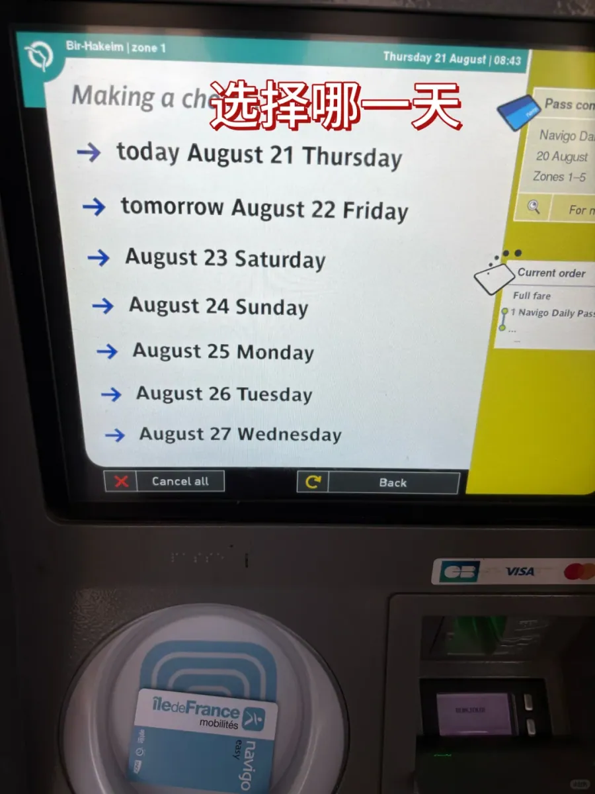

CDGはパリの北東約25 kmにあり、市内への行き方は簡単です。Train / RERの看板に従って駅へ下り、RER Bに乗ります。混乱が始まるのは切符売り場で、黄色い「Tickets et Navigo」券売機がTickets、Passes、Airport Ticketsを並べ、ポスターには「Paris ↔ Airport 13€ +2€」と書かれています。

このガイドはある到着に沿って進みます。ホーム、5種類の切符、週間パスでお金を無駄にしやすい規則、券売機の画面を1つずつ追う手順、そして地方行きの列車がどの駅から出るかです。価格は2026年8月に旅行者が実際に支払った金額です。

RER Bは特別な「空港エクスプレス」ではなく、パリ近郊ネットワークのB線です。市内を貫通し、パリ北駅とシャトレに停まります。GoogleマップではRER Bと表示され、青地に白いBのマークを目印にしてください。

## 1. CDGからパリ市内へ

手荷物受取所を出たら、MétroではなくTrain / RERまたはGaresを探してください。駅はターミナル2の下、到着ロビーの1階下にあります。ターミナル1か3からは、まず無料のCDGVALシャトルでT2へ向かいます。

下には2つの選択肢があります。黄色い券売機の列と、「Services Navigo / Tickets Paris et Île-de-France」と書かれたガラス張りのSNCF窓口（カウンター01〜03）です。空港からの単券だけなら券売機が最速で、窓口は週間パスの相談、変更、鉄道切符を扱います。

改札を抜けると、白い枠のRER、青いB、下向き矢印2本の濃紺の看板がホームを示し、下にVoie 11、12、Parisと書かれています。パリ北駅かシャトレ＝レ・アールまで約25〜30分です。大きなスーツケースがある場合は朝のラッシュを避けましょう。

空港からの単券は**13ユーロ**で、旅の中で最も高い切符であり、空港と市内の間のRER Bで有効な唯一の切符です。この区間だけが対象なので、パリのメトロやバスに乗るには市内用の切符が必要です。週間パスを考えている場合でも、この13ユーロの切符は空港で買います。第3節を参照してください。

## 2. パリの切符の種類と料金

切符は5種類あります。単券、空港切符、10枚綴り、1日券、週間パスです。最初のカードには**2ユーロの手数料**がかかり、同じカードに後からチャージできます。日数と乗車回数で決めます。2日間で3〜4回なら単券か10枚綴り、週をまたぐ5日間なら週間パスが候補です。

| 切符 | 料金 | 向いている用途 | 空港線は対象？ |
| --- | --- | --- | --- |
| 単券（市内のメトロ / RER） | 2.50ユーロ | 1日2〜3回の乗車 | いいえ |
| 単券（バス） | 2ユーロ | 短距離、途中の観光 | いいえ |
| 空港単券 | 13ユーロ | 到着日または出発日 | はい |
| 10枚綴り | 25ユーロ | 3〜5日間、列に並びたくない | いいえ |
| 1日券 | 12ユーロ | 1日に複数の観光地 | いいえ |
| 週間Navigo | 31.50ユーロ＋カード5ユーロ | 週をまたぐ滞在、毎日の移動 | はい |

メトロの単券は**2.50ユーロ**、バスの単券は**2ユーロ**です。10枚綴りは**25ユーロ**、1回2.50ユーロで単券と同じなので、買えるのは列に並ぶ時間の節約であって割引ではありません。1日券は**12ユーロ**で、購入日の**24:00**に失効します。24時間後ではないので、朝に買いましょう。

重要な点が2つあります。空港切符をカードに入れると、そのカードには後からメトロの単券を入れられず、バスの切符しか入らないことに旅行者は気づきました。また1日券は空港線が対象外で、画面に「excluding airports」と表示されます。RER Bには別途13ユーロの切符が必要です。

週間パスは**31.50ユーロ**にカード**5ユーロ**を加えた金額で、空港線をカバーする唯一の長期切符です。

## 3. 週間パスの4つのルール

週間パスは購入した週の**日曜日の24:00**に終了します。7日間のローリングではないのです。月曜に買えば7日、木曜なら4日、日曜ならほぼ0日です。1日券や10枚綴りと違い、暦週単位の商品です。カードには**パスポートサイズの写真**が必要で、ないと無効扱いになることがあります。販売は**有人カウンターとÎle-de-France Mobilitésアプリのみ**で、券売機では買えません。そして**空港では販売していません**。到着時に13ユーロの単券を買い（カードがなければ2ユーロ追加）、市内の駅の窓口で週間パスを買います。

週間パスは単券や1日券と違い、空港線も対象です。週の半ばに到着して週末に発つなら、13ユーロの帰り便分も含まれます。日曜24:00を過ぎて発つ場合は、もう1枚単券が必要です。

アプリで切符をApple Walletに追加すればカード手数料はかかりませんが、登録には通常ヨーロッパの電話番号が必要です。カードを使う場合、週間パスは31.50＋5＝**36.50ユーロ**で、1日12ユーロと比べると、1日券4枚は48ユーロ、3枚は36ユーロでほぼ並びますが、週間パスは空港の1往復分もカバーします。

| 購入日 | 実際に使える日数 | 判断 |
| --- | --- | --- |
| 月曜 | 7 | 最もお得。買ってよい |
| 火曜 | 6 | お得 |
| 水曜 | 5 | お得 |
| 木曜 | 4 | 1日券4枚と同等。加えて空港1往復分 |
| 金曜 | 3 | 帰りもRERを使う場合のみ価値あり |
| 土曜 | 2 | 1日券のほうがよい |
| 日曜 | 1 | その夜に失効。買わないこと |

## 4. 券売機での切符の買い方

2台の券売機が同じ筐体に並んでいます。**ticket**と表示された機はカードの販売とチャージ、**recharge**と表示された機はチャージのみです。カードがない場合はticketを選びます。Visa、Mastercard、硬貨が使えます。

右側の赤いポスターには「To leave this Airport: Paris ↔ Airport ticket ONLY」とあり、**13€**と**+2€**が示されています。運賃と新規カード手数料の公式表示です。

1画面目では、既存のカードにチャージする「Place your Navigo pass」か、新しく買う「You don't have a Navigo Pass: touch here」を選びます。

2画面目には**Tickets**、**Passes**、**Airport Tickets**が並びます。Airport Ticketsは運賃とカード手数料をまとめた金額です。

Ticketsを選ぶと**Metro-Train**か**Bus-Tram**（2.50ユーロと2ユーロ）、次に**full fare**か**reduced fare**へ進みます。reducedは4歳から10歳未満の子供か割引カード保持者用なので、旅行者はfull fareを選びます。

Passesを選ぶと**Forfait Day Pass**（空港を除く）か**Forfait Paris Visite**（1、2、3、5日）へ進みます。1日券は次に開始日を尋ねられ、今日から7日先までが表示されます。習慣で今日を押さないようにしてください。

カードか硬貨で支払います。新しいカードは最後に2ユーロが加算されます。週間パスはここでは一切販売していません。

1. 券売機を選びます。ticketは新規カードの販売、rechargeはチャージのみです。
2. 最初の画面：カードをかざすか、「You don't have a Navigo Pass」をタップします。
3. 2画面目：Tickets、Passes、Airport Tickets。
4. 3画面目（単券の場合）：Metro-TrainかBus-Tram。
5. 4画面目：full fareかreduced fare。
6. 1日券の場合：Passes → Forfait Day Pass → 開始日。
7. 支払います。新しいカードは2ユーロが自動で加算されます。

## 5. パリを発つ：駅を確認する

パリには6つの主要駅があり、それぞれ決まった方向を担当しています。北京に複数のターミナル駅があるのと同じで、間違えると列車に乗り遅れます。

予約アプリは駅名を翻訳するため、「Paris Est」も「Paris Gare de Lyon」も「パリ」と表示されますが、実際は数キロ離れています。スクリーンショットでは、ランス行きが**パリ東駅を09:58**に出て11:22にランス着、リヨン行きが**リヨン駅を11:52**に出て13:56にリヨン・パールデュー着となっています。

3つ目の可能性として、**Aéroport Charles de Gaulle 2 TGV**と書かれた切符があります。ターミナル2の下の駅で、市内へ出ずに下へ降りるだけです。

| 駅 | 主な方向 | メトロ / RER |
| --- | --- | --- |
| パリ北駅（Gare du Nord） | フランス北部、ベルギー、イギリス（ユーロスター） | 4・5号線、RER B・D |
| パリ東駅（Gare de l'Est） | フランス東部、ドイツ、ルクセンブルク | 4・5・7号線 |
| リヨン駅（Gare de Lyon） | フランス南東部、スイス、イタリア | 1・14号線、RER A・D |
| オステルリッツ駅（Gare d'Austerlitz） | フランス南西部、スペイン、ポルトガル | 5・10号線、RER C |
| モンパルナス駅（Gare Montparnasse） | フランス西部、ブルターニュ | 4・6・12・13号線 |
| サン・ラザール駅（Gare Saint-Lazare） | ノルマンディー方面 | 3・12・13・14号線 |

古いターミナル駅はほとんどが行き止まり式です。掲示板で列車とホーム（voie）を確認してから線路へ歩きます。古いメトロ路線は階段が多くエレベーターが少ないので、重いスーツケースがある場合は時間を見ておきましょう。出発の45〜60分前を目安にすると安心です。

この順番で行えば、パリの交通は簡単です。**13ユーロ**の空港単券を買い、1日券と週間パスを比較し、通常の切符は券売機、週間パスは窓口かアプリを使い、駅を確認します。運賃と制度は変わるため、当日はÎle-de-France MobilitésとSNCFで確認してください。

## 関連リンク

- **このサイト内**：[パリ＝シャルル・ド・ゴール空港 (CDG)](/airport/CDG)、[フランス (FR)](/country/FR)
- **Wikipedia**：[パリ＝シャルル・ド・ゴール空港](https://en.wikipedia.org/wiki/Paris_Charles_de_Gaulle_Airport)
- **百度百科**：[パリ＝シャルル・ド・ゴール空港](https://baike.baidu.com/item/%E5%B7%B4%E9%BB%8E%E5%A4%8F%E5%B0%94%C2%B7%E6%88%B4%E9%AB%98%E4%B9%90%E6%9C%BA%E5%9C%BA)
