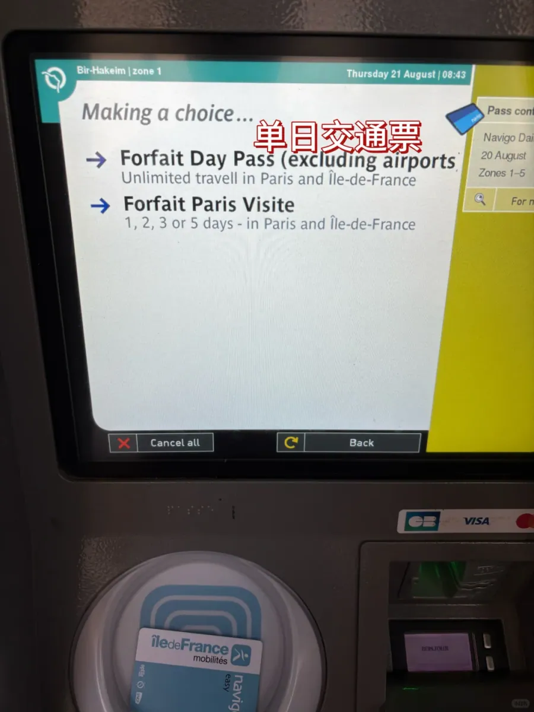

CDG leży około 25 km na północny wschód od Paryża, a droga do miasta jest prosta: idź za znakami Train / RER w dół do stacji i wsiądź do RER B. Zamieszanie zaczyna się w hali biletowej, gdzie żółte automaty „Tickets et Navigo" oferują opcje Tickets, Passes i Airport Tickets, a plakat obiecuje „Paris ↔ Airport 13€ +2€".

Ten przewodnik opisuje jeden przylot: peron, pięć rodzajów biletów, zasady, przez które na bilecie tygodniowym łatwo stracić pieniądze, automat ekran po ekranie oraz to, z którego dworca odjeżdża pociąg w głąb kraju. Ceny pochodzą z sierpnia 2026 roku.

RER B nie jest osobnym „ekspresem lotniskowym", tylko linią B paryskiej sieci regionalnej, która przechodzi przez miasto, zatrzymując się na Gare du Nord i Châtelet; Google Maps oznacza ją jako RER B, a biała litera B na niebieskim tle to znak, za którym trzeba podążać.

## 1. Jak dostać się z CDG do Paryża

Po wyjściu z odbioru bagażu szukaj oznaczeń Train / RER lub Gares, a nie Métro. Stacja znajduje się pod terminalem 2, poziom niżej od hali przylotów; z terminali 1 i 3 najpierw trzeba dojechać darmowym shuttle CDGVAL do T2.

Na dole są dwie opcje: rząd żółtych automatów oraz przeszklone biuro SNCF z napisem „Services Navigo / Tickets Paris et Île-de-France" i okienkami od 01 do 03. Automat jest najszybszy przy pojedynczym bilecie lotniskowym; w okienku załatwi się sprawy dotyczące biletu tygodniowego, zmiany i bilety kolejowe.

Za bramkami perony wskazuje granatowy znak z RER w białej ramce, niebieską literą B i dwiema strzałkami w dół, a poniżej widnieją Voie 11, 12 i Paris. Przejazd do Gare du Nord lub Châtelet-Les Halles zajmuje około 25–30 minut. Z dużymi walizkami lepiej unikać porannego szczytu.

Bilet lotniskowy w jedną stronę kosztuje **13 €**, jest najdroższym biletem całej podróży i jedynym ważnym na RER B między lotniskiem a miastem. Obejmuje tylko ten odcinek, więc przejazdy metrem i autobusem w Paryżu wymagają miejskiego biletu. Nawet jeśli planujesz bilet tygodniowy, ten bilet za 13 € kupujesz na lotnisku — zobacz punkt 3.

## 2. Rodzaje biletów i ceny w Paryżu

Istnieje pięć biletów: przejazd jednorazowy, bilet lotniskowy, carnet dziesięciu biletów, bilet jednodniowy i bilet tygodniowy. Pierwsza karta wiąże się z **opłatą 2 €**, a tę samą kartę można później doładowywać. Decyduj według liczby dni i przejazdów: dwa dni po trzy lub cztery przejazdy to bilety jednorazowe albo carnet; pięć dni w ciągu tygodnia wskazuje na bilet tygodniowy.

| Bilet | Cena | Najlepszy dla | Obejmuje linię lotniskową? |
| --- | --- | --- | --- |
| Przejazd jednorazowy (metro / RER w mieście) | 2,50 € | Dwa lub trzy przejazdy dziennie | Nie |
| Przejazd jednorazowy (autobus) | 2 € | Krótkie odcinki, zwiedzanie po drodze | Nie |
| Bilet lotniskowy w jedną stronę | 13 € | Dzień przylotu lub odlotu | Tak |
| Carnet dziesięciu biletów | 25 € | Trzy do pięciu dni, bez stania w kolejce | Nie |
| Bilet jednodniowy | 12 € | Kilka atrakcji w jeden dzień | Nie |
| Tygodniowy Navigo | 31,50 € plus karta za 5 € | Pobyty obejmujące cały tydzień, codzienne podróże | Tak |

Przejazd metrem kosztuje **2,50 €**, autobusem **2 €**. Carnet to **25 €**, czyli 2,50 € za przejazd — tyle samo co bilety jednorazowe, więc kupuje się nim czas w kolejce, a nie zniżkę. Bilet dzienny kosztuje **12 €** i wygasa o **24:00** tego samego dnia, a nie 24 godziny później, więc kupuj go rano.

Liczą się dwa szczegóły. Gdy bilet lotniskowy zostanie zapisany na karcie, podróżny odkrył, że karta nie przyjmie później jednorazowych biletów metra, tylko bilety autobusowe. A bilet dzienny nie obejmuje linii lotniskowej — na ekranie widnieje „excluding airports" — więc na RER B potrzebny jest osobny bilet za 13 €.

Bilet tygodniowy kosztuje **31,50 €** plus **5 €** za kartę i jest jedynym biletem długookresowym obejmującym linię lotniskową.

## 3. Cztery zasady biletu tygodniowego

Bilet kończy ważność o **24:00 w niedzielę** tygodnia, w którym został kupiony, a nie siedem dni później. Poniedziałek daje siedem dni, czwartek cztery, niedziela prawie nic; to produkt liczony według tygodnia kalendarzowego, inaczej niż bilet dzienny czy carnet. Do karty potrzebne jest **zdjęcie w rozmiarze paszportowym**, bez którego może ona zostać uznana za nieważną. Sprzedaje się go **wyłącznie w obsadzonych okienkach i w aplikacji Île-de-France Mobilités**, nigdy w automacie. A **lotnisko nie może go sprzedać**: na przylocie kup bilet jednorazowy za 13 € (plus 2 €, jeśli nie masz karty), a bilet tygodniowy dopiero przy okienku na stacji w mieście.

Bilet obejmuje linię lotniskową, inaczej niż bilety jednorazowe i dzienne: przyleć w środku tygodnia i wyjedź w weekend, a powrót za 13 € jest wliczony; wyjazd po niedzieli, godz. 24:00, oznacza kolejny bilet jednorazowy.

Aplikacja pozwala uniknąć opłaty za kartę, jeśli dodasz bilet do Apple Wallet, ale rejestracja zwykle wymaga europejskiego numeru telefonu. Z kartą bilet kosztuje 31,50 € + 5 € = **36,50 €** wobec 12 € dziennie: cztery bilety dzienne to 48 €, trzy to 36 € i prawie się wyrównują, choć bilet tygodniowy obejmuje jeszcze jeden przejazd na lotnisko.

| Kupiony w | Dni, które faktycznie dostajesz | Ocena |
| --- | --- | --- |
| Poniedziałek | 7 | Najlepsza wartość; po prostu go kup |
| Wtorek | 6 | Dobra wartość |
| Środa | 5 | Dobra wartość |
| Czwartek | 4 | Na równi z czterema biletami dziennymi, plus jeden przejazd na lotnisko |
| Piątek | 3 | Opłaca się tylko, jeśli podróż powrotna też jest RER |
| Sobota | 2 | Lepszy będzie bilet dzienny |
| Niedziela | 1 | Wygasa tej samej nocy; nie kupuj |

## 4. Kupowanie biletu w automacie

Dwa automaty mają wspólną obudowę: jeden oznaczony **ticket** sprzedaje karty i je doładowuje, drugi oznaczony **recharge** tylko doładowuje. Jeśli nie masz karty, wybierz ticket. Przyjmują Visa, Mastercard i monety.

Czerwony plakat po prawej głosi „To leave this Airport: Paris ↔ Airport ticket ONLY", z **13 €** i **+2 €** — to oficjalna wersja taryfy i opłaty za nową kartę.

Pierwszy ekran oferuje „Place your Navigo pass", aby doładować istniejącą kartę, albo „You don't have a Navigo Pass: touch here", aby kupić nową.

Drugi ekran wyświetla **Tickets**, **Passes** i **Airport Tickets**. Airport Tickets sumuje opłatę za przejazd i opłatę za kartę.

Tickets prowadzi do **Metro-Train** lub **Bus-Tram** (2,50 € wobec 2 €), a następnie do **full fare** lub **reduced fare**; taryfa ulgowa jest dla dzieci od 4 do poniżej 10 lat lub posiadaczy kart zniżkowych, więc turyści wybierają pełną.

Passes prowadzi do **Forfait Day Pass** (z wyłączeniem lotnisk) lub **Forfait Paris Visite** (1, 2, 3 lub 5 dni). Bilet dzienny pyta następnie o datę rozpoczęcia, wymienioną od dziś do siedmiu dni naprzód; nie stukaj w dzisiejszą datę z przyzwyczajenia.

Płać kartą lub monetami; nowa karta dolicza 2 € na końcu. Biletu tygodniowego nie sprzedaje się tu w ogóle.

1. Wybierz automat: ticket sprzedaje nowe karty, recharge tylko doładowuje.
2. Pierwszy ekran: przyłóż kartę albo stuknij „You don't have a Navigo Pass".
3. Drugi ekran: Tickets, Passes lub Airport Tickets.
4. Trzeci ekran (dla biletów jednorazowych): Metro-Train lub Bus-Tram.
5. Czwarty ekran: pełna lub ulgowa taryfa.
6. Dla biletu dziennego: Passes → Forfait Day Pass → data rozpoczęcia.
7. Zapłać; nowa karta automatycznie dolicza 2 €.

## 5. Wyjazd z Paryża: znaj swój dworzec

Paryż ma sześć dworców głównych, z których każdy obsługuje własne kierunki, podobnie jak kilka pekińskich dworców: pomylony dworzec oznacza utracony pociąg.

Aplikacje do rezerwacji tłumaczą nazwy dworców, więc „Paris Est" i „Paris Gare de Lyon" brzmią jak Paryż, choć dzielą je kilometry. Na zrzutach widać pociąg do Reims odjeżdżający **z Paris Est o 09:58** i docierający do Reims o 11:22 oraz pociąg do Lyonu odjeżdżający **z Paris Gare de Lyon o 11:52** i docierający do Lyon Part-Dieu o 13:56.

Jest jeszcze trzecia możliwość: bilet z nazwą **Aéroport Charles de Gaulle 2 TGV**, czyli stacja pod terminalem 2, gdzie można zjechać na dół zamiast jechać do miasta.

| Dworzec | Główne kierunki | Metro / RER |
| --- | --- | --- |
| Gare du Nord | Północna Francja, Belgia, Wielka Brytania (Eurostar) | Linie 4, 5; RER B, D |
| Gare de l'Est | Wschodnia Francja, Niemcy, Luksemburg | Linie 4, 5, 7 |
| Gare de Lyon | Południowo-wschodnia Francja, Szwajcaria, Włochy | Linie 1, 14; RER A, D |
| Gare d'Austerlitz | Południowo-zachodnia Francja, Hiszpania, Portugalia | Linie 5, 10; RER C |
| Gare Montparnasse | Zachodnia Francja, Bretania | Linie 4, 6, 12, 13 |
| Gare Saint-Lazare | Normandia | Linie 3, 12, 13, 14 |

Stare dworce są przeważnie czołowe: sprawdź na tablicy pociąg i jego peron (voie), a potem podejdź do toru. Starsze linie metra oznaczają schody i mało wind, więc z ciężką walizką zostaw sobie czas; 45–60 minut przed odjazdem to rozsądny zapas.

W tej kolejności paryska komunikacja jest prosta: kup bilet lotniskowy za **13 €**, porównaj bilet dzienny z tygodniowym, zwykłe bilety kupuj w automacie, a bilet tygodniowy w okienku lub aplikacji, i sprawdź swój dworzec. Taryfy i rozwiązania się zmieniają, więc w dniu podróży sprawdź Île-de-France Mobilités i SNCF.

## Powiązane linki

- **Na tej stronie**: [Port lotniczy Paryż Charles de Gaulle (CDG)](/airport/CDG), [Francja (FR)](/country/FR)
- **Wikipedia**: [Port lotniczy Paryż Charles de Gaulle](https://en.wikipedia.org/wiki/Paris_Charles_de_Gaulle_Airport)
- **Baidu Baike**: [Port lotniczy Paryż Charles de Gaulle](https://baike.baidu.com/item/%E5%B7%B4%E9%BB%8E%E5%A4%8F%E5%B0%94%C2%B7%E6%88%B4%E9%AB%98%E4%B9%90%E6%9C%BA%E5%9C%BA)
