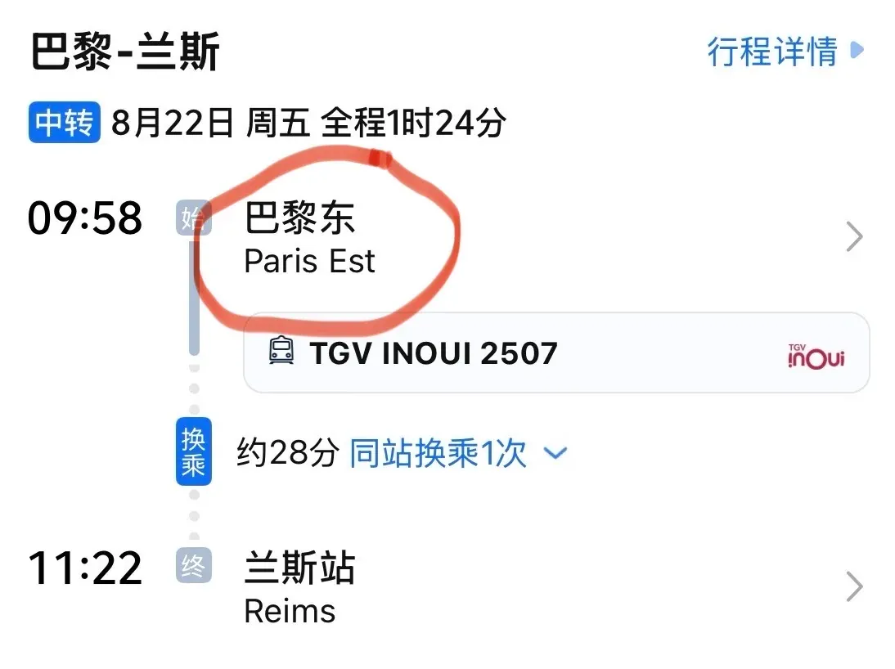

CDG se află la circa 25 km nord-est de Paris, iar drumul în oraș este simplu: urmează indicatoarele Train / RER până la gară și ia RER B. Confuzia începe în sala de bilete, unde automatele galbene „Tickets et Navigo” oferă Tickets, Passes și Airport Tickets, în timp ce un afiș promite „Paris ↔ Airport 13€ +2€”.

Acest ghid urmărește o singură sosire: peronul, cele cinci tipuri de bilete, regulile care fac abonamentul săptămânal ușor de irosit, automatul ecran cu ecran și gara din care pleacă trenul tău spre provincie. Prețurile sunt cele plătite de călător în august 2026.

RER B nu este un „express de aeroport” separat, ci linia B a rețelei regionale pariziene, care traversează orașul cu opriri la Gare du Nord și Châtelet; Google Maps o etichetează RER B, iar B-ul alb pe fundal albastru este semnul de urmat.

## 1. Cum ajungi în Paris din CDG

După predarea bagajelor, caută Train / RER sau Gares, nu Métro. Gara se află sub Terminalul 2, un nivel mai jos de sosiri; din Terminalele 1 sau 3, ia mai întâi naveta gratuită CDGVAL până la T2.

La nivelul inferior există două opțiuni: un rând de automate galbene și un birou SNCF cu pereți de sticlă pe care scrie „Services Navigo / Tickets Paris et Île-de-France”, cu ghișeele 01–03. Automatul este cel mai rapid pentru un singur bilet de aeroport; la ghișeu se rezolvă întrebările despre abonamentul săptămânal, schimbările și biletele de tren.

După porți, un panou albastru închis cu RER într-un chenar alb, un B albastru și două săgeți în jos marchează peroanele, cu Voie 11, 12 și Paris dedesubt. Călătoria până la Gare du Nord sau Châtelet-Les Halles durează circa 25–30 de minute. Cu bagaje mari, evită vârful de dimineață.

Biletul simplu de aeroport costă **13 €**, cel mai scump bilet al călătoriei și singurul valabil pe RER B între aeroport și oraș. Acoperă doar acest tronson, așa că pentru metroul și autobuzele din Paris este nevoie de un bilet urban. Chiar dacă ai în plan abonamentul săptămânal, cumperi acest bilet de 13 € la aeroport — vezi secțiunea 3.

## 2. Tipuri de bilete și prețuri în Paris

Există cinci tipuri de bilete: o călătorie simplă, biletul de aeroport, un carnet de zece, un abonament de o zi și abonamentul săptămânal. Primul card costă **2 €**, iar același card se reîncarcă ulterior. Decide după zile și călătorii: două zile cu trei sau patru călătorii înseamnă bilete simple sau un carnet; cinci zile într-o săptămână indică abonamentul săptămânal.

| Bilet | Preț | Cel mai potrivit pentru | Acoperă linia de aeroport? |
| --- | --- | --- | --- |
| Călătorie simplă (metrou / RER în oraș) | 2,50 € | Două sau trei călătorii pe zi | Nu |
| Călătorie simplă (autobuz) | 2 € | Distanțe scurte, vizitat pe drum | Nu |
| Călătorie simplă de aeroport | 13 € | Ziua sosirii sau a plecării | Da |
| Carnet de zece | 25 € | Trei până la cinci zile, fără coadă | Nu |
| Abonament de o zi | 12 € | Mai multe obiective într-o singură zi | Nu |
| Navigo săptămânal | 31,50 € plus un card de 5 € | Sejururi care traversează o săptămână, deplasări zilnice | Da |

O călătorie simplă cu metroul costă **2,50 €**, una cu autobuzul **2 €**. Carnetul costă **25 €**, adică 2,50 € pe călătorie — la fel ca biletele simple, așa că îți cumpără timp de așteptare, nu o reducere. Abonamentul de o zi costă **12 €** și expiră la **24:00** în aceeași zi, nu 24 de ore mai târziu, așa că ia-l dimineața.

Două detalii contează. Odată ce un bilet de aeroport este încărcat pe un card, călătorul a constatat că respectivul card nu mai putea primi ulterior bilete simple de metrou, ci doar bilete de autobuz. Iar abonamentul de zi exclude linia de aeroport — ecranul afișează „excluding airports” —, așa că RER B necesită un bilet separat de 13 €.

Abonamentul săptămânal costă **31,50 €** plus un card de **5 €**, singurul bilet de perioadă lungă care acoperă linia de aeroport.

## 3. Cele patru reguli ale abonamentului săptămânal

Abonamentul expiră la **24:00 în duminica** săptămânii în care l-ai cumpărat, nu șapte zile consecutive mai târziu. O zi de luni îți dă șapte zile, joia patru, duminica aproape niciuna; este un produs pe săptămână calendaristică, spre deosebire de abonamentul de zi sau de carnet. Cardul are nevoie de o **fotografie formato pașaport**, fără de care poate fi considerat nevalid. Se vinde **doar la ghișeele cu personal și în aplicația Île-de-France Mobilités**, niciodată la automat. Și **aeroportul nu îl poate vinde**: cumpără biletul simplu de 13 € la sosire (plus 2 € dacă nu ai card), apoi cumpără abonamentul săptămânal la un ghișeu dintr-o gară din oraș.

Abonamentul acoperă linia de aeroport, spre deosebire de biletele simple și de abonamentele de zi: dacă aterizezi la mijlocul săptămânii și pleci în weekend, returul de 13 € este inclus, iar dacă pleci după duminică la 24:00, ai nevoie de un alt bilet simplu.

Aplicația evită taxa pentru card dacă adaugi biletul în Apple Wallet, dar înregistrarea necesită de obicei un număr de telefon european. Cu card, abonamentul costă 31,50 € + 5 € = **36,50 €**, față de 12 € pe zi: patru abonamente de zi costă 48 €, trei costă 36 € și aproape egalează, deși abonamentul acoperă o călătorie de aeroport.

| Cumperi în | Zilele pe care le primești efectiv | Verdict |
| --- | --- | --- |
| Luni | 7 | Cea mai bună valoare; cumpără-l |
| Marți | 6 | Valoare bună |
| Miercuri | 5 | Valoare bună |
| Joi | 4 | La egalitate cu patru abonamente de zi, plus o călătorie de aeroport |
| Vineri | 3 | Merită doar dacă și returul se face cu RER |
| Sâmbătă | 2 | Un abonament de zi este mai bun |
| Duminică | 1 | Expiră în aceeași noapte; nu cumpăra |

## 4. Cum cumperi un bilet la automat

Două automate împart aceeași carcasă: unul marcat **ticket** vinde și reîncarcă carduri, celălalt marcat **recharge** doar reîncarcă. Dacă nu ai card, alege ticket. Acceptă Visa, Mastercard și monede.

Afișul roșu din dreapta scrie „To leave this Airport: Paris ↔ Airport ticket ONLY”, cu **13 €** și **+2 €** — versiunea oficială a tarifului și a taxei pentru cardul nou.

Primul ecran oferă „Place your Navigo pass” pentru reîncărcarea unui card existent sau „You don't have a Navigo Pass: touch here” pentru a cumpăra unul.

Al doilea ecran listează **Tickets**, **Passes** și **Airport Tickets**. Airport Tickets adună tariful și taxa pentru card.

Tickets duce la **Metro-Train** sau **Bus-Tram** (2,50 € față de 2 €), apoi la **full fare** sau **reduced fare**; tariful redus este pentru copiii de la 4 la sub 10 ani sau pentru deținătorii de carduri de reducere, așa că vizitatorii vor alege full fare.

Passes duce la **Forfait Day Pass** (cu excepția aeroporturilor) sau **Forfait Paris Visite** (1, 2, 3 sau 5 zile). Abonamentul de zi cere apoi o dată de început, listată de la ziua curentă până la șapte zile înainte; nu apăsa pe ziua de azi din obișnuință.

Plătești cu cardul sau cu monede; un card nou adaugă 2 € la final. Abonamentul săptămânal nu se vinde deloc aici.

1. Alege automatul: ticket vinde carduri noi, recharge doar reîncarcă.
2. Primul ecran: prezintă un card sau apasă „You don't have a Navigo Pass”.
3. Al doilea ecran: Tickets, Passes sau Airport Tickets.
4. Al treilea ecran (pentru bilete simple): Metro-Train sau Bus-Tram.
5. Al patrulea ecran: full fare sau reduced fare.
6. Pentru un abonament de zi: Passes → Forfait Day Pass → data de început.
7. Plătește; un card nou adaugă automat 2 €.

## 5. Plecarea din Paris: știe-ți gara

Parisul are șase gări principale, fiecare deservind propriile direcții, cam ca numeroasele gări terminale din Beijing: dacă nimerești greșit, pierzi trenul.

Aplicațiile de rezervare traduc numele gărilor, așa că „Paris Est” și „Paris Gare de Lyon” apar amândouă ca Paris, deși sunt la kilometri distanță. Capturile arată trenul spre Reims plecând de la **Paris Est la 09:58** și ajungând la Reims la 11:22, și trenul spre Lyon plecând de la **Paris Gare de Lyon la 11:52** și ajungând la Lyon Part-Dieu la 13:56.

O a treia posibilitate: un bilet care indică **Aéroport Charles de Gaulle 2 TGV**, gara de sub Terminalul 2, unde poți coborî direct, în loc să mergi în oraș.

| Gară | Direcții principale | Metrou / RER |
| --- | --- | --- |
| Gare du Nord | Nordul Franței, Belgia, Marea Britanie (Eurostar) | Liniile 4, 5; RER B, D |
| Gare de l'Est | Estul Franței, Germania, Luxemburg | Liniile 4, 5, 7 |
| Gare de Lyon | Sud-estul Franței, Elveția, Italia | Liniile 1, 14; RER A, D |
| Gare d'Austerlitz | Sud-vestul Franței, Spania, Portugalia | Liniile 5, 10; RER C |
| Gare Montparnasse | Vestul Franței, Bretania | Liniile 4, 6, 12, 13 |
| Gare Saint-Lazare | Normandia | Liniile 3, 12, 13, 14 |

Gările vechi sunt în mare parte fără ieșire: verifică panoul pentru tren și peronul lui (voie), apoi mergi la linie. Liniile mai vechi de metrou înseamnă scări și puține lifturi, așa că lasă timp pentru o valiză grea; 45–60 de minute înainte de plecare sunt o marjă rezonabilă.

Făcute în această ordine, transportul în Paris este simplu: cumpără biletul simplu de aeroport de **13 €**, cântărește abonamentul de zi față de cel săptămânal, folosește automatul pentru biletele obișnuite și ghișeul sau aplicația pentru abonamentul săptămânal, și verifică-ți gara. Tarifele și organizarea se schimbă, așa că verifică Île-de-France Mobilités și SNCF în ziua respectivă.

## Linkuri utile

- **Pe acest site**: [Aeroportul Paris Charles de Gaulle (CDG)](/airport/CDG), [Franța (FR)](/country/FR)
- **Wikipedia**: [Aeroportul Paris Charles de Gaulle](https://en.wikipedia.org/wiki/Paris_Charles_de_Gaulle_Airport)
- **Baidu Baike**: [Aeroportul Paris Charles de Gaulle](https://baike.baidu.com/item/%E5%B7%B4%E9%BB%8E%E5%A4%8F%E5%B0%94%C2%B7%E6%88%B4%E9%AB%98%E4%B9%90%E6%9C%BA%E5%9C%BA)
