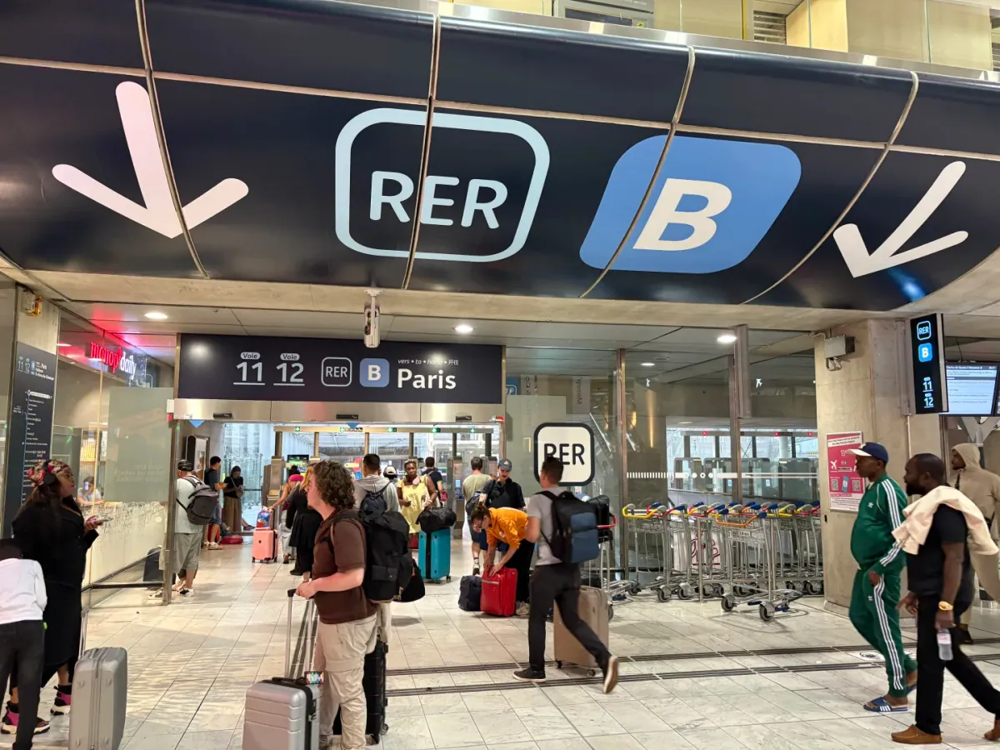
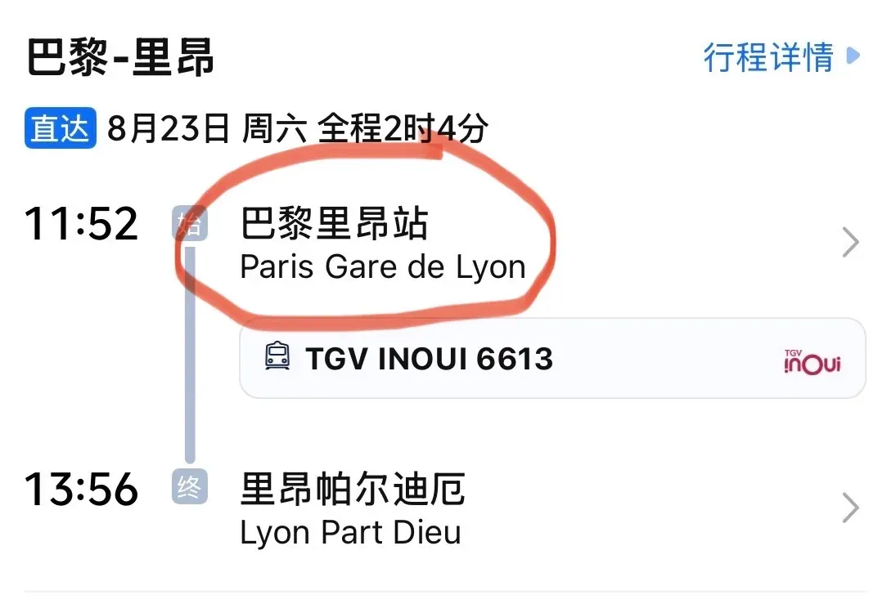

CDG находится примерно в 25 км к северо-востоку от Парижа, и путь в город прост: идите по указателям Train / RER вниз к станции и садитесь на RER B. Путаница начинается в билетном зале, где жёлтые автоматы «Tickets et Navigo» предлагают Tickets, Passes и Airport Tickets, а плакат обещает «Paris ↔ Airport 13€ +2€».

Этот гид повторяет один прилёт: платформа, пять типов билетов, правила, из-за которых на недельном проездном легко потерять деньги, автомат экран за экраном и с какого вокзала уходит ваш поезд в провинцию. Цены — те, что путешественник заплатил в августе 2026 года.

RER B — не отдельный «аэропортовый экспресс», а линия B парижской региональной сети, проходящая через город с остановками на Гар-дю-Нор и Шатле; Google Maps обозначает её как RER B, а белая буква B на синем фоне — тот знак, за которым нужно идти.

## 1. Как добраться из CDG в Париж

Выйдя из зоны выдачи багажа, ищите Train / RER или Gares, а не Métro. Станция находится под терминалом 2, на уровень ниже прилёта; из терминалов 1 или 3 сначала доезжайте на бесплатном шаттле CDGVAL до T2.

Внизу два варианта: ряд жёлтых автоматов и стеклянный офис SNCF с надписью «Services Navigo / Tickets Paris et Île-de-France» и стойками 01–03. Автомат быстрее для разового аэропортового билета; на стойке решают вопросы недельного проездного, обмена и железнодорожных билетов.

За турникетами платформы обозначает тёмно-синий указатель с RER в белой рамке, синей B и двумя стрелками вниз, ниже — Voie 11, 12 и Paris. Поездка до Гар-дю-Нор или Шатле-Ле-Аль занимает около 25–30 минут. С большими чемоданами избегайте утреннего часа пик.

Аэропортовый разовый билет стоит **€13** — самый дорогой билет поездки и единственный, действительный на RER B между аэропортом и городом. Он покрывает только этот отрезок, поэтому для метро и автобусов в Париже нужен городской билет. Даже если вы планируете недельный проездной, этот билет за €13 покупают в аэропорту — см. раздел 3.

## 2. Типы билетов и цены в Париже

Есть пять билетов: разовая поездка, аэропортовый билет, карне из десяти, дневной проездной и недельный проездной. Первая карта стоит **€2**, и ту же карту потом можно пополнять. Выбирайте по дням и поездкам: два дня по три-четыре поездки — это разовые билеты или карне; пять дней в течение недели указывают на недельный проездной.

| Билет | Цена | Лучше всего для | Покрывает ли линию аэропорта? |
| --- | --- | --- | --- |
| Разовая поездка (метро / RER в городе) | €2,50 | Две-три поездки в день | Нет |
| Разовая поездка (автобус) | €2 | Короткие переезды, осмотр по пути | Нет |
| Аэропортовый разовый | €13 | День прилёта или вылета | Да |
| Карне из десяти | €25 | Три-пять дней, без очередей | Нет |
| Дневной проездной | €12 | Несколько достопримечательностей за день | Нет |
| Недельный Navigo | €31,50 плюс карта за €5 | Поездки длиннее недели, ежедневные перемещения | Да |

Разовый билет на метро стоит **€2,50**, на автобус — **€2**. Карне стоит **€25**, или €2,50 за поездку — столько же, сколько разовые, так что вы платите за экономию времени в очереди, а не за скидку. Дневной проездной стоит **€12** и действует до **24:00** того же дня, а не 24 часа, поэтому покупайте его утром.

Важны две детали. После записи аэропортового билета на карту путешественник обнаружил, что на неё потом нельзя записать разовые билеты метро, только автобусные. А дневной проездной не покрывает линию аэропорта — на экране написано «excluding airports», — поэтому для RER B нужен отдельный билет за €13.

Недельный проездной стоит **€31,50** плюс карта за **€5**; это единственный долгосрочный билет, покрывающий линию аэропорта.

## 3. Четыре правила недельного проездного

Проездной действует до **24:00 воскресенья** той недели, в которую вы его купили, а не семь дней подряд. Покупка в понедельник даёт семь дней, в четверг — четыре, в воскресенье — почти ничего; это продукт на календарную неделю, в отличие от дневного проездного или карне. На карту нужна **фотография размером с паспортную**, без неё её могут счесть недействительной. Проездной продаётся **только на стойках с сотрудниками и в приложении Île-de-France Mobilités**, никогда в автомате. И **аэропорт не может его продать**: при прилёте покупайте разовый билет за €13 (плюс €2, если у вас нет карты), а недельный проездной покупайте на стойке городской станции.

Проездной, в отличие от разовых билетов и дневных проездных, покрывает линию аэропорта: прилетите в середине недели и улетайте на выходных — обратная поездка за €13 включена, а если вылет после воскресенья 24:00, понадобится ещё один разовый билет.

Приложение избавляет от платы за карту, если добавить билет в Apple Wallet, но для регистрации обычно нужен европейский номер телефона. С картой проездной стоит €31,50 + €5 = **€36,50** против €12 в день: четыре дневных проездных — это €48, три — €36, почти вровень, хотя проездной покрывает одну поездку в аэропорт.

| Куплен в | Сколько дней реально получаете | Вердикт |
| --- | --- | --- |
| Понедельник | 7 | Лучшая выгода; берите |
| Вторник | 6 | Хорошая выгода |
| Среда | 5 | Хорошая выгода |
| Четверг | 4 | На уровне четырёх дневных проездных плюс одна поездка в аэропорт |
| Пятница | 3 | Выгоден, только если обратная поездка тоже на RER |
| Суббота | 2 | Дневной проездной лучше |
| Воскресенье | 1 | Истекает той же ночью; не покупайте |

## 4. Покупка билета в автомате

Два автомата стоят в одном корпусе: один с надписью **ticket** продаёт и пополняет карты, другой с надписью **recharge** только пополняет. Если карты нет, выбирайте ticket. Они принимают Visa, Mastercard и монеты.

Красный плакат справа гласит «To leave this Airport: Paris ↔ Airport ticket ONLY», с **13€** и **+2€** — официальная версия тарифа и платы за новую карту.

Первый экран предлагает «Place your Navigo pass», чтобы пополнить существующую карту, или «You don't have a Navigo Pass: touch here», чтобы купить новую.

Второй экран перечисляет **Tickets**, **Passes** и **Airport Tickets**. Airport Tickets складывает тариф и плату за карту вместе.

Tickets ведёт к **Metro-Train** или **Bus-Tram** (€2,50 против €2), затем к **full fare** или **reduced fare**; льготный тариф — для детей от 4 до 10 лет и владельцев дисконтных карт, поэтому путешественникам нужен полный тариф.

Passes ведёт к **Forfait Day Pass** (без аэропортов) или **Forfait Paris Visite** (на 1, 2, 3 или 5 дней). Затем дневной проездной просит дату начала, перечисленную от сегодняшнего дня до семи дней вперёд; не нажимайте сегодняшнюю дату по привычке.

Оплатите картой или монетами; новая карта добавляет €2 в конце. Недельный проездной здесь вообще не продаётся.

1. Выберите автомат: ticket продаёт новые карты, recharge только пополняет.
2. Первый экран: приложите карту или нажмите «You don't have a Navigo Pass».
3. Второй экран: Tickets, Passes или Airport Tickets.
4. Третий экран (для разовых): Metro-Train или Bus-Tram.
5. Четвёртый экран: full fare или reduced fare.
6. Для дневного проездного: Passes → Forfait Day Pass → дата начала.
7. Оплатите; новая карта автоматически добавит €2.

## 5. Выезд из Парижа: знайте свой вокзал

В Париже шесть вокзалов дальнего следования, каждый обслуживает свои направления, во многом как несколько вокзалов Пекина: ошибка означает пропущенный поезд.

Приложения бронирования переводят названия вокзалов, поэтому «Paris Est» и «Paris Gare de Lyon» оба читаются как Париж, хотя находятся в километрах друг от друга. На скриншотах поезд до Реймса отправляется с **Paris Est в 09:58** и прибывает в Реймс в 11:22, а поезд до Лиона отправляется с **Paris Gare de Lyon в 11:52** и прибывает на Lyon Part-Dieu в 13:56.

Третий вариант: билет с указанием **Aéroport Charles de Gaulle 2 TGV** — станции под терминалом 2, куда можно спуститься вместо поездки в город.

| Вокзал | Основные направления | Метро / RER |
| --- | --- | --- |
| Северный вокзал (Gare du Nord) | Север Франции, Бельгия, Великобритания (Eurostar) | Линии 4, 5; RER B, D |
| Восточный вокзал (Gare de l'Est) | Восток Франции, Германия, Люксембург | Линии 4, 5, 7 |
| Лионский вокзал (Gare de Lyon) | Юго-восток Франции, Швейцария, Италия | Линии 1, 14; RER A, D |
| Вокзал Аустерлиц (Gare d'Austerlitz) | Юго-запад Франции, Испания, Португалия | Линии 5, 10; RER C |
| Вокзал Монпарнас (Gare Montparnasse) | Запад Франции, Бретань | Линии 4, 6, 12, 13 |
| Вокзал Сен-Лазар (Gare Saint-Lazare) | Нормандия | Линии 3, 12, 13, 14 |

Старые вокзалы в основном тупиковые: проверьте табло, найдите поезд и его платформу (voie), затем идите к пути. Старые линии метро означают лестницы и мало лифтов, поэтому закладывайте время на тяжёлый чемодан; 45–60 минут до отправления — разумный запас.

В таком порядке парижский транспорт прост: купите **€13** за аэропортовый разовый, сравните дневной проездной с недельным, используйте автомат для обычных билетов, а стойку или приложение — для недельного проездного, и проверьте свой вокзал. Тарифы и правила меняются, поэтому в день поездки проверяйте Île-de-France Mobilités и SNCF.

## Связанные ссылки

- **На этом сайте**: [Аэропорт Париж-Шарль-де-Голль (CDG)](/airport/CDG), [Франция (FR)](/country/FR)
- **Википедия**: [Аэропорт Париж-Шарль-де-Голль](https://en.wikipedia.org/wiki/Paris_Charles_de_Gaulle_Airport)
- **Байду Байкэ**: [Аэропорт Париж-Шарль-де-Голль](https://baike.baidu.com/item/%E5%B7%B4%E9%BB%8E%E5%A4%8F%E5%B0%94%C2%B7%E6%88%B4%E9%AB%98%E4%B9%90%E6%9C%BA%E5%9C%BA)
