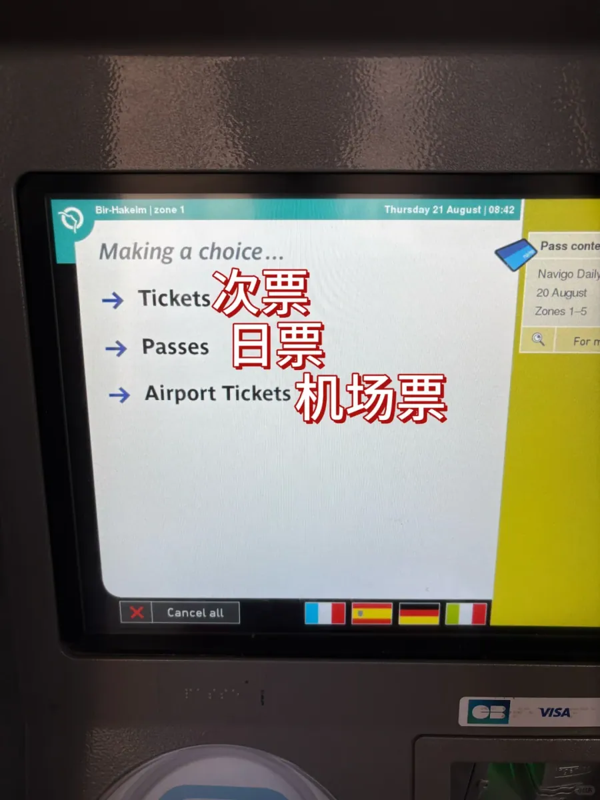

CDG ligger cirka 25 km nordost om Paris, och vägen in till stan är enkel: följ skyltarna Train / RER ner till stationen och ta RER B. Förvirringen börjar i biljethallen, där gula "Tickets et Navigo"-automater erbjuder Tickets, Passes och Airport Tickets medan en affisch lovar "Paris ↔ Airport 13€ +2€".

Den här guiden följer en ankomst: perrongen, de fem biljettyperna, reglerna som gör det lätt att slösa pengar på veckokortet, automaten skärm för skärm, och vilken station tåget till landsorten avgår från. Priserna är vad resenären betalade i augusti 2026.

RER B är ingen separat "flygexpress" utan linje B i Parisregionens regionalnät, som går genom staden med stopp vid Gare du Nord och Châtelet; Google Maps kallar den RER B, och det vita B:et på blå botten är märket att följa.

## 1. Från CDG in till Paris

När du kommit ut från bagageutlämningen letar du efter Train / RER eller Gares, inte Métro. Stationen ligger under Terminal 2, en våning ner från ankomsthallen; från Terminal 1 eller 3 tar du först den kostnadsfria CDGVAL-shuttlen till T2.

Nere finns två alternativ: en rad gula automater och ett SNCF-kontor med glasväggar där det står "Services Navigo / Tickets Paris et Île-de-France" med diskar 01 till 03. Automaten går snabbast för en enkel flygplatsbiljett; i disken får du hjälp med frågor om veckokort, byten och tågbiljetter.

Bortom spärrarna markerar en mörkblå skylt med en vitramad RER-logotyp, ett blått B och två nedåtpilar perrongerna, med Voie 11, 12 och Paris nedanför. Resan till Gare du Nord eller Châtelet-Les Halles tar cirka 25–30 minuter. Med stora väskor bör du undvika morgonrusningen.

Flygplatsens enkelbiljett kostar **13 €**, resans dyraste biljett och den enda som gäller på RER B mellan flygplatsen och staden. Den täcker bara den sträckan, så tunnelbane- och bussresor i Paris kräver en stadsbiljett. Även om du planerar ett veckokort köper du den här biljetten för 13 € på flygplatsen – se avsnitt 3.

## 2. Biljettyper och priser i Paris

Det finns fem biljetter: en enkelbiljett, flygplatsbiljetten, ett carnet med tio biljetter, ett dagkort och veckokortet. Det första kortet kostar **2 €**, och samma kort kan laddas på igen efteråt. Bestäm efter antal dagar och resor: två dagar med tre eller fyra resor blir enkelbiljetter eller ett carnet; fem dagar under en vecka pekar mot veckokortet.

| Biljett | Pris | Bäst för | Gäller flygplatslinjen? |
| --- | --- | --- | --- |
| Enkelbiljett (metro / RER i staden) | 2,50 € | Två eller tre resor per dag | Nej |
| Enkelbiljett (buss) | 2 € | Korta sträckor, sightseeing på vägen | Nej |
| Flygplatsbiljett enkel | 13 € | Ankomstdag eller avresedag | Ja |
| Carnet med tio | 25 € | Tre till fem dagar, utan köande | Nej |
| Dagkort | 12 € | Flera sevärdheter på en dag | Nej |
| Veckokort Navigo | 31,50 € plus ett kort för 5 € | Vistelser som sträcker sig över en vecka, dagliga resor | Ja |

En tunnelbanebiljett kostar **2,50 €**, en bussbiljett **2 €**. Carnet kostar **25 €**, eller 2,50 € per resa – samma som enkelbiljetter, så det köper kötid, inte rabatt. Dagkortet kostar **12 €** och gäller till **24:00** samma dag, inte 24 timmar senare, så köp det på morgonen.

Två detaljer spelar roll. När en flygplatsbiljett väl låg på ett kort upptäckte resenären att kortet inte senare kunde ta tunnelbanebiljetter, bara bussbiljetter. Och dagkortet utesluter flygplatslinjen – skärmen säger "excluding airports" – så RER B kräver en separat biljett för 13 €.

Veckokortet kostar **31,50 €** plus ett kort för **5 €**, den enda långtidsbiljetten som gäller på flygplatslinjen.

## 3. Veckokortets fyra regler

Kortet slutar gälla klockan **24:00 på söndagen** i den vecka du köpte det, inte sju rullande dagar senare. Måndag ger sju dagar, torsdag fyra, söndag nästan ingen; det är en kalenderveckoprodukt, till skillnad från dagkortet eller carnet. Kortet kräver ett **passfoto**, utan vilket det kan betraktas som ogiltigt. Det säljs **endast i bemannade biljettdiskar och i appen Île-de-France Mobilités**, aldrig i automater. Och **flygplatsen kan inte sälja det**: köp enkelbiljetten för 13 € vid ankomst (plus 2 € om du inte har något kort) och köp sedan veckokortet i en biljettdisk på en station i staden.

Till skillnad från enkelbiljetter och dagkort gäller veckokortet på flygplatslinjen: landar du mitt i veckan och åker hem till helgen ingår returen för 13 €, medan en avresa efter söndag klockan 24:00 innebär ytterligare en enkelbiljett.

Appen slipper kortavgiften om du lägger biljetten i Apple Wallet, men registreringen kräver vanligtvis ett europeiskt telefonnummer. Med kortet kostar veckokortet 31,50 € + 5 € = **36,50 €**, mot 12 € per dag: fyra dagkort kostar 48 €, tre kostar 36 € och ligger nästan jämsides, även om veckokortet täcker en flygplatsresa.

| Köps | Dagar du faktiskt får | Bedömning |
| --- | --- | --- |
| Måndag | 7 | Bäst värde; köp det bara |
| Tisdag | 6 | Bra värde |
| Onsdag | 5 | Bra värde |
| Torsdag | 4 | Jämförbart med fyra dagkort, plus en flygplatsresa |
| Fredag | 3 | Bara värt det om även hemresan sker med RER |
| Lördag | 2 | Ett dagkort är bättre |
| Söndag | 1 | Går ut samma kväll; köp det inte |

## 4. Att köpa biljett i automaten

Två automater delar ett hölje: en märkt **ticket** säljer och laddar kort, en märkt **recharge** laddar bara. Har du inget kort väljer du ticket. De tar Visa, Mastercard och mynt.

Den röda affischen till höger säger "To leave this Airport: Paris ↔ Airport ticket ONLY", med **13€** och **+2€** – den officiella versionen av priset och avgiften för ett nytt kort.

Den första skärmen erbjuder "Place your Navigo pass" för att ladda ett befintligt kort, eller "You don't have a Navigo Pass: touch here" för att köpa ett.

Den andra skärmen listar **Tickets**, **Passes** och **Airport Tickets**. Airport Tickets lägger ihop biljettpriset och kortavgiften.

Tickets leder till **Metro-Train** eller **Bus-Tram** (2,50 € mot 2 €) och sedan till **full fare** eller **reduced fare**; reduced är för barn från 4 till under 10 år eller innehavare av rabattkort, så besökare vill ha full fare.

Passes leder till **Forfait Day Pass** (exklusive flygplatser) eller **Forfait Paris Visite** (1, 2, 3 eller 5 dagar). Dagkortet frågar sedan efter ett startdatum, listat från i dag till sju dagar framåt; tryck inte på i dag av gammal vana.

Betala med kort eller mynt; ett nytt kort lägger till 2 € på slutet. Veckokortet säljs inte här alls.

1. Välj automat: ticket säljer nya kort, recharge laddar bara.
2. Första skärmen: visa ett kort, eller tryck på "You don't have a Navigo Pass".
3. Andra skärmen: Tickets, Passes eller Airport Tickets.
4. Tredje skärmen (för enkelbiljetter): Metro-Train eller Bus-Tram.
5. Fjärde skärmen: full fare eller reduced fare.
6. För dagkort: Passes → Forfait Day Pass → startdatum.
7. Betala; ett nytt kort lägger automatiskt till 2 €.

## 5. Lämna Paris: håll koll på stationen

Paris har sex fjärrtågsstationer, var och en med sina egna riktningar, ungefär som Pekings flera säckstationer: fel station innebär ett missat tåg.

Bokningsappar översätter stationsnamn, så "Paris Est" och "Paris Gare de Lyon" framstår båda som Paris trots att de ligger kilometer ifrån varandra. Skärmbilderna visar tåget till Reims som avgår från **Paris Est klockan 09:58** och når Reims 11:22, och tåget till Lyon som avgår från **Paris Gare de Lyon klockan 11:52** och når Lyon Part-Dieu 13:56.

En tredje möjlighet: en biljett som anger **Aéroport Charles de Gaulle 2 TGV**, stationen under Terminal 2, där du kan gå ner en trappa i stället för in till staden.

| Station | Huvudriktningar | Metro / RER |
| --- | --- | --- |
| Gare du Nord | Norra Frankrike, Belgien, Storbritannien (Eurostar) | Linje 4, 5; RER B, D |
| Gare de l'Est | Östra Frankrike, Tyskland, Luxemburg | Linje 4, 5, 7 |
| Gare de Lyon | Sydöstra Frankrike, Schweiz, Italien | Linje 1, 14; RER A, D |
| Gare d'Austerlitz | Sydvästra Frankrike, Spanien, Portugal | Linje 5, 10; RER C |
| Gare Montparnasse | Västra Frankrike, Bretagne | Linje 4, 6, 12, 13 |
| Gare Saint-Lazare | Normandie | Linje 3, 12, 13, 14 |

De äldre stationerna är mestadels säckstationer: kontrollera tavlan efter tåget och dess spår (voie) och gå sedan till spåret. Äldre tunnelbanelinjer innebär trappor och få hissar, så avsätt tid för en tung väska; 45–60 minuter före avgång är en rimlig marginal.

Gjort i den ordningen är kollektivtrafiken i Paris enkel: köp flygplatsens enkelbiljett för **13 €**, väg dagkortet mot veckokortet, använd en automat för vanliga biljetter och disken eller appen för veckokortet, och kontrollera din station. Taxor och upplägg ändras, så kontrollera Île-de-France Mobilités och SNCF samma dag.

## Relaterade länkar

- **På den här webbplatsen**: [Paris Charles de Gaulle Airport (CDG)](/airport/CDG), [Frankrike (FR)](/country/FR)
- **Wikipedia**: [Paris Charles de Gaulle-flygplatsen](https://en.wikipedia.org/wiki/Paris_Charles_de_Gaulle_Airport)
- **Baidu Baike**: [Paris Charles de Gaulle-flygplatsen](https://baike.baidu.com/item/%E5%B7%B4%E9%BB%8E%E5%A4%8F%E5%B0%94%C2%B7%E6%88%B4%E9%AB%98%E4%B9%90%E6%9C%BA%E5%9C%BA)
