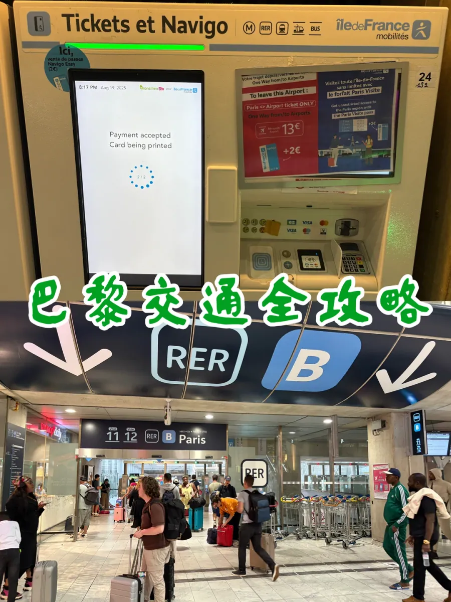
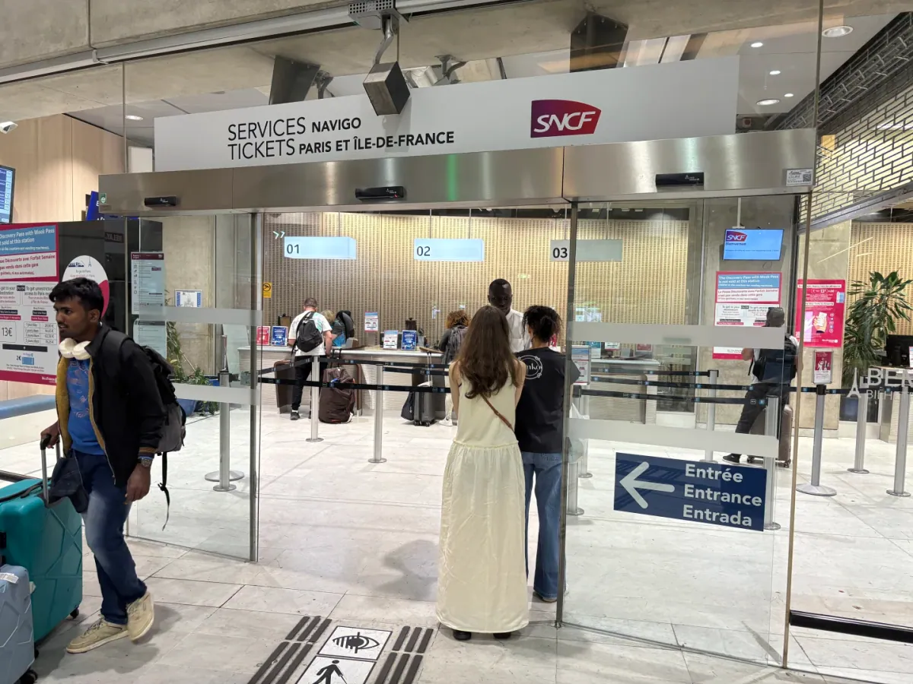

CDG อยู่ห่างจากปารีสไปทางตะวันออกเฉียงเหนือประมาณ 25 กม. และวิธีเข้าเมืองง่ายมาก: ตามป้าย Train / RER ลงไปที่สถานีแล้วนั่ง RER B ความสับสนเริ่มที่โถงตั๋ว ซึ่งเครื่อง «Tickets et Navigo» สีเหลืองเสนอ Tickets, Passes และ Airport Tickets ขณะที่โปสเตอร์โฆษณา «Paris ↔ Airport 13€ +2€»

คู่มือนี้ตามการมาถึงหนึ่งครั้ง: ชานชาลา ตั๋วห้าประเภท กฎที่ทำให้ตั๋วรายสัปดาห์เสียเงินง่าย หน้าจอเครื่องทีละหน้า และสถานีที่รถไฟไปต่างจังหวัดของคุณออก ราคาคือราคาที่นักเดินทางจ่ายในเดือนสิงหาคม 2026

RER B ไม่ใช่ «รถไฟด่วนสนามบิน» แยกต่างหาก แต่เป็นสาย B ของเครือข่ายภูมิภาคปารีส วิ่งผ่านเมืองโดยจอดที่ Gare du Nord และ Châtelet; Google Maps ระบุว่า RER B และตัว B สีขาวบนพื้นน้ำเงินคือเครื่องหมายที่ต้องตาม

## 1. เข้าปารีสจาก CDG

ออกจากรับกระเป๋า มองหา Train / RER หรือ Gares ไม่ใช่ Métro สถานีอยู่ใต้อาคารผู้โดยสาร 2 ต่ำกว่าชั้นผู้โดยสารขาเข้าหนึ่งชั้น; จากอาคารผู้โดยสาร 1 หรือ 3 ให้นั่งรถรับส่ง CDGVAL ฟรีไป T2 ก่อน

ชั้นล่างมีสองทางเลือก: แถวเครื่องสีเหลือง และสำนักงาน SNCF ผนังกระจกที่เขียน «Services Navigo / Tickets Paris et Île-de-France» พร้อมเคาน์เตอร์ 01 ถึง 03 เครื่องเร็วที่สุดสำหรับตั๋วสนามบินเที่ยวเดียว; เคาน์เตอร์จัดการคำถามเรื่องตั๋วรายสัปดาห์ การเปลี่ยน และตั๋วรถไฟ

ผ่านประตูมา ป้ายสีน้ำเงินเข้มที่มี RER ในกรอบขาว B สีน้ำเงิน และลูกศรชี้ลงสองอันบอกชานชาลา พร้อม Voie 11, 12 และ Paris ด้านล่าง การเดินทางไป Gare du Nord หรือ Châtelet-Les Halles ใช้เวลาประมาณ 25–30 นาที หากมีกระเป๋าใหญ่ หลีกเลี่ยงชั่วโมงเร่งด่วนเช้า

ตั๋วสนามบินเที่ยวเดียวราคา **€13** แพงที่สุดของการเดินทาง และเป็นตั๋วเดียวที่ใช้ได้บน RER B ระหว่างสนามบินกับเมือง ครอบคลุมเพียงช่วงนั้น ดังนั้นการเดินทางด้วยรถไฟใต้ดินและรถบัสในปารีสต้องใช้ตั๋วในเมือง แม้คิดจะซื้อตั๋วรายสัปดาห์ คุณก็ต้องซื้อตั๋ว €13 นี้ที่สนามบิน — ดูหัวข้อ 3

## 2. ประเภทตั๋วและราคาในปารีส

มีตั๋วห้าแบบ: เที่ยวเดียว ตั๋วสนามบิน คาร์เนต์สิบใบ ตั๋วหนึ่งวัน และตั๋วรายสัปดาห์ บัตรใบแรกมี **ค่าธรรมเนียม €2** และบัตรเดิมเติมเงินได้ภายหลัง ตัดสินใจตามจำนวนวันและเที่ยว: สองวันกับสามหรือสี่เที่ยวคือตั๋วเที่ยวเดียวหรือคาร์เนต์; ห้าวันในหนึ่งสัปดาห์ชี้ไปที่ตั๋วรายสัปดาห์

| ตั๋ว | ราคา | เหมาะกับ | ครอบคลุมสายสนามบินหรือไม่ |
| --- | --- | --- | --- |
| เที่ยวเดียว (รถไฟใต้ดิน / RER ในเมือง) | €2.50 | สองหรือสามเที่ยวต่อวัน | ไม่ |
| เที่ยวเดียว (รถบัส) | €2 | ระยะสั้น ชมเมืองระหว่างทาง | ไม่ |
| ตั๋วสนามบินเที่ยวเดียว | €13 | วันมาถึงหรือวันออกเดินทาง | ใช่ |
| คาร์เนต์สิบใบ | €25 | สามถึงห้าวัน ไม่ต้องต่อคิว | ไม่ |
| ตั๋วหนึ่งวัน | €12 | หลายสถานที่ในหนึ่งวัน | ไม่ |
| Navigo รายสัปดาห์ | €31.50 บวกบัตร €5 | การพักที่คาบเกี่ยวกับสัปดาห์ เดินทางทุกวัน | ใช่ |

ตั๋วรถไฟใต้ดินเที่ยวเดียว **€2.50** รถบัสเที่ยวเดียว **€2** คาร์เนต์ **€25** หรือ €2.50 ต่อเที่ยว — เท่ากับตั๋วเที่ยวเดียว จึงซื้อเวลาต่อคิว ไม่ใช่ส่วนลด ตั๋วรายวัน **€12** และหมดอายุเวลา **24:00** ของวันนั้น ไม่ใช่ 24 ชั่วโมงถัดไป จึงควรซื้อตอนเช้า

สองรายละเอียดสำคัญ เมื่อตั๋วสนามบินอยู่ในบัตรแล้ว นักเดินทางพบว่าบัตรไม่สามารถรับตั๋วรถไฟใต้ดินเที่ยวเดียวได้ในภายหลัง รับได้เพียงตั๋วรถบัส และตั๋วรายวันไม่ครอบคลุมสายสนามบิน — จอระบุ «excluding airports» — ดังนั้น RER B ต้องใช้ตั๋ว €13 แยก

ตั๋วรายสัปดาห์ **€31.50** บวกบัตร **€5** เป็นตั๋วระยะยาวเพียงแบบเดียวที่ครอบคลุมสายสนามบิน

## 3. กฎสี่ข้อของตั๋วรายสัปดาห์

ตั๋วสิ้นสุดเวลา **24:00 ของวันอาทิตย์** ในสัปดาห์ที่ซื้อ ไม่ใช่เจ็ดวันนับจากวันซื้อ วันจันทร์ให้เจ็ดวัน วันพุธห้าวัน วันอาทิตย์แทบไม่มีเลย; เป็นผลิตภัณฑ์ตามสัปดาห์ปฏิทิน ต่างจากตั๋วรายวันหรือคาร์เนต์ บัตรต้องมี **รูปขนาดหนังสือเดินทาง** มิฉะนั้นอาจถือเป็นโมฆะ ขาย **เฉพาะที่เคาน์เตอร์ที่มีเจ้าหน้าที่และในแอป Île-de-France Mobilités** ไม่เคยขายที่เครื่อง และ **สนามบินขายไม่ได้**: ซื้อตั๋วเที่ยวเดียว €13 เมื่อมาถึง (บวก €2 หากไม่มีบัตร) แล้วซื้อตั๋วรายสัปดาห์ที่เคาน์เตอร์สถานีในเมือง

ตั๋วครอบคลุมสายสนามบิน ต่างจากตั๋วเที่ยวเดียวและตั๋วรายวัน: ลงจอดกลางสัปดาห์และกลับช่วงสุดสัปดาห์ ค่าโดยสาร €13 ขากลับรวมอยู่ด้วย ขณะที่การกลับหลังวันอาทิตย์ 24:00 ต้องซื้อตั๋วอีกใบ

แอปหลีกเลี่ยงค่าบัตรหากเพิ่มตั๋วใน Apple Wallet แต่การลงทะเบียนมักต้องใช้หมายเลขโทรศัพท์ยุโรป เมื่อใช้บัตร ตั๋วราคา €31.50 + €5 = **€36.50** เทียบกับ €12 ต่อวัน: ตั๋วรายวันสี่ใบคือ €48 สามใบคือ €36 และเกือบเสมอกัน แม้ตั๋วรายสัปดาห์ครอบคลุมการเดินทางสนามบินหนึ่งครั้ง

| ซื้อวัน | จำนวนวันที่ได้จริง | สรุป |
| --- | --- | --- |
| จันทร์ | 7 | คุ้มที่สุด; ซื้อได้เลย |
| อังคาร | 6 | คุ้มดี |
| พุธ | 5 | คุ้มดี |
| พฤหัสบดี | 4 | เท่ากับตั๋วรายวันสี่ใบ บวกการเดินทางสนามบินหนึ่งครั้ง |
| ศุกร์ | 3 | คุ้มเฉพาะหากขากลับใช้ RER ด้วย |
| เสาร์ | 2 | ตั๋วรายวันดีกว่า |
| อาทิตย์ | 1 | หมดอายุคืนนั้น; อย่าซื้อ |

## 4. ซื้อตั๋วที่เครื่อง

สองเครื่องใช้ตัวถังร่วมกัน: เครื่องที่ติดป้าย **ticket** ขายและเติมบัตร เครื่องที่ติดป้าย **recharge** เติมเท่านั้น หากไม่มีบัตร ให้เลือก ticket รับ Visa, Mastercard และเหรียญ

โปสเตอร์สีแดงทางขวาเขียนว่า «To leave this Airport: Paris ↔ Airport ticket ONLY» พร้อม **13€** และ **+2€** — เวอร์ชันทางการของค่าโดยสารและค่าบัตรใหม่

หน้าจอแรกมี «Place your Navigo pass» สำหรับเติมบัตรเดิม หรือ «You don't have a Navigo Pass: touch here» สำหรับซื้อบัตรใหม่

หน้าจอที่สองมี **Tickets**, **Passes** และ **Airport Tickets** Airport Tickets รวมค่าโดยสารและค่าบัตรเข้าด้วยกัน

Tickets นำไปสู่ **Metro-Train** หรือ **Bus-Tram** (€2.50 เทียบกับ €2) แล้วไปที่ **full fare** หรือ **reduced fare**; reduced สำหรับเด็กอายุ 4 ถึงต่ำกว่า 10 ปีหรือผู้ถือบัตรส่วนลด นักท่องเที่ยวจึงต้องการ full fare

Passes นำไปสู่ **Forfait Day Pass** (ไม่รวมสนามบิน) หรือ **Forfait Paris Visite** (1, 2, 3 หรือ 5 วัน) ตั๋วรายวันจะถามวันเริ่มต้น โดยแสดงตั้งแต่วันนี้ถึงเจ็ดวันข้างหน้า; อย่าแตะวันนี้ตามความเคยชิน

ชำระด้วยบัตรหรือเหรียญ; บัตรใหม่เพิ่ม €2 ในตอนท้าย ตั๋วรายสัปดาห์ไม่ขายที่นี่เลย

1. เลือกเครื่อง: ticket ขายบัตรใหม่ recharge เติมเท่านั้น
2. หน้าจอแรก: ยื่นบัตร หรือแตะ «You don't have a Navigo Pass»
3. หน้าจอที่สอง: Tickets, Passes หรือ Airport Tickets
4. หน้าจอที่สาม (สำหรับเที่ยวเดียว): Metro-Train หรือ Bus-Tram
5. หน้าจอที่สี่: full fare หรือ reduced fare
6. สำหรับตั๋วรายวัน: Passes → Forfait Day Pass → วันเริ่มต้น
7. ชำระเงิน; บัตรใหม่เพิ่ม €2 อัตโนมัติ

## 5. ออกจากปารีส: รู้จักสถานีของคุณ

ปารีสมีสถานีรถไฟสายหลักหกแห่ง แต่ละแห่งให้บริการทิศทางของตัวเอง คล้ายกับสถานีปลายทางหลายแห่งของปักกิ่ง: ผิดสถานีหมายถึงตกรถ

แอปจองแปลชื่อสถานี ดังนั้น «Paris Est» และ «Paris Gare de Lyon» ต่างอ่านว่า Paris ทั้งที่อยู่ห่างกันหลายกิโลเมตร ภาพหน้าจอแสดงรถไฟไปแร็งส์ออกจาก **Paris Est เวลา 09:58** และถึงแร็งส์ 11:22 และรถไฟไปลียงออกจาก **Paris Gare de Lyon เวลา 11:52** และถึง Lyon Part-Dieu 13:56

ความเป็นไปได้ที่สาม: ตั๋วที่ระบุ **Aéroport Charles de Gaulle 2 TGV** สถานีใต้อาคารผู้โดยสาร 2 ซึ่งคุณลงบันไดแทนการเข้าเมือง

| สถานี | ทิศทางหลัก | รถไฟใต้ดิน / RER |
| --- | --- | --- |
| Gare du Nord | ฝรั่งเศสเหนือ เบลเยียม อังกฤษ (Eurostar) | สาย 4, 5; RER B, D |
| Gare de l'Est | ฝรั่งเศสตะวันออก เยอรมนี ลักเซมเบิร์ก | สาย 4, 5, 7 |
| Gare de Lyon | ฝรั่งเศสตะวันออกเฉียงใต้ สวิตเซอร์แลนด์ อิตาลี | สาย 1, 14; RER A, D |
| Gare d'Austerlitz | ฝรั่งเศสตะวันตกเฉียงใต้ สเปน โปรตุเกส | สาย 5, 10; RER C |
| Gare Montparnasse | ฝรั่งเศสตะวันตก บริตทานี | สาย 4, 6, 12, 13 |
| Gare Saint-Lazare | นอร์ม็องดี | สาย 3, 12, 13, 14 |

สถานีปลายทางเก่าส่วนใหญ่เป็นทางตัน: ตรวจป้ายรถไฟและชานชาลา (voie) แล้วเดินไปที่ราง สายรถไฟใต้ดินเก่าหมายถึงบันไดและลิฟต์น้อย จึงควรเผื่อเวลาสำหรับกระเป๋าหนัก; 45–60 นาทีก่อนออกเดินทางเป็นเวลาเผื่อที่สมเหตุสมผล

ทำตามลำดับนี้ การเดินทางในปารีสง่ายมาก: ซื้อตั๋วสนามบินเที่ยวเดียว **€13** ชั่งน้ำหนักตั๋วรายวันกับตั๋วรายสัปดาห์ ใช้เครื่องสำหรับตั๋วธรรมดาและเคาน์เตอร์หรือแอปสำหรับตั๋วรายสัปดาห์ และตรวจสถานีของคุณ ค่าโดยสารและข้อกำหนดเปลี่ยนได้ จึงควรตรวจสอบ Île-de-France Mobilités และ SNCF ในวันเดินทาง

## ลิงก์ที่เกี่ยวข้อง

- **ในเว็บไซต์นี้**: [ท่าอากาศยานปารีสชาร์ลเดอโกล (CDG)](/airport/CDG), [ฝรั่งเศส (FR)](/country/FR)
- **Wikipedia**: [ท่าอากาศยานปารีสชาร์ลเดอโกล](https://en.wikipedia.org/wiki/Paris_Charles_de_Gaulle_Airport)
- **Baidu Baike**: [ท่าอากาศยานปารีสชาร์ลเดอโกล](https://baike.baidu.com/item/%E5%B7%B4%E9%BB%8E%E5%A4%8F%E5%B0%94%C2%B7%E6%88%B4%E9%AB%98%E4%B9%90%E6%9C%BA%E5%9C%BA)
