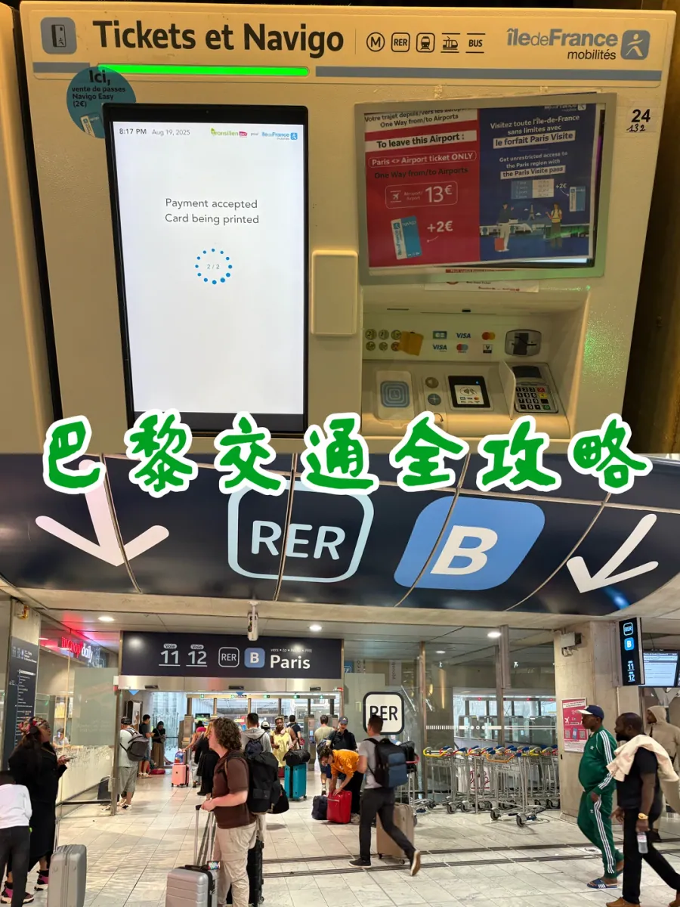

戴高樂機場（CDG）在巴黎東北約 25 公里，進城的路其實只有一條主線：跟著「Train / RER」的牌子走到車站，坐 RER B 進城。真正讓人卡住的是買票這一步——玻璃門上寫著「Tickets et Navigo」，牆上一排黃色機器，螢幕裡跳出 Tickets、Passes、Airport Tickets 三個詞，機身旁邊還貼著「Paris ↔ Airport 13€ +2€」的海報。每個單詞都認識，卻不一定知道該按哪一個。

這篇指南按一次真實落地的順序走：先跟 RER B 的牌子找到站臺，再把巴黎的五種車票和價格攤開對比，然後逐條講清周卡那幾條最容易踩坑的規則，最後用七張機器螢幕把買票流程拆成一步一步，順帶說清去外省該從哪座火車站出發。文中價格是 2026 年 8 月實測時所見。

第一次來巴黎的人常有的誤會，是把 RER B 當成「機場快線」以外的另一種東西。它其實就是巴黎的區域快鐵（RER）B 線，從機場一路穿城而過，在市區的北站、Châtelet 等地停靠；谷歌地圖上把它顯示為 RER B，藍底白字的 B 就是它的標誌。認清這一點，後面所有的票種選擇才有意義。

## 一、從戴高樂機場進城

從行李轉盤出來，先找「Train / RER」或「Gares」的指示牌，不要找「Métro」。戴高樂機場的火車站就在 2 號航廈地下，從到達層坐扶梯或電梯下去就是；如果航班停在 1 號或 3 號航廈，要先坐免費的 CDGVAL 輕軌到 T2，再下樓。這一段路標得很密，跟著走就行，不必開啟地圖。

下到車站，會同時看到兩樣東西：一排寫著「Tickets et Navigo」的黃色自動售票機，和一間用玻璃隔出的 SNCF 售票處，門楣上寫著「Services Navigo / Tickets Paris et Île-de-France」，裡面是 01 到 03 號櫃檯。只買一張機場線單程票，機器最快；想諮詢周卡、改簽或買去外省的火車票，才去櫃檯排隊。大航班集中落地時兩邊都會排長隊，能提前在手機上買好電子票的人，這時候可以直接走向閘機。

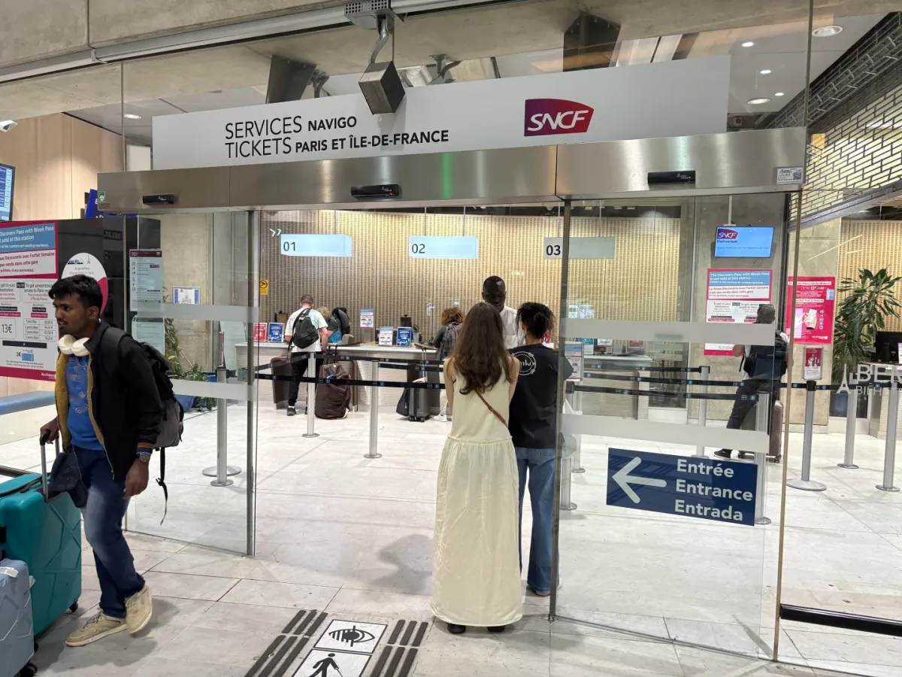

買完票往裡走，頭頂是一塊巨大的深藍色牌子：白框「RER」旁邊一個藍色「B」，兩個箭頭朝下，下面一行小字寫著 Voie 11、12 和 Paris——這就是站臺入口。RER B 從機場到巴黎北站、Châtelet-Les Halles 一帶大約 25–30 分鐘，中途停靠數站。行李多的時候儘量避開早高峰，車廂裡的行李架不大，大箱子通常要放在門邊。

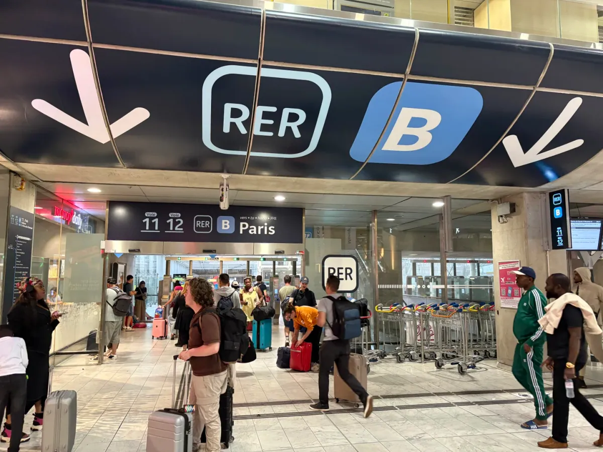

機場線單程 **€13**，是整趟進城最貴的一張票，也是唯一一張能把 RER B 從機場坐進市區的單程票。它只負責機場到市區這一段，進城以後坐地鐵、公交要另買市內的票。如果你打算買周卡，機場這一段仍然要單獨買這張 €13——原因在第三節。

## 二、巴黎市內票種與價格

巴黎市內的車票分五種：單次票、機場線、十次卡、一日卡、周卡。第一次買任何一種，都要另付 **€2 制卡費**，之後同一張卡可以反覆充值；卡本身不收押金，也不用退。買之前先算一件事：你在巴黎待幾天、每天坐幾次車。待兩天、每天三四趟，單次票或十次卡就夠；待五天以上、又正好跨周，周卡通常最省。

| 票種 | 價格 | 適合的場景 | 是否覆蓋機場線 |
| --- | --- | --- | --- |
| 單次票（地鐵／RER 市區段） | €2.50 | 一天只坐兩三次 | 否 |
| 單次票（公交） | €2 | 短距離、想看看街景 | 否 |
| 機場線單程 | €13 | 落地或離境當天往返機場 | 是 |
| 十次卡 | €25 | 待 3–5 天、不想每次買票 | 否 |
| 一日卡 | €12 | 一天內跑多個景點 | 否 |
| 周卡（Navigo） | €31.50＋卡費 €5 | 停留跨周、每天都要坐車 | 是 |

單次票地鐵 **€2.50**、公交 **€2**，一次一刷。十次卡 **€25**，折下來每趟也是 €2.50，和單買完全一樣——它省的是每次在機器前排隊的時間，不是單價，別把它當成「批發價」。一日卡 **€12**，從當天首次使用算到 **24:00**，不是 24 小時；下午三點才買日卡，實際只能用九個小時，所以日卡要早上買。

有兩個容易被忽略的細節。第一，機場線的票裝進卡以後，按這次實測的經驗，這張卡不能再充地鐵次票，只能充公交票，所以別把它當成市內通票的起點。第二，一日卡不含機場線：機器螢幕上寫得很清楚，「Forfait Day Pass (excluding airports)」，拿日卡去坐 RER B，出站閘機會把你攔下，得單獨補一張 €13。

周卡 **€31.50**，另加 **€5** 卡費，是五種票裡唯一覆蓋機場線的長期票。它便宜，但規則比前面四種都硬，下一節單獨說。

## 三、周卡的四條規則

周卡是巴黎交通裡價效比最高的票，也是最容易買錯的票。四條規則記住，基本不會白花錢。

第一，有效期到購買當週的週日 **24:00**，不是七個自然日。週一早上買，能用滿七天；週四買，只剩四天；週日買，當天晚上就失效。周卡按「自然周」結算，這是它和日卡、十次卡最根本的區別。第二，卡上必須貼一張**護照尺寸的照片**，卡面留了貼照片的方框，沒貼照片的卡查到會被視為無效；地鐵站裡通常有自助照相亭，出發前列印一張帶來更省事。周卡用的卡和次票卡不是同一張：它帶照片位，卡費 €5，次票用的 Navigo Easy 只要 €2。第三，周卡**只能在人工櫃檯和 Île-de-France Mobilités 的 App 上買**，自助售票機不賣——機器選單裡翻不到周卡，不是你找錯了。第四，**機場買不到周卡**：落地當天先在機場買一張 €13 的機場線單程票（沒有卡再加 €2 制卡費），進城以後再到地鐵站的人工櫃檯辦周卡。

最後一條尤其重要：周卡覆蓋機場線，單次票和一日卡都不覆蓋。如果你週中落地、週末離境，周卡能把返程那一趟 €13 也包進去；但如果返程在週日 24:00 之後，回機場還得再買一張單程票。

想省掉制卡費，可以在 App 上買電子票，直接加進 Apple Wallet；代價是註冊通常需要一個歐洲手機號，短期遊客不一定有。把卡費和票價加在一起算：周卡 €31.50 加 €5 等於 **€36.50**，一日卡 €12 一張。待四天，四張日卡 €48，周卡明顯便宜；待三天，三張日卡 €36，兩者幾乎持平，但周卡多覆蓋一次機場線，仍然划算。

| 購買日 | 實際可用 | 怎麼選 |
| --- | --- | --- |
| 週一 | 7 天 | 最划算，閉眼買 |
| 週二 | 6 天 | 划算 |
| 週三 | 5 天 | 划算 |
| 週四 | 4 天 | 與四張日卡打平，還多一次機場線 |
| 週五 | 3 天 | 只在返程也要坐機場線時才值 |
| 週六 | 2 天 | 不如買日卡 |
| 週日 | 1 天 | 當天失效，不要買 |

## 四、售票機買票圖解

售票機有兩種，機身顏色一樣，功能不同：寫著 **ticket** 的機器既能買新卡也能充值，寫著 **recharge** 的只能給已有的卡充值。第一次來、手上沒有卡，認準 ticket；已經有卡、只想加幾次地鐵，recharge 的隊通常短一些。機器接受 Visa、Mastercard 等銀行卡，也收硬幣，介面下方有一排國旗，可以切成英文。

走近機器，先別急著按螢幕。機身右側貼著一張紅色價目海報，寫著「To leave this Airport: Paris ↔ Airport ticket ONLY」，下面是大字 **13€**，旁邊一行小字 **+2€**——這就是「機場線單程 13 歐、新卡另加 2 歐制卡費」的官方寫法，和網上各種說法對得上。

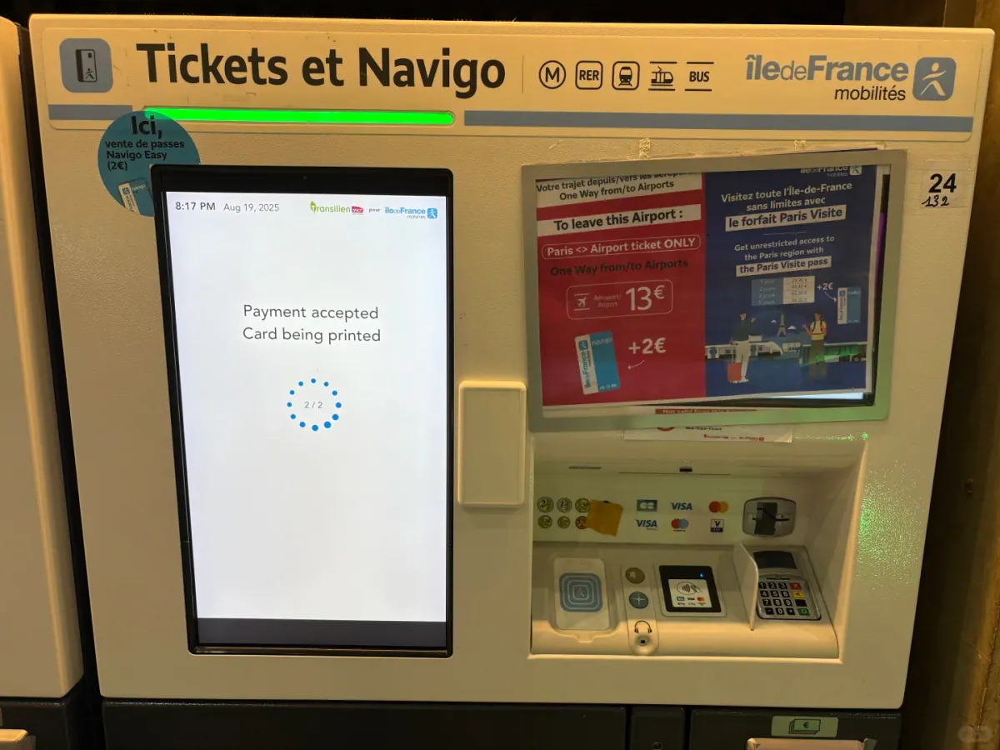

螢幕第一頁只有兩個選擇：左邊畫著一張藍色的 Navigo 卡，寫「Place your Navigo pass」，意思是**已經有卡，把卡放到讀卡區充值**；右邊寫「You don't have a Navigo Pass: touch here」，**還沒有卡，點這裡買新卡**。兩張圖共用一頁，別看到左邊有讀卡區就以為只能充值。

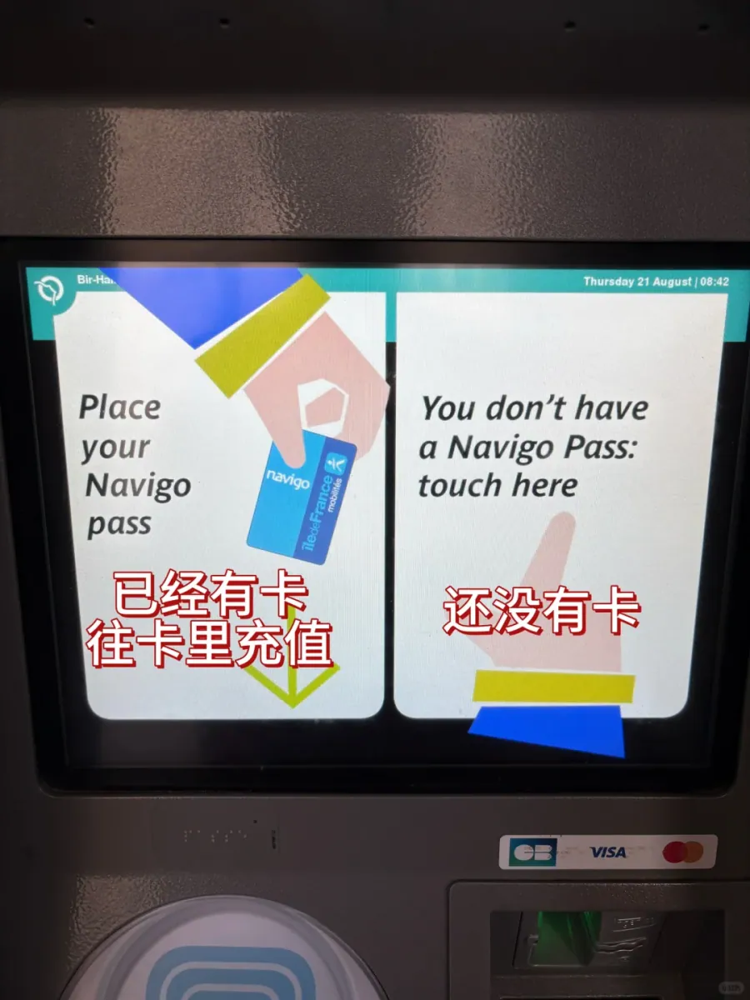

點進「沒有卡」之後，第二頁是票種總目錄：**Tickets**（次票）、**Passes**（日票、周票一類的通票）、**Airport Tickets**（機場票）。第一次買機場線，其實可以直接選 Airport Tickets，機器會把 €13 的票和 €2 的卡費一起算進去；如果先選了 Tickets，後面也能找到機場票，只是多翻一層。

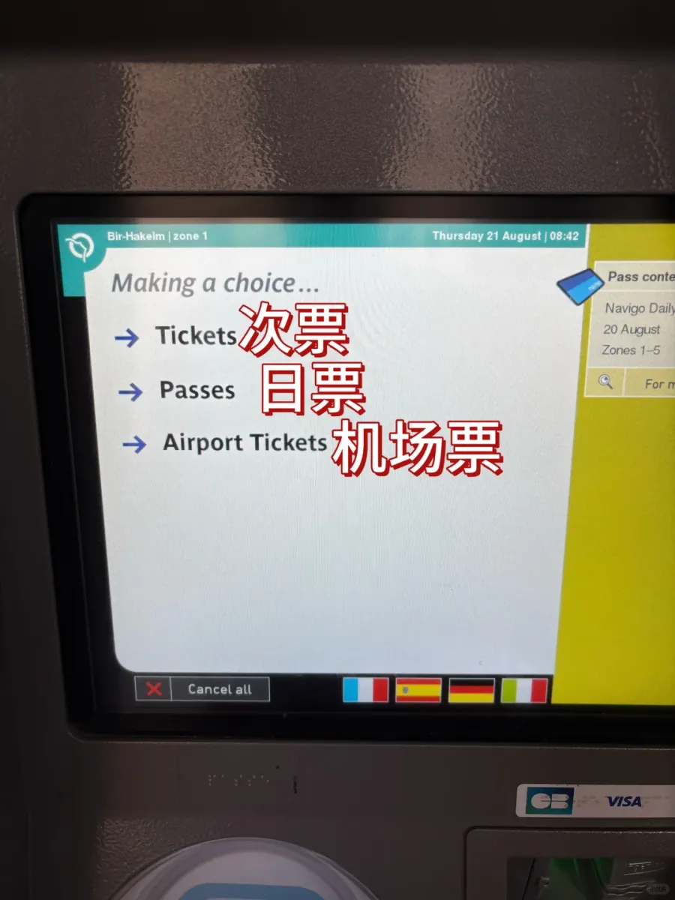

選 Tickets 會進到第三頁：**Metro-Train Ticket**（地鐵與火車票）和 **Bus-Tram Ticket**（公交與有軌電車票）。巴黎的地鐵單程和公交單程是兩個價，地鐵 €2.50、公交 €2，這一步選錯，票價就跟著錯。選完再進第四頁，問你要**全價**還是**特價**：全價是成人普通票，特價只給 4 歲到 10 歲以下兒童或持折扣卡的人，遊客一般選全價。

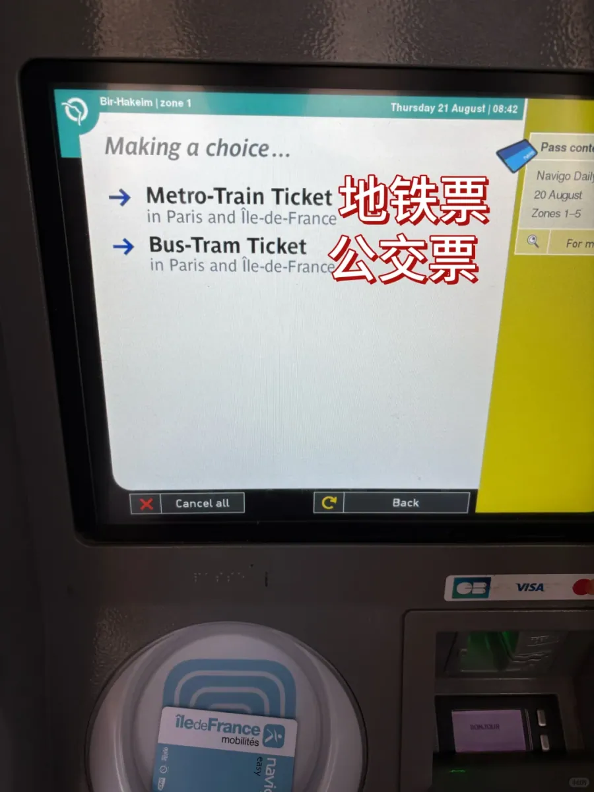

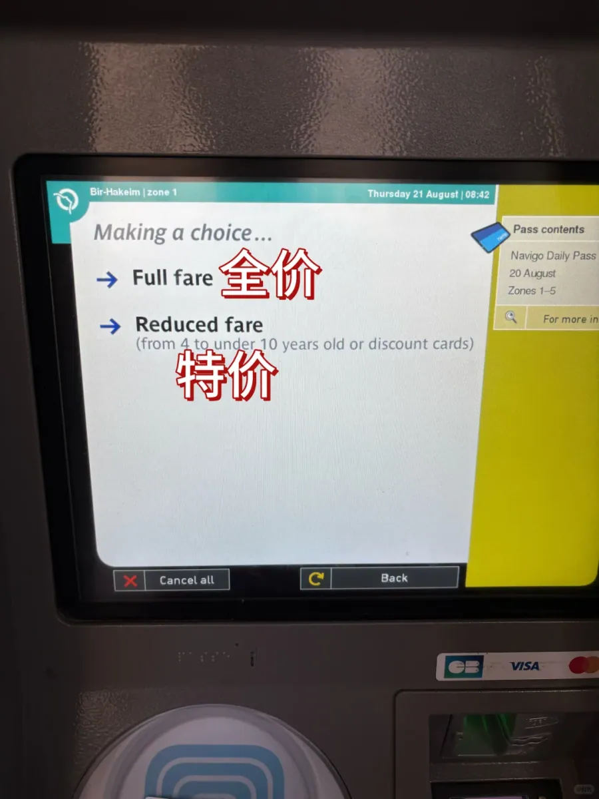

日票走的是另一條路。回到第二頁選 Passes，會看到 **Forfait Day Pass**（一日票，不含機場）和 **Forfait Paris Visite**（1、2、3 或 5 天的遊客通票）。選一日票後，機器會列出從今天起一週的日期，從「today August 21」到「August 27」，點哪一天，票就從那一天開始生效——所以別順手點今天，除非你當天就要用。螢幕右側會即時顯示訂單內容，例如「1 Navigo Daily Pass」，付錢前掃一眼，能避免買錯張數。

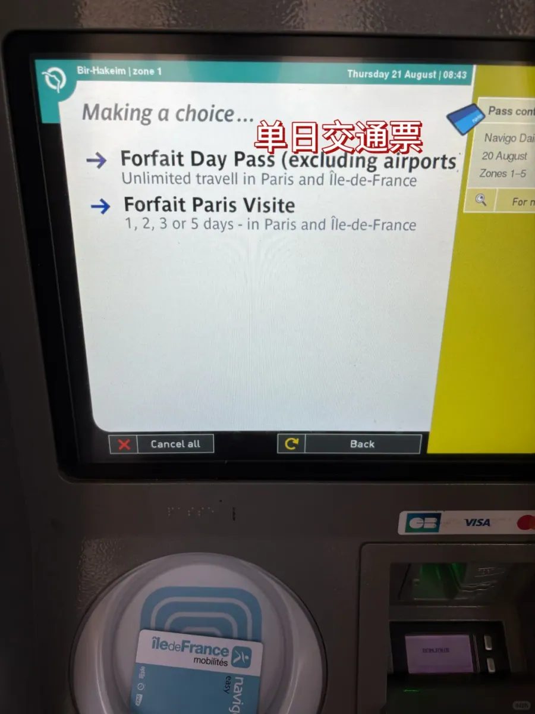

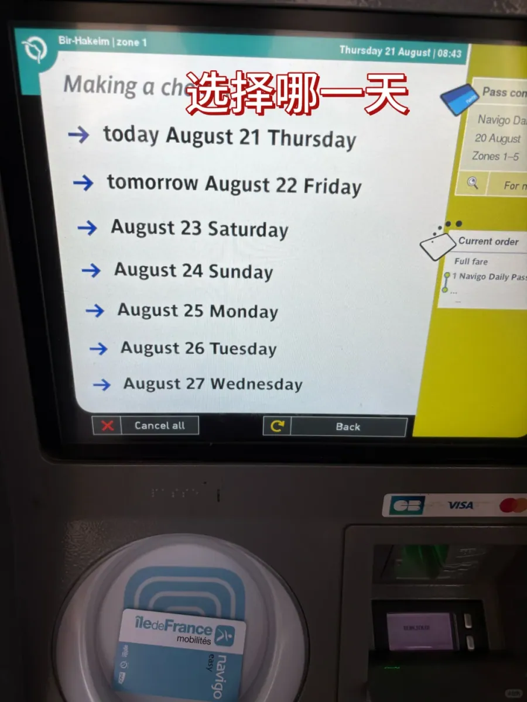

付款可以用銀行卡，也可以用硬幣；新卡會從機器下方的出卡口吐出來，票則寫在卡里。充值和新卡的流程幾乎一樣，區別只在最後一步：買新卡要多付 €2 制卡費。**周卡在機器上買不到**，這一條在第三節說過，選單裡翻到底也沒有——不是機器壞了，是規則如此。

把上面的螢幕連起來，就是一臺機器的完整順序：

1. 認機器：ticket 可買新卡，recharge 只能充值。
2. 第一屏：有卡放卡，沒卡點「You don't have a Navigo Pass」。
3. 第二屏：Tickets、Passes、Airport Tickets 選一類。
4. 第三屏（次票）：Metro-Train 或 Bus-Tram。
5. 第四屏：全價或特價。
6. 日票：選 Passes → Forfait Day Pass → 選生效日期。
7. 付款：刷卡或投幣，新卡自動加收 €2。

## 五、去外省：先認清火車站

從巴黎去外省，或者在巴黎換乘高鐵，先要認清一件事：巴黎不是「一個火車站」的城市。市區有六座主要火車站，各自負責一個方向，去不同的周邊城市、不同的機場，車次分佈在不同車站——這一點和北京很像，北京站、北京西站、北京南站各管一片，跑錯站就是誤車。

手機買票的時候尤其容易忽略。購票頁面會把站名翻譯成中文，「巴黎東」「巴黎里昂站」看起來都像「巴黎」，實際在城裡相隔好幾公里。手機購票頁上的兩張截圖就是典型：去蘭斯的車 **09:58 從巴黎東站（Paris Est）** 發車，中途換乘一次，11:22 到蘭斯站；去里昂的車 **11:52 從巴黎里昂站（Paris Gare de Lyon）** 發車，13:56 到里昂帕爾迪厄站。兩張票的出發地都寫著巴黎，卻是兩座不同的車站。

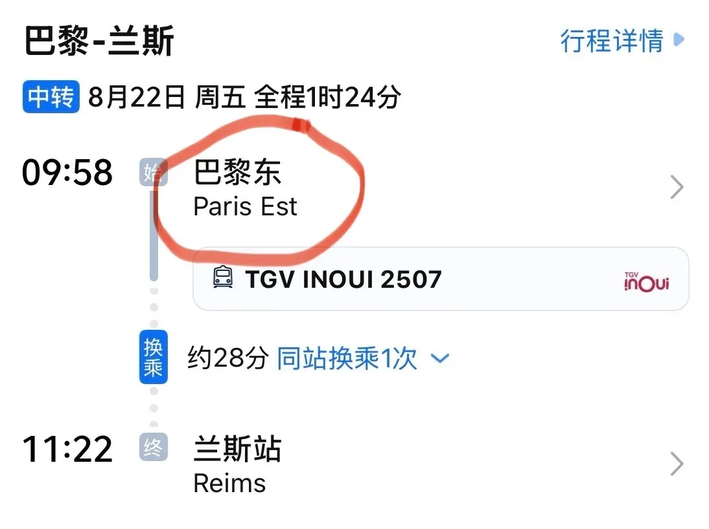

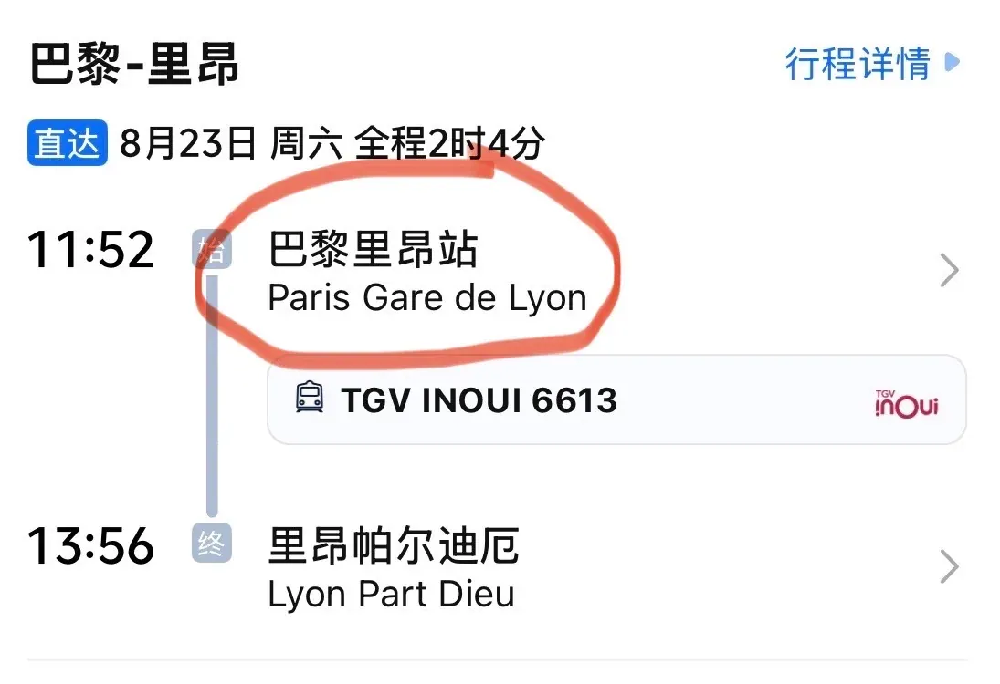

還有第三種可能：車票上寫的出發站是 **Aéroport Charles de Gaulle 2 TGV**，那就是機場 2 號航廈地下的高鐵站，落地後不用先進城，直接下樓換高鐵。買票時看清這一行，能省掉一次往返市區的折騰。

| 火車站 | 主要方向 | 到站地鐵／RER |
| --- | --- | --- |
| Gare du Nord | 法國北部、比利時、英國（歐洲之星） | 4、5 號線，RER B、D |
| Gare de l'Est | 法國東部、德國、盧森堡 | 4、5、7 號線 |
| Gare de Lyon | 法國東南部、瑞士、義大利 | 1、14 號線，RER A、D |
| Gare d'Austerlitz | 法國西南部、西班牙、葡萄牙 | 5、10 號線，RER C |
| Gare Montparnasse | 法國西部、布列塔尼 | 4、6、12、13 號線 |
| Gare Saint-Lazare | 諾曼底方向 | 3、12、13、14 號線 |

到了車站，還要留出找站臺的時間。巴黎的老站多是盡頭式站臺，進站後先看大屏確認車次和站臺號（Voie），再去找對應的軌道；從地鐵換高鐵時，老線路（尤其 4 號線）樓梯多、電梯少，拖大箱子要預留時間。穩妥的做法是提前 45–60 分鐘到站，旺季再寬一點。

把這幾件事按順序做完，巴黎的交通其實不難：落地先買 **€13** 的機場線單程進城，按停留天數在日卡和周卡之間做一次算術，買票優先用 ticket 機器、周卡去櫃檯或 App，最後確認去外省的車從哪座車站發車。票價、票種與售票安排都會調整，出行前以 Île-de-France Mobilités 與 SNCF 當日公佈的資訊為準。

## 相關連結

- **本站頁面**：[巴黎戴高樂機場（CDG）](/tw/airport/CDG)、[法國（FR）](/tw/country/FR)
- **維基百科**：[巴黎夏爾·戴高樂機場](https://zh.wikipedia.org/wiki/%E5%B7%B4%E9%BB%8E%E5%A4%8F%E5%B0%94%C2%B7%E6%88%B4%E9%AB%98%E4%B9%90%E6%9C%BA%E5%9C%BA)
