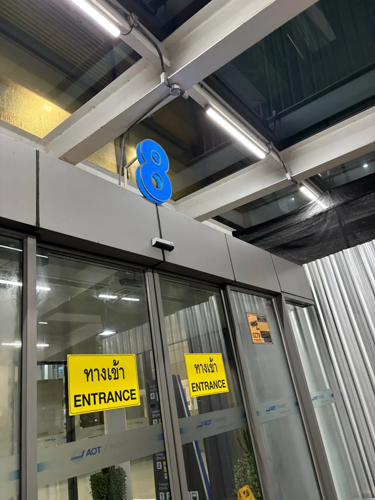

Si vuelas a Phuket desde Shanghái en un vuelo internacional, el camino más sencillo hasta el hotel es exactamente uno: **sal por la puerta 8**, camina recto hacia fuera y estarás en el punto de recogida de Grab.

## Por qué la puerta 8

Las salidas de llegadas internacionales de Phuket están numeradas. En la práctica, **la puerta 2 es confusa y cuesta conectar con la recogida de Grab**, mientras que **la puerta 8 lleva directamente por un único camino**, sin complicaciones. Así que no lo dudes: ve a la puerta 8.

## Paso a paso

### 1. Compra una SIM tailandesa al aterrizar

Resuelve la SIM local antes de salir de la terminal: necesitarás datos para la app de transporte y para los mapas.

### 2. Pasa el control de inmigración

Haz cola como siempre. **No se permite hacer fotos en la zona de inmigración**, así que guarda el móvil.

### 3. Sigue las indicaciones hacia la puerta 8

Sal de la terminal siguiendo los carteles de Exit, con la **salida 8** como objetivo. Por la noche los carteles están muy iluminados y es difícil pasarlos por alto.

### 4. Fuera de la puerta 8, todo recto

Fuera hay una pasarela cubierta con carteles de **Public Taxi, Public Bus y Ride App**. Síguela todo recto.

### 5. Encuentra el kiosco verde de Grab

Al final del recorrido llegas al cartel y al kiosco verdes de **Grab Pick-Up Point**, con una flecha que señala la zona de recogida.

### 6. Pide en Grab

Abre Grab, regístrate, **vincula Alipay** e introduce tu destino. Fija el punto de recogida en el Grab Pick-Up Point que tienes delante.

## Algunos consejos

- **Aterrizar a medianoche** no es problema: la pasarela está iluminada y el punto de recogida tiene personal.
- Del aeropuerto de Phuket a Patong, Kata y las demás playas hay un buen trecho: **comprueba la matrícula y el modelo que aparecen en la app antes de subir**.
- Grab fija el precio al reservar, así que no hay regateo. Si un conductor pide más, denúncialo en la app.
