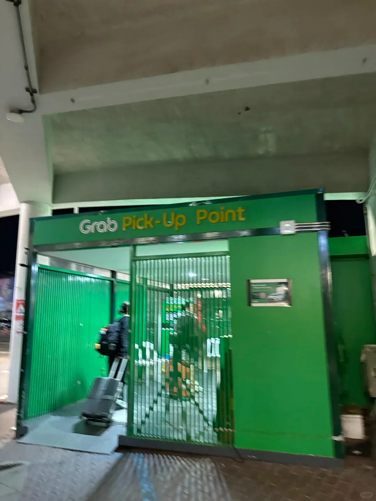

Terbang ke Phuket dari Shanghai dengan penerbangan internasional, cara paling sederhana menuju hotel adalah tepat satu rute: **keluar melalui gerbang 8**, berjalan lurus ke luar, dan Anda sudah berada di titik penjemputan Grab.

## Mengapa gerbang 8

Pintu keluar kedatangan internasional Phuket diberi nomor. Dalam praktiknya, **gerbang 2 membingungkan dan sulit dihubungkan dengan titik penjemputan Grab**, sedangkan **gerbang 8 mengarah lurus ke satu jalur** tanpa kerumitan. Jadi jangan ragu — tuju gerbang 8.

## Langkah demi langkah

### 1. Beli SIM Thailand saat mendarat

Urus SIM lokal sebelum meninggalkan terminal — Anda memerlukan data untuk aplikasi transportasi dan peta.

### 2. Lewati imigrasi

Bergabunglah dengan antrean seperti biasa. **Memotret tidak diizinkan di area imigrasi**, jadi simpan ponsel Anda.

### 3. Ikuti tanda menuju gerbang 8

Tinggalkan terminal dengan mengikuti tanda Exit, menuju **pintu keluar 8**. Tandanya menyala terang pada malam hari dan sulit terlewat.

### 4. Keluar dari gerbang 8, lalu lurus ke depan

Di luar ada lorong beratap dengan tanda **Public Taxi, Public Bus, dan Ride App**. Ikuti lorong itu lurus.

### 5. Temukan kios Grab hijau

Di ujung lorong Anda sampai di tanda dan kios **Grab Pick-Up Point** berwarna hijau, dengan panah yang menunjuk ke area penjemputan.

### 6. Pesan di Grab

Buka Grab, daftar, **tautkan Alipay**, dan masukkan tujuan Anda. Tetapkan titik penjemputan ke Grab Pick-Up Point di depan Anda.

## Beberapa tips

- **Mendarat tengah malam** bukan masalah: lorongnya terang dan titik penjemputan dijaga petugas.
- Perjalanan dari Bandara Phuket ke Patong, Kata, dan pantai-pantai lain cukup jauh — **periksa pelat dan model mobil yang tertera di aplikasi sebelum Anda masuk**.
- Grab menetapkan harga saat Anda memesan, jadi tidak ada tawar-menawar. Jika pengemudi meminta lebih, laporkan melalui aplikasi.
