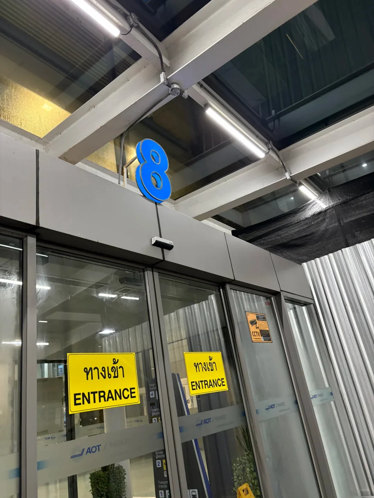
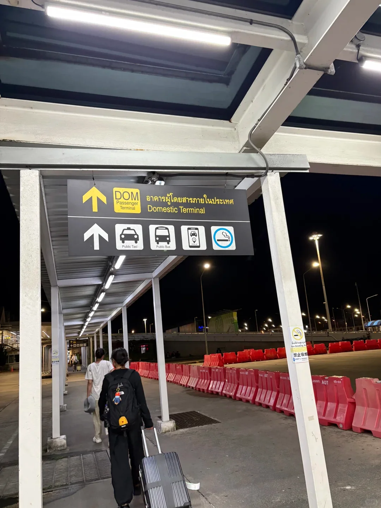
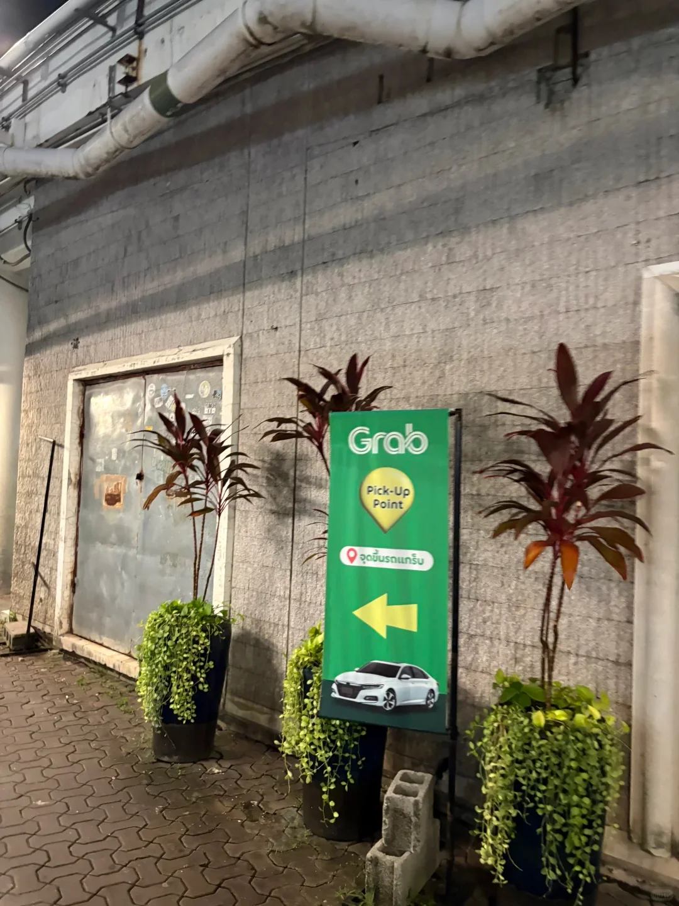
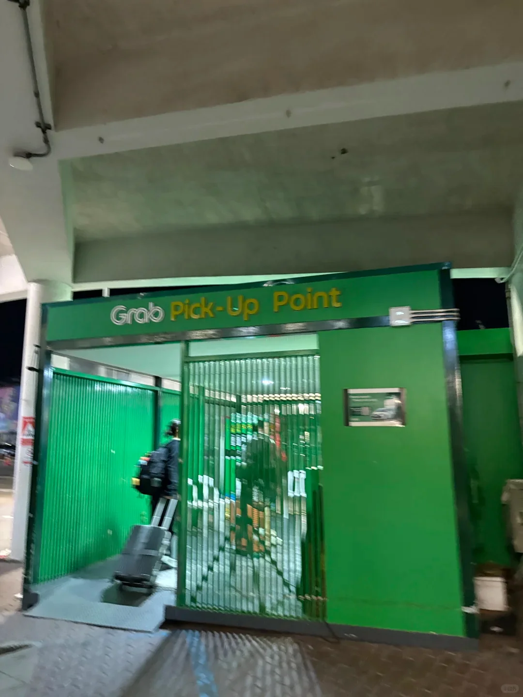
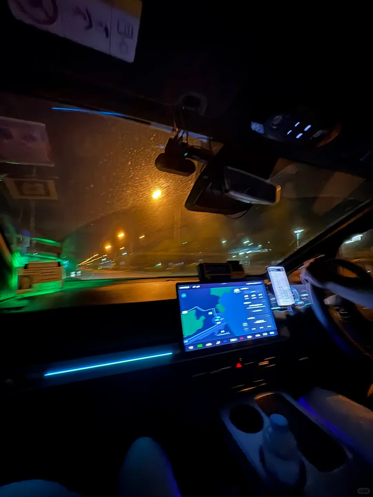

从上海飞普吉岛，坐的是国际航班。落地后想打车去酒店，最省事的方式只有一条：**国际到达直接走 8 号口**，出来直走就是 Grab 的上车点。

## 为什么是 8 号口

普吉岛机场国际到达出口按数字编号。实测下来 **2 号口一带很难找到 Grab 上车点**，而 **8 号口出来一条直路就能到**，几乎"无痛"。所以不用纠结，认准 8 号口。

## 完整步骤

### 1. 落地先换电话卡

出关前先买好／换好泰国本地电话卡，后面叫车、查地图都要用网络。

### 2. 过海关

跟着人流排队过海关即可。**海关区域禁止拍照**，请把手机收好。

### 3. 跟着指引找 8 号口

出关后顺着 Exit 指示牌走，目标是 **8 号出口**。夜间指示牌很亮，跟着走不容易错。

### 4. 从 8 号口出来，一直直走

出门就是带顶棚的通道，沿路有 **Public Taxi、Public Bus、Ride App** 等图标指引，跟着往前走。

### 5. 找到绿色的 Grab 上车亭

直走到底就能看到绿色的 **Grab Pick-Up Point** 立牌与亭子，方向箭头指向上车区。

### 6. 用 Grab 叫车

打开 Grab，注册账号并**绑定支付宝**，输入目的地叫车即可。上车点就选眼前的 Grab Pick-Up Point。

## 小提醒

- **午夜落地**也照样走 8 号口，通道有照明，上车点有工作人员。
- 普吉岛机场到芭东、卡塔等海滩车程较长，**下单后留意 App 显示的车牌与车型**再上车。
- Grab 价格在下单时就已确定，不必和司机议价；如遇加价要求，可以在 App 内投诉。
