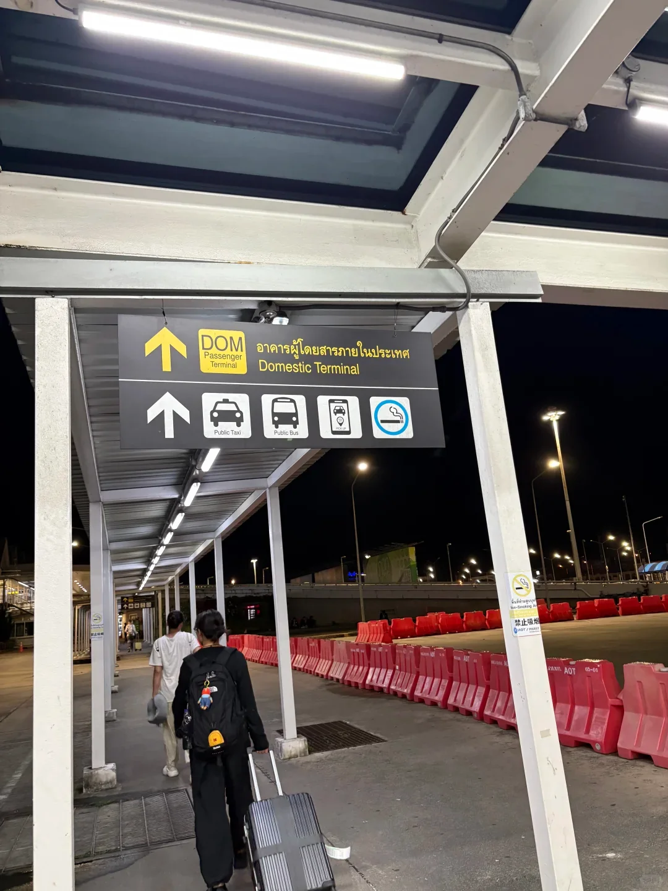

Przylatując do Phuket z Szanghaju lotem międzynarodowym, najprostsza droga do hotelu jest dokładnie jedna: **wyjdź bramą 8**, idź prosto i jesteś przy punkcie odbioru Grab.

## Dlaczego brama 8

Wyjścia z hali przylotów międzynarodowych na Phuket są ponumerowane. W praktyce **brama 2 jest myląca i trudno przy niej trafić na odbiór Grab**, natomiast **brama 8 prowadzi prosto jedną ścieżką**, bez zbędnego zamieszania. Nie zastanawiaj się więc — kieruj się do bramy 8.

## Krok po kroku

### 1. Kup tajlandzką kartę SIM po przylocie

Załatw lokalną kartę SIM, zanim opuścisz terminal — potrzebujesz internetu do aplikacji przewozowej i map.

### 2. Przejdź kontrolę paszportową

Ustaw się w kolejce jak zwykle. **Na terenie kontroli paszportowej nie wolno fotografować**, więc schowaj telefon.

### 3. Idź za znakami do bramy 8

Opuść terminal, idąc za znakami wyjścia, w kierunku **wyjścia 8**. Nocą znaki są jasno podświetlone i trudno ich nie zauważyć.

### 4. Wyjdź bramą 8, potem prosto przed siebie

Na zewnątrz znajduje się zadaszone przejście ze znakami **Public Taxi, Public Bus i Ride App**. Idź nim prosto.

### 5. Znajdź zielony kiosk Grab

Na końcu przejścia dochodzisz do zielonego znaku i kiosku **Grab Pick-Up Point**, ze strzałką wskazującą miejsce odbioru.

### 6. Zamów przejazd w Grab

Otwórz Grab, zarejestruj się, **powiąż Alipay** i wpisz cel podróży. Ustaw punkt odbioru na znajdujący się przed tobą Grab Pick-Up Point.

## Kilka wskazówek

- **Lądowanie o północy** to żaden problem: przejście jest oświetlone, a punkt odbioru ma obsługę.
- Z lotniska Phuket do Patong, Kata i pozostałych plaż jedzie się długo — **zanim wsiądziesz, sprawdź tablicę rejestracyjną i model samochodu pokazane w aplikacji**.
- Grab ustala cenę przy zamówieniu, więc nie ma targowania. Jeśli kierowca żąda więcej, zgłoś to w aplikacji.
