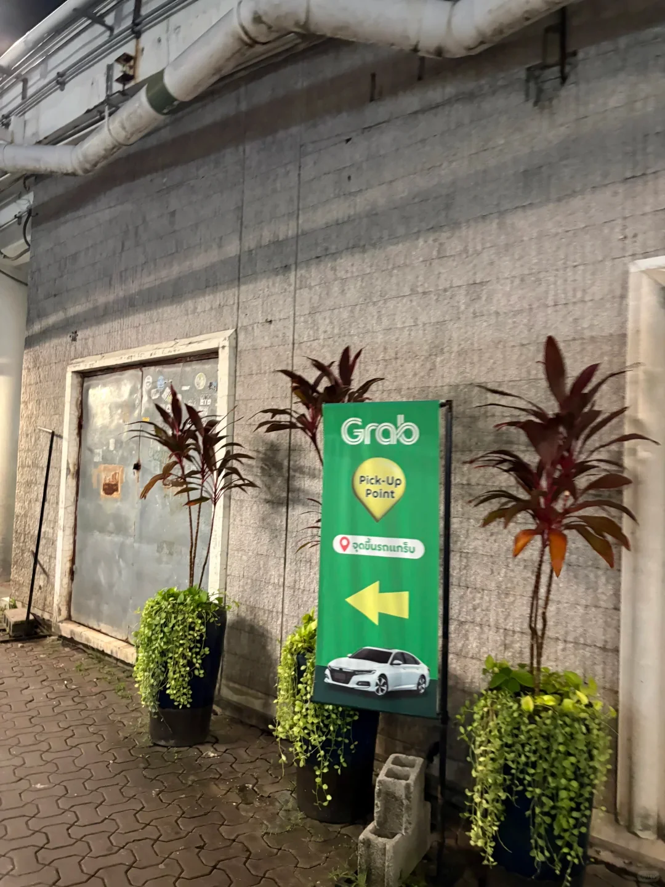

Прилетая в Пхукет из Шанхая международным рейсом, вы доберётесь до отеля проще всего единственным маршрутом: **выходите через выход 8**, идите прямо и оказываетесь у точки посадки Grab.

## Почему выход 8

Выходы международного прилёта в Пхукете пронумерованы. На практике **выход 2 сбивает с толку и плохо связан с точкой посадки Grab**, тогда как **выход 8 ведёт прямо по одной дорожке** без лишней суеты. Так что не раздумывайте — идите к выходу 8.

## Пошагово

### 1. Купите тайскую SIM-карту сразу после посадки

Разберитесь с местной SIM-картой, пока не покинули терминал: мобильный интернет нужен для приложения такси и карт.

### 2. Пройдите паспортный контроль

Вставайте в общую очередь. **В зоне паспортного контроля фотографировать нельзя**, поэтому уберите телефон.

### 3. Следуйте указателям к выходу 8

Покиньте терминал по указателям Exit, держа курс на **выход 8**. Ночью таблички ярко подсвечены, пройти мимо трудно.

### 4. Выйдите через выход 8 и идите прямо

Снаружи — крытая галерея с указателями **Public Taxi, Public Bus и Ride App**. Идите по ней прямо.

### 5. Найдите зелёный киоск Grab

В конце дорожки вы увидите зелёную вывеску и киоск **Grab Pick-Up Point** со стрелкой в сторону зоны посадки.

### 6. Закажите машину в Grab

Откройте Grab, зарегистрируйтесь, **привяжите Alipay** и укажите пункт назначения. Точкой посадки выберите Grab Pick-Up Point прямо перед вами.

## Несколько советов

- **Прилёт в полночь** — не проблема: галерея освещена, на точке посадки дежурят сотрудники.
- От аэропорта Пхукета до Патонга, Каты и других пляжей ехать долго — **сверьте номер и модель машины, указанные в приложении, прежде чем садиться**.
- Grab фиксирует цену при заказе, поэтому торговаться не нужно. Если водитель требует больше, сообщите об этом в приложении.
