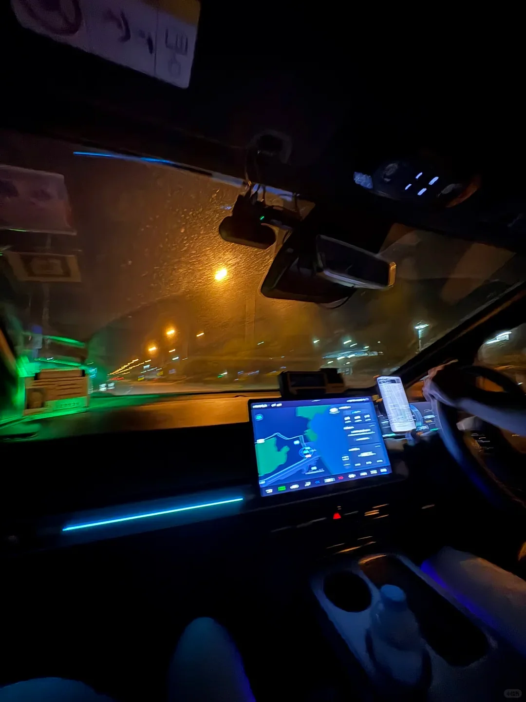

Flyger du in till Phuket från Shanghai på ett internationellt flyg är den enklaste vägen till hotellet precis en: **gå ut genom gate 8**, fortsätt rakt fram och du är vid Grabs upphämtningsplats.

## Varför gate 8

Phukets internationella ankomstutgångar är numrerade. I praktiken är **gate 2 förvirrande och svår att koppla ihop med Grabs upphämtningsplats**, medan **gate 8 leder rakt längs en enda gångväg** utan krångel. Så tveka inte – bege dig mot gate 8.

## Steg för steg

### 1. Köp ett thailändskt SIM-kort när du landar

Ordna ett lokalt SIM-kort innan du lämnar terminalen – du behöver data för appen och kartorna.

### 2. Passera immigrationen

Ställ dig i kön som vanligt. **Det är inte tillåtet att fotografera i immigrationsområdet**, så lägg undan telefonen.

### 3. Följ skyltarna till gate 8

Lämna terminalen och följ Exit-skyltarna mot **utgång 8**. Skyltarna är starkt belysta på natten och svåra att missa.

### 4. Ut genom gate 8 och sedan rakt fram

Utanför finns en övertäckt gångväg med skyltar för **Public Taxi, Public Bus och Ride App**. Följ den rakt fram.

### 5. Hitta den gröna Grab-kiosken

I slutet av gångvägen når du den gröna skylten och kiosken **Grab Pick-Up Point**, med en pil som pekar mot upphämtningsområdet.

### 6. Boka via Grab

Öppna Grab, registrera dig, **koppla Alipay** och ange din destination. Ställ in upphämtningsplatsen till Grab Pick-Up Point framför dig.

## Några tips

- **Att landa vid midnatt** är inget problem: gångvägen är upplyst och upphämtningsplatsen är bemannad.
- Från Phukets flygplats till Patong, Kata och de andra stränderna är det en lång resa – **kontrollera registreringsnummer och bilmodell som visas i appen innan du sätter dig i**.
- Grab fastställer priset när du bokar, så det finns inget att pruta om. Om en förare kräver mer, rapportera det i appen.
