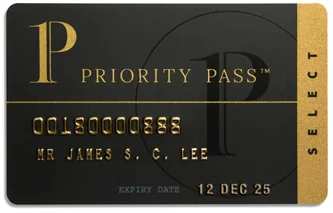

Tarde o temprano las cuentas se vuelven concretas: una conexión de tres horas, todos los asientos cerca de la puerta ocupados, una cola en el restaurante. ¿Cuánto vale de verdad en ese momento una tarjeta que abre las puertas de las salas VIP? Para los titulares de tarjetas de crédito de gama media y alta, el acceso a las salas VIP de aeropuerto suele llegar por tres vías: la sala propia del banco, DragonPass y Priority Pass. Las dos primeras tienen más densidad en China continental; la tercera es la que suele cubrir el hueco en el extranjero.

Priority Pass (PP) es una red de salas VIP y el mayor proveedor de acceso a salas VIP de aeropuerto del mundo. Rara vez construye sus propias salas: firma contratos con salas independientes y operadas por aerolíneas y luego distribuye el acceso mediante membresías y ventajas bancarias. Según sus cifras de 2024, PP reúne más de 1.500 salas asociadas en 145 países y regiones, repartidas por más de 6.000 ciudades. Los titulares de tarjetas entran gratis o pagando una tarifa, cambiando un asiento en la zona de puertas por un lugar más tranquilo con enchufe y comida caliente.

## 1. Priority Pass y Priority Pass Select

Hay que separar dos nombres. Priority Pass es la membresía minorista, que cualquiera puede comprar en la web. Priority Pass Select (PPS) es la versión que un banco compra a PP y asocia a una tarjeta de crédito. Ambas apuntan a las mismas salas contratadas; las salas a las que puedes entrar son idénticas. La única diferencia es quién paga y cuánto.

Por eso la vía práctica hacia la libertad de salas VIP es una tarjeta de crédito con PPS y no una membresía. También explica por qué en las conversaciones mandan las tarjetas y no las membresías: la cuota anual suele haberse pagado por otras ventajas, así que el acceso a las salas llega incluido.

## 2. Los tres niveles: qué compran 99, 329 y 469 dólares

PP vende tres niveles. La diferencia de precio está íntegramente en cuántas veces puede entrar el socio; los cargos por invitado son iguales en los tres.

| Nivel | Cuota anual | Acceso del socio | Invitados |
| --- | --- | --- | --- |
| Standard | 99 $ | 35 $ por visita | 35 $ por persona y visita |
| Plus | 329 $ | Las 10 primeras visitas gratis; después, 35 $ cada una | 35 $ por persona y visita |
| Prestige | 469 $ | Ilimitado | 35 $ por persona y visita |

Haz las cuentas y los niveles se ordenan solos. En Standard, n visitas cuestan 99 + 35n dólares, lo que solo supera los 469 $ fijos de Prestige en la undécima visita. Plus incluye diez visitas gratis, así que su punto de equilibrio frente a Standard cae en la séptima. Salvo que entres en una sala diez veces al año, comprar una membresía directamente no sale barato. Un veredicto más directo: ninguno de los tres niveles es buena relación calidad-precio para un viajero individual. El precio minorista compra el derecho a entrar cuando quieras, no un descuento.

## 3. Cómo te cede la tarjeta de crédito el derecho

Los bancos emiten PPS en formatos muy distintos, pero los puntos en común son que la ventaja suele cubrir solo al titular, que los invitados se cobran aparte y que los límites se cuentan en visitas y no en días. La tabla siguiente recoge las tarjetas que los bancos emiten habitualmente.

| Tarjeta | Cuota anual | Ventaja de sala VIP |
| --- | --- | --- |
| CCB Dashanbai (Platinum) | Condonable con puntos | 5 visitas al año tanto en la principal como en la adicional, solo para el titular |
| Paquete CEB World Elite | 5.000 RMB el primer año, condonable con 500.000 puntos a partir de entonces | Ilimitado |
| Minsheng Centurion Platinum | 3.600 RMB (sin condonación) | Ilimitado; una tarjeta adicional gratis, también ilimitada |
| CMB Centurion Platinum | 3.600 RMB (sin condonación) | Ilimitado; tarjeta adicional por 1.800 RMB al año, sin PP |
| BoCom World Elite | 4.800 RMB, condonable con 1,2 millones de puntos | Principal ilimitada y puede llevar 3 invitados por visita; adicional ilimitada, solo para el titular |
| Minsheng Centurion Black | 36.000 RMB (sin condonación) | Ilimitado en principal y adicional; la primera adicional gratis, las demás 6.000 RMB al año |

Aquí importan dos variables: si la cuota anual se puede compensar con puntos y si la ventaja es solo para el titular. La Dashanbai de CCB es la opción de poco volumen y bajo coste, adecuada para quien sale del país una o dos veces al año. El paquete World Elite de CEB es la vía ilimitada más barata, pero solo para clientes que ya lo son: solicitar la tarjeta diamond ya no incluye World Elite. Minsheng y CMB cobran 3.600 RMB fijos por sus tarjetas Centurion Platinum; la diferencia está en la tarjeta adicional, que Minsheng regala con PP ilimitado mientras que CMB cobra 1.800 RMB al año por una tarjeta sin PP. La World Elite de BoCom es de las pocas que escriben «lleva a la familia» en la ventaja, con tres invitados por visita en la tarjeta principal. La Black de 36.000 RMB es ya otro nivel de gasto.

## 4. El mapa de 2024: recuentos regionales y hubs clave

La fuerza de PP es la cobertura global; su debilidad es la densidad dentro de China continental. En la lista de marzo de 2024, 73 aeropuertos de China continental tenían una sala asociada: la mayoría de las capitales provinciales y de las grandes ciudades turísticas, aunque todavía por detrás de DragonPass. Si se comprimen las ocho listas regionales en una sola tabla, la forma se ve con más claridad.

| Región | Aeropuertos en la lista | Hubs que conviene recordar |
| --- | --- | --- |
| China continental | 73 | Pekín Capital, Pekín Daxing, Shanghái Pudong, Shanghái Hongqiao, Cantón Baiyun, Shenzhen Bao'an, Chengdu Tianfu, Hangzhou Xiaoshan |
| Asia-Pacífico (sin China continental) | 178 | Hong Kong, Singapur Changi, Seúl Incheon, Tokio Haneda, Osaka Kansai, Taipéi Taoyuan, Bangkok Suvarnabhumi, Kuala Lumpur |
| Europa | 136 | Ámsterdam, París CDG, Fráncfort, Múnich, Roma, Madrid, Barcelona, Zúrich, Viena, Estambul |
| Reino Unido e Irlanda | 32 | Londres Heathrow, Londres Gatwick, Londres Stansted, Mánchester, Edimburgo, Dublín |
| Oriente Medio | 31 | Dubái, Doha, Abu Dabi, Yeda, Riad, Kuwait, Mascate, Tel Aviv |
| Norteamérica | 91 | Atlanta, Los Ángeles, San Francisco, Seattle, Chicago O'Hare, Dallas-Fort Worth, Toronto, Vancouver |
| América Latina y el Caribe | 121 | Bogotá, Lima, Ciudad de Panamá, San José, Buenos Aires |
| África | 62 | El Cairo, Johannesburgo, Nairobi, Casablanca, Adís Abeba, Lagos |

Los recuentos son las entradas visibles en cada captura regional, no el total oficial de salas de PP, y la captura de América Latina se corta en la entrada 121. Un mismo aeropuerto suele albergar más de una sala, y así se explica que «1.500 salas» y «700 aeropuertos» puedan ser ciertos a la vez. Las listas se compilaron a mano; si una sala está abierta hoy sigue siendo una pregunta para la web o la app.

## 5. Comprobar la elegibilidad, encontrar una sala y seis cosas que salen mal

Antes de un viaje, el trabajo se divide en tres pasos: mirar en la app de tu emisor cuántas visitas te quedan y si la ventaja es solo para el titular; buscar por código de aeropuerto en la app de PP la terminal, la posición anterior o posterior al control y el horario; y luego encajar la sala con tu hora de embarque, porque cruzar veinte minutos una terminal por un café es un mal negocio.

Los detalles son donde falla. Primero, no todas las entradas son una sala tradicional: en algunos aeropuertos el asociado es un restaurante o una cafetería que descuenta una cantidad fija de la cuenta, una experiencia distinta de una sala de autoservicio. Segundo, las restricciones en hora punta son habituales: cuando las franjas de la tarde están llenas, el mostrador saca un cartel de «no se permite el acceso a terceros» y los titulares de PPS hacen cola detrás de los pasajeros de business. Tercero, la mayoría de las salas asociadas limita una visita a unas tres horas desde la hora que figura en tu tarjeta de embarque. Cuarto, la posición importa: las salas anteriores y posteriores al control no son intercambiables, las terminales normalmente no están conectadas y un giro equivocado durante una conexión puede dejarte sin poder entrar y sin poder volver. Quinto, las normas de invitados son más fáciles de pasar por alto que los recuentos de visitas: los invitados de la membresía minorista cuestan 35 $ por persona y visita en todos los niveles, mientras que la mayoría de las tarjetas PPS emitidas por bancos no incluyen ningún cupo de invitado. Sexto, los contratos cambian: una sala puede cerrar por reforma o salir de la red, así que la sala del año pasado puede no estar este año.

## 6. ¿Vale la pena?

Tres casos. Si vuelas una o dos veces al año y tu aeropuerto de origen no tiene sala de PP, no saques una tarjeta solo por esto. Si vuelas cuatro o cinco veces al año por hubs como Hong Kong, Singapur, Dubái, Seúl Incheon o Londres Heathrow, una tarjeta PP ilimitada puede recuperar su cuota: esos aeropuertos tienen salas asociadas de sobra y en buenas posiciones, y los precios en mostrador no son bajos. En el término medio, prefiere una tarjeta con un número fijo de visitas y paga lo que uses.

Un punto fácil de pasar por alto: PP y DragonPass se complementan en lugar de competir. DragonPass tiene más densidad en los aeropuertos continentales; PP es más fiable en el extranjero. Si tienes las dos, dos minutos comprobando qué red cubre tu aeropuerto de salida valen más que aprenderse el reglamento de memoria.

## Enlaces relacionados

- **En este sitio**: [Londres Heathrow (LHR)](/airport/LHR), [Singapur Changi (SIN)](/airport/SIN), [Hong Kong International (HKG)](/airport/HKG), [Dubái International (DXB)](/airport/DXB), [Seúl Incheon (ICN)](/airport/ICN)
- **Páginas de país**: [Reino Unido (GB)](/country/GB), [Singapur (SG)](/country/SG)
- **Wikipedia**: [Airport lounge](https://en.wikipedia.org/wiki/Airport_lounge), [Priority Pass](https://en.wikipedia.org/wiki/Priority_Pass)
- **Baidu Baike**: [Airport lounge](https://baike.baidu.com/item/%E6%9C%BA%E5%9C%BA%E8%B4%B5%E5%AE%BE%E5%AE%A4)

Fuente de las imágenes: Priority Pass y la recopilación de Luoluo Talks Cards. Los precios de las membresías, las listas de salas y las ventajas de las tarjetas reflejan información pública a marzo de 2024 y pueden haber cambiado desde entonces; consulta la web o la app de Priority Pass y las condiciones vigentes de tu emisor antes de viajar.
