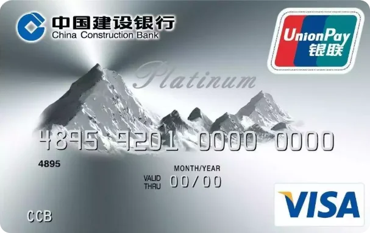

Cepat atau lambat, hitungannya menjadi nyata: koneksi tiga jam, semua kursi di dekat gerbang terisi, antrean di restoran. Berapa sebenarnya nilai kartu yang bisa membuka pintu lounge pada saat seperti itu? Bagi pemegang kartu kredit kelas menengah dan atas, akses lounge bandara biasanya datang melalui tiga jalur — lounge milik bank sendiri, DragonPass, dan Priority Pass. Dua yang pertama lebih rapat di Tiongkok daratan; yang ketiga biasanya mengisi celah di luar negeri.

Priority Pass (PP) adalah jaringan lounge dan penyedia akses lounge bandara terbesar di dunia. PP jarang membangun ruangannya sendiri; PP menandatangani kontrak dengan lounge independen dan lounge yang dioperasikan maskapai, lalu mendistribusikan akses melalui keanggotaan dan manfaat bank. Berdasarkan angka 2024, PP mencantumkan lebih dari 1.500 lounge mitra di 145 negara dan wilayah, tersebar di lebih dari 6.000 kota. Pemegang kartu masuk gratis atau dengan biaya, menukar kursi di area gerbang dengan tempat yang lebih tenang, dilengkapi soket listrik dan makanan panas.

## 1. Priority Pass dan Priority Pass Select

Ada dua nama yang perlu dibedakan. Priority Pass adalah keanggotaan ritel yang dapat dibeli siapa saja di situs web. Priority Pass Select (PPS) adalah versi yang dibeli bank dari PP dan dilekatkan pada kartu kredit. Keduanya menunjuk ke lounge kontrak yang sama; ruangan yang dapat Anda masuki identik. Satu-satunya perbedaan adalah siapa yang membayar, dan berapa banyak.

Itulah sebabnya jalan praktis menuju kebebasan lounge adalah kartu kredit yang membawa PPS, bukan keanggotaan. Ini juga menjelaskan mengapa kartu, bukan keanggotaan, mendominasi pembahasan: biaya tahunan biasanya sudah dibayar untuk manfaat lain, sehingga akses lounge ikut mengalir.

## 2. Tiga tingkat: apa yang didapat dengan $99, $329, dan $469

PP menjual tiga tingkat. Perbedaan harga sepenuhnya terletak pada berapa kali anggota dapat masuk; biaya tamu sama di ketiga tingkat.

| Tingkat | Biaya tahunan | Akses anggota | Tamu |
| --- | --- | --- | --- |
| Standard | $99 | $35 per kunjungan | $35 per orang per kunjungan |
| Plus | $329 | 10 kunjungan pertama gratis, lalu $35 per kunjungan | $35 per orang per kunjungan |
| Prestige | $469 | Tanpa batas | $35 per orang per kunjungan |

Kalau dihitung, tingkatannya akan menjelaskan dirinya sendiri. Pada Standard, n kunjungan berbiaya 99 + 35n dolar, yang baru melampaui tarif tetap Prestige sebesar $469 pada kunjungan kesebelas. Plus mencakup sepuluh kunjungan gratis, sehingga titik impasnya terhadap Standard jatuh pada kunjungan ketujuh. Kecuali Anda masuk lounge sepuluh kali setahun, membeli keanggotaan secara langsung tidak murah. Putusannya lebih blak-blakan: tidak ada dari ketiga tingkat yang bernilai baik bagi pelancong individu. Harga ritel membeli hak untuk masuk kapan saja Anda mau, bukan diskon.

## 3. Bagaimana kartu kredit memberi Anda hak akses

Bank menerbitkan PPS dalam bentuk yang sangat berbeda, tetapi benang merahnya adalah manfaatnya biasanya hanya mencakup pemegang kartu, tamu dikenai biaya terpisah, dan jatahnya dihitung dalam kunjungan, bukan hari. Tabel di bawah ini memaparkan kartu yang umum diterbitkan bank.

| Kartu | Biaya tahunan | Manfaat lounge |
| --- | --- | --- |
| CCB Dashanbai (Platinum) | Dapat dibebaskan dengan poin | 5 kunjungan setahun masing-masing pada kartu utama dan kartu tambahan, hanya pemegang kartu |
| Paket CEB World Elite | RMB 5.000 pada tahun pertama, dapat dibebaskan dengan 500.000 poin setelahnya | Tanpa batas |
| Minsheng Centurion Platinum | RMB 3.600 (tidak dapat dibebaskan) | Tanpa batas; satu kartu tambahan gratis, juga tanpa batas |
| CMB Centurion Platinum | RMB 3.600 (tidak dapat dibebaskan) | Tanpa batas; kartu tambahan RMB 1.800 setahun tanpa PP |
| BoCom World Elite | RMB 4.800, dapat dibebaskan dengan 1,2 juta poin | Kartu utama tanpa batas dan dapat membawa 3 tamu per kunjungan; kartu tambahan tanpa batas, hanya pemegang kartu |
| Minsheng Centurion Black | RMB 36.000 (tidak dapat dibebaskan) | Tanpa batas pada kartu utama dan tambahan; kartu tambahan pertama gratis, sisanya RMB 6.000 setahun |

Ada dua variabel yang penting di sini: apakah biaya tahunan dapat diimbangi dengan poin, dan apakah manfaatnya hanya untuk pemegang kartu. Dashanbai dari CCB adalah pilihan bervolume rendah dan berbiaya rendah, cocok untuk seseorang yang keluar negeri sekali atau dua kali setahun. Paket World Elite dari CEB adalah jalur tanpa batas termurah, tetapi hanya untuk nasabah yang sudah ada — mengajukan kartu diamond tidak lagi disertai World Elite. Minsheng dan CMB sama-sama mengenakan RMB 3.600 penuh untuk kartu Centurion Platinum mereka; perbedaannya ada pada kartu tambahan, yang diberikan gratis oleh Minsheng dengan PP tanpa batas, sedangkan CMB mengenakan RMB 1.800 setahun untuk kartu tanpa PP sama sekali. World Elite dari BoCom adalah salah satu dari sedikit yang menuliskan “ajak keluarga” dalam manfaatnya, dengan tiga tamu per kunjungan pada kartu utama. Kartu Black seharga RMB 36.000 adalah tingkat pengeluaran yang sama sekali berbeda.

## 4. Peta 2024: jumlah per wilayah dan hub utama

Kekuatan PP adalah cakupan global; kelemahannya adalah kepadatan di Tiongkok daratan. Dalam daftar Maret 2024, 73 bandara daratan utama memiliki lounge mitra — sebagian besar ibu kota provinsi dan kota wisata utama, meskipun masih di bawah DragonPass. Merangkum delapan daftar regional ke dalam satu tabel memberikan gambaran yang lebih jelas tentang bentuknya.

| Wilayah | Bandara dalam daftar | Hub yang layak diingat |
| --- | --- | --- |
| Tiongkok daratan | 73 | Beijing Capital, Beijing Daxing, Shanghai Pudong, Shanghai Hongqiao, Guangzhou Baiyun, Shenzhen Bao'an, Chengdu Tianfu, Hangzhou Xiaoshan |
| Asia-Pasifik (kecuali Tiongkok daratan) | 178 | Hong Kong, Singapura Changi, Seoul Incheon, Tokyo Haneda, Osaka Kansai, Taipei Taoyuan, Bangkok Suvarnabhumi, Kuala Lumpur |
| Eropa | 136 | Amsterdam, Paris CDG, Frankfurt, Munich, Roma, Madrid, Barcelona, Zurich, Wina, Istanbul |
| Inggris dan Irlandia | 32 | London Heathrow, London Gatwick, London Stansted, Manchester, Edinburgh, Dublin |
| Timur Tengah | 31 | Dubai, Doha, Abu Dhabi, Jeddah, Riyadh, Kuwait, Muscat, Tel Aviv |
| Amerika Utara | 91 | Atlanta, Los Angeles, San Francisco, Seattle, Chicago O'Hare, Dallas-Fort Worth, Toronto, Vancouver |
| Amerika Latin dan Karibia | 121 | Bogotá, Lima, Panama City, San José, Buenos Aires |
| Afrika | 62 | Kairo, Johannesburg, Nairobi, Casablanca, Addis Ababa, Lagos |

Jumlah tersebut adalah entri yang terlihat di setiap tangkapan layar regional, bukan total lounge resmi PP, dan tangkapan layar Amerika Latin terpotong pada entri 121. Satu bandara sering memiliki lebih dari satu lounge, sehingga “1.500 lounge” dan “700 bandara” bisa sama-sama benar. Daftar tersebut disusun secara manual; apakah sebuah lounge buka hari ini tetap menjadi pertanyaan untuk situs web atau aplikasi.

## 5. Memeriksa kelayakan, menemukan lounge, dan enam hal yang bisa salah

Sebelum perjalanan, pekerjaannya terbagi menjadi tiga langkah: periksa aplikasi penerbit kartu Anda untuk mengetahui berapa kunjungan yang tersisa dan apakah manfaatnya hanya untuk pemegang kartu; cari berdasarkan kode bandara di aplikasi PP untuk mengetahui terminal, posisi di sisi udara atau sisi darat, dan jam bukanya; lalu cocokkan lounge dengan waktu boarding Anda, karena berjalan dua puluh menit melintasi terminal demi secangkir kopi adalah pertukaran yang buruk.

Detailnya adalah tempat kesalahan terjadi. Pertama, tidak setiap entri adalah lounge tradisional: di beberapa bandara, mitranya adalah restoran atau kafe yang memotong jumlah tetap dari tagihan, pengalaman yang berbeda dari ruangan swalayan. Kedua, pembatasan jam sibuk umum terjadi — ketika gelombang penerbangan malam penuh, meja resepsionis memasang tanda “tidak menerima akses pihak ketiga” dan pemegang PPS mengantre di belakang penumpang kelas bisnis. Ketiga, sebagian besar lounge mitra membatasi satu kunjungan sekitar tiga jam sejak waktu pada boarding pass Anda. Keempat, posisi penting: lounge di sisi darat dan sisi udara tidak dapat dipertukarkan, terminal biasanya tidak terhubung, dan salah belok saat transit dapat membuat Anda tidak bisa masuk dan tidak bisa kembali. Kelima, aturan tamu lebih mudah terlewat daripada jumlah kunjungan — tamu ritel dikenai $35 per orang per kunjungan di setiap tingkat, sedangkan sebagian besar kartu PPS terbitan bank tidak mencakup jatah tamu sama sekali. Keenam, kontrak berubah: lounge dapat ditutup untuk renovasi atau keluar dari jaringan, jadi ruangan tahun lalu mungkin tidak ada tahun ini.

## 6. Apakah layak?

Tiga kasus. Jika Anda terbang sekali atau dua kali setahun dan bandara asal Anda tidak memiliki lounge PP, jangan mengajukan kartu hanya untuk ini. Jika Anda terbang empat atau lima kali setahun melalui hub seperti Hong Kong, Singapura, Dubai, Seoul Incheon, atau London Heathrow, kartu PP tanpa batas dapat mengembalikan biayanya — bandara tersebut memiliki banyak lounge mitra di posisi yang baik, dan harga langsung di tempat tidak murah. Di antaranya, pilih kartu dengan jumlah kunjungan tetap dan bayar sesuai penggunaan.

Satu hal mudah terlewat: PP dan DragonPass saling melengkapi, bukan bersaing. DragonPass lebih rapat di bandara daratan utama, PP lebih andal di luar negeri. Jika Anda memegang keduanya, dua menit untuk memeriksa jaringan mana yang mencakup bandara keberangkatan Anda lebih berharga daripada menghafal buku aturan.

## Tautan terkait

- **Di situs ini**: [London Heathrow (LHR)](/airport/LHR), [Singapura Changi (SIN)](/airport/SIN), [Hong Kong International (HKG)](/airport/HKG), [Dubai International (DXB)](/airport/DXB), [Seoul Incheon (ICN)](/airport/ICN)
- **Halaman negara**: [Inggris (GB)](/country/GB), [Singapura (SG)](/country/SG)
- **Wikipedia**: [Airport lounge](https://en.wikipedia.org/wiki/Airport_lounge), [Priority Pass](https://en.wikipedia.org/wiki/Priority_Pass)
- **Baidu Baike**: [Airport lounge](https://baike.baidu.com/item/%E6%9C%BA%E5%9C%BA%E8%B4%B5%E5%AE%BE%E5%AE%A4)

Sumber gambar: Priority Pass dan kompilasi oleh Luoluo Talks Cards. Harga keanggotaan, daftar lounge, dan manfaat kartu mencerminkan informasi publik per Maret 2024 dan mungkin telah berubah sejak itu; periksa situs web atau aplikasi Priority Pass serta ketentuan penerbit Anda yang berlaku sebelum bepergian.
