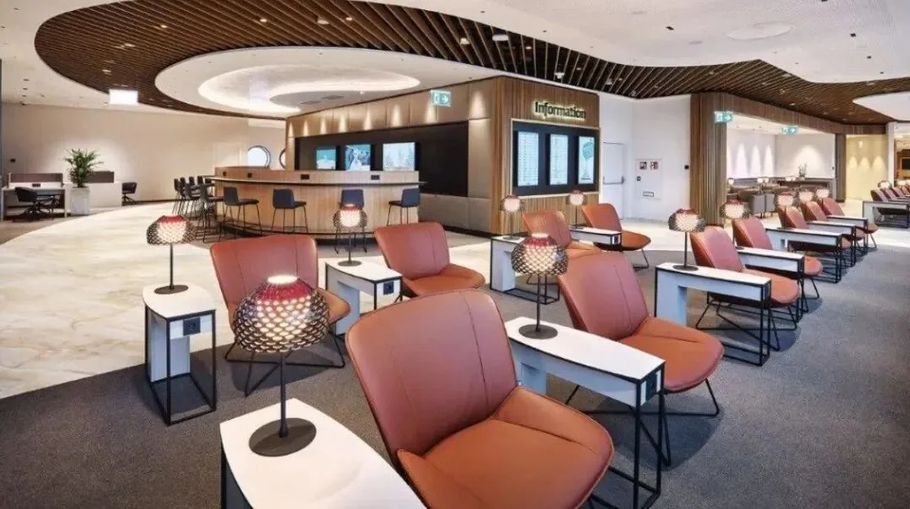
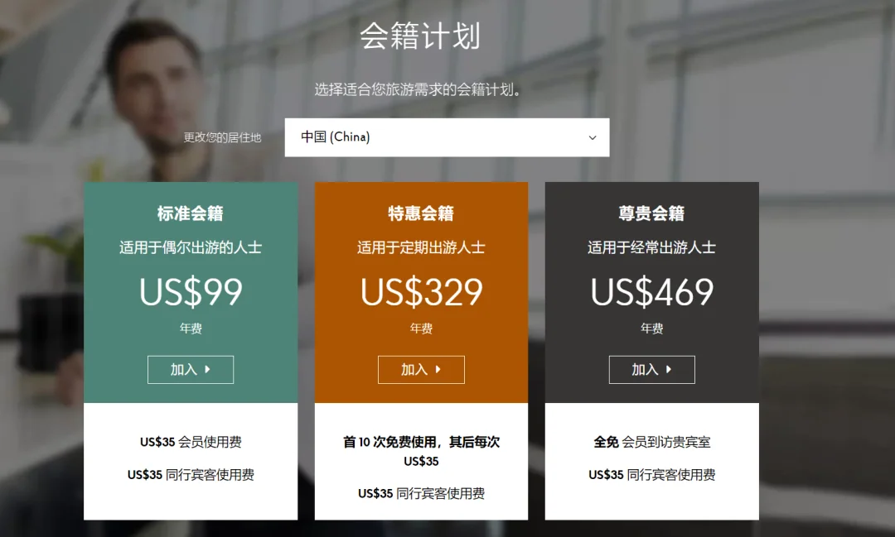
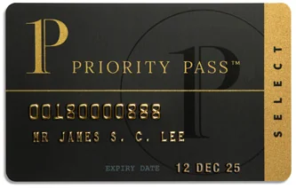
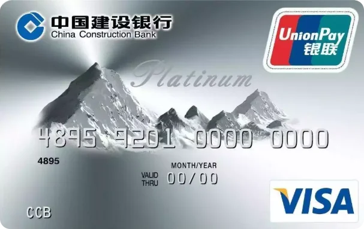
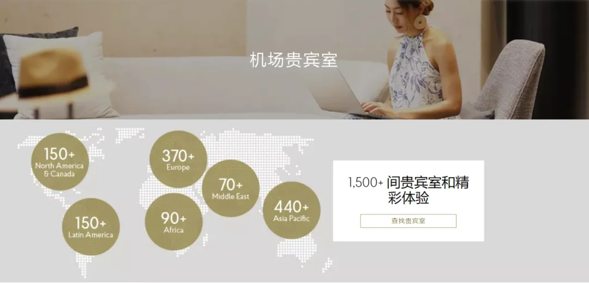
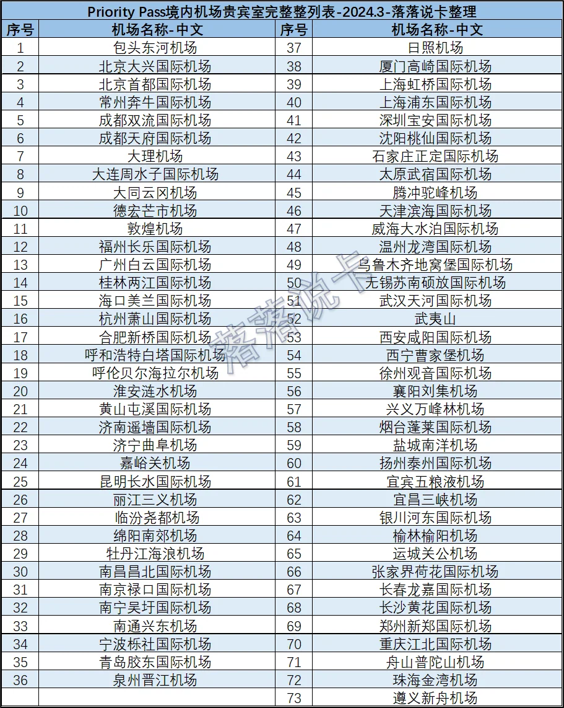

Prima o poi l'aritmetica diventa concreta: una coincidenza di tre ore, ogni posto vicino al gate occupato, la coda al ristorante. Quanto vale davvero, in quel momento, una carta che apre le porte dei saloni? Per i titolari di carte di credito di fascia media e alta, l'accesso ai saloni aeroportuali arriva di solito attraverso tre canali: il salone della banca stessa, DragonPass e Priority Pass. I primi due sono più diffusi nella Cina continentale; il terzo è quello che di solito colma il vuoto all'estero.

Priority Pass (PP) è un network di saloni e il più grande fornitore di accessi ai saloni aeroportuali del mondo. Raramente costruisce sale proprie; firma contratti con saloni indipendenti e gestiti da compagnie aeree, poi distribuisce l'accesso tramite iscrizioni e vantaggi bancari. Secondo i dati del 2024, PP elenca oltre 1.500 saloni partner in 145 Paesi e regioni, distribuiti in più di 6.000 città. I titolari di carta entrano gratis o pagando, scambiando un posto nell'area dei gate con un ambiente più tranquillo, con una presa di corrente e cibo caldo.

## 1. Priority Pass e Priority Pass Select

Due nomi da distinguere. Priority Pass è l'iscrizione al dettaglio, che chiunque può acquistare sul sito. Priority Pass Select (PPS) è la versione che una banca acquista da PP e abbina a una carta di credito. Entrambe puntano agli stessi saloni convenzionati; le sale a cui potete accedere sono identiche. L'unica differenza è chi paga e quanto.

Ecco perché la via pratica per entrare liberamente nei saloni è una carta di credito con PPS anziché un'iscrizione. Questo spiega anche perché nella discussione prevalgono le carte, non le iscrizioni: il canone annuo è di solito già stato pagato per altri vantaggi, quindi l'accesso ai saloni arriva di conseguenza.

## 2. I tre livelli: cosa comprano 99 $, 329 $ e 469 $

PP vende tre livelli. La differenza di prezzo sta interamente nel numero di ingressi consentiti al membro; le tariffe per gli ospiti sono identiche in tutti e tre.

| Livello | Canone annuo | Accesso del membro | Ospiti |
| --- | --- | --- | --- |
| Standard | 99 $ | 35 $ per visita | 35 $ a persona per visita |
| Plus | 329 $ | Prime 10 visite gratuite, poi 35 $ ciascuna | 35 $ a persona per visita |
| Prestige | 469 $ | Illimitato | 35 $ a persona per visita |

Fate i conti e i livelli si sistemano da soli. Con Standard, n visite costano 99 + 35n dollari, una cifra che supera il forfait fisso di 469 $ di Prestige solo all'undicesima visita. Plus include dieci visite gratuite, quindi il suo punto di pareggio rispetto a Standard cade alla settima. A meno di entrare in un salone dieci volte l'anno, comprare un'iscrizione a prezzo pieno non è economico. Un verdetto più diretto: nessuno dei tre livelli è un buon affare per un viaggiatore individuale. Il prezzo al dettaglio compra il diritto di entrare quando volete, non uno sconto.

## 3. Come una carta di credito vi consegna il diritto

Le banche emettono PPS in forme molto diverse, ma il filo comune è che il vantaggio di solito copre solo il titolare della carta, che gli ospiti pagano a parte e che le quote si contano in visite, non in giorni. La tabella qui sotto riporta le carte che le banche emettono comunemente.

| Carta | Canone annuo | Vantaggio salone |
| --- | --- | --- |
| CCB Dashanbai (Platinum) | Azzerabile con punti | 5 visite all'anno ciascuna su carta principale e aggiuntiva, solo titolare |
| Pacchetto CEB World Elite | 5.000 RMB il primo anno, azzerabile con 500.000 punti negli anni successivi | Illimitato |
| Minsheng Centurion Platinum | 3.600 RMB (non azzerabile) | Illimitato; una carta aggiuntiva gratuita, anch'essa illimitata |
| CMB Centurion Platinum | 3.600 RMB (non azzerabile) | Illimitato; carta aggiuntiva a 1.800 RMB all'anno senza PP |
| BoCom World Elite | 4.800 RMB, azzerabile con 1,2 milioni di punti | Principale illimitata e può portare 3 ospiti per visita; aggiuntiva illimitata, solo titolare |
| Minsheng Centurion Black | 36.000 RMB (non azzerabile) | Illimitato su principale e aggiuntiva; prima aggiuntiva gratuita, le altre 6.000 RMB all'anno |

Due variabili contano: se il canone annuo può essere compensato con i punti e se il vantaggio è riservato al titolare. La Dashanbai di CCB è l'opzione a basso utilizzo e basso costo, adatta a chi lascia il Paese una o due volte l'anno. Il pacchetto World Elite di CEB è la via illimitata più economica, ma solo per i clienti esistenti — richiedere la carta diamond non include più World Elite. Minsheng e CMB chiedono entrambe 3.600 RMB secchi per le loro Centurion Platinum; la differenza sta nella carta aggiuntiva, che Minsheng regala con PP illimitato mentre CMB chiede 1.800 RMB all'anno per una carta senza alcun PP. La World Elite di BoCom è una delle poche che scrive "porta la famiglia" nel vantaggio, con tre ospiti per visita sulla carta principale. La Black da 36.000 RMB è un livello di spesa del tutto diverso.

## 4. La mappa del 2024: conteggi regionali e hub principali

Il punto di forza di PP è la copertura globale; il punto debole è la densità nella Cina continentale. Nell'elenco di marzo 2024, 73 aeroporti della Cina continentale avevano un salone partner — la maggior parte dei capoluoghi di provincia e delle principali città turistiche, ma ancora sotto DragonPass. Comprimere gli otto elenchi regionali in un'unica tabella dà un'idea più chiara della configurazione complessiva.

| Regione | Aeroporti nell'elenco | Hub da ricordare |
| --- | --- | --- |
| Cina continentale | 73 | Pechino Capital, Pechino Daxing, Shanghai Pudong, Shanghai Hongqiao, Guangzhou Baiyun, Shenzhen Bao'an, Chengdu Tianfu, Hangzhou Xiaoshan |
| Asia-Pacifico (esclusa la Cina continentale) | 178 | Hong Kong, Singapore Changi, Seul Incheon, Tokyo Haneda, Osaka Kansai, Taipei Taoyuan, Bangkok Suvarnabhumi, Kuala Lumpur |
| Europa | 136 | Amsterdam, Parigi CDG, Francoforte, Monaco di Baviera, Roma, Madrid, Barcellona, Zurigo, Vienna, Istanbul |
| Regno Unito e Irlanda | 32 | Londra Heathrow, Londra Gatwick, Londra Stansted, Manchester, Edimburgo, Dublino |
| Medio Oriente | 31 | Dubai, Doha, Abu Dhabi, Gedda, Riad, Kuwait, Mascate, Tel Aviv |
| Nord America | 91 | Atlanta, Los Angeles, San Francisco, Seattle, Chicago O'Hare, Dallas-Fort Worth, Toronto, Vancouver |
| America Latina e Caraibi | 121 | Bogotà, Lima, Panama City, San José, Buenos Aires |
| Africa | 62 | Il Cairo, Johannesburg, Nairobi, Casablanca, Addis Abeba, Lagos |

I conteggi sono le voci visibili in ciascuno screenshot regionale, non il totale ufficiale dei saloni di PP, e lo screenshot dell'America Latina si ferma alla voce 121. Un aeroporto ospita spesso più di un salone, ed è così che "1.500 saloni" e "700 aeroporti" possono essere entrambi veri. Gli elenchi sono stati compilati a mano; se un salone è aperto oggi resta una domanda per il sito o l'app.

## 5. Verificare l'idoneità, trovare un salone e sei cose che vanno storte

Prima di un viaggio, il lavoro si divide in tre passi: controllate l'app del vostro emittente per quante visite restano e se il vantaggio è riservato al titolare; cercate per codice aeroportuale sull'app PP il terminal, la posizione lato aria o lato terra e gli orari; poi confrontate il salone con l'orario d'imbarco, perché percorrere venti minuti attraverso un terminal per un caffè è uno scambio pessimo.

I dettagli sono il punto in cui le cose vanno storte. Primo, non ogni voce è un salone tradizionale: in alcuni aeroporti il partner è un ristorante o un bar che detrae un importo fisso dal conto, un'esperienza diversa da una sala self-service. Secondo, le restrizioni nelle ore di punta sono comuni — quando i voli serali sono pieni, allo sportello compare un cartello "no third-party access" e i titolari di PPS fanno la coda dietro i passeggeri di business class. Terzo, la maggior parte dei saloni partner limita una singola visita a circa tre ore dal momento indicato sulla carta d'imbarco. Quarto, la posizione conta: i saloni lato terra e lato aria non sono intercambiabili, i terminal di solito non sono collegati, e una svolta sbagliata durante una coincidenza può lasciarvi nell'impossibilità di entrare e di tornare indietro. Quinto, le regole per gli ospiti sono più facili da trascurare dei conteggi delle visite — gli ospiti al dettaglio costano 35 $ a persona per visita su ogni livello, mentre la maggior parte delle carte PPS emesse dalle banche non include alcuna quota ospiti. Sesto, i contratti cambiano: un salone può chiudere per ristrutturazione o uscire dal network, quindi la sala dell'anno scorso potrebbe non esserci quest'anno.

## 6. Ne vale la pena?

Tre casi. Se volate una o due volte l'anno e il vostro aeroporto di casa non ha saloni PP, non richiedete una carta solo per questo. Se volate quattro o cinque volte l'anno attraverso hub come Hong Kong, Singapore, Dubai, Seul Incheon o Londra Heathrow, una carta PP illimitata può ripagarsi il canone — quegli aeroporti hanno molti saloni partner in buone posizioni, e i prezzi all'ingresso non sono bassi. Nel mezzo, preferite una carta con un numero fisso di visite e pagate per quello che usate.

Un punto facile da trascurare: PP e DragonPass si completano anziché competere. DragonPass è più denso negli aeroporti della Cina continentale, PP è più affidabile all'estero. Se avete entrambi, due minuti spesi a controllare quale network copre il vostro aeroporto di partenza valgono più che imparare a memoria il regolamento.

## Link correlati

- **Su questo sito**: [Londra Heathrow (LHR)](/airport/LHR), [Singapore Changi (SIN)](/airport/SIN), [Hong Kong International (HKG)](/airport/HKG), [Dubai International (DXB)](/airport/DXB), [Seul Incheon (ICN)](/airport/ICN)
- **Pagine Paese**: [Regno Unito (GB)](/country/GB), [Singapore (SG)](/country/SG)
- **Wikipedia**: [Airport lounge](https://en.wikipedia.org/wiki/Airport_lounge), [Priority Pass](https://en.wikipedia.org/wiki/Priority_Pass)
- **Baidu Baike**: [Airport lounge](https://baike.baidu.com/item/%E6%9C%BA%E5%9C%BA%E8%B4%B5%E5%AE%BE%E5%AE%A4)

Fonte delle immagini: Priority Pass e la compilazione di Luoluo Talks Cards. Prezzi delle iscrizioni, elenchi dei saloni e vantaggi delle carte riflettono informazioni pubbliche a marzo 2024 e possono essere cambiati da allora; consultate il sito o l'app Priority Pass e i termini attuali del vostro emittente prima di viaggiare.
