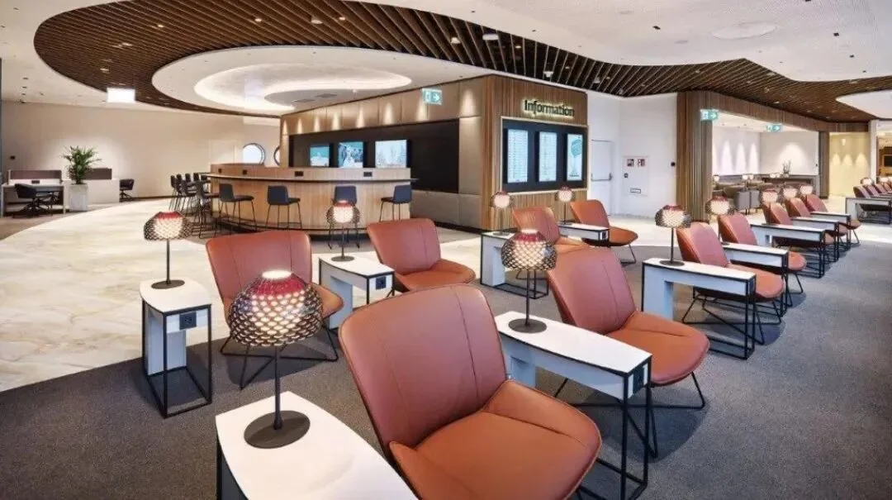

Mais cedo ou mais tarde, a conta fica concreta: uma conexão de três horas, todos os assentos perto do portão ocupados, fila no restaurante. Quanto vale, naquele momento, um cartão que abre as portas das salas VIP? Para quem tem cartões de crédito de nível médio e alto, o acesso a salas VIP de aeroporto costuma chegar por três canais: a sala própria do banco, o DragonPass e o Priority Pass. Os dois primeiros são mais densos na China continental; o terceiro é o que costuma cobrir a lacuna no exterior.

O Priority Pass (PP) é uma rede de salas VIP e o maior provedor de acesso a salas VIP de aeroporto do mundo. Ele raramente constrói salas próprias: firma contratos com salas independentes e operadas por companhias aéreas e depois distribui o acesso por meio de assinaturas e benefícios bancários. Segundo seus números de 2024, o PP lista mais de 1.500 salas parceiras em 145 países e regiões, distribuídas por mais de 6.000 cidades. Os titulares de cartão entram de graça ou pagando uma taxa, trocando um assento na área do portão por um lugar mais tranquilo, com tomada e comida quente.

## 1. Priority Pass e Priority Pass Select

Dois nomes precisam ser separados. O Priority Pass é a assinatura de varejo, que qualquer pessoa pode comprar no site. O Priority Pass Select (PPS) é a versão que um banco compra do PP e vincula a um cartão de crédito. Ambos apontam para as mesmas salas contratadas; as salas a que você pode entrar são idênticas. A única diferença é quem paga, e quanto.

É por isso que o caminho prático para a liberdade de salas VIP é um cartão de crédito com PPS, e não uma assinatura. Isso também explica por que os cartões, e não as assinaturas, dominam a discussão: a anuidade geralmente já foi paga por outros benefícios, e o acesso às salas VIP vem de brinde.

## 2. Os três planos: o que $99, $329 e $469 compram

O PP vende três planos. A diferença de preço está inteiramente em quantas vezes o membro pode entrar; a cobrança de acompanhantes é igual nos três.

| Plano | Anuidade | Acesso do membro | Acompanhantes |
| --- | --- | --- | --- |
| Standard | $99 | $35 por visita | $35 por pessoa por visita |
| Plus | $329 | Primeiras 10 visitas grátis, depois $35 cada | $35 por pessoa por visita |
| Prestige | $469 | Ilimitado | $35 por pessoa por visita |

Faça as contas e os planos se explicam sozinhos. No Standard, n visitas custam 99 + 35n dólares, o que só supera o valor fixo de $469 do Prestige na décima primeira visita. O Plus inclui dez visitas grátis, então o ponto de equilíbrio em relação ao Standard cai na sétima. A menos que você entre em uma sala VIP dez vezes por ano, comprar uma assinatura avulsa não é barato. Um veredito mais direto: nenhum dos três planos vale a pena para um viajante individual. O preço de varejo compra o direito de entrar quando quiser, não um desconto.

## 3. Como um cartão de crédito entrega o benefício

Os bancos emitem o PPS em formatos muito diferentes, mas os pontos em comum são que o benefício geralmente cobre apenas o titular, que os acompanhantes são cobrados à parte e que as cotas são contadas em visitas, não em dias. A tabela abaixo mostra os cartões que os bancos costumam emitir.

| Cartão | Anuidade | Benefício de sala VIP |
| --- | --- | --- |
| CCB Dashanbai (Platinum) | Isenta com pontos | 5 visitas por ano no cartão principal e no adicional, somente para o titular |
| Pacote CEB World Elite | RMB 5.000 no primeiro ano, isento com 500.000 pontos a partir de então | Ilimitado |
| Minsheng Centurion Platinum | RMB 3.600 (sem isenção) | Ilimitado; um cartão adicional grátis, também ilimitado |
| CMB Centurion Platinum | RMB 3.600 (sem isenção) | Ilimitado; cartão adicional RMB 1.800 por ano, sem PP |
| BoCom World Elite | RMB 4.800, isento com 1,2 milhão de pontos | Principal ilimitado e pode levar 3 acompanhantes por visita; adicional ilimitado, somente para o titular |
| Minsheng Centurion Black | RMB 36.000 (sem isenção) | Ilimitado no principal e no adicional; primeiro adicional grátis, os demais RMB 6.000 por ano |

Duas variáveis importam aqui: se a anuidade pode ser compensada com pontos e se o benefício é exclusivo do titular. O Dashanbai do CCB é a opção de baixo volume e baixo custo, indicada para quem sai do país uma ou duas vezes por ano. O pacote World Elite do CEB é o caminho ilimitado mais barato, mas só para clientes existentes — pedir o cartão Diamond já não vem com o World Elite atrelado. Minsheng e CMB cobram RMB 3.600 fixos pelos cartões Centurion Platinum; a diferença está no cartão adicional, que a Minsheng dá de graça com PP ilimitado, enquanto a CMB cobra RMB 1.800 por ano por um cartão sem PP nenhum. O World Elite do BoCom é um dos poucos que inclui “levar a família” no benefício, com três acompanhantes por visita no cartão principal. O Black de RMB 36.000 é outro patamar de gastos.

## 4. O mapa de 2024: contagens regionais e principais hubs

A força do PP é a cobertura global; sua fraqueza é a densidade na China continental. Na lista de março de 2024, 73 aeroportos continentais tinham uma sala parceira — a maioria das capitais provinciais e grandes cidades turísticas, ainda assim aquém do DragonPass. Comprimir as oito listas regionais em uma única tabela dá uma noção mais clara do formato.

| Região | Aeroportos na lista | Hubs que vale lembrar |
| --- | --- | --- |
| China continental | 73 | Pequim-Capital, Pequim-Daxing, Xangai-Pudong, Xangai-Hongqiao, Cantão-Baiyun, Shenzhen-Bao'an, Chengdu-Tianfu, Hangzhou-Xiaoshan |
| Ásia-Pacífico (excl. China continental) | 178 | Hong Kong, Singapura-Changi, Seul-Incheon, Tóquio-Haneda, Osaka-Kansai, Taipé-Taoyuan, Bangkok-Suvarnabhumi, Kuala Lumpur |
| Europa | 136 | Amsterdã, Paris CDG, Frankfurt, Munique, Roma, Madri, Barcelona, Zurique, Viena, Istambul |
| Reino Unido e Irlanda | 32 | Londres-Heathrow, Londres-Gatwick, Londres-Stansted, Manchester, Edimburgo, Dublin |
| Oriente Médio | 31 | Dubai, Doha, Abu Dhabi, Jidá, Riade, Kuwait, Mascate, Tel Aviv |
| América do Norte | 91 | Atlanta, Los Angeles, São Francisco, Seattle, Chicago O'Hare, Dallas-Fort Worth, Toronto, Vancouver |
| América Latina e Caribe | 121 | Bogotá, Lima, Cidade do Panamá, San José, Buenos Aires |
| África | 62 | Cairo, Joanesburgo, Nairóbi, Casablanca, Addis Abeba, Lagos |

As contagens são as entradas visíveis em cada captura regional, não o total oficial de salas do PP, e a captura da América Latina está cortada na entrada 121. Um aeroporto costuma abrigar mais de uma sala, e é assim que “1.500 salas” e “700 aeroportos” podem ser verdade ao mesmo tempo. As listas foram compiladas à mão; se uma sala está aberta hoje ainda é uma questão para o site ou o aplicativo.

## 5. Verificar a elegibilidade, encontrar uma sala e seis coisas que dão errado

Antes de uma viagem, o trabalho se divide em três etapas: consulte o aplicativo do seu emissor para ver quantas visitas restam e se o benefício é exclusivo do titular; pesquise pelo código do aeroporto no aplicativo do PP para saber o terminal, a posição antes ou depois da segurança e o horário; depois encaixe a sala no seu horário de embarque, porque caminhar vinte minutos por um terminal por um café é uma troca ruim.

Os detalhes são onde as coisas dão errado. Primeiro, nem toda entrada é uma sala VIP tradicional: em alguns aeroportos, o parceiro é um restaurante ou café que desconta um valor fixo da conta, uma experiência diferente de uma sala de autoatendimento. Segundo, restrições em horário de pico são comuns — quando as ondas de voos da noite enchem a sala, o balcão coloca uma placa de “sem acesso a terceiros” e os titulares de PPS ficam na fila atrás dos passageiros de classe executiva. Terceiro, a maioria das salas parceiras limita uma visita a cerca de três horas a partir do horário do seu cartão de embarque. Quarto, a posição importa: salas antes e depois da segurança não são intercambiáveis, os terminais geralmente não são conectados, e uma curva errada durante uma conexão pode deixar você sem conseguir entrar e sem conseguir voltar. Quinto, as regras para acompanhantes são mais fáceis de passar despercebidas do que as contagens de visitas — acompanhantes no varejo custam $35 por pessoa por visita em todos os planos, enquanto a maioria dos cartões PPS emitidos por bancos não inclui cota de acompanhante alguma. Sexto, os contratos mudam: uma sala pode fechar para reforma ou sair da rede, então a sala do ano passado pode não estar lá este ano.

## 6. Vale a pena?

Três casos. Se você voa uma ou duas vezes por ano e o aeroporto da sua cidade não tem sala do PP, não peça um cartão só por isso. Se você voa quatro ou cinco vezes por ano por hubs como Hong Kong, Singapura, Dubai, Seul-Incheon ou Londres-Heathrow, um cartão PP ilimitado pode devolver o valor da anuidade — esses aeroportos têm muitas salas parceiras em boas posições, e os preços na porta não são baixos. No meio-termo, prefira um cartão com um número fixo de visitas e pague pelo que usar.

Um ponto é fácil de esquecer: o PP e o DragonPass se complementam em vez de competir. O DragonPass é mais denso nos aeroportos da China continental, o PP é mais confiável no exterior. Se você tem os dois, dois minutos verificando qual rede cobre o aeroporto de partida valem mais do que decorar o regulamento.

## Links relacionados

- **Neste site**: [Aeroporto de Londres-Heathrow (LHR)](/airport/LHR), [Aeroporto de Singapura-Changi (SIN)](/airport/SIN), [Aeroporto Internacional de Hong Kong (HKG)](/airport/HKG), [Aeroporto Internacional de Dubai (DXB)](/airport/DXB), [Aeroporto Internacional de Incheon (ICN)](/airport/ICN)
- **Páginas de países**: [Reino Unido (GB)](/country/GB), [Singapura (SG)](/country/SG)
- **Wikipedia**: [Sala VIP de aeroporto](https://en.wikipedia.org/wiki/Airport_lounge), [Priority Pass](https://en.wikipedia.org/wiki/Priority_Pass)
- **Baidu Baike**: [Sala VIP de aeroporto](https://baike.baidu.com/item/%E6%9C%BA%E5%9C%BA%E8%B4%B5%E5%AE%BE%E5%AE%A4)

Fonte das imagens: Priority Pass e a compilação de Luoluo Talks Cards. Os preços das assinaturas, as listas de salas e os benefícios dos cartões refletem informações públicas de março de 2024 e podem ter mudado desde então; consulte o site ou o aplicativo do Priority Pass e os termos atuais do seu emissor antes de viajar.
