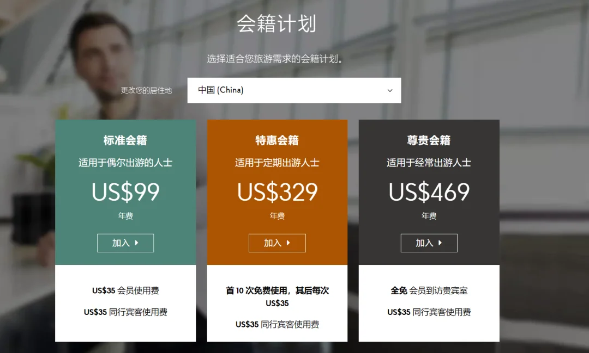

Mai devreme sau mai târziu, calculele devin concrete: o escală de trei ore, toate locurile de lângă poartă ocupate, o coadă la restaurant. Cât valorează de fapt, în acel moment, un card care deschide ușile saloanelor? Pentru deținătorii de carduri de credit de nivel mediu și superior, accesul în saloanele de aeroport vine de obicei prin trei canale — salonul propriu al băncii, DragonPass și Priority Pass. Primele două sunt mai dense în China continentală; al treilea este cel care umple de obicei golul în străinătate.

Priority Pass (PP) este o rețea de saloane și cel mai mare furnizor de acces în saloanele de aeroport din lume. Rareori își construiește propriile spații; încheie contracte cu saloane independente și operate de companii aeriene, apoi distribuie accesul prin abonamente și beneficii bancare. Conform cifrelor sale din 2024, PP listează peste 1.500 de saloane partenere în 145 de țări și regiuni, răspândite în peste 6.000 de orașe. Deținătorii de carduri intră gratuit sau contra cost, schimbând un loc din zona porții pe un spațiu mai liniștit, cu priză și mâncare caldă.

## 1. Priority Pass și Priority Pass Select

Trebuie separate două nume. Priority Pass este abonamentul de retail, pe care oricine îl poate cumpăra pe site. Priority Pass Select (PPS) este versiunea pe care o bancă o cumpără de la PP și o atașează unui card de credit. Ambele trimit către aceleași saloane contractate; sălile în care poți intra sunt identice. Singura diferență este cine plătește și cât.

De aceea calea practică spre libertatea saloanelor este un card de credit care include PPS, nu un abonament. Asta explică și de ce discuțiile sunt dominate de carduri, nu de abonamente: taxa anuală a fost plătită de obicei pentru alte beneficii, așa că accesul în saloane vine pe deasupra.

## 2. Cele trei niveluri: ce îți cumpără $99, $329 și $469

PP vinde trei niveluri. Diferența de preț constă în întregime în numărul de intrări permise membrului; tarifele pentru însoțitori sunt aceleași la toate trei.

| Nivel | Taxă anuală | Acces pentru membru | Însoțitori |
| --- | --- | --- | --- |
| Standard | $99 | $35 pe vizită | $35 de persoană pe vizită |
| Plus | $329 | Primele 10 vizite gratuite, apoi $35 fiecare | $35 de persoană pe vizită |
| Prestige | $469 | Nelimitat | $35 de persoană pe vizită |

Fă calculul și nivelurile se aranjează singure. La Standard, n vizite costă 99 + 35n dolari, sumă care depășește tariful fix de $469 al Prestige abia la a unsprezecea vizită. Plus include zece vizite gratuite, așa că pragul de echivalență cu Standard cade la a șaptea. Dacă nu intri într-un salon de zece ori pe an, cumpărarea unui abonament direct nu este ieftină. Un verdict mai direct: niciunul dintre cele trei niveluri nu este o afacere bună pentru un călător individual. Prețul de retail cumpără dreptul de a intra oricând vrei, nu o reducere.

## 3. Cum îți oferă un card de credit dreptul

Băncile emit PPS în forme foarte diferite, dar firele comune sunt că beneficiul acoperă de obicei doar titularul cardului, că însoțitorii sunt taxați separat și că alocațiile se numără în vizite, nu în zile. Tabelul de mai jos prezintă cardurile pe care băncile le emit frecvent.

| Card | Taxă anuală | Beneficiu de salon |
| --- | --- | --- |
| CCB Dashanbai (Platinum) | Se poate scuti cu puncte | 5 vizite pe an fiecare, pe cardul principal și pe cel suplimentar, doar pentru titular |
| Pachetul CEB World Elite | 5.000 RMB în primul an, apoi se poate scuti cu 500.000 de puncte | Nelimitat |
| Minsheng Centurion Platinum | 3.600 RMB (fără scutire) | Nelimitat; un card suplimentar gratuit, de asemenea nelimitat |
| CMB Centurion Platinum | 3.600 RMB (fără scutire) | Nelimitat; cardul suplimentar costă 1.800 RMB pe an și nu include PP |
| BoCom World Elite | 4.800 RMB, se poate scuti cu 1,2 milioane de puncte | Cardul principal nelimitat și poate aduce 3 însoțitori pe vizită; cel suplimentar nelimitat, doar pentru titular |
| Minsheng Centurion Black | 36.000 RMB (fără scutire) | Nelimitat pe cardul principal și pe cel suplimentar; primul suplimentar gratuit, celelalte 6.000 RMB pe an |

Aici contează două variabile: dacă taxa anuală poate fi compensată cu puncte și dacă beneficiul este doar pentru titular. Dashanbai de la CCB este opțiunea cu volum mic și cost redus, potrivită pentru cineva care iese din țară o dată sau de două ori pe an. Pachetul World Elite de la CEB este cea mai ieftină rută nelimitată, dar numai pentru clienții existenți — solicitarea cardului diamond nu mai vine cu World Elite atașat. Minsheng și CMB percep amândouă 3.600 RMB fix pentru cardurile lor Centurion Platinum; diferența o face cardul suplimentar, pe care Minsheng îl oferă gratuit cu PP nelimitat, în timp ce CMB cere 1.800 RMB pe an pentru un card fără niciun PP. World Elite de la BoCom este unul dintre puținele care scrie „adu familia” în beneficiu, cu trei însoțitori pe vizită pe cardul principal. Cardul Black de 36.000 RMB este cu totul alt nivel de cheltuieli.

## 4. Harta din 2024: cifre regionale și hub-uri principale

Punctul forte al PP este acoperirea globală; slăbiciunea este densitatea în China continentală. În lista din martie 2024, 73 de aeroporturi din China continentală aveau un salon partener — majoritatea capitalelor provinciale și orașele turistice importante, dar încă sub DragonPass. Comprimarea celor opt liste regionale într-un singur tabel oferă o imagine mai clară a formei.

| Regiune | Aeroporturi în listă | Hub-uri de reținut |
| --- | --- | --- |
| China continentală | 73 | Beijing Capital, Beijing Daxing, Shanghai Pudong, Shanghai Hongqiao, Guangzhou Baiyun, Shenzhen Bao'an, Chengdu Tianfu, Hangzhou Xiaoshan |
| Asia-Pacific (fără China continentală) | 178 | Hong Kong, Singapore Changi, Seul Incheon, Tokyo Haneda, Osaka Kansai, Taipei Taoyuan, Bangkok Suvarnabhumi, Kuala Lumpur |
| Europa | 136 | Amsterdam, Paris CDG, Frankfurt, München, Roma, Madrid, Barcelona, Zürich, Viena, Istanbul |
| Regatul Unit și Irlanda | 32 | Londra Heathrow, Londra Gatwick, Londra Stansted, Manchester, Edinburgh, Dublin |
| Orientul Mijlociu | 31 | Dubai, Doha, Abu Dhabi, Jeddah, Riad, Kuweit, Muscat, Tel Aviv |
| America de Nord | 91 | Atlanta, Los Angeles, San Francisco, Seattle, Chicago O'Hare, Dallas-Fort Worth, Toronto, Vancouver |
| America Latină și Caraibe | 121 | Bogotá, Lima, Panama City, San José, Buenos Aires |
| Africa | 62 | Cairo, Johannesburg, Nairobi, Casablanca, Addis Abeba, Lagos |

Cifrele reprezintă intrările vizibile în fiecare captură regională, nu totalul oficial de saloane al PP, iar captura pentru America Latină este tăiată la intrarea 121. Un aeroport găzduiește adesea mai mult de un salon, ceea ce face ca „1.500 de saloane” și „700 de aeroporturi” să fie amândouă adevărate. Listele au fost alcătuite manual; dacă un salon este deschis astăzi rămâne o întrebare pentru site sau pentru aplicație.

## 5. Verificarea eligibilității, găsirea unui salon și șase lucruri care merg prost

Înainte de o călătorie, munca se împarte în trei pași: verifică în aplicația emitentului câte vizite au rămas și dacă beneficiul este doar pentru titular; caută după codul aeroportului în aplicația PP terminalul, poziția dinainte sau de după controlul de securitate și programul; apoi aliniază salonul cu ora ta de îmbarcare, pentru că să mergi douăzeci de minute prin terminal după o cafea este un schimb prost.

Detaliile sunt locul unde apar problemele. În primul rând, nu fiecare intrare este un salon tradițional: la unele aeroporturi partenerul este un restaurant sau o cafenea care deduce o sumă fixă din notă, o experiență diferită de o sală cu autoservire. În al doilea rând, restricțiile la orele de vârf sunt frecvente — când valurile de zboruri de seară sunt pline, ghișeul afișează un panou „no third-party access”, iar deținătorii de PPS stau la coadă în spatele pasagerilor de la business. În al treilea rând, majoritatea saloanelor partenere limitează o singură vizită la circa trei ore de la ora de pe cartea de îmbarcare. În al patrulea rând, poziția contează: saloanele dinainte și de după controlul de securitate nu sunt interschimbabile, terminalele de obicei nu sunt legate între ele, iar o cotitură greșită în timpul unei escale te poate lăsa fără posibilitatea de a intra și fără de a te întoarce. În al cincilea rând, regulile pentru însoțitori sunt mai ușor de trecut cu vederea decât numărul de vizite — însoțitorii la tarif de retail costă $35 de persoană pe vizită la toate nivelurile, în timp ce majoritatea cardurilor PPS emise de bănci nu includ deloc alocație pentru însoțitori. În al șaselea rând, contractele se schimbă: un salon poate fi închis pentru renovare sau poate ieși din rețea, așa că sala de anul trecut poate să nu mai existe anul acesta.

## 6. Merită?

Trei cazuri. Dacă zbori o dată sau de două ori pe an și aeroportul tău de origine nu are salon PP, nu scoate un card doar pentru asta. Dacă zbori de patru sau cinci ori pe an prin hub-uri precum Hong Kong, Singapore, Dubai, Seul Incheon sau Londra Heathrow, un card PP nelimitat își poate recupera taxa — acele aeroporturi au destule saloane partenere în poziții bune, iar prețurile la intrare nu sunt mici. Între cele două, preferă un card cu un număr fix de vizite și plătește pentru ce folosești.

Un punct este ușor de ratat: PP și DragonPass se completează reciproc, în loc să concureze. DragonPass este mai dens în aeroporturile din China continentală, PP este mai de încredere în străinătate. Dacă le ai pe amândouă, două minute petrecute verificând ce rețea acoperă aeroportul tău de plecare valorează mai mult decât memorarea regulamentului.

## Linkuri utile

- **Pe acest site**: [Londra Heathrow (LHR)](/airport/LHR), [Singapore Changi (SIN)](/airport/SIN), [Hong Kong International (HKG)](/airport/HKG), [Dubai International (DXB)](/airport/DXB), [Seul Incheon (ICN)](/airport/ICN)
- **Pagini de țară**: [Regatul Unit (GB)](/country/GB), [Singapore (SG)](/country/SG)
- **Wikipedia**: [Salon de aeroport](https://en.wikipedia.org/wiki/Airport_lounge), [Priority Pass](https://en.wikipedia.org/wiki/Priority_Pass)
- **Baidu Baike**: [Salon de aeroport](https://baike.baidu.com/item/%E6%9C%BA%E5%9C%BA%E8%B4%B5%E5%AE%BE%E5%AE%A4)

Sursa imaginilor: Priority Pass și compilația Luoluo Talks Cards. Prețurile abonamentelor, listele de saloane și beneficiile cardurilor reflectă informații publice valabile în martie 2024 și se pot fi schimbat de atunci; verifică site-ul sau aplicația Priority Pass și condițiile actuale ale emitentului tău înainte de a călători.
