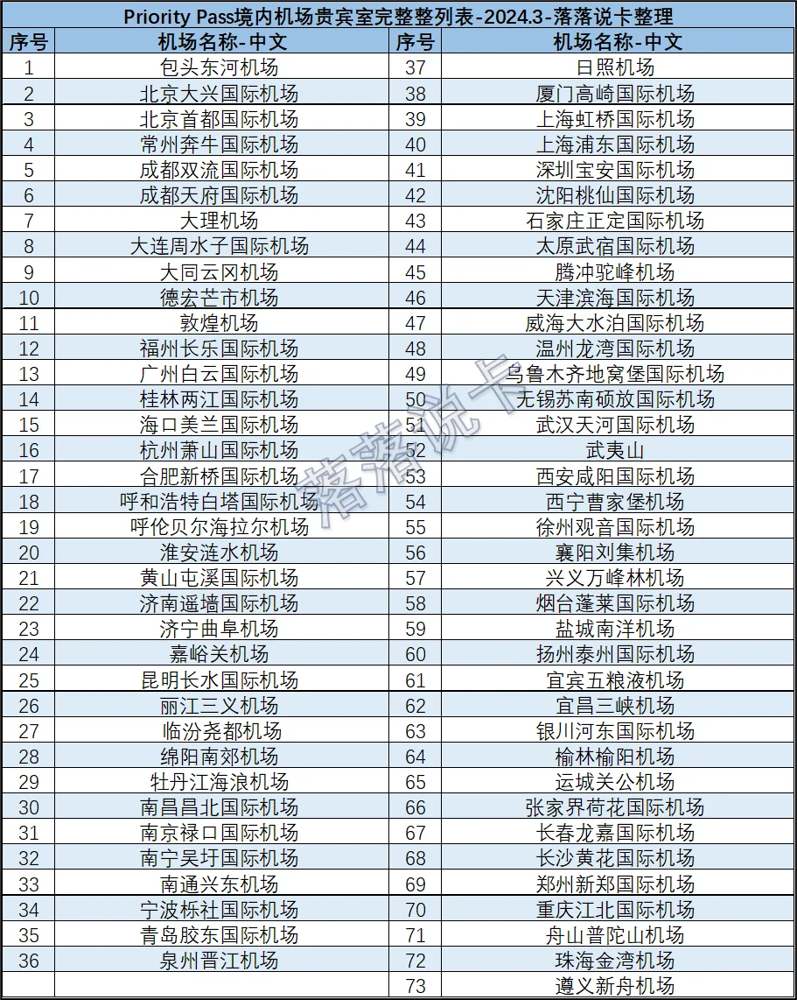

ไม่ช้าก็เร็ว ตัวเลขจะชัดเจนขึ้น: เปลี่ยนเครื่องสามชั่วโมง ที่นั่งทุกที่ใกล้ประตูขึ้นเครื่องถูกจองหมด ร้านอาหารมีคิว ตอนนั้นบัตรที่เปิดประตูเลานจ์ได้มีค่าจริงแค่ไหน? สำหรับผู้ถือบัตรเครดิตระดับกลางและระดับสูง การเข้าเลานจ์สนามบินมักมาได้สามช่องทาง — เลานจ์ของธนาคารเอง DragonPass และ Priority Pass สองช่องแรกหนาแน่นกว่าในจีนแผ่นดินใหญ่ ช่องที่สามคือสิ่งที่มักเติมช่องว่างในต่างประเทศ

Priority Pass (PP) คือเครือข่ายเลานจ์และผู้ให้บริการสิทธิ์เข้าเลานจ์สนามบินรายใหญ่ที่สุดในโลก แทบไม่สร้างห้องของตัวเอง แต่ทำสัญญากับเลานจ์อิสระและเลานจ์ที่สายการบินดำเนินการ แล้วกระจายสิทธิ์ผ่านสมาชิกและสิทธิประโยชน์จากธนาคาร ตามตัวเลขปี 2024 PP ระบุเลานจ์พันธมิตรมากกว่า 1,500 แห่งใน 145 ประเทศและภูมิภาค กระจายอยู่กว่า 6,000 เมือง ผู้ถือบัตรเข้าได้ฟรีหรือเสียค่าธรรมเนียม แลกที่นั่งในโซนประตูขึ้นเครื่องกับที่เงียบกว่า มีปลั๊กไฟและอาหารร้อน

## 1. Priority Pass กับ Priority Pass Select

ต้องแยกสองชื่อออกจากกัน Priority Pass คือสมาชิกราคาปลีกที่ใครก็ซื้อได้บนเว็บไซต์ Priority Pass Select (PPS) คือเวอร์ชันที่ธนาคารซื้อจาก PP แล้วแนบไปกับบัตรเครดิต ทั้งสองชี้ไปยังเลานจ์ภายใต้สัญญาชุดเดียวกัน ห้องที่เข้าได้เหมือนกันทุกประการ ต่างกันเพียงใครเป็นคนจ่าย และจ่ายเท่าไร

นั่นจึงเป็นเหตุผลว่าทำไมเส้นทางปฏิบัติสู่การเข้าเลานจ์อย่างอิสระคือบัตรเครดิตที่พ่วง PPS ไม่ใช่การซื้อสมาชิก และอธิบายว่าทำไมบัตร ไม่ใช่สมาชิก จึงครองการพูดคุย: ค่าธรรมเนียมรายปีมักจ่ายไปเพื่อสิทธิประโยชน์อื่นอยู่แล้ว การเข้าเลานจ์จึงติดมาเอง

## 2. สามระดับ: $99, $329 และ $469 ให้อะไร

PP ขายสามระดับ ความต่างของราคาอยู่ที่จำนวนครั้งที่สมาชิกเข้าได้ทั้งหมด ค่าธรรมเนียมผู้ติดตามเท่ากันทั้งสามระดับ

| ระดับ | ค่าธรรมเนียมรายปี | สิทธิ์สมาชิก | ผู้ติดตาม |
| --- | --- | --- | --- |
| Standard | $99 | $35 ต่อครั้ง | $35 ต่อคนต่อครั้ง |
| Plus | $329 | 10 ครั้งแรกฟรี จากนั้นครั้งละ $35 | $35 ต่อคนต่อครั้ง |
| Prestige | $469 | ไม่จำกัด | $35 ต่อคนต่อครั้ง |

ลองคิดเลขดู ระดับต่าง ๆ จะจัดตัวเอง Standard: เข้า n ครั้งเสีย 99 + 35n ดอลลาร์ ซึ่งจะแซง Prestige ราคาเหมา $469 เมื่อเข้าครั้งที่สิบเอ็ด Plus รวมสิบครั้งฟรี จุดคุ้มทุนเทียบกับ Standard จึงอยู่ที่ครั้งที่เจ็ด เว้นแต่คุณเข้าเลานจ์ปีละสิบครั้ง การซื้อสมาชิกตรง ๆ ก็ไม่ถูก คำตัดสินตรง ๆ: ไม่มีระดับใดคุ้มค่าสำหรับนักเดินทางคนเดียว ราคาปลีกซื้อสิทธิ์ในการเดินเข้าได้ทุกเมื่อ ไม่ใช่ส่วนลด

## 3. บัตรเครดิตมอบสิทธิ์ให้คุณอย่างไร

ธนาคารออก PPS ในรูปแบบที่ต่างกันมาก แต่จุดร่วมคือสิทธิประโยชน์มักครอบคลุมเฉพาะผู้ถือบัตร ผู้ติดตามจ่ายแยก และวงเงินนับเป็นจำนวนครั้งไม่ใช่วัน ตารางด้านล่างแสดงบัตรที่ธนาคารมักออก

| บัตร | ค่าธรรมเนียมรายปี | สิทธิ์เลานจ์ |
| --- | --- | --- |
| CCB Dashanbai (Platinum) | ยกเว้นได้ด้วยคะแนน | ปีละ 5 ครั้งทั้งบัตรหลักและบัตรเสริม เฉพาะผู้ถือบัตร |
| CEB World Elite package | ปีแรก 5,000 หยวน ยกเว้นได้ด้วย 500,000 คะแนนหลังจากนั้น | ไม่จำกัด |
| Minsheng Centurion Platinum | 3,600 หยวน (ยกเว้นไม่ได้) | ไม่จำกัด; บัตรเสริมหนึ่งใบฟรี ไม่จำกัดเช่นกัน |
| CMB Centurion Platinum | 3,600 หยวน (ยกเว้นไม่ได้) | ไม่จำกัด; บัตรเสริมปีละ 1,800 หยวน แต่ไม่มี PP |
| BoCom World Elite | 4,800 หยวน ยกเว้นได้ด้วย 1.2 ล้านคะแนน | บัตรหลักไม่จำกัดและพาผู้ติดตามได้ 3 คนต่อครั้ง; บัตรเสริมไม่จำกัด เฉพาะผู้ถือบัตร |
| Minsheng Centurion Black | 36,000 หยวน (ยกเว้นไม่ได้) | ไม่จำกัดทั้งบัตรหลักและบัตรเสริม; บัตรเสริมใบแรกฟรี ใบถัดไปปีละ 6,000 หยวน |

ตัวแปรสองอย่างสำคัญตรงนี้: ค่าธรรมเนียมรายปีหักล้างด้วยคะแนนได้หรือไม่ และสิทธิ์จำกัดเฉพาะผู้ถือบัตรหรือไม่ CCB Dashanbai เป็นตัวเลือกปริมาณน้อยต้นทุนต่ำ เหมาะกับคนที่ออกนอกประเทศปีละครั้งหรือสองครั้ง CEB World Elite package เป็นเส้นทางไม่จำกัดที่ถูกที่สุด แต่สำหรับลูกค้าเดิมเท่านั้น — การสมัครบัตรไดมอนด์ไม่ได้มาพร้อม World Elite อีกต่อไป Minsheng และ CMB ต่างเก็บ 3,600 หยวนเต็มสำหรับบัตร Centurion Platinum ต่างกันที่บัตรเสริม ซึ่ง Minsheng ให้ฟรีพร้อม PP ไม่จำกัด ขณะที่ CMB เก็บปีละ 1,800 หยวนสำหรับบัตรที่ไม่มี PP เลย BoCom World Elite เป็นหนึ่งในไม่กี่ใบที่เขียน «พาครอบครัว» ไว้ในสิทธิ์ โดยบัตรหลักพาผู้ติดตามได้สามคนต่อครั้ง บัตร Black ราคา 36,000 หยวนอยู่คนละระดับการใช้จ่ายเลย

## 4. แผนที่ปี 2024: จำนวนตามภูมิภาคและฮับสำคัญ

จุดแข็งของ PP คือความครอบคลุมระดับโลก จุดอ่อนคือความหนาแน่นในจีนแผ่นดินใหญ่ ในรายการเดือนมีนาคม 2024 สนามบินจีนแผ่นดินใหญ่ 73 แห่งมีเลานจ์พันธมิตร — ส่วนใหญ่เป็นเมืองหลวงจังหวัดและเมืองท่องเที่ยวสำคัญ แต่ยังน้อยกว่า DragonPass การย่อรายชื่อแปดภูมิภาคเป็นตารางเดียวช่วยให้เห็นภาพชัดขึ้น

| ภูมิภาค | สนามบินในรายการ | ฮับที่น่าจดจำ |
| --- | --- | --- |
| จีนแผ่นดินใหญ่ | 73 | ปักกิ่งแคปิตอล, ปักกิ่งต้าซิง, เซี่ยงไฮ้ผู่ตง, เซี่ยงไฮ้หงเฉียว, กว่างโจวไป่หยุน, เซินเจิ้นเป่าอาน, เฉิงตูเทียนฟู่, หังโจวเซียวซาน |
| เอเชียแปซิฟิก (ไม่รวมจีนแผ่นดินใหญ่) | 178 | ฮ่องกง, สิงคโปร์ชางงี, โซลอินชอน, โตเกียวฮาเนดะ, โอซาก้าคันไซ, ไทเปเถาหยวน, กรุงเทพสุวรรณภูมิ, กัวลาลัมเปอร์ |
| ยุโรป | 136 | อัมสเตอร์ดัม, ปารีส CDG, แฟรงก์เฟิร์ต, มิวนิก, โรม, มาดริด, บาร์เซโลนา, ซูริก, เวียนนา, อิสตันบูล |
| สหราชอาณาจักรและไอร์แลนด์ | 32 | ลอนดอนฮีทโธรว์, ลอนดอนแกตวิก, ลอนดอนสแตนสเตด, แมนเชสเตอร์, เอดินบะระ, ดับลิน |
| ตะวันออกกลาง | 31 | ดูไบ, โดฮา, อาบูดาบี, เจดดาห์, ริยาด, คูเวต, มัสกัต, เทลอาวีฟ |
| อเมริกาเหนือ | 91 | แอตแลนตา, ลอสแอนเจลิส, ซานฟรานซิสโก, ซีแอตเทิล, ชิคาโกโอแฮร์, ดัลลาส-ฟอร์ตเวิร์ธ, โตรอนโต, แวนคูเวอร์ |
| ลาตินอเมริกาและแคริบเบียน | 121 | โบโกตา, ลิมา, ปานามาซิตี, ซานโฮเซ, บัวโนสไอเรส |
| แอฟริกา | 62 | ไคโร, โจฮันเนสเบิร์ก, ไนโรบี, คาซาบลังกา, แอดดิสอาบาบา, ลากอส |

ตัวเลขคือรายการที่มองเห็นในภาพหน้าจอแต่ละภูมิภาค ไม่ใช่ยอดเลานจ์ทางการของ PP และภาพหน้าจอลาตินอเมริกาถูกตัดที่รายการที่ 121 สนามบินหนึ่งแห่งมักมีเลานจ์มากกว่าหนึ่งแห่ง นี่คือเหตุผลที่ «1,500 เลานจ์» และ «700 สนามบิน» เป็นจริงทั้งคู่ได้ รายชื่อรวบรวมด้วยมือ เลานจ์ยังเปิดอยู่หรือไม่ในวันนี้ยังต้องถามเว็บไซต์หรือแอป

## 5. ตรวจสิทธิ์ หาเลานจ์ และหกสิ่งที่มักผิดพลาด

ก่อนเดินทาง งานแบ่งเป็นสามขั้น: ตรวจแอปของผู้ออกบัตรว่ามีสิทธิ์เหลือกี่ครั้งและสิทธิ์จำกัดเฉพาะผู้ถือบัตรหรือไม่ ค้นด้วยรหัสสนามบินบนแอป PP เพื่อดูอาคารผู้โดยสาร ตำแหน่งก่อนหรือหลังด่านตรวจคนเข้าเมือง และเวลาเปิด แล้วจัดเลานจ์ให้เข้ากับเวลาขึ้นเครื่อง เพราะเดินยี่สิบนาทีข้ามอาคารเพื่อกาแฟหนึ่งแก้วเป็นการแลกที่ไม่คุ้ม

รายละเอียดคือจุดที่มันผิดพลาด หนึ่ง ไม่ใช่ทุกรายการเป็นเลานจ์แบบดั้งเดิม: ที่สนามบินบางแห่งพันธมิตรเป็นร้านอาหารหรือคาเฟ่ที่หักเงินจำนวนคงที่จากบิล ประสบการณ์ต่างจากห้องบริการตนเอง สอง การจำกัดช่วงพีคเป็นเรื่องปกติ — เมื่อเที่ยวบินช่วงเย็นเต็ม เคาน์เตอร์จะติดป้าย «ไม่รับผู้ถือบัตรภายนอก» และผู้ถือ PPS ต้องต่อคิวหลังผู้โดยสารชั้นธุรกิจ สาม เลานจ์พันธมิตรส่วนใหญ่จำกัดการเข้าครั้งเดียวประมาณสามชั่วโมงนับจากเวลาบนบัตรขึ้นเครื่อง สี่ ตำแหน่งสำคัญ: เลานจ์ก่อนและหลังด่านตรวจคนเข้าเมืองใช้แทนกันไม่ได้ อาคารผู้โดยสารมักไม่เชื่อมต่อกัน และการเลี้ยวผิดระหว่างเปลี่ยนเครื่องอาจทำให้เข้าไม่ได้และกลับไม่ได้ ห้า กฎผู้ติดตามมองข้ามได้ง่ายกว่าจำนวนครั้ง — ผู้ติดตามราคาปลีกเสีย $35 ต่อคนต่อครั้งทุกระดับ ขณะที่บัตร PPS จากธนาคารส่วนใหญ่ไม่มีสิทธิ์ผู้ติดตามเลย หก สัญญาเปลี่ยนได้: เลานจ์อาจปิดปรับปรุงหรือออกจากเครือข่าย ห้องของปีที่แล้วอาจไม่อยู่ในปีนี้

## 6. คุ้มหรือไม่

สามกรณี หากคุณบินปีละครั้งหรือสองครั้งและสนามบินบ้านเกิดไม่มีเลานจ์ PP อย่าออกบัตรเพื่อสิ่งนี้เพียงอย่างเดียว หากคุณบินปีละสี่หรือห้าครั้งผ่านฮับอย่างฮ่องกง สิงคโปร์ ดูไบ โซลอินชอน หรือลอนดอนฮีทโธรว์ บัตร PP แบบไม่จำกัดอาจคืนค่าธรรมเนียมได้ — สนามบินเหล่านี้มีเลานจ์พันธมิตรมากในตำแหน่งดี และราคาซื้อหน้างานไม่ถูก ระหว่างนั้น ให้เลือกบัตรที่จำนวนครั้งคงที่และจ่ายตามที่ใช้

จุดหนึ่งที่มองข้ามง่าย: PP กับ DragonPass เสริมกันมากกว่าแข่งขัน DragonPass หนาแน่นกว่าที่สนามบินจีนแผ่นดินใหญ่ PP ไว้ใจได้กว่าในต่างประเทศ หากคุณถือทั้งสองใบ การใช้สองนาทีตรวจว่าเครือข่ายไหนครอบคลุมสนามบินต้นทางของคุณคุ้มค่ากว่าท่องจำกฎ

## ลิงก์ที่เกี่ยวข้อง

- **ในเว็บไซต์นี้**: [ลอนดอนฮีทโธรว์ (LHR)](/airport/LHR), [สิงคโปร์ชางงี (SIN)](/airport/SIN), [สนามบินนานาชาติฮ่องกง (HKG)](/airport/HKG), [สนามบินนานาชาติดูไบ (DXB)](/airport/DXB), [โซลอินชอน (ICN)](/airport/ICN)
- **หน้าประเทศ**: [สหราชอาณาจักร (GB)](/country/GB), [สิงคโปร์ (SG)](/country/SG)
- **Wikipedia**: [เลานจ์สนามบิน](https://en.wikipedia.org/wiki/Airport_lounge), [Priority Pass](https://en.wikipedia.org/wiki/Priority_Pass)
- **Baidu Baike**: [เลานจ์สนามบิน](https://baike.baidu.com/item/%E6%9C%BA%E5%9C%BA%E8%B4%B5%E5%AE%BE%E5%AE%A4)

ที่มาของภาพ: Priority Pass และการรวบรวมของ Luoluo Talks Cards ราคาสมาชิก รายชื่อเลานจ์ และสิทธิประโยชน์บัตรอ้างอิงข้อมูลสาธารณะ ณ เดือนมีนาคม 2024 และอาจเปลี่ยนไปแล้ว ตรวจสอบเว็บไซต์หรือแอป Priority Pass และเงื่อนไขปัจจุบันของผู้ออกบัตรก่อนเดินทาง
