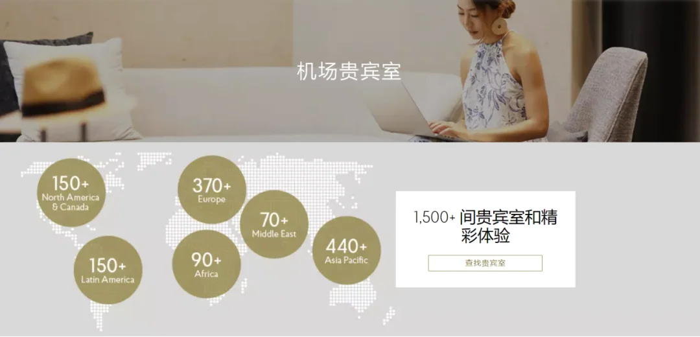

Er ya da geç hesap somutlaşır: üç saatlik bir aktarma, kapı yakınındaki tüm koltuklar dolu, restoranda kuyruk. Salon kapılarını açan bir kart o anda gerçekte ne kadar değerli? Orta ve üst segment kredi kartı sahipleri için havalimanı salonuna erişim genellikle üç kanaldan gelir — bankanın kendi salonu, DragonPass ve Priority Pass. İlk ikisi Çin anakarasında daha yoğundur; yurt dışında boşluğu genellikle üçüncüsü doldurur.

Priority Pass (PP) bir salon ağı ve dünyanın en büyük havalimanı salonu erişim sağlayıcısıdır. Nadiren kendi salonunu inşa eder; bağımsız ve havayolu işletmesindeki salonlarla sözleşme imzalar, ardından erişimi üyelikler ve banka avantajları aracılığıyla dağıtır. 2024 verilerine göre PP, 145 ülke ve bölgede 6.000'den fazla şehre yayılmış 1.500'den fazla ortak salon listeliyor. Kart sahipleri ücretsiz ya da ücret ödeyerek girer; kapı bölgesindeki bir koltuğu priz ve sıcak yemek sunan daha sakin bir yerle değiştirir.

## 1. Priority Pass ve Priority Pass Select

İki adı birbirinden ayırmak gerekir. Priority Pass, herkesin web sitesinden satın alabileceği perakende üyeliktir. Priority Pass Select (PPS) ise bir bankanın PP'den satın alıp kredi kartına bağladığı sürümdür. İkisi de aynı sözleşmeli salonları gösterir; girebileceğiniz salonlar birebir aynıdır. Tek fark, parayı kimin ödediği ve ne kadar ödediğidir.

Bu yüzden salona erişim özgürlüğünün pratik yolu üyelik değil, PPS taşıyan bir kredi kartıdır. Tartışmalara üyeliklerin değil kartların hâkim olmasının nedeni de bu: yıllık ücret genellikle başka avantajlar için ödenmiştir, salona giriş de yanında gelir.

## 2. Üç kademe: 99, 329 ve 469 dolar ne satın alır

PP üç kademe satar. Fiyat farkı tamamen üyenin kaç kez girebileceğinde yatıyor; misafir ücretleri üçünde de aynı.

| Kademe | Yıllık ücret | Üye girişi | Misafirler |
| --- | --- | --- | --- |
| Standart | 99 dolar | Ziyaret başına 35 dolar | Ziyaret başına kişi başı 35 dolar |
| Plus | 329 dolar | İlk 10 ziyaret ücretsiz, sonrasında her biri 35 dolar | Ziyaret başına kişi başı 35 dolar |
| Prestige | 469 dolar | Sınırsız | Ziyaret başına kişi başı 35 dolar |

Hesabı yapınca kademeler kendiliğinden yerine oturur. Standart'ta n ziyaret 99 + 35n dolar tutar; bu ancak on birinci ziyarette Prestige'in sabit 469 dolarını geçer. Plus on ücretsiz ziyaret içerir, dolayısıyla Standart'a karşı başabaş noktası yedinci ziyarettedir. Yılda on kez salona girmiyorsanız, doğrudan üyelik satın almak ucuz değildir. Daha net bir yargı: üç kademeden hiçbiri bireysel gezgin için iyi bir değer sunmaz. Perakende fiyat, indirim değil, istediğiniz zaman içeri girme hakkını satın alır.

## 3. Kredi kartı bu hakkı nasıl veriyor

Bankalar PPS'yi çok farklı biçimlerde çıkarır, ancak ortak noktalar şunlardır: avantaj genellikle yalnızca kart hamilini kapsar, misafirler ayrıca ücretlendirilir ve haklar gün yerine ziyaret olarak sayılır. Aşağıdaki tablo bankaların yaygın olarak çıkardığı kartları gösterir.

| Kart | Yıllık ücret | Salon avantajı |
| --- | --- | --- |
| CCB Dashanbai (Platin) | Puanla muaf tutulabilir | Ana ve ek kartlarda yılda 5'er ziyaret, yalnızca kart hamili |
| CEB World Elite paketi | İlk yıl 5.000 yuan, sonrasında 500.000 puanla muaf tutulabilir | Sınırsız |
| Minsheng Centurion Platin | 3.600 yuan (muafiyet yok) | Sınırsız; bir ek kart ücretsiz, o da sınırsız |
| CMB Centurion Platin | 3.600 yuan (muafiyet yok) | Sınırsız; ek kart yılda 1.800 yuan ve PP yok |
| BoCom World Elite | 4.800 yuan, 1,2 milyon puanla muaf tutulabilir | Ana kart sınırsız ve her ziyarette 3 misafir getirebilir; ek kart sınırsız, yalnızca kart hamili |
| Minsheng Centurion Black | 36.000 yuan (muafiyet yok) | Ana ve ek kartlarda sınırsız; ilk ek kart ücretsiz, diğerleri yılda 6.000 yuan |

Burada iki değişken önemli: yıllık ücretin puanla dengelenip dengelenemeyeceği ve avantajın yalnızca kart hamiline mi ait olduğu. CCB'nin Dashanbai'si düşük kullanım ve düşük maliyet seçeneğidir; yılda bir iki kez yurt dışına çıkan biri için uygundur. CEB'nin World Elite paketi en ucuz sınırsız yoldur, ancak yalnızca mevcut müşteriler için — elmas kart başvurusu artık World Elite ile birlikte gelmiyor. Minsheng ve CMB, Centurion Platin kartları için kesin olarak 3.600 yuan alır; fark ek karttadır: Minsheng ek kartı sınırsız PP ile ücretsiz verirken CMB, PP'si hiç olmayan bir kart için yılda 1.800 yuan alır. BoCom'un World Elite'i, avantaja “aileyi getir” hükmünü yazan ender kartlardan biridir; ana kartla her ziyarette üç misafir getirilebilir. 36.000 yuanlık Black kart ise bambaşka bir harcama segmentidir.

## 4. 2024 haritası: bölgesel sayılar ve önemli merkezler

PP'nin gücü küresel kapsamdır; zayıflığı Çin anakarasındaki yoğunluktur. Mart 2024 listesinde 73 anakara havalimanında ortak salon vardı — çoğu eyalet başkenti ve büyük turistik şehir, ancak yine de DragonPass'in gerisinde. Sekiz bölgesel listeyi tek tabloya sıkıştırmak, tablonun biçimi hakkında daha net bir fikir verir.

| Bölge | Listedeki havalimanı sayısı | Hatırlanmaya değer merkezler |
| --- | --- | --- |
| Çin anakarası | 73 | Pekin Başkent, Pekin Daxing, Şanghay Pudong, Şanghay Hongqiao, Guangzhou Baiyun, Shenzhen Bao'an, Chengdu Tianfu, Hangzhou Xiaoshan |
| Asya-Pasifik (Çin anakarası hariç) | 178 | Hong Kong, Singapur Changi, Seul Incheon, Tokyo Haneda, Osaka Kansai, Taipei Taoyuan, Bangkok Suvarnabhumi, Kuala Lumpur |
| Avrupa | 136 | Amsterdam, Paris CDG, Frankfurt, Münih, Roma, Madrid, Barselona, Zürih, Viyana, İstanbul |
| Birleşik Krallık ve İrlanda | 32 | Londra Heathrow, Londra Gatwick, Londra Stansted, Manchester, Edinburgh, Dublin |
| Orta Doğu | 31 | Dubai, Doha, Abu Dabi, Cidde, Riyad, Kuveyt, Maskat, Tel Aviv |
| Kuzey Amerika | 91 | Atlanta, Los Angeles, San Francisco, Seattle, Chicago O'Hare, Dallas-Fort Worth, Toronto, Vancouver |
| Latin Amerika ve Karayipler | 121 | Bogota, Lima, Panama City, San José, Buenos Aires |
| Afrika | 62 | Kahire, Johannesburg, Nairobi, Kazablanka, Addis Ababa, Lagos |

Sayılar her bölgesel ekran görüntüsünde görünen kayıtlardır, PP'nin resmî salon toplamı değildir ve Latin Amerika ekran görüntüsü 121. kayıtta kesilmiştir. Bir havalimanında genellikle birden fazla salon bulunur; “1.500 salon” ile “700 havalimanı”nın ikisinin de doğru olmasının nedeni budur. Listeler elle derlenmiştir; bir salonun bugün açık olup olmadığı hâlâ web sitesine veya uygulamaya sorulacak bir konudur.

## 5. Uygunluğu kontrol etmek, salon bulmak ve ters giden altı şey

Bir seyahatten önce iş üç adıma ayrılır: kartı veren kurumun uygulamasından kaç ziyaret kaldığını ve avantajın yalnızca kart hamiline ait olup olmadığını kontrol edin; PP uygulamasında havalimanı koduna göre terminali, hava tarafı veya kara tarafı konumunu ve çalışma saatlerini arayın; ardından salonu uçuş saatinizle karşılaştırın, çünkü bir kahve için terminalde yirmi dakika yürümek kötü bir takastır.

Sorunlar ayrıntılarda çıkar. Birincisi, her kayıt geleneksel bir salon değildir: bazı havalimanlarında ortak, hesaptan sabit bir tutar düşen bir restoran veya kafedir; self servis bir salondan farklı bir deneyimdir. İkincisi, yoğun saat kısıtlamaları yaygındır — akşam dalgaları dolduğunda gişe “üçüncü taraf girişi yok” tabelası koyar ve PPS sahipleri business sınıfı yolcuların arkasında kuyruğa girer. Üçüncüsü, çoğu ortak salon tek ziyareti biniş kartınızdaki saatten itibaren yaklaşık üç saatle sınırlar. Dördüncüsü, konum önemlidir: kara tarafı ve hava tarafı salonları birbirinin yerine geçmez, terminaller genellikle bağlantılı değildir ve aktarma sırasında yanlış bir dönüş sizi ne içeri ne de geri girebilir halde bırakabilir. Beşincisi, misafir kurallarını ziyaret sayılarından daha kolay gözden kaçırırsınız — perakende misafirler her kademede ziyaret başına kişi başı 35 dolar öder, bankaların çıkardığı çoğu PPS kartında ise hiç misafir hakkı yoktur. Altıncısı, sözleşmeler değişir: bir salon tadilat için kapanabilir veya ağdan çıkabilir, yani geçen yılki salon bu yıl orada olmayabilir.

## 6. Değer mi?

Üç durum. Yılda bir iki kez uçuyorsanız ve memleketinizdeki havalimanında PP salonu yoksa, bunun için tek başına kart çıkarmayın. Yılda dört beş kez Hong Kong, Singapur, Dubai, Seul Incheon veya Londra Heathrow gibi merkezlerden uçuyorsanız, sınırsız PP kartı ücretini geri kazanabilir — bu havalimanlarında iyi konumlarda bolca ortak salon vardır ve kapıdan giriş fiyatları düşük değildir. Aradaysanız, sabit ziyaret sayısı olan bir kartı tercih edin ve kullandığınız kadar ödeyin.

Kolayca gözden kaçan bir nokta: PP ve DragonPass birbirini tamamlar, rekabet etmez. DragonPass anakara havalimanlarında daha yoğundur, PP yurt dışında daha güvenilirdir. İkisine de sahipseniz, hangi ağın kalkış havalimanınızı kapsadığını kontrol etmek için harcanan iki dakika, kural kitabını ezberlemekten daha değerlidir.

## İlgili bağlantılar

- **Bu sitede**: [Londra Heathrow (LHR)](/airport/LHR), [Singapur Changi (SIN)](/airport/SIN), [Hong Kong Uluslararası (HKG)](/airport/HKG), [Dubai Uluslararası (DXB)](/airport/DXB), [Seul Incheon (ICN)](/airport/ICN)
- **Ülke sayfaları**: [Birleşik Krallık (GB)](/country/GB), [Singapur (SG)](/country/SG)
- **Wikipedia**: [Airport lounge](https://en.wikipedia.org/wiki/Airport_lounge), [Priority Pass](https://en.wikipedia.org/wiki/Priority_Pass)
- **Baidu Baike**: [Airport lounge](https://baike.baidu.com/item/%E6%9C%BA%E5%9C%BA%E8%B4%B5%E5%AE%BE%E5%AE%A4)

Görsel kaynağı: Priority Pass ve Luoluo Talks Cards derlemesi. Üyelik fiyatları, salon listeleri ve kart avantajları Mart 2024 itibarıyla kamuya açık bilgileri yansıtır ve o zamandan beri değişmiş olabilir; seyahatten önce Priority Pass web sitesini veya uygulamasını ve kartı veren kurumun güncel koşullarını kontrol edin.
