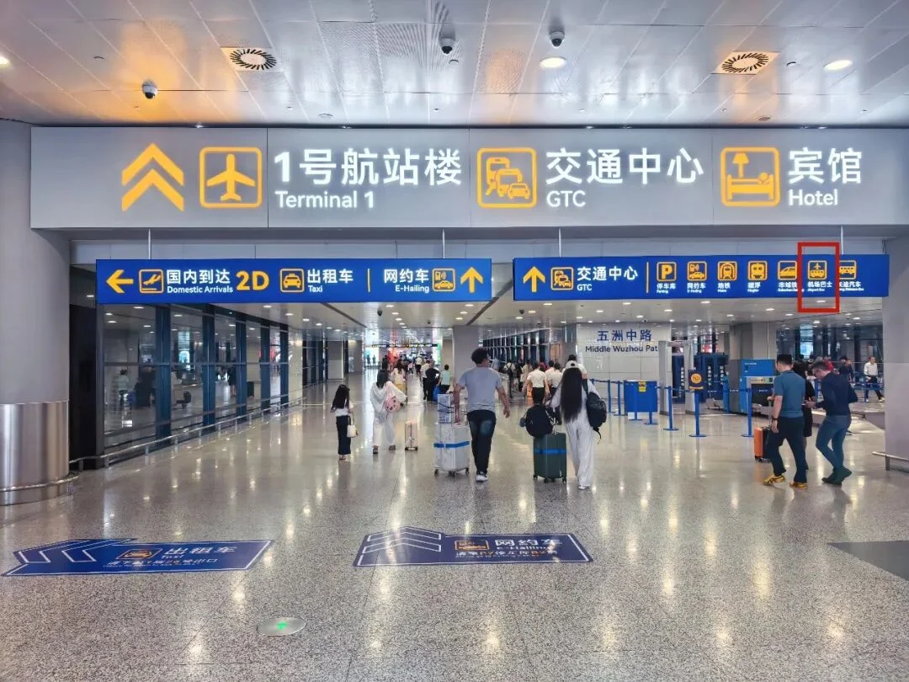
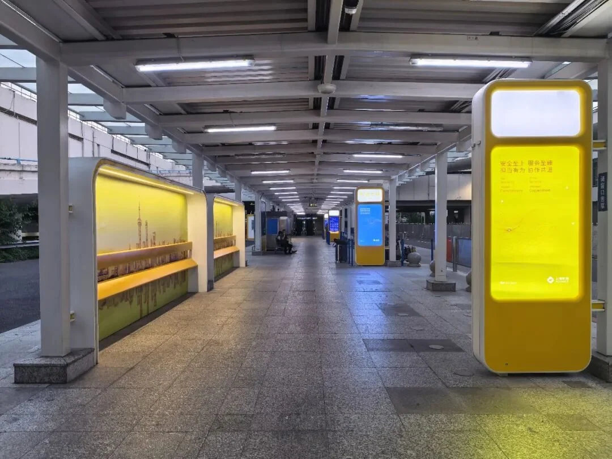
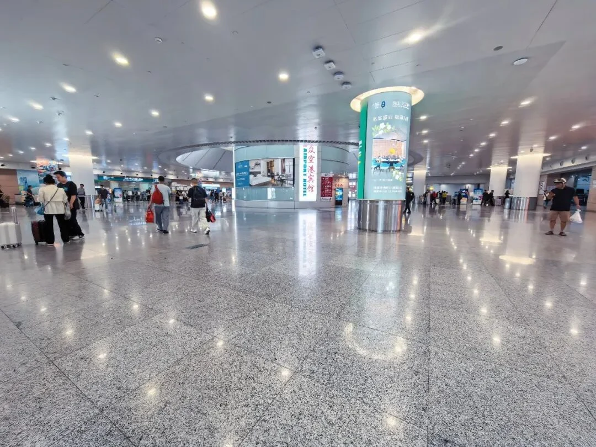

Národní svátek ČLR je už skoro tady, takže kdo plánuje cestu do Šanghaje, dávejte pozor.

Přilétáte na mezinárodní letiště Pudong — jak se rychle dostanete z terminálu 1 nebo 2 do metra, do taxíku nebo do autobusu směrem do města? Tady je dopravní průvodce — **vydání Mezinárodní letiště Pudong**. Podívejte se ↓

## Mezinárodní letiště Pudong — terminál 2

### Kde co je

Příletová úroveň terminálu 2 má **tři východy**: **ve druhém patře** východ z mezinárodních příletů a příletů z Hongkongu, Macaa a Tchaj-wanu a východ z vnitrostátních příletů; **v prvním patře** východ z vnitrostátních příletů.

Schéma ↓

Východ z mezinárodních příletů a příletů z Hongkongu, Macaa a Tchaj-wanu ve druhém patře ↓

Východ z vnitrostátních příletů ve druhém patře ↓

Východ z vnitrostátních příletů v prvním patře ↓

### Metro a vlak

**Odchod z východu mezinárodních příletů a příletů z Hongkongu, Macaa a Tchaj-wanu ve druhém patře nebo z východu vnitrostátních příletů**

Jděte podle značek stále rovně směrem k ulici Wuzhou Middle Road ↓

Jděte podle značek do přestupní haly: na jedné straně je vstup do **metra linky 2**, na druhé vstup na **maglev** ↓

Pokud jedete městskou železniční linkou **Airport Link**, jděte podle značek rovně a výtahem vyjeďte do přestupní haly ↓

**Odchod z východu vnitrostátních příletů v prvním patře**

**Nejprve výtahem vyjeďte do druhého patra**, pak jděte stejnou cestou k metru linky 2, maglevu nebo lince Airport Link ↓

### Taxi

Místo vyzvednutí taxíkem u terminálu 2 je **venku před terminálem v prvním patře** a má 26 nakládacích stání.

**Odchod z východu mezinárodních příletů a příletů z Hongkongu, Macaa a Tchaj-wanu ve druhém patře nebo z východu vnitrostátních příletů**

Jděte podle značek a sjeďte výtahem do prvního patra ↓

Projděte **branou 26** k místu vyzvednutí taxíkem ↓

**Odchod z východu vnitrostátních příletů v prvním patře**

Projděte **branou 26** k místu vyzvednutí taxíkem ↓

### Autobusy

**Odchod z východu mezinárodních příletů a příletů z Hongkongu, Macaa a Tchaj-wanu ve druhém patře nebo z východu vnitrostátních příletů**

Jděte podle značek stále rovně směrem k ulici Wuzhou Middle Road ↓

Jděte podle značek a výtahem sjeďte do čekárny autobusů ↓

Čekárna autobusů terminálu 2 obsluhuje letištní linku 4, letištní linku 7, letištní linku 8, letištní okružní linku 1 a noční službu Shouhang (z terminálu 2 do východního dopravního centra Hongqiao Hub, první a poslední odjezd 23:03 až 05:33 následujícího rána).

**Odchod z východu vnitrostátních příletů v prvním patře**

**Nejprve výtahem vyjeďte do druhého patra**, pak jděte výše popsanou cestou do čekárny autobusů ↓

## Mezinárodní letiště Pudong — terminál 1

### Kde co je

Příletová úroveň terminálu 1 má **dva východy**, oba **v prvním patře**: východ z mezinárodních příletů a příletů z Hongkongu, Macaa a Tchaj-wanu a východ z vnitrostátních příletů.

Schéma ↓

Východ z mezinárodních příletů a příletů z Hongkongu, Macaa a Tchaj-wanu v prvním patře ↓

Východ z vnitrostátních příletů v prvním patře ↓

### Metro a vlak

Pokud přilétáte na terminál 1 a chcete metro linky 2, maglev nebo linku Airport Link, vyjeďte výtahem **do druhého patra** ↓

Jděte podle značek rovně přes dveře ↓

Vstupte do přestupní haly: na jedné straně je vstup do **metra linky 2**, na druhé vstup na **maglev** ↓

Pokud jedete městskou železniční linkou **Airport Link**, jděte podle značek a výtahem sjeďte do přestupní haly ↓

### Taxi

Místo vyzvednutí taxíkem u terminálu 1 je **venku před terminálem v prvním patře** a má 20 nakládacích stání.

Pokud vycházíte **východem z vnitrostátních příletů**, přejděte k **bráně 4** a dostanete se k místu vyzvednutí taxíkem ↓

Pokud vycházíte **východem z mezinárodních příletů a příletů z Hongkongu, Macaa a Tchaj-wanu**, přejděte k **bráně 8** a dostanete se k místu vyzvednutí taxíkem ↓

### Autobusy

Čekárna autobusů terminálu 1 je **venku před terminálem v prvním patře** a obsluhuje letištní linku 4, letištní linku 7, letištní linku 8, letištní okružní linku 1 a noční službu Shouhang (z terminálu 1 do východního dopravního centra Hongqiao Hub, první a poslední odjezd 23:00 až 05:30 následujícího rána).

Pokud vycházíte **východem z vnitrostátních příletů**, přejděte k **bráně 4** a dostanete se do čekárny autobusů ↓

Pokud vycházíte **východem z mezinárodních příletů a příletů z Hongkongu, Macaa a Tchaj-wanu**, přejděte k **bráně 8** a dostanete se do čekárny autobusů ↓

PS: výše uvedené informace jsou orientační — aktuální situaci si prosím ověřte na místě.

Zdroje: Shanghai Airport Authority, Pudong International Airport

## Související odkazy

- **Na tomto webu**: [Mezinárodní letiště Šanghaj Pudong (PVG)](/airport/PVG), [Čína (CN)](/country/CN)
- **Wikipedie**: [Mezinárodní letiště Šanghaj Pudong](https://en.wikipedia.org/wiki/Shanghai_Pudong_International_Airport)
- **Baidu Baike**: [Mezinárodní letiště Šanghaj Pudong](https://baike.baidu.com/item/%E4%B8%8A%E6%B5%B7%E6%B5%A6%E4%B8%9C%E5%9B%BD%E9%99%85%E6%9C%BA%E5%9C%BA)
