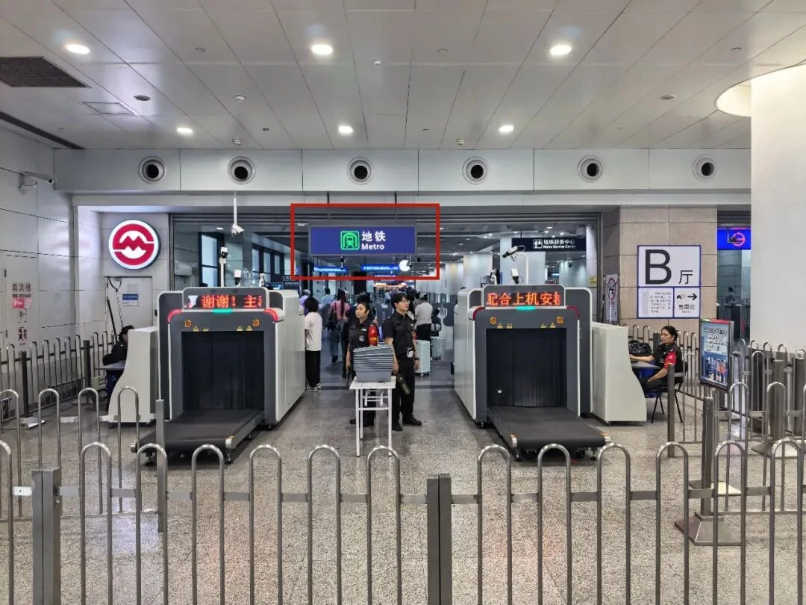
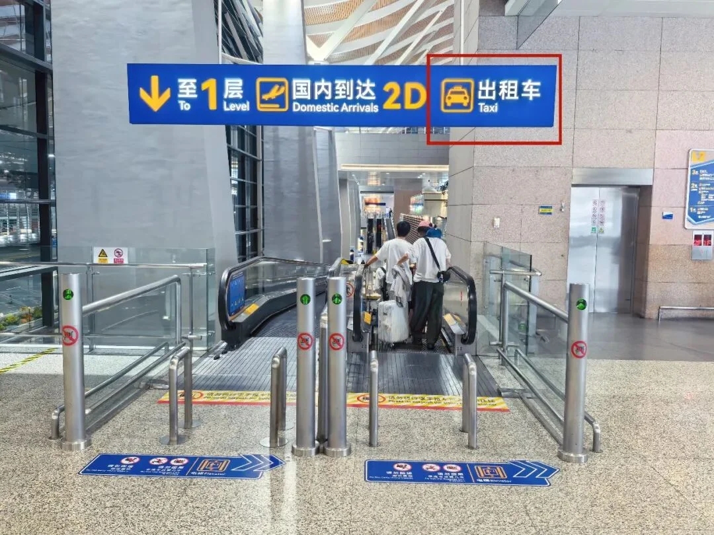
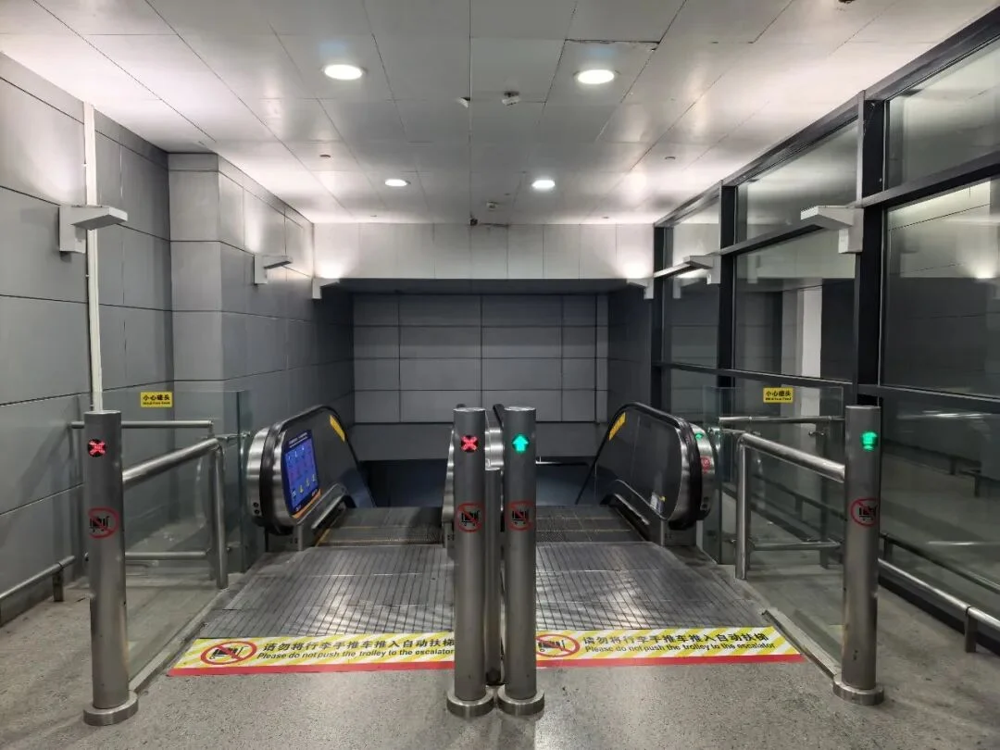
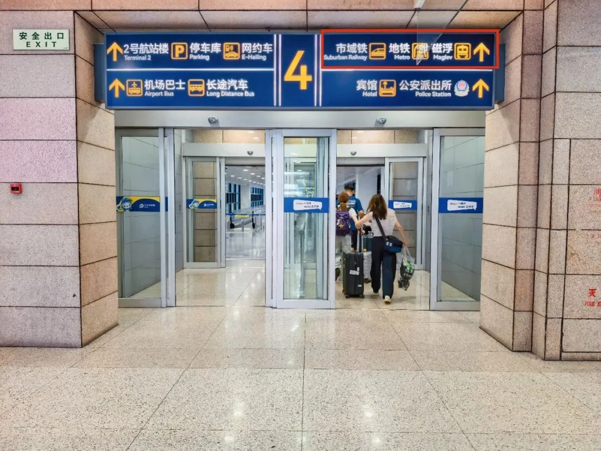
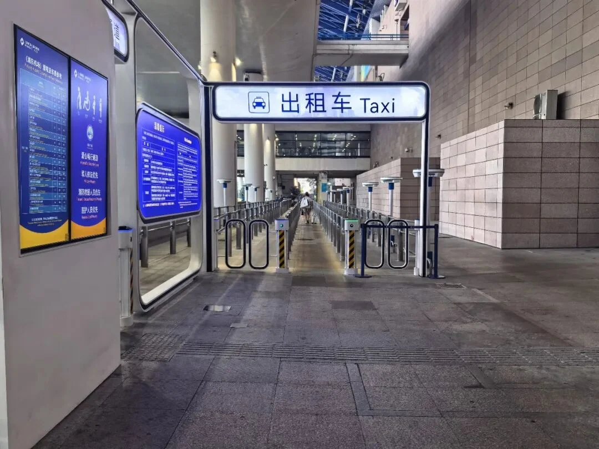

Las vacaciones del Día Nacional están a la vuelta de la esquina, así que quien tenga pensado viajar a Shanghái, que preste atención.

Al llegar al Aeropuerto Internacional de Pudong, ¿cómo se pasa rápido de la Terminal 1 o la Terminal 2 al metro, a un taxi o a un autobús hacia la ciudad? Aquí está la guía de transporte: la **edición del Aeropuerto Internacional de Pudong**. Echa un vistazo ↓

## Aeropuerto Internacional de Pudong — Terminal 2

### Dónde está cada cosa

La planta de llegadas de la Terminal 2 tiene **tres salidas**: **en la segunda planta**, la salida de llegadas internacionales / Hong Kong, Macao y Taiwán y la salida de llegadas nacionales; **en la primera planta**, la salida de llegadas nacionales.

Esquema ↓

La salida de llegadas internacionales / Hong Kong, Macao y Taiwán en la segunda planta ↓

La salida de llegadas nacionales en la segunda planta ↓

La salida de llegadas nacionales en la primera planta ↓

### Metro y tren

**Saliendo por la salida internacional / Hong Kong, Macao y Taiwán de la segunda planta o por la salida nacional**

Sigue las indicaciones y camina recto hacia Wuzhou Middle Road ↓

Sigue las indicaciones hasta la sala de transbordo: a un lado está la entrada de la **línea 2 del metro**, al otro la del **maglev** ↓

Si vas a tomar el **Airport Link**, la línea de ferrocarril urbano, sigue las indicaciones todo recto y sube en ascensor hasta la sala de transbordo ↓

**Saliendo por la salida nacional de la primera planta**

**Primero sube en ascensor a la segunda planta** y luego sigue la misma ruta hacia la línea 2 del metro, el maglev o el Airport Link ↓

### Taxi

El punto de recogida de taxis de la Terminal 2 está **fuera de la terminal, en la primera planta**, con 26 dársenas.

**Saliendo por la salida internacional / Hong Kong, Macao y Taiwán de la segunda planta o por la salida nacional**

Sigue las indicaciones y baja en ascensor a la primera planta ↓

Cruza la **puerta 26** para llegar al punto de recogida de taxis ↓

**Saliendo por la salida nacional de la primera planta**

Cruza la **puerta 26** para llegar al punto de recogida de taxis ↓

### Autobuses

**Saliendo por la salida internacional / Hong Kong, Macao y Taiwán de la segunda planta o por la salida nacional**

Sigue las indicaciones y camina recto hacia Wuzhou Middle Road ↓

Sigue las indicaciones y toma el ascensor hasta la zona de espera de autobuses ↓

La zona de espera de autobuses de la Terminal 2 da servicio a la línea 4 del aeropuerto, la línea 7 del aeropuerto, la línea 8 del aeropuerto, la línea circular 1 del aeropuerto y el servicio nocturno Shouhang (de la Terminal 2 al Centro de Transporte Este del Hub de Hongqiao, con primeras y últimas salidas de 23:03 a 05:33 de la mañana siguiente).

**Saliendo por la salida nacional de la primera planta**

**Primero sube en ascensor a la segunda planta** y luego sigue la ruta anterior hasta la zona de espera de autobuses ↓

## Aeropuerto Internacional de Pudong — Terminal 1

### Dónde está cada cosa

La planta de llegadas de la Terminal 1 tiene **dos salidas**, ambas **en la primera planta**: la salida de llegadas internacionales / Hong Kong, Macao y Taiwán y la salida de llegadas nacionales.

Esquema ↓

La salida de llegadas internacionales / Hong Kong, Macao y Taiwán en la primera planta ↓

La salida de llegadas nacionales en la primera planta ↓

### Metro y tren

Si llegas a la Terminal 1 y quieres la línea 2 del metro, el maglev o el Airport Link, sube en ascensor **a la segunda planta** ↓

Sigue las indicaciones y camina recto por la puerta ↓

Entra en la sala de transbordo: a un lado está la entrada de la **línea 2 del metro**, al otro la del **maglev** ↓

Si vas a tomar el **Airport Link**, la línea de ferrocarril urbano, sigue las indicaciones y sube en ascensor hasta la sala de transbordo ↓

### Taxi

El punto de recogida de taxis de la Terminal 1 está **fuera de la terminal, en la primera planta**, con 20 dársenas.

Saliendo por la **salida de llegadas nacionales**, cruza a la **puerta 4** para llegar al punto de recogida de taxis ↓

Saliendo por la **salida de llegadas internacionales / Hong Kong, Macao y Taiwán**, cruza a la **puerta 8** para llegar al punto de recogida de taxis ↓

### Autobuses

La zona de espera de autobuses de la Terminal 1 está **fuera de la terminal, en la primera planta**, y da servicio a la línea 4 del aeropuerto, la línea 7 del aeropuerto, la línea 8 del aeropuerto, la línea circular 1 del aeropuerto y el servicio nocturno Shouhang (de la Terminal 1 al Centro de Transporte Este del Hub de Hongqiao, con primeras y últimas salidas de 23:00 a 05:30 de la mañana siguiente).

Saliendo por la **salida de llegadas nacionales**, cruza a la **puerta 4** para llegar a la zona de espera de autobuses ↓

Saliendo por la **salida de llegadas internacionales / Hong Kong, Macao y Taiwán**, cruza a la **puerta 8** para llegar a la zona de espera de autobuses ↓

PD: la información anterior es orientativa; comprueba la situación sobre el terreno.

Algunas fuentes: Autoridad Aeroportuaria de Shanghái, Aeropuerto Internacional de Pudong

## Enlaces relacionados

- **En este sitio**: [Aeropuerto Internacional de Shanghái Pudong (PVG)](/airport/PVG), [China (CN)](/country/CN)
- **Wikipedia**: [Shanghai Pudong International Airport](https://en.wikipedia.org/wiki/Shanghai_Pudong_International_Airport)
- **Baidu Baike**: [Shanghai Pudong International Airport](https://baike.baidu.com/item/%E4%B8%8A%E6%B5%B7%E6%B5%A6%E4%B8%9C%E5%9B%BD%E9%99%85%E6%9C%BA%E5%9C%BA)
