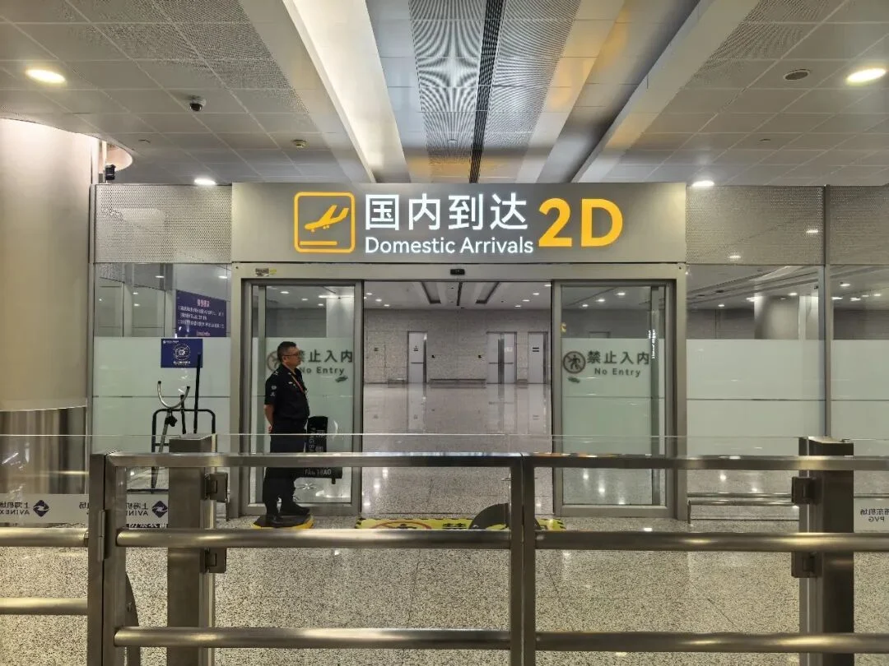
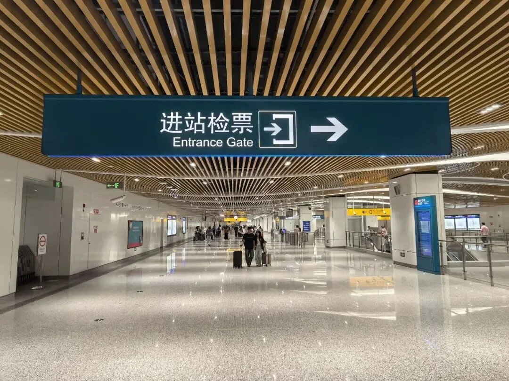
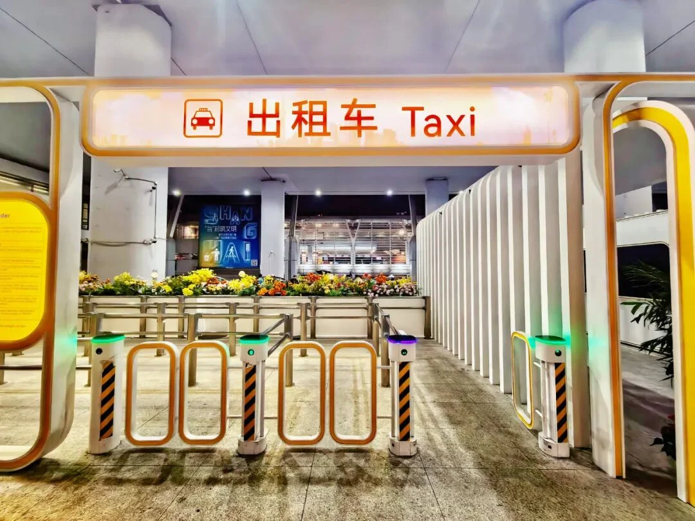
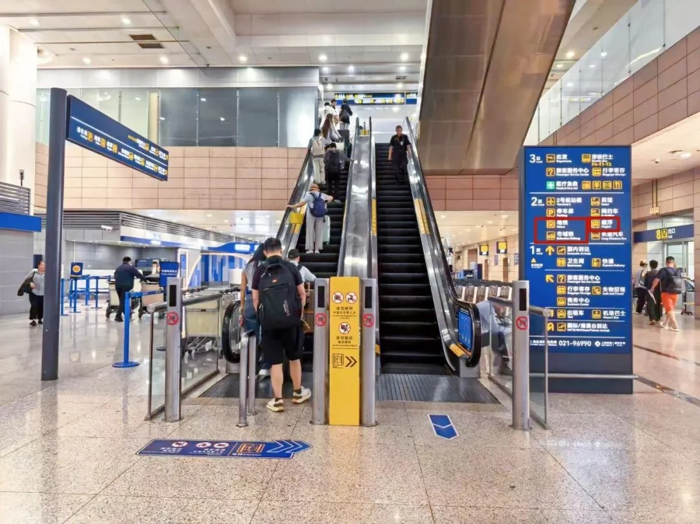
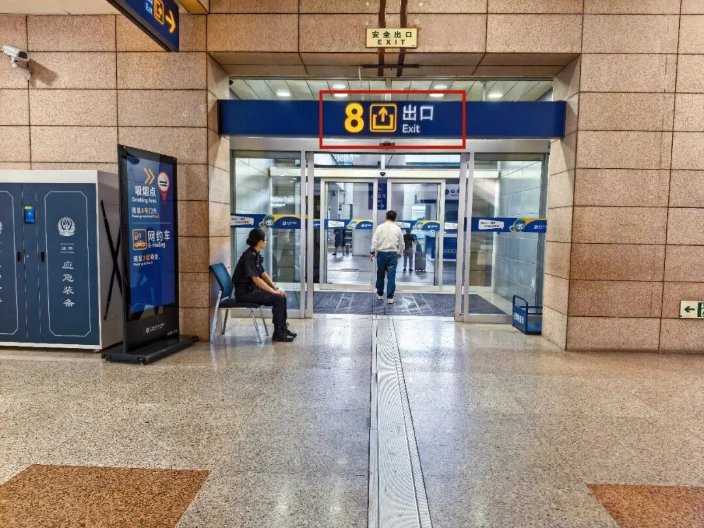

राष्ट्रीय दिवस की छुट्टी लगभग आ ही गई है, इसलिए शंघाई की यात्रा की योजना बनाने वाले ध्यान दें।

पुडोंग इंटरनेशनल एयरपोर्ट पर उतरकर आप टर्मिनल 1 या टर्मिनल 2 से जल्दी से मेट्रो, टैक्सी या बस पकड़कर शहर कैसे पहुँचेंगे? यह रही परिवहन गाइड — **पुडोंग इंटरनेशनल एयरपोर्ट संस्करण**। नीचे देखें ↓

## पुडोंग इंटरनेशनल एयरपोर्ट — टर्मिनल 2

### क्या कहाँ है

टर्मिनल 2 के आगमन स्तर पर **तीन निकास** हैं: **दूसरी मंज़िल पर**, अंतरराष्ट्रीय / हांगकांग, मकाओ और ताइवान आगमन निकास और घरेलू आगमन निकास; **पहली मंज़िल पर**, घरेलू आगमन निकास।

आरेख ↓

दूसरी मंज़िल पर अंतरराष्ट्रीय / हांगकांग, मकाओ और ताइवान आगमन निकास ↓

दूसरी मंज़िल पर घरेलू आगमन निकास ↓

पहली मंज़िल पर घरेलू आगमन निकास ↓

### मेट्रो और रेल

**दूसरी मंज़िल के अंतरराष्ट्रीय / हांगकांग, मकाओ और ताइवान निकास या घरेलू निकास से निकलना**

संकेतों का पालन करें और सीधे Wuzhou Middle Road की ओर चलें ↓

संकेतों का पालन करते हुए ट्रांसफ़र हॉल में जाएँ: एक ओर **मेट्रो लाइन 2** का प्रवेश है, दूसरी ओर **मैग्लेव** का प्रवेश ↓

अगर आप **एयरपोर्ट लिंक** सिटी रेल लाइन ले रहे हैं, तो संकेतों का पालन करते हुए सीधे आगे बढ़ें और लिफ़्ट से ट्रांसफ़र हॉल ऊपर जाएँ ↓

**पहली मंज़िल के घरेलू आगमन निकास से निकलना**

**पहले लिफ़्ट से दूसरी मंज़िल पर जाएँ**, फिर उसी रास्ते से मेट्रो लाइन 2, मैग्लेव या एयरपोर्ट लिंक तक जाएँ ↓

### टैक्सी

टर्मिनल 2 का टैक्सी पिक-अप पॉइंट **टर्मिनल के बाहर पहली मंज़िल पर** है, जहाँ 26 लोडिंग बे हैं।

**दूसरी मंज़िल के अंतरराष्ट्रीय / हांगकांग, मकाओ और ताइवान निकास या घरेलू निकास से निकलना**

संकेतों का पालन करें और लिफ़्ट से नीचे पहली मंज़िल पर जाएँ ↓

**गेट 26** से होकर टैक्सी पिक-अप पॉइंट तक पहुँचें ↓

**पहली मंज़िल के घरेलू आगमन निकास से निकलना**

**गेट 26** से होकर टैक्सी पिक-अप पॉइंट तक पहुँचें ↓

### बसें

**दूसरी मंज़िल के अंतरराष्ट्रीय / हांगकांग, मकाओ और ताइवान निकास या घरेलू निकास से निकलना**

संकेतों का पालन करें और सीधे Wuzhou Middle Road की ओर चलें ↓

संकेतों का पालन करें और लिफ़्ट से बस प्रतीक्षा क्षेत्र में जाएँ ↓

टर्मिनल 2 का बस प्रतीक्षा क्षेत्र एयरपोर्ट लाइन 4, एयरपोर्ट लाइन 7, एयरपोर्ट लाइन 8, एयरपोर्ट रिंग लाइन 1 और Shouhang ओवरनाइट सेवा (टर्मिनल 2 से Hongqiao Hub East Transport Centre तक, पहला और अंतिम प्रस्थान 23:03 से अगली सुबह 05:33 तक) को सेवा देता है।

**पहली मंज़िल के घरेलू आगमन निकास से निकलना**

**पहले लिफ़्ट से दूसरी मंज़िल पर जाएँ**, फिर ऊपर बताए रास्ते से बस प्रतीक्षा क्षेत्र तक जाएँ ↓

## पुडोंग इंटरनेशनल एयरपोर्ट — टर्मिनल 1

### क्या कहाँ है

टर्मिनल 1 के आगमन स्तर पर **दो निकास** हैं, दोनों **पहली मंज़िल पर**: अंतरराष्ट्रीय / हांगकांग, मकाओ और ताइवान आगमन निकास और घरेलू आगमन निकास।

आरेख ↓

पहली मंज़िल पर अंतरराष्ट्रीय / हांगकांग, मकाओ और ताइवान आगमन निकास ↓

पहली मंज़िल पर घरेलू आगमन निकास ↓

### मेट्रो और रेल

अगर आप टर्मिनल 1 पर उतरते हैं और मेट्रो लाइन 2, मैग्लेव या एयरपोर्ट लिंक चाहते हैं, तो लिफ़्ट से **दूसरी मंज़िल पर ऊपर** जाएँ ↓

संकेतों का पालन करें और दरवाज़े से होकर सीधे आगे चलें ↓

ट्रांसफ़र हॉल में कदम रखें: एक ओर **मेट्रो लाइन 2** का प्रवेश है, दूसरी ओर **मैग्लेव** का प्रवेश ↓

अगर आप **एयरपोर्ट लिंक** सिटी रेल लाइन ले रहे हैं, तो संकेतों का पालन करें और लिफ़्ट से ट्रांसफ़र हॉल जाएँ ↓

### टैक्सी

टर्मिनल 1 का टैक्सी पिक-अप पॉइंट **टर्मिनल के बाहर पहली मंज़िल पर** है, जहाँ 20 लोडिंग बे हैं।

**घरेलू आगमन निकास** से निकलकर **गेट 4** की ओर जाएँ और टैक्सी पिक-अप पॉइंट तक पहुँचें ↓

**अंतरराष्ट्रीय / हांगकांग, मकाओ और ताइवान आगमन निकास** से निकलकर **गेट 8** की ओर जाएँ और टैक्सी पिक-अप पॉइंट तक पहुँचें ↓

### बसें

टर्मिनल 1 का बस प्रतीक्षा क्षेत्र **टर्मिनल के बाहर पहली मंज़िल पर** है, जो एयरपोर्ट लाइन 4, एयरपोर्ट लाइन 7, एयरपोर्ट लाइन 8, एयरपोर्ट रिंग लाइन 1 और Shouhang ओवरनाइट सेवा (टर्मिनल 1 से Hongqiao Hub East Transport Centre तक, पहला और अंतिम प्रस्थान 23:00 से अगली सुबह 05:30 तक) को सेवा देता है।

**घरेलू आगमन निकास** से निकलकर **गेट 4** की ओर जाएँ और बस प्रतीक्षा क्षेत्र तक पहुँचें ↓

**अंतरराष्ट्रीय / हांगकांग, मकाओ और ताइवान आगमन निकास** से निकलकर **गेट 8** की ओर जाएँ और बस प्रतीक्षा क्षेत्र तक पहुँचें ↓

पुनश्च: ऊपर की जानकारी संदर्भ के लिए है — कृपया ज़मीन पर वास्तविक स्थिति जाँच लें।

कुछ स्रोत: Shanghai Airport Authority, Pudong International Airport

## संबंधित लिंक

- **इस साइट पर**: [Shanghai Pudong International Airport (PVG)](/airport/PVG), [चीन (CN)](/country/CN)
- **Wikipedia**: [Shanghai Pudong International Airport](https://en.wikipedia.org/wiki/Shanghai_Pudong_International_Airport)
- **Baidu Baike**: [Shanghai Pudong International Airport](https://baike.baidu.com/item/%E4%B8%8A%E6%B5%B7%E6%B5%A6%E4%B8%9C%E5%9B%BD%E9%99%85%E6%9C%BA%E5%9C%BA)
