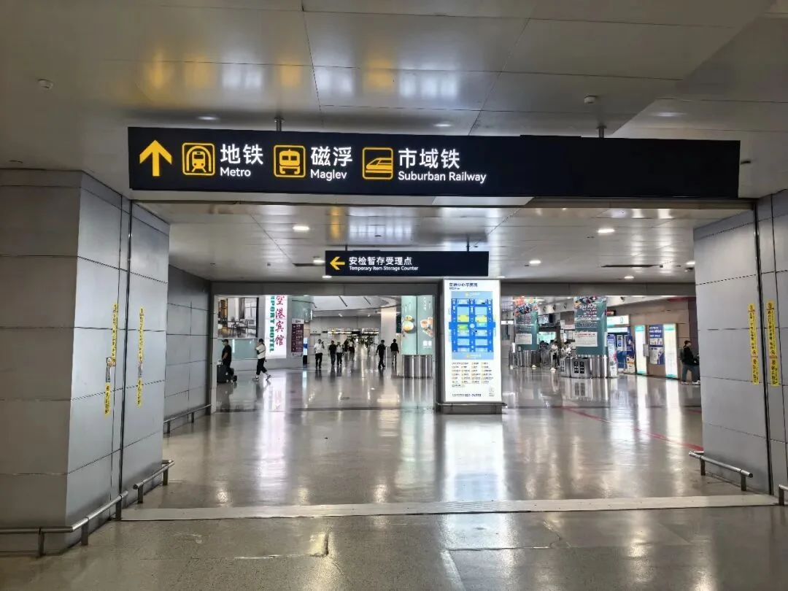

Libur Hari Nasional sudah hampir tiba, jadi siapa pun yang berencana bepergian ke Shanghai, perhatikan.

Setibanya di Bandara Internasional Pudong, bagaimana cara cepat dari Terminal 1 atau Terminal 2 ke metro, taksi, atau bus menuju kota? Inilah panduan transportasinya — **edisi Bandara Internasional Pudong**. Mari kita lihat ↓

## Bandara Internasional Pudong — Terminal 2

### Di mana letaknya

Lantai kedatangan Terminal 2 memiliki **tiga pintu keluar**: **di lantai dua**, pintu keluar kedatangan internasional / Hong Kong, Makau, dan Taiwan serta pintu keluar kedatangan domestik; **di lantai satu**, pintu keluar kedatangan domestik.

Diagram ↓

Pintu keluar kedatangan internasional / Hong Kong, Makau, dan Taiwan di lantai dua ↓

Pintu keluar kedatangan domestik di lantai dua ↓

Pintu keluar kedatangan domestik di lantai satu ↓

### Metro dan kereta

**Berangkat dari pintu keluar internasional / Hong Kong, Makau, dan Taiwan di lantai dua atau pintu keluar domestik**

Ikuti tanda dan berjalan lurus menuju Jalan Wuzhou Tengah ↓

Ikuti tanda masuk ke aula transfer: di satu sisi ada pintu masuk **Metro Jalur 2**, di sisi lain pintu masuk **Maglev** ↓

Jika Anda menggunakan jalur kereta kota **Airport Link**, ikuti tanda lurus ke depan dan naik lift ke aula transfer ↓

**Berangkat dari pintu keluar kedatangan domestik di lantai satu**

**Naik lift ke lantai dua terlebih dahulu**, lalu ikuti rute yang sama menuju Metro Jalur 2, Maglev, atau Airport Link ↓

### Taksi

Titik penjemputan taksi Terminal 2 berada **di luar terminal di lantai satu**, dengan 26 area naik.

**Berangkat dari pintu keluar internasional / Hong Kong, Makau, dan Taiwan di lantai dua atau pintu keluar domestik**

Ikuti tanda dan turun dengan lift ke lantai satu ↓

Lewati **Gerbang 26** untuk mencapai titik penjemputan taksi ↓

**Berangkat dari pintu keluar kedatangan domestik di lantai satu**

Lewati **Gerbang 26** untuk mencapai titik penjemputan taksi ↓

### Bus

**Berangkat dari pintu keluar internasional / Hong Kong, Makau, dan Taiwan di lantai dua atau pintu keluar domestik**

Ikuti tanda dan berjalan lurus menuju Jalan Wuzhou Tengah ↓

Ikuti tanda dan naik lift ke area tunggu bus ↓

Area tunggu bus Terminal 2 melayani Airport Line 4, Airport Line 7, Airport Line 8, Airport Ring Line 1, dan layanan semalam Shouhang (Terminal 2 ke Pusat Transportasi Timur Hub Hongqiao, keberangkatan pertama dan terakhir pukul 23.03 hingga 05.33 pagi berikutnya).

**Berangkat dari pintu keluar kedatangan domestik di lantai satu**

**Naik lift ke lantai dua terlebih dahulu**, lalu ikuti rute di atas menuju area tunggu bus ↓

## Bandara Internasional Pudong — Terminal 1

### Di mana letaknya

Lantai kedatangan Terminal 1 memiliki **dua pintu keluar**, keduanya **di lantai satu**: pintu keluar kedatangan internasional / Hong Kong, Makau, dan Taiwan serta pintu keluar kedatangan domestik.

Diagram ↓

Pintu keluar kedatangan internasional / Hong Kong, Makau, dan Taiwan di lantai satu ↓

Pintu keluar kedatangan domestik di lantai satu ↓

### Metro dan kereta

Jika Anda tiba di Terminal 1 dan ingin menggunakan Metro Jalur 2, Maglev, atau Airport Link, naik lift **ke lantai dua** ↓

Ikuti tanda dan berjalan lurus melewati pintu ↓

Masuklah ke aula transfer: di satu sisi ada pintu masuk **Metro Jalur 2**, di sisi lain pintu masuk **Maglev** ↓

Jika Anda menggunakan jalur kereta kota **Airport Link**, ikuti tanda dan naik lift ke aula transfer ↓

### Taksi

Titik penjemputan taksi Terminal 1 berada **di luar terminal di lantai satu**, dengan 20 area naik.

Dengan keluar melalui **pintu keluar kedatangan domestik**, seberangi ke **Gerbang 4** untuk mencapai titik penjemputan taksi ↓

Dengan keluar melalui **pintu keluar kedatangan internasional / Hong Kong, Makau, dan Taiwan**, seberangi ke **Gerbang 8** untuk mencapai titik penjemputan taksi ↓

### Bus

Area tunggu bus Terminal 1 berada **di luar terminal di lantai satu**, melayani Airport Line 4, Airport Line 7, Airport Line 8, Airport Ring Line 1, dan layanan semalam Shouhang (Terminal 1 ke Pusat Transportasi Timur Hub Hongqiao, keberangkatan pertama dan terakhir pukul 23.00 hingga 05.30 pagi berikutnya).

Dengan keluar melalui **pintu keluar kedatangan domestik**, seberangi ke **Gerbang 4** untuk mencapai area tunggu bus ↓

Dengan keluar melalui **pintu keluar kedatangan internasional / Hong Kong, Makau, dan Taiwan**, seberangi ke **Gerbang 8** untuk mencapai area tunggu bus ↓

PS: informasi di atas hanya untuk referensi — silakan periksa situasi di lapangan.

Beberapa sumber: Otoritas Bandara Shanghai, Bandara Internasional Pudong

## Tautan terkait

- **Di situs ini**: [Bandara Internasional Shanghai Pudong (PVG)](/airport/PVG), [Tiongkok (CN)](/country/CN)
- **Wikipedia**: [Shanghai Pudong International Airport](https://en.wikipedia.org/wiki/Shanghai_Pudong_International_Airport)
- **Baidu Baike**: [Shanghai Pudong International Airport](https://baike.baidu.com/item/%E4%B8%8A%E6%B5%B7%E6%B5%A6%E4%B8%9C%E5%9B%BD%E9%99%85%E6%9C%BA%E5%9C%BA)
