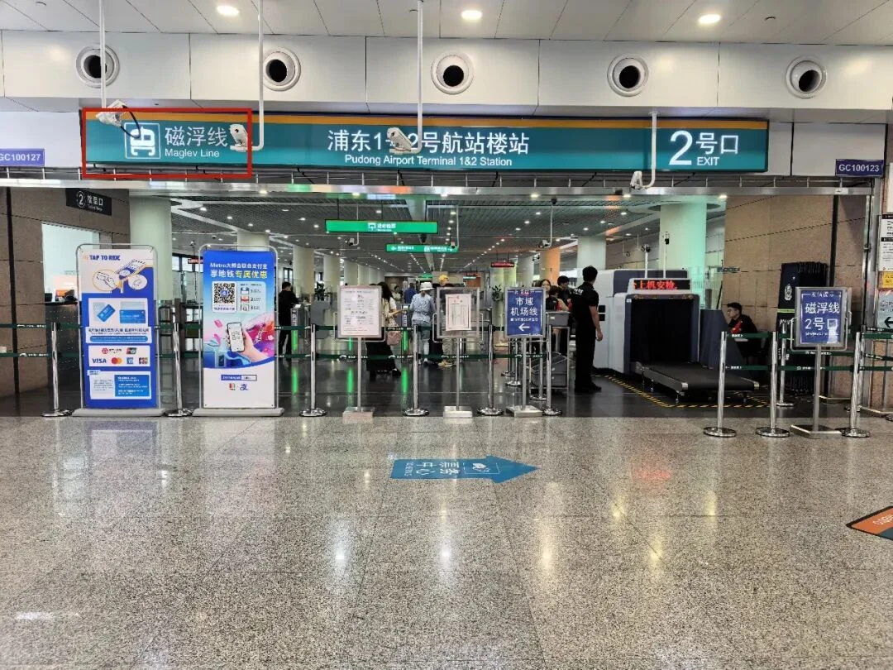

国慶節の連休が近づいています。上海への旅行を計画している人は注目してください。

浦東国際空港に到着したら、第1ターミナルや第2ターミナルから地下鉄、タクシー、バスで市内へ素早く移動するにはどうすればよいでしょうか。ここでは交通ガイドの**浦東国際空港編**をお届けします。ぜひご覧ください ↓

## 浦東国際空港 — 第2ターミナル

### 場所の確認

第2ターミナルの到着階には**3つの出口**があります。**2階**には国際線・香港・マカオ・台湾線の到着出口と国内線の到着出口、**1階**には国内線の到着出口があります。

図 ↓

2階の国際線・香港・マカオ・台湾線の到着出口 ↓

2階の国内線到着出口 ↓

1階の国内線到着出口 ↓

### 地下鉄と鉄道

**2階の国際線・香港・マカオ・台湾線の出口、または国内線の出口から出る場合**

表示に従って、五洲中路方面へまっすぐ進みます ↓

表示に従って乗り換えホールへ入ります。片側が**地下鉄2号線**の入口、もう片側が**リニアモーターカー（マグレブ）**の入口です ↓

**空港連絡鉄道（Airport Link）**を利用する場合は、表示に従ってまっすぐ進み、エレベーターで乗り換えホールへ上がります ↓

**1階の国内線到着出口から出る場合**

**まずエレベーターで2階へ上がってください**。あとは同じルートで地下鉄2号線、リニアモーターカー、空港連絡鉄道へ向かいます ↓

### タクシー

第2ターミナルのタクシー乗り場は**ターミナル外の1階**にあり、26の乗車レーンがあります。

**2階の国際線・香港・マカオ・台湾線の出口、または国内線の出口から出る場合**

表示に従い、エレベーターで1階へ下ります ↓

**26番ゲート**を通ってタクシー乗り場へ ↓

**1階の国内線到着出口から出る場合**

**26番ゲート**を通ってタクシー乗り場へ ↓

### バス

**2階の国際線・香港・マカオ・台湾線の出口、または国内線の出口から出る場合**

表示に従って、五洲中路方面へまっすぐ進みます ↓

表示に従い、エレベーターでバス待合エリアへ ↓

第2ターミナルのバス待合エリアからは、空港4号線、空港7号線、空港8号線、空港環状1号線、そして首航の夜間便（第2ターミナル〜虹橋ハブ東交通センター、始発・終発23:03〜翌朝05:33）が発着します。

**1階の国内線到着出口から出る場合**

**まずエレベーターで2階へ上がり**、そのあと上記のルートでバス待合エリアへ ↓

## 浦東国際空港 — 第1ターミナル

### 場所の確認

第1ターミナルの到着階には**2つの出口**があり、どちらも**1階**です。国際線・香港・マカオ・台湾線の到着出口と国内線の到着出口です。

図 ↓

1階の国際線・香港・マカオ・台湾線の到着出口 ↓

1階の国内線到着出口 ↓

### 地下鉄と鉄道

第1ターミナルに到着し、地下鉄2号線、リニアモーターカー、空港連絡鉄道を利用する場合は、エレベーターで**2階へ上がって**ください ↓

表示に従ってドアを抜けてまっすぐ進みます ↓

乗り換えホールに入ると、片側が**地下鉄2号線**の入口、もう片側が**リニアモーターカー**の入口です ↓

**空港連絡鉄道**を利用する場合は、表示に従ってエレベーターで乗り換えホールへ ↓

### タクシー

第1ターミナルのタクシー乗り場は**ターミナル外の1階**にあり、20の乗車レーンがあります。

**国内線到着出口**から出る場合は、**4番ゲート**を渡ってタクシー乗り場へ ↓

**国際線・香港・マカオ・台湾線の到着出口**から出る場合は、**8番ゲート**を渡ってタクシー乗り場へ ↓

### バス

第1ターミナルのバス待合エリアは**ターミナル外の1階**にあり、空港4号線、空港7号線、空港8号線、空港環状1号線、首航の夜間便（第1ターミナル〜虹橋ハブ東交通センター、始発・終発23:00〜翌朝05:30）が発着します。

**国内線到着出口**から出る場合は、**4番ゲート**を渡ってバス待合エリアへ ↓

**国際線・香港・マカオ・台湾線の到着出口**から出る場合は、**8番ゲート**を渡ってバス待合エリアへ ↓

PS：以上の情報は参考です。現地の状況をご確認ください。

資料：上海機場（集団）有限公司、浦東国際空港

## 関連リンク

- **このサイト内**：[上海浦東国際空港 (PVG)](/airport/PVG)、[中国 (CN)](/country/CN)
- **Wikipedia**：[上海浦東国際空港](https://en.wikipedia.org/wiki/Shanghai_Pudong_International_Airport)
- **百度百科**：[上海浦東国際空港](https://baike.baidu.com/item/%E4%B8%8A%E6%B5%B7%E6%B5%A6%E4%B8%9C%E5%9B%BD%E9%99%85%E6%9C%BA%E5%9C%BA)
