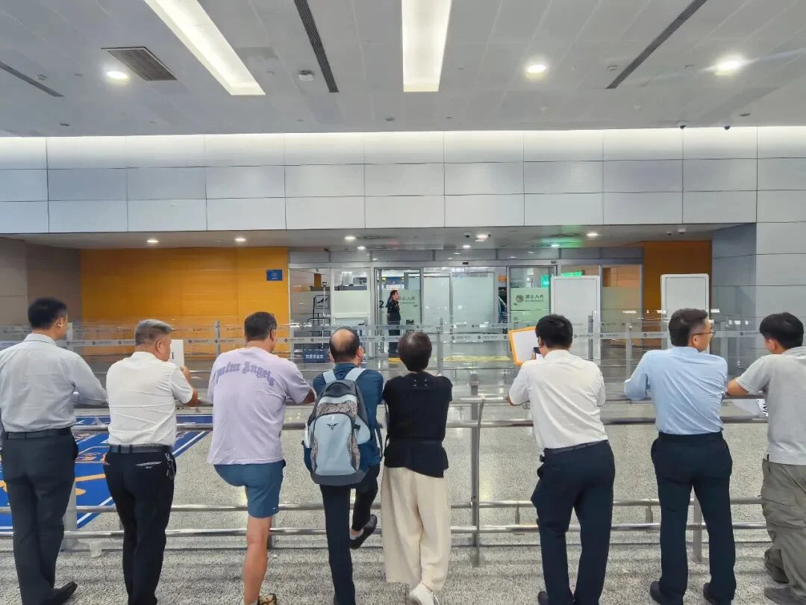
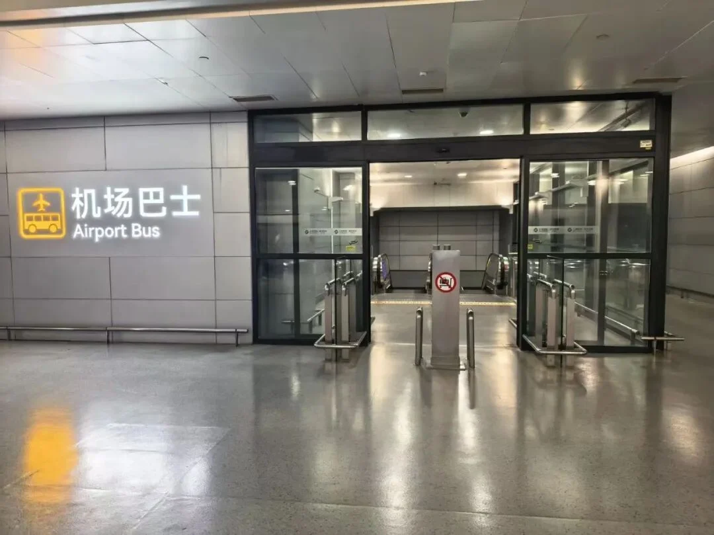
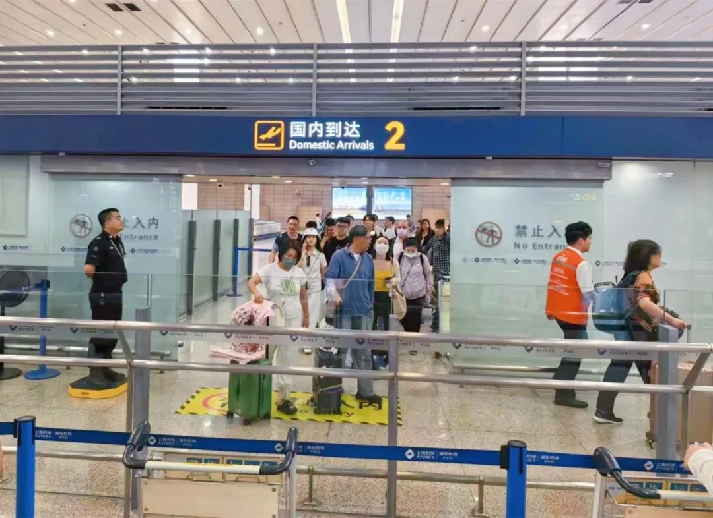
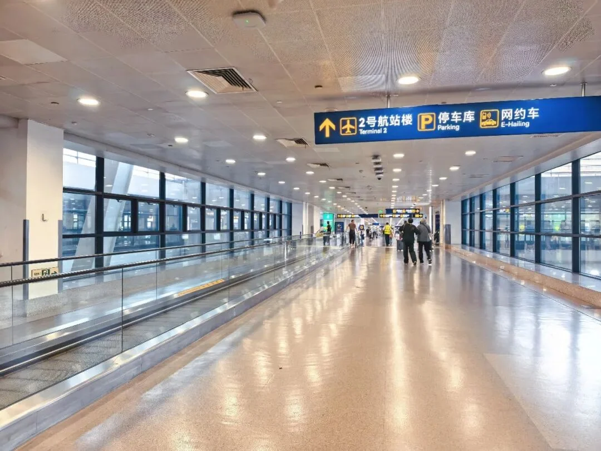

De Nationale Dagvakantie staat voor de deur, dus wie een reis naar Shanghai plant, moet opletten.

Na aankomst op Pudong International Airport: hoe komt u snel vanaf Terminal 1 of Terminal 2 in de metro, in een taxi of in een bus naar de stad? Hier is de vervoersgids — de **editie Pudong International Airport**. Kijk maar ↓

## Pudong International Airport — Terminal 2

### Waar alles ligt

De aankomstverdieping van Terminal 2 heeft **drie uitgangen**: **op de tweede verdieping** de uitgang voor internationale aankomsten en aankomsten uit Hongkong, Macau en Taiwan, plus de uitgang voor binnenlandse aankomsten; **op de eerste verdieping** de uitgang voor binnenlandse aankomsten.

Plattegrond ↓

De uitgang voor internationale aankomsten en aankomsten uit Hongkong, Macau en Taiwan op de tweede verdieping ↓

De uitgang voor binnenlandse aankomsten op de tweede verdieping ↓

De uitgang voor binnenlandse aankomsten op de eerste verdieping ↓

### Metro en trein

**Vanuit de uitgang op de tweede verdieping voor internationale aankomsten en aankomsten uit Hongkong, Macau en Taiwan of vanuit de binnenlandse uitgang**

Volg de borden en loop rechtdoor richting Wuzhou Middle Road ↓

Volg de borden naar de overstaphal: aan de ene kant is de ingang van **metrolijn 2**, aan de andere die van de **Maglev** ↓

Als u de stadsrailverbinding **Airport Link** neemt, volgt u de borden rechtdoor en neemt u de lift naar de overstaphal ↓

**Vanuit de uitgang voor binnenlandse aankomsten op de eerste verdieping**

**Neem eerst de lift naar de tweede verdieping** en volg dan dezelfde route naar metrolijn 2, de Maglev of de Airport Link ↓

### Taxi

Het taxiophaalpunt van Terminal 2 ligt **buiten de terminal op de eerste verdieping**, met 26 opstelplaatsen voor taxi's.

**Vanuit de uitgang op de tweede verdieping voor internationale aankomsten en aankomsten uit Hongkong, Macau en Taiwan of vanuit de binnenlandse uitgang**

Volg de borden en neem de lift naar de eerste verdieping ↓

Ga door **Gate 26** naar het taxiophaalpunt ↓

**Vanuit de uitgang voor binnenlandse aankomsten op de eerste verdieping**

Ga door **Gate 26** naar het taxiophaalpunt ↓

### Bussen

**Vanuit de uitgang op de tweede verdieping voor internationale aankomsten en aankomsten uit Hongkong, Macau en Taiwan of vanuit de binnenlandse uitgang**

Volg de borden en loop rechtdoor richting Wuzhou Middle Road ↓

Volg de borden en neem de lift naar de wachtruimte voor bussen ↓

De buswachtruimte van Terminal 2 bedient Airport Line 4, Airport Line 7, Airport Line 8, Airport Ring Line 1 en de Shouhang-nachtdienst (Terminal 2 naar Hongqiao Hub East Transport Centre, eerste en laatste vertrek 23:03 tot 05:33 de volgende ochtend).

**Vanuit de uitgang voor binnenlandse aankomsten op de eerste verdieping**

**Neem eerst de lift naar de tweede verdieping** en volg dan de bovenstaande route naar de wachtruimte voor bussen ↓

## Pudong International Airport — Terminal 1

### Waar alles ligt

De aankomstverdieping van Terminal 1 heeft **twee uitgangen**, beide **op de eerste verdieping**: de uitgang voor internationale aankomsten en aankomsten uit Hongkong, Macau en Taiwan, en de uitgang voor binnenlandse aankomsten.

Plattegrond ↓

De uitgang voor internationale aankomsten en aankomsten uit Hongkong, Macau en Taiwan op de eerste verdieping ↓

De uitgang voor binnenlandse aankomsten op de eerste verdieping ↓

### Metro en trein

Als u op Terminal 1 aankomt en metrolijn 2, de Maglev of de Airport Link wilt nemen, neemt u de lift **naar de tweede verdieping** ↓

Volg de borden en loop rechtdoor door de deur ↓

Stap de overstaphal binnen: aan de ene kant is de ingang van **metrolijn 2**, aan de andere die van de **Maglev** ↓

Als u de stadsrailverbinding **Airport Link** neemt, volgt u de borden en neemt u de lift naar de overstaphal ↓

### Taxi

Het taxiophaalpunt van Terminal 1 ligt **buiten de terminal op de eerste verdieping**, met 20 opstelplaatsen voor taxi's.

Als u de **binnenlandse uitgang** neemt, steekt u over naar **Gate 4** om bij het taxiophaalpunt te komen ↓

Als u de **uitgang voor internationale aankomsten en aankomsten uit Hongkong, Macau en Taiwan** neemt, steekt u over naar **Gate 8** om bij het taxiophaalpunt te komen ↓

### Bussen

De buswachtruimte van Terminal 1 ligt **buiten de terminal op de eerste verdieping** en bedient Airport Line 4, Airport Line 7, Airport Line 8, Airport Ring Line 1 en de Shouhang-nachtdienst (Terminal 1 naar Hongqiao Hub East Transport Centre, eerste en laatste vertrek 23:00 tot 05:30 de volgende ochtend).

Als u de **binnenlandse uitgang** neemt, steekt u over naar **Gate 4** om bij de wachtruimte voor bussen te komen ↓

Als u de **uitgang voor internationale aankomsten en aankomsten uit Hongkong, Macau en Taiwan** neemt, steekt u over naar **Gate 8** om bij de wachtruimte voor bussen te komen ↓

PS: de bovenstaande informatie is bedoeld als referentie — controleer de situatie ter plaatse.

Enkele bronnen: Shanghai Airport Authority, Pudong International Airport

## Gerelateerde links

- **Op deze site**: [Shanghai Pudong International Airport (PVG)](/airport/PVG), [China (CN)](/country/CN)
- **Wikipedia**: [Shanghai Pudong International Airport](https://en.wikipedia.org/wiki/Shanghai_Pudong_International_Airport)
- **Baidu Baike**: [Shanghai Pudong International Airport](https://baike.baidu.com/item/%E4%B8%8A%E6%B5%B7%E6%B5%A6%E4%B8%9C%E5%9B%BD%E9%99%85%E6%9C%BA%E5%9C%BA)
