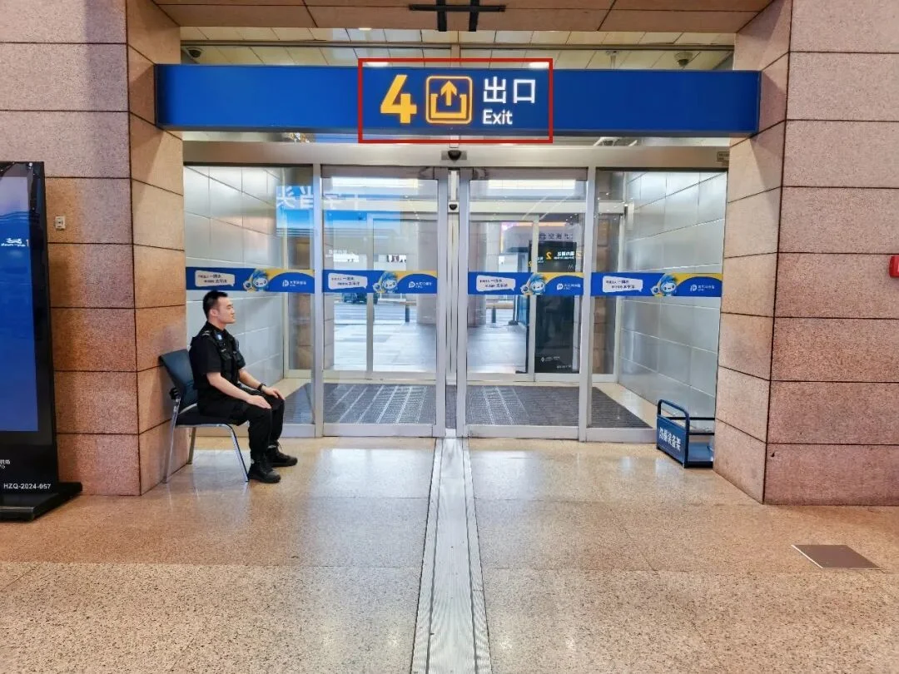

Święto Narodowe tuż tuż, więc wszyscy, którzy planują podróż do Szanghaju — uwaga.

Przylatujesz na międzynarodowe lotnisko Pudong. Jak szybko dostać się z terminala 1 lub 2 do metra, taksówki albo autobusu jadącego do miasta? Oto przewodnik transportowy — **wydanie poświęcone lotnisku Pudong**. Zobacz ↓

## Międzynarodowy port lotniczy Pudong — terminal 2

### Gdzie co jest

Poziom przylotów terminala 2 ma **trzy wyjścia**: **na drugim piętrze** wyjście dla przylotów międzynarodowych / z Hongkongu, Makau i Tajwanu oraz wyjście dla przylotów krajowych; **na pierwszym piętrze** wyjście dla przylotów krajowych.

Schemat ↓

Wyjście dla przylotów międzynarodowych / z Hongkongu, Makau i Tajwanu na drugim piętrze ↓

Wyjście dla przylotów krajowych na drugim piętrze ↓

Wyjście dla przylotów krajowych na pierwszym piętrze ↓

### Metro i kolej

**Wychodząc z drugiego piętra przez wyjście dla przylotów międzynarodowych / z Hongkongu, Makau i Tajwanu lub przez wyjście dla przylotów krajowych**

Idź za znakami prosto w kierunku Wuzhou Middle Road ↓

Idź za znakami do hali przesiadkowej: z jednej strony znajduje się wejście do **metra linii 2**, z drugiej wejście do **Maglevu** ↓

Jeśli jedziesz miejską koleją **Airport Link**, idź za znakami prosto i wjedź windą do hali przesiadkowej ↓

**Z wyjścia dla przylotów krajowych na pierwszym piętrze**

**Najpierw wjedź windą na drugie piętro**, a następnie tą samą trasą do metra linii 2, Maglevu lub Airport Link ↓

### Taksówka

Punkt odbioru taksówek terminala 2 znajduje się **na zewnątrz terminala, na pierwszym piętrze**, i liczy 26 stanowisk.

**Wychodząc z drugiego piętra przez wyjście dla przylotów międzynarodowych / z Hongkongu, Makau i Tajwanu lub przez wyjście dla przylotów krajowych**

Idź za znakami i zjedź windą na pierwsze piętro ↓

Przejdź przez **bramę 26**, aby dotrzeć do punktu odbioru taksówek ↓

**Z wyjścia dla przylotów krajowych na pierwszym piętrze**

Przejdź przez **bramę 26**, aby dotrzeć do punktu odbioru taksówek ↓

### Autobusy

**Wychodząc z drugiego piętra przez wyjście dla przylotów międzynarodowych / z Hongkongu, Makau i Tajwanu lub przez wyjście dla przylotów krajowych**

Idź za znakami prosto w kierunku Wuzhou Middle Road ↓

Idź za znakami i wjedź windą do poczekalni autobusowej ↓

Poczekalnia autobusowa terminala 2 obsługuje linię lotniskową 4, linię lotniskową 7, linię lotniskową 8, lotniskową linię okrężną 1 oraz nocny kurs Shouhang (terminal 2 – Hongqiao Hub East Transport Centre, pierwszy i ostatni odjazd 23:03–05:33 następnego ranka).

**Z wyjścia dla przylotów krajowych na pierwszym piętrze**

**Najpierw wjedź windą na drugie piętro**, a następnie przejdź opisaną wyżej trasą do poczekalni autobusowej ↓

## Międzynarodowy port lotniczy Pudong — terminal 1

### Gdzie co jest

Poziom przylotów terminala 1 ma **dwa wyjścia**, oba **na pierwszym piętrze**: wyjście dla przylotów międzynarodowych / z Hongkongu, Makau i Tajwanu oraz wyjście dla przylotów krajowych.

Schemat ↓

Wyjście dla przylotów międzynarodowych / z Hongkongu, Makau i Tajwanu na pierwszym piętrze ↓

Wyjście dla przylotów krajowych na pierwszym piętrze ↓

### Metro i kolej

Jeśli przylatujesz na terminal 1 i chcesz do metra linii 2, Maglevu lub Airport Link, wjedź windą **na drugie piętro** ↓

Idź za znakami prosto przez drzwi ↓

Wejdź do hali przesiadkowej: z jednej strony znajduje się wejście do **metra linii 2**, z drugiej wejście do **Maglevu** ↓

Jeśli jedziesz miejską koleją **Airport Link**, idź za znakami i wjedź windą do hali przesiadkowej ↓

### Taksówka

Punkt odbioru taksówek terminala 1 znajduje się **na zewnątrz terminala, na pierwszym piętrze**, i liczy 20 stanowisk.

Wychodząc **wyjściem dla przylotów krajowych**, przejdź do **bramy 4**, aby dotrzeć do punktu odbioru taksówek ↓

Wychodząc **wyjściem dla przylotów międzynarodowych / z Hongkongu, Makau i Tajwanu**, przejdź do **bramy 8**, aby dotrzeć do punktu odbioru taksówek ↓

### Autobusy

Poczekalnia autobusowa terminala 1 znajduje się **na zewnątrz terminala, na pierwszym piętrze** i obsługuje linię lotniskową 4, linię lotniskową 7, linię lotniskową 8, lotniskową linię okrężną 1 oraz nocny kurs Shouhang (terminal 1 – Hongqiao Hub East Transport Centre, pierwszy i ostatni odjazd 23:00–05:30 następnego ranka).

Wychodząc **wyjściem dla przylotów krajowych**, przejdź do **bramy 4**, aby dotrzeć do poczekalni autobusowej ↓

Wychodząc **wyjściem dla przylotów międzynarodowych / z Hongkongu, Makau i Tajwanu**, przejdź do **bramy 8**, aby dotrzeć do poczekalni autobusowej ↓

PS: powyższe informacje mają charakter poglądowy — sprawdź sytuację na miejscu.

Wybrane źródła: Shanghai Airport Authority, Pudong International Airport

## Powiązane linki

- **Na tej stronie**: [Port lotniczy Szanghaj Pudong (PVG)](/airport/PVG), [Chiny (CN)](/country/CN)
- **Wikipedia**: [Port lotniczy Szanghaj Pudong](https://en.wikipedia.org/wiki/Shanghai_Pudong_International_Airport)
- **Baidu Baike**: [Port lotniczy Szanghaj Pudong](https://baike.baidu.com/item/%E4%B8%8A%E6%B5%B7%E6%B5%A6%E4%B8%9C%E5%9B%BD%E9%99%85%E6%9C%BA%E5%9C%BA)
