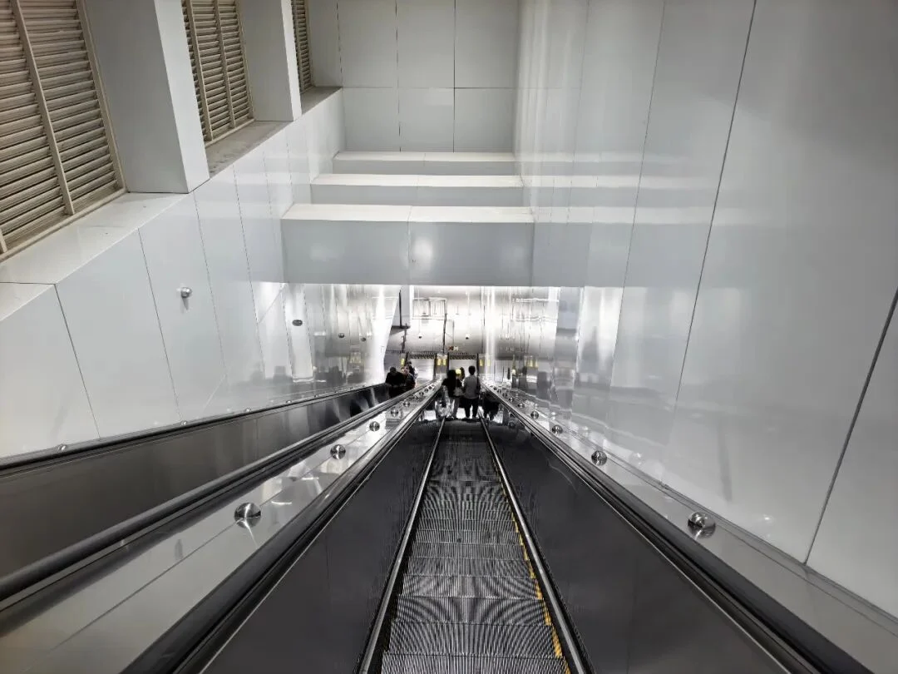
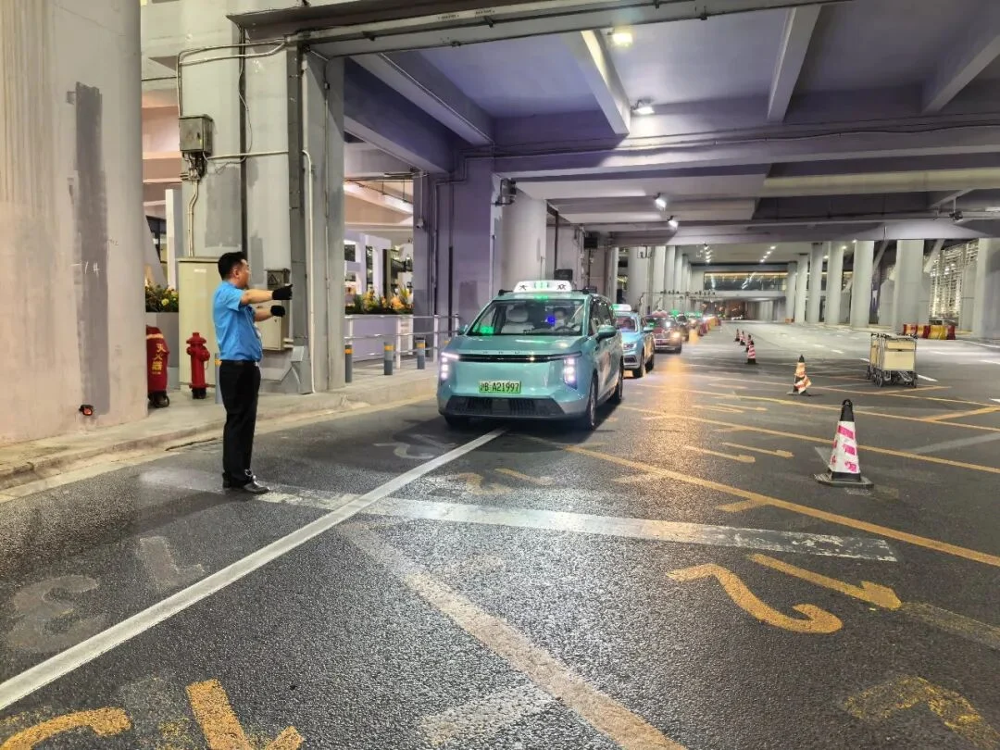
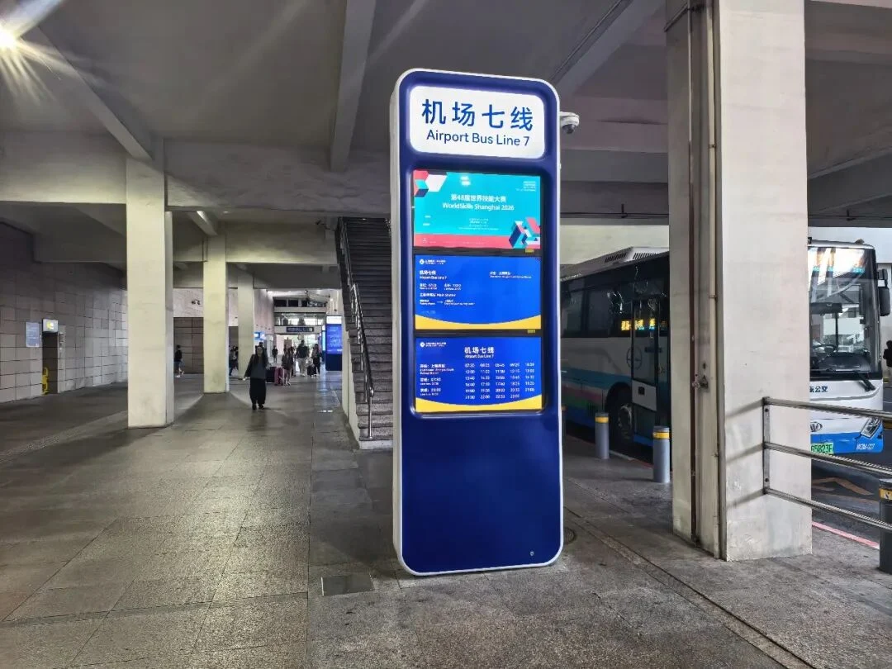

O feriado do Dia Nacional está chegando, então quem planeja uma viagem a Xangai, atenção.

Chegando ao Aeroporto Internacional de Pudong, como sair rápido do Terminal 1 ou do Terminal 2 para o metrô, para um táxi ou para um ônibus até a cidade? Aqui está o guia de transporte — a **edição Aeroporto Internacional de Pudong**. Dê uma olhada ↓

## Aeroporto Internacional de Pudong — Terminal 2

### Onde ficam as coisas

O nível de desembarque do Terminal 2 tem **três saídas**: **no segundo andar**, a saída de desembarque internacional / Hong Kong, Macau e Taiwan e a saída de desembarque doméstico; **no primeiro andar**, a saída de desembarque doméstico.

Diagrama ↓

A saída de desembarque internacional / Hong Kong, Macau e Taiwan no segundo andar ↓

A saída de desembarque doméstico no segundo andar ↓

A saída de desembarque doméstico no primeiro andar ↓

### Metrô e trem

**Saindo pela saída internacional / Hong Kong, Macau e Taiwan do segundo andar ou pela saída doméstica**

Siga as placas e caminhe em frente em direção à Wuzhou Middle Road ↓

Siga as placas até o saguão de transferência: de um lado fica a entrada da **Linha 2 do metrô**, do outro a entrada do **Maglev** ↓

Se você vai pegar o **Airport Link**, a linha ferroviária urbana, siga as placas em frente e pegue o elevador até o saguão de transferência ↓

**Saindo pela saída de desembarque doméstico do primeiro andar**

**Primeiro pegue o elevador até o segundo andar**, depois siga o mesmo caminho até a Linha 2 do metrô, o Maglev ou o Airport Link ↓

### Táxi

O ponto de táxi do Terminal 2 fica **do lado de fora do terminal, no primeiro andar**, com 26 vagas de embarque.

**Saindo pela saída internacional / Hong Kong, Macau e Taiwan do segundo andar ou pela saída doméstica**

Siga as placas e pegue o elevador até o primeiro andar ↓

Passe pelo **Portão 26** para chegar ao ponto de táxi ↓

**Saindo pela saída de desembarque doméstico do primeiro andar**

Passe pelo **Portão 26** para chegar ao ponto de táxi ↓

### Ônibus

**Saindo pela saída internacional / Hong Kong, Macau e Taiwan do segundo andar ou pela saída doméstica**

Siga as placas e caminhe em frente em direção à Wuzhou Middle Road ↓

Siga as placas e pegue o elevador até a área de espera dos ônibus ↓

A área de espera de ônibus do Terminal 2 atende a Linha 4 do Aeroporto, a Linha 7 do Aeroporto, a Linha 8 do Aeroporto, a Linha Circular do Aeroporto 1 e o serviço noturno Shouhang (do Terminal 2 ao Centro de Transporte Leste do Hub de Hongqiao, com primeira e última partidas das 23:03 às 05:33 da manhã seguinte).

**Saindo pela saída de desembarque doméstico do primeiro andar**

**Primeiro pegue o elevador até o segundo andar**, depois siga o caminho acima até a área de espera dos ônibus ↓

## Aeroporto Internacional de Pudong — Terminal 1

### Onde ficam as coisas

O nível de desembarque do Terminal 1 tem **duas saídas**, ambas **no primeiro andar**: a saída de desembarque internacional / Hong Kong, Macau e Taiwan e a saída de desembarque doméstico.

Diagrama ↓

A saída de desembarque internacional / Hong Kong, Macau e Taiwan no primeiro andar ↓

A saída de desembarque doméstico no primeiro andar ↓

### Metrô e trem

Se você chega ao Terminal 1 e quer a Linha 2 do metrô, o Maglev ou o Airport Link, pegue o elevador **até o segundo andar** ↓

Siga as placas e caminhe em frente pela porta ↓

Entre no saguão de transferência: de um lado fica a entrada da **Linha 2 do metrô**, do outro a entrada do **Maglev** ↓

Se você vai pegar o **Airport Link**, a linha ferroviária urbana, siga as placas e pegue o elevador até o saguão de transferência ↓

### Táxi

O ponto de táxi do Terminal 1 fica **do lado de fora do terminal, no primeiro andar**, com 20 vagas de embarque.

Saindo pela **saída de desembarque doméstico**, atravesse até o **Portão 4** para chegar ao ponto de táxi ↓

Saindo pela **saída de desembarque internacional / Hong Kong, Macau e Taiwan**, atravesse até o **Portão 8** para chegar ao ponto de táxi ↓

### Ônibus

A área de espera de ônibus do Terminal 1 fica **do lado de fora do terminal, no primeiro andar**, e atende a Linha 4 do Aeroporto, a Linha 7 do Aeroporto, a Linha 8 do Aeroporto, a Linha Circular do Aeroporto 1 e o serviço noturno Shouhang (do Terminal 1 ao Centro de Transporte Leste do Hub de Hongqiao, com primeira e última partidas das 23:00 às 05:30 da manhã seguinte).

Saindo pela **saída de desembarque doméstico**, atravesse até o **Portão 4** para chegar à área de espera dos ônibus ↓

Saindo pela **saída de desembarque internacional / Hong Kong, Macau e Taiwan**, atravesse até o **Portão 8** para chegar à área de espera dos ônibus ↓

PS: as informações acima são de referência — confira a situação no local.

Algumas fontes: Autoridade Aeroportuária de Xangai, Aeroporto Internacional de Pudong

## Links relacionados

- **Neste site**: [Aeroporto Internacional de Xangai-Pudong (PVG)](/airport/PVG), [China (CN)](/country/CN)
- **Wikipedia**: [Aeroporto Internacional de Xangai-Pudong](https://en.wikipedia.org/wiki/Shanghai_Pudong_International_Airport)
- **Baidu Baike**: [Aeroporto Internacional de Xangai-Pudong](https://baike.baidu.com/item/%E4%B8%8A%E6%B5%B7%E6%B5%A6%E4%B8%9C%E5%9B%BD%E9%99%85%E6%9C%BA%E5%9C%BA)
