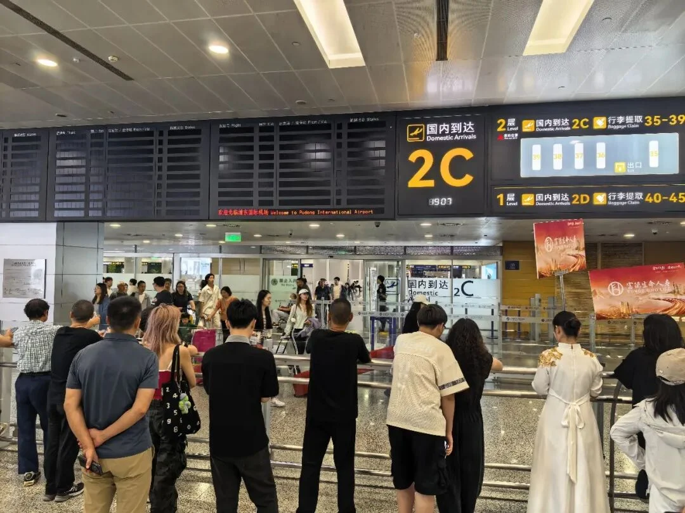
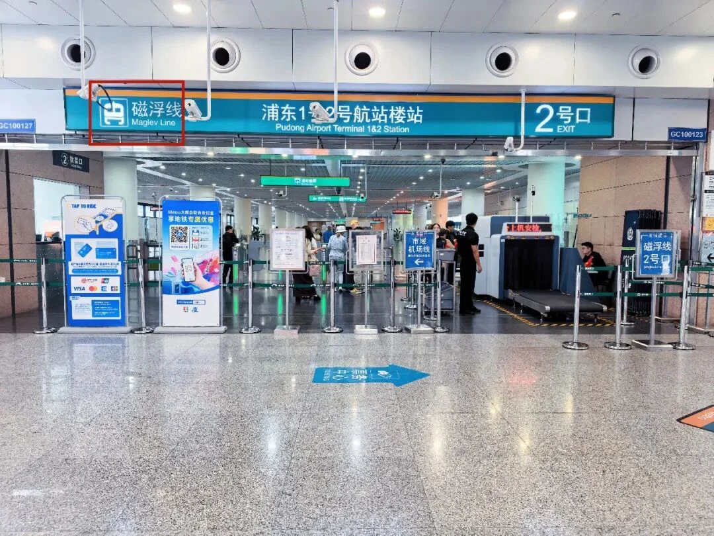
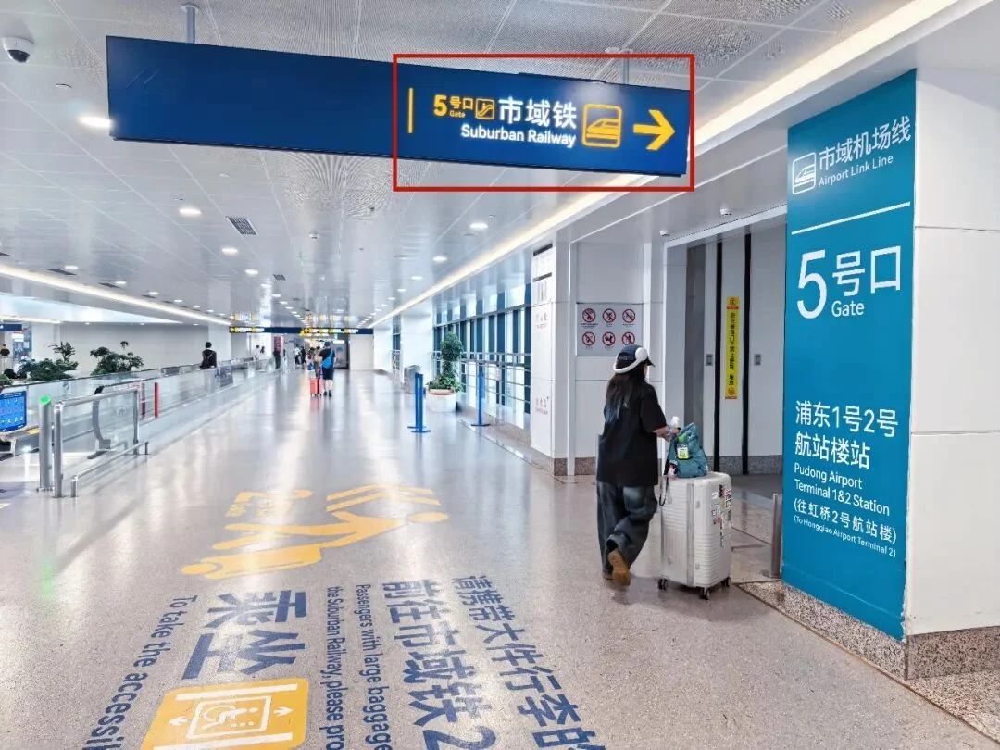

Sărbătoarea Națională este aproape, așa că toți cei care plănuiesc o călătorie la Shanghai, atenție.

Sosind la Aeroportul Internațional Pudong, cum ajungi repede din Terminalul 1 sau Terminalul 2 la metrou, într-un taxi sau într-un autobuz spre oraș? Iată ghidul de transport — **ediția Aeroportul Internațional Pudong**. Aruncă o privire ↓

## Aeroportul Internațional Pudong — Terminalul 2

### Unde se află fiecare lucru

Nivelul de sosiri al Terminalului 2 are **trei ieșiri**: **la etajul al doilea**, ieșirea pentru sosiri internaționale / Hong Kong, Macau și Taiwan și ieșirea pentru sosiri interne; **la primul etaj**, ieșirea pentru sosiri interne.

Schema ↓

Ieșirea pentru sosiri internaționale / Hong Kong, Macau și Taiwan de la etajul al doilea ↓

Ieșirea pentru sosiri interne de la etajul al doilea ↓

Ieșirea pentru sosiri interne de la primul etaj ↓

### Metrou și tren

**Dacă pleci de la ieșirea pentru sosiri internaționale / Hong Kong, Macau și Taiwan de la etajul al doilea sau de la ieșirea pentru sosiri interne**

Urmează indicatoarele și mergi drept înainte spre Wuzhou Middle Road ↓

Urmează indicatoarele în sala de transfer: pe o parte este intrarea la **Metroul Linia 2**, pe cealaltă intrarea la **Maglev** ↓

Dacă iei linia feroviară urbană **Airport Link**, urmează indicatoarele drept înainte și ia liftul în sus până la sala de transfer ↓

**Dacă pleci de la ieșirea pentru sosiri interne de la primul etaj**

**Ia mai întâi liftul în sus până la etajul al doilea**, apoi urmează același traseu spre Metroul Linia 2, Maglev sau Airport Link ↓

### Taxi

Punctul de preluare cu taxi al Terminalului 2 este **în afara terminalului, la primul etaj**, cu 26 de locuri de îmbarcare.

**Dacă pleci de la ieșirea pentru sosiri internaționale / Hong Kong, Macau și Taiwan de la etajul al doilea sau de la ieșirea pentru sosiri interne**

Urmează indicatoarele și ia liftul în jos până la primul etaj ↓

Treci prin **Poarta 26** pentru a ajunge la punctul de preluare cu taxi ↓

**Dacă pleci de la ieșirea pentru sosiri interne de la primul etaj**

Treci prin **Poarta 26** pentru a ajunge la punctul de preluare cu taxi ↓

### Autobuze

**Dacă pleci de la ieșirea pentru sosiri internaționale / Hong Kong, Macau și Taiwan de la etajul al doilea sau de la ieșirea pentru sosiri interne**

Urmează indicatoarele și mergi drept înainte spre Wuzhou Middle Road ↓

Urmează indicatoarele și ia liftul până la zona de așteptare a autobuzelor ↓

Zona de așteptare a autobuzelor din Terminalul 2 deservește Linia 4 de aeroport, Linia 7 de aeroport, Linia 8 de aeroport, Linia inelară 1 de aeroport și serviciul de noapte Shouhang (de la Terminalul 2 la Centrul de Transport Est din Hub-ul Hongqiao, primele și ultimele plecări între 23:03 și 05:33 dimineața).

**Dacă pleci de la ieșirea pentru sosiri interne de la primul etaj**

**Ia mai întâi liftul în sus până la etajul al doilea**, apoi urmează traseul de mai sus spre zona de așteptare a autobuzelor ↓

## Aeroportul Internațional Pudong — Terminalul 1

### Unde se află fiecare lucru

Nivelul de sosiri al Terminalului 1 are **două ieșiri**, ambele **la primul etaj**: ieșirea pentru sosiri internaționale / Hong Kong, Macau și Taiwan și ieșirea pentru sosiri interne.

Schema ↓

Ieșirea pentru sosiri internaționale / Hong Kong, Macau și Taiwan de la primul etaj ↓

Ieșirea pentru sosiri interne de la primul etaj ↓

### Metrou și tren

Dacă sosești în Terminalul 1 și vrei Metroul Linia 2, Maglev sau Airport Link, ia liftul **în sus până la etajul al doilea** ↓

Urmează indicatoarele și mergi drept înainte prin ușă ↓

Intră în sala de transfer: pe o parte este intrarea la **Metroul Linia 2**, pe cealaltă intrarea la **Maglev** ↓

Dacă iei linia feroviară urbană **Airport Link**, urmează indicatoarele și ia liftul până la sala de transfer ↓

### Taxi

Punctul de preluare cu taxi al Terminalului 1 este **în afara terminalului, la primul etaj**, cu 20 de locuri de îmbarcare.

Dacă pleci pe **ieșirea pentru sosiri interne**, traversează spre **Poarta 4** pentru a ajunge la punctul de preluare cu taxi ↓

Dacă pleci pe **ieșirea pentru sosiri internaționale / Hong Kong, Macau și Taiwan**, traversează spre **Poarta 8** pentru a ajunge la punctul de preluare cu taxi ↓

### Autobuze

Zona de așteptare a autobuzelor din Terminalul 1 este **în afara terminalului, la primul etaj**, și deservește Linia 4 de aeroport, Linia 7 de aeroport, Linia 8 de aeroport, Linia inelară 1 de aeroport și serviciul de noapte Shouhang (de la Terminalul 1 la Centrul de Transport Est din Hub-ul Hongqiao, primele și ultimele plecări între 23:00 și 05:30 dimineața).

Dacă pleci pe **ieșirea pentru sosiri interne**, traversează spre **Poarta 4** pentru a ajunge la zona de așteptare a autobuzelor ↓

Dacă pleci pe **ieșirea pentru sosiri internaționale / Hong Kong, Macau și Taiwan**, traversează spre **Poarta 8** pentru a ajunge la zona de așteptare a autobuzelor ↓

PS: informațiile de mai sus sunt orientative — verifică situația la fața locului.

Surse: Shanghai Airport Authority, Aeroportul Internațional Pudong

## Linkuri utile

- **Pe acest site**: [Aeroportul Internațional Shanghai Pudong (PVG)](/airport/PVG), [China (CN)](/country/CN)
- **Wikipedia**: [Aeroportul Internațional Shanghai Pudong](https://en.wikipedia.org/wiki/Shanghai_Pudong_International_Airport)
- **Baidu Baike**: [Aeroportul Internațional Shanghai Pudong](https://baike.baidu.com/item/%E4%B8%8A%E6%B5%B7%E6%B5%A6%E4%B8%9C%E5%9B%BD%E9%99%85%E6%9C%BA%E5%9C%BA)
