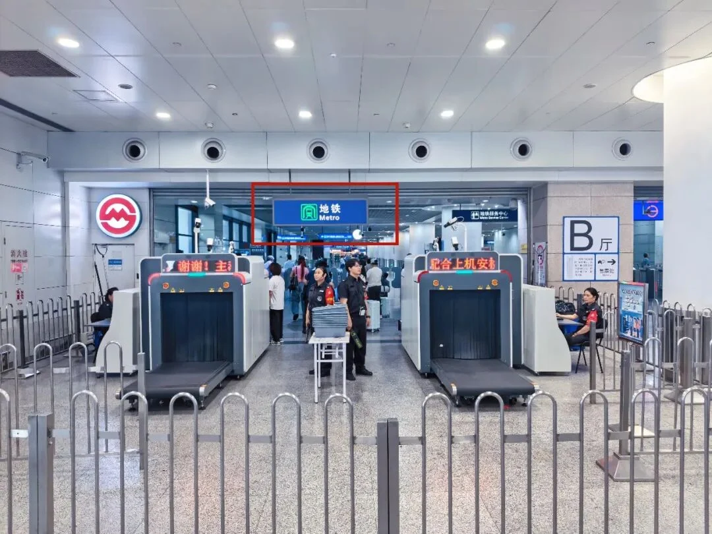
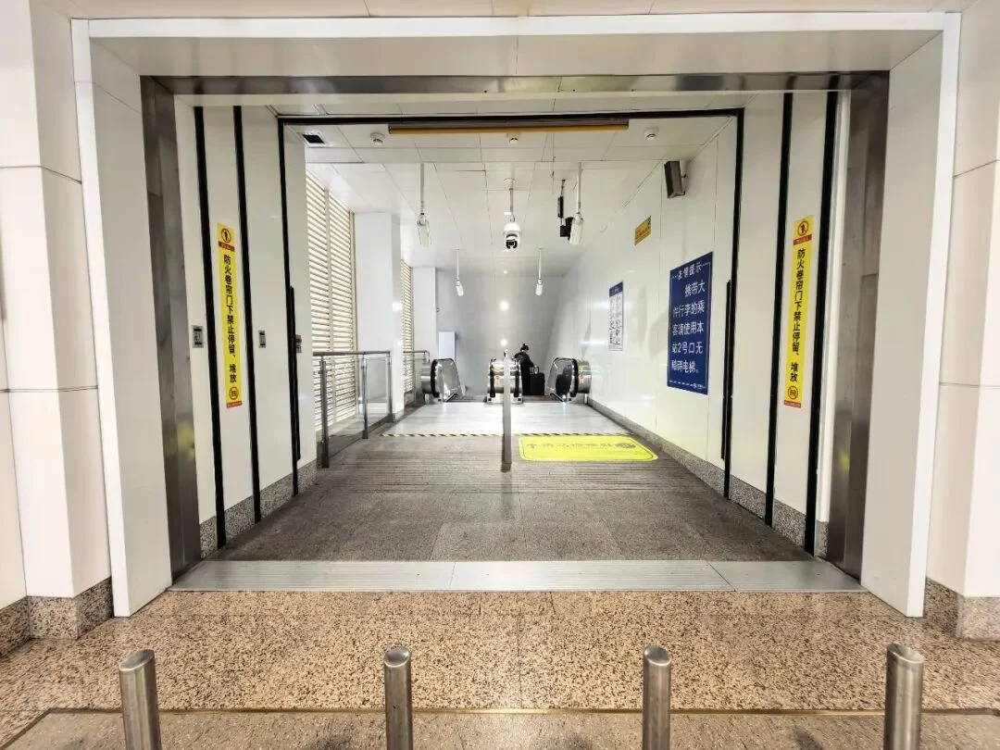
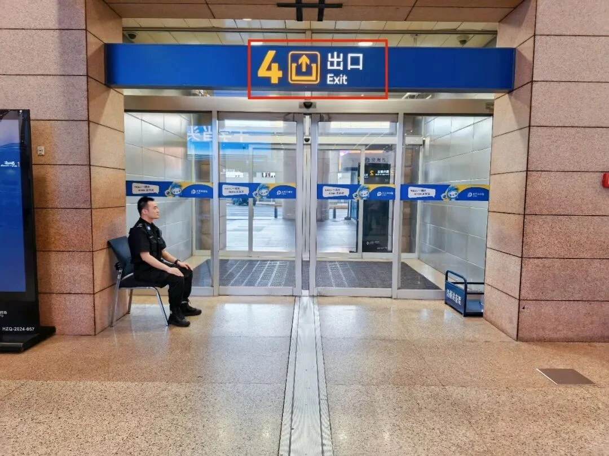

Праздник Дня образования КНР уже близко, поэтому всем, кто планирует поездку в Шанхай, стоит обратить внимание.

Прилетая в международный аэропорт Пудун, как быстро добраться из терминала 1 или терминала 2 до метро, такси или автобуса в город? Вот транспортный гид — **выпуск о международном аэропорте Пудун**. Смотрите ↓

## Международный аэропорт Пудун — терминал 2

### Где что находится

В зале прилёта терминала 2 **три выхода**: **на втором этаже** — выход для международных рейсов и рейсов из Гонконга, Макао и Тайваня и выход для внутренних рейсов; **на первом этаже** — выход для внутренних рейсов.

Схема ↓

Выход для международных рейсов и рейсов из Гонконга, Макао и Тайваня на втором этаже ↓

Выход для внутренних рейсов на втором этаже ↓

Выход для внутренних рейсов на первом этаже ↓

### Метро и железная дорога

**Если вы выходите через международный выход или выход для рейсов из Гонконга, Макао и Тайваня на втором этаже либо через выход для внутренних рейсов**

Следуйте указателям и идите прямо в сторону Учжоу Чжунлу ↓

Следуйте по указателям в переходный зал: с одной стороны вход в **метро линию 2**, с другой — вход на **маглев** ↓

Если вы едете по городской железнодорожной линии **Airport Link**, идите по указателям прямо и поднимитесь на лифте в переходный зал ↓

**Если вы выходите через выход для внутренних рейсов на первом этаже**

**Сначала поднимитесь на лифте на второй этаж**, затем следуйте тем же маршрутом к метро линии 2, маглеву или Airport Link ↓

### Такси

Пункт посадки такси терминала 2 — **снаружи терминала на первом этаже**, 26 стоянок посадки.

**Если вы выходите через международный выход или выход для рейсов из Гонконга, Макао и Тайваня на втором этаже либо через выход для внутренних рейсов**

Следуйте указателям и спуститесь на лифте на первый этаж ↓

Пройдите через **выход 26** к пункту посадки такси ↓

**Если вы выходите через выход для внутренних рейсов на первом этаже**

Пройдите через **выход 26** к пункту посадки такси ↓

### Автобусы

**Если вы выходите через международный выход или выход для рейсов из Гонконга, Макао и Тайваня на втором этаже либо через выход для внутренних рейсов**

Следуйте указателям и идите прямо в сторону Учжоу Чжунлу ↓

Следуйте указателям и спуститесь на лифте в зону ожидания автобусов ↓

Зона ожидания автобусов терминала 2 обслуживает Airport Line 4, Airport Line 7, Airport Line 8, Airport Ring Line 1 и ночной маршрут Shouhang (терминал 2 — Восточный транспортный центр Hongqiao Hub, первый и последний рейсы с 23:03 до 05:33 следующего утра).

**Если вы выходите через выход для внутренних рейсов на первом этаже**

**Сначала поднимитесь на лифте на второй этаж**, затем следуйте маршруту выше в зону ожидания автобусов ↓

## Международный аэропорт Пудун — терминал 1

### Где что находится

В зале прилёта терминала 1 **два выхода**, оба **на первом этаже**: выход для международных рейсов и рейсов из Гонконга, Макао и Тайваня и выход для внутренних рейсов.

Схема ↓

Выход для международных рейсов и рейсов из Гонконга, Макао и Тайваня на первом этаже ↓

Выход для внутренних рейсов на первом этаже ↓

### Метро и железная дорога

Если вы прилетели в терминал 1 и хотите воспользоваться метро линии 2, маглевом или Airport Link, поднимитесь на лифте **на второй этаж** ↓

Следуйте указателям и идите прямо через дверь ↓

Войдите в переходный зал: с одной стороны вход в **метро линию 2**, с другой — вход на **маглев** ↓

Если вы едете по городской железнодорожной линии **Airport Link**, следуйте указателям и поднимитесь на лифте в переходный зал ↓

### Такси

Пункт посадки такси терминала 1 — **снаружи терминала на первом этаже**, 20 стоянок посадки.

Выходя через **выход для внутренних рейсов**, перейдите к **выходу 4**, чтобы добраться до пункта посадки такси ↓

Выходя через **выход для международных рейсов и рейсов из Гонконга, Макао и Тайваня**, перейдите к **выходу 8**, чтобы добраться до пункта посадки такси ↓

### Автобусы

Зона ожидания автобусов терминала 1 — **снаружи терминала на первом этаже**, обслуживает Airport Line 4, Airport Line 7, Airport Line 8, Airport Ring Line 1 и ночной маршрут Shouhang (терминал 1 — Восточный транспортный центр Hongqiao Hub, первый и последний рейсы с 23:00 до 05:30 следующего утра).

Выходя через **выход для внутренних рейсов**, перейдите к **выходу 4**, чтобы добраться до зоны ожидания автобусов ↓

Выходя через **выход для международных рейсов и рейсов из Гонконга, Макао и Тайваня**, перейдите к **выходу 8**, чтобы добраться до зоны ожидания автобусов ↓

PS: информация выше приведена для справки — проверяйте обстановку на месте.

Некоторые источники: Shanghai Airport Authority, Pudong International Airport

## Полезные ссылки

- **На этом сайте**: [Шанхайский международный аэропорт Пудун (PVG)](/airport/PVG), [Китай (CN)](/country/CN)
- **Википедия**: [Shanghai Pudong International Airport](https://en.wikipedia.org/wiki/Shanghai_Pudong_International_Airport)
- **Baidu Baike**: [Shanghai Pudong International Airport](https://baike.baidu.com/item/%E4%B8%8A%E6%B5%B7%E6%B5%A6%E4%B8%9C%E5%9B%BD%E9%99%85%E6%9C%BA%E5%9C%BA)
