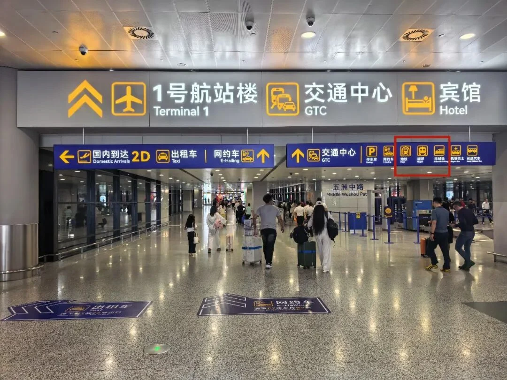
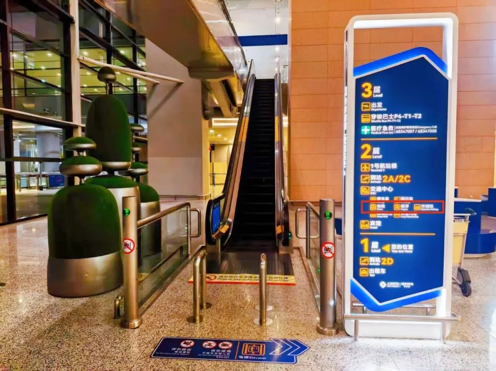
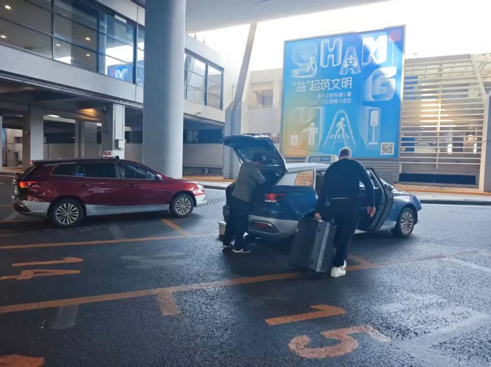
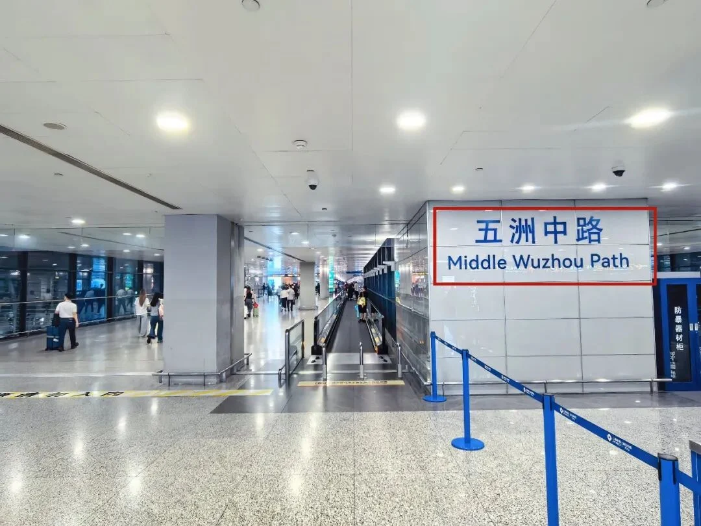
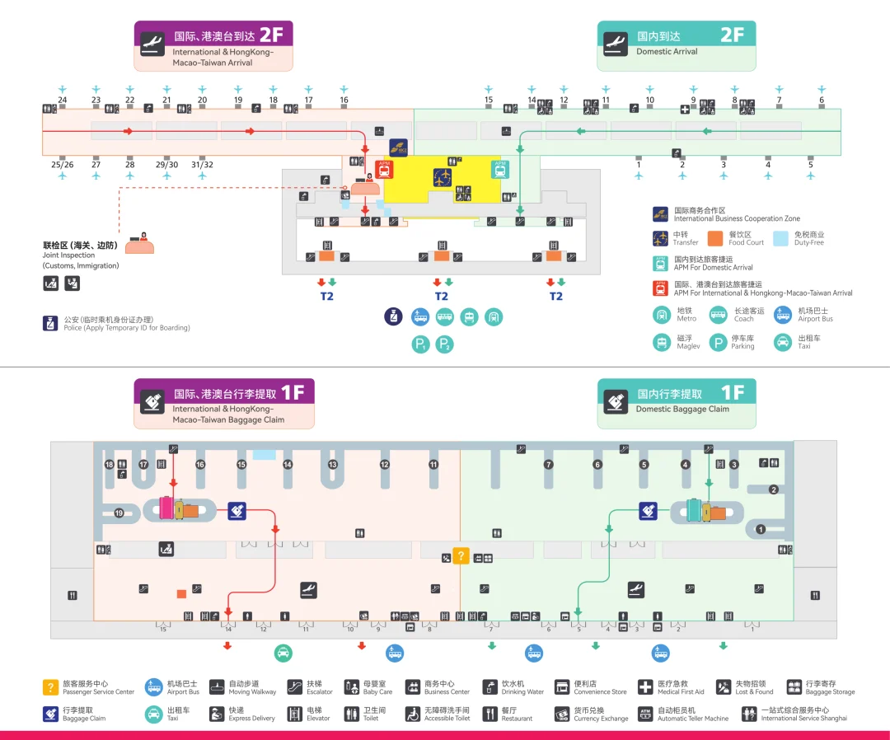

Nationaldagshelgen är snart här, så alla som planerar en resa till Shanghai bör vara uppmärksamma.

Du landar på Pudong International Airport – hur tar du dig snabbt från Terminal 1 eller Terminal 2 till metron, till en taxi eller till en buss in mot staden? Här är transportguiden – **Pudong International Airport-utgåvan**. Ta en titt ↓

## Pudong International Airport – Terminal 2

### Var allt ligger

Ankomstplanet i Terminal 2 har **tre utgångar**: **på andra våningen** utgången för internationella ankomster / ankomster från Hongkong, Macau och Taiwan samt utgången för inrikes ankomster; **på första våningen** utgången för inrikes ankomster.

Diagram ↓

Utgången för internationella ankomster / ankomster från Hongkong, Macau och Taiwan på andra våningen ↓

Utgången för inrikes ankomster på andra våningen ↓

Utgången för inrikes ankomster på första våningen ↓

### Metro och tåg

**Om du går ut genom den internationella utgången / utgången för Hongkong, Macau och Taiwan på andra våningen eller genom inrikesutgången**

Följ skyltarna och fortsätt rakt fram mot Wuzhou Middle Road ↓

Följ skyltarna in i transferhallen: på ena sidan ligger ingången till **Metro Line 2**, på den andra ingången till **Maglev** ↓

Om du ska ta pendeltågslinjen **Airport Link** följer du skyltarna rakt fram och tar hissen upp till transferhallen ↓

**Om du går ut genom inrikesutgången på första våningen**

**Ta först hissen upp till andra våningen** och följ sedan samma väg till Metro Line 2, Maglev eller Airport Link ↓

### Taxi

Terminal 2:s taxistation ligger **utanför terminalen på första våningen** och har 26 lastplatser.

**Om du går ut genom den internationella utgången / utgången för Hongkong, Macau och Taiwan på andra våningen eller genom inrikesutgången**

Följ skyltarna och ta hissen ner till första våningen ↓

Gå genom **Gate 26** för att nå taxistationen ↓

**Om du går ut genom inrikesutgången på första våningen**

Gå genom **Gate 26** för att nå taxistationen ↓

### Bussar

**Om du går ut genom den internationella utgången / utgången för Hongkong, Macau och Taiwan på andra våningen eller genom inrikesutgången**

Följ skyltarna och fortsätt rakt fram mot Wuzhou Middle Road ↓

Följ skyltarna och ta hissen till bussväntområdet ↓

Terminal 2:s bussväntområde trafikerar Airport Line 4, Airport Line 7, Airport Line 8, Airport Ring Line 1 och nattlinjen Shouhang (Terminal 2 till Hongqiao Hub East Transport Centre, första och sista avgång 23:03 till 05:33 nästa morgon).

**Om du går ut genom inrikesutgången på första våningen**

**Ta först hissen upp till andra våningen** och följ sedan vägen ovan till bussväntområdet ↓

## Pudong International Airport – Terminal 1

### Var allt ligger

Ankomstplanet i Terminal 1 har **två utgångar**, båda **på första våningen**: utgången för internationella ankomster / ankomster från Hongkong, Macau och Taiwan och utgången för inrikes ankomster.

Diagram ↓

Utgången för internationella ankomster / ankomster från Hongkong, Macau och Taiwan på första våningen ↓

Utgången för inrikes ankomster på första våningen ↓

### Metro och tåg

Om du landar i Terminal 1 och ska ta Metro Line 2, Maglev eller Airport Link tar du hissen **upp till andra våningen** ↓

Följ skyltarna och fortsätt rakt fram genom dörren ↓

Kliv in i transferhallen: på ena sidan ligger ingången till **Metro Line 2**, på den andra ingången till **Maglev** ↓

Om du ska ta pendeltågslinjen **Airport Link** följer du skyltarna och tar hissen till transferhallen ↓

### Taxi

Terminal 1:s taxistation ligger **utanför terminalen på första våningen** och har 20 lastplatser.

Om du går ut genom **inrikesutgången** går du över till **Gate 4** för att nå taxistationen ↓

Om du går ut genom **utgången för internationella ankomster / ankomster från Hongkong, Macau och Taiwan** går du över till **Gate 8** för att nå taxistationen ↓

### Bussar

Terminal 1:s bussväntområde ligger **utanför terminalen på första våningen** och trafikerar Airport Line 4, Airport Line 7, Airport Line 8, Airport Ring Line 1 och nattlinjen Shouhang (Terminal 1 till Hongqiao Hub East Transport Centre, första och sista avgång 23:00 till 05:30 nästa morgon).

Om du går ut genom **inrikesutgången** går du över till **Gate 4** för att nå bussväntområdet ↓

Om du går ut genom **utgången för internationella ankomster / ankomster från Hongkong, Macau och Taiwan** går du över till **Gate 8** för att nå bussväntområdet ↓

PS: informationen ovan är endast för referens – kontrollera läget på plats.

Källor: Shanghai Airport Authority, Pudong International Airport

## Relaterade länkar

- **På den här webbplatsen**: [Shanghai Pudong International Airport (PVG)](/airport/PVG), [Kina (CN)](/country/CN)
- **Wikipedia**: [Shanghai Pudong International Airport](https://en.wikipedia.org/wiki/Shanghai_Pudong_International_Airport)
- **Baidu Baike**: [Shanghai Pudong International Airport](https://baike.baidu.com/item/%E4%B8%8A%E6%B5%B7%E6%B5%A6%E4%B8%9C%E5%9B%BD%E9%99%85%E6%9C%BA%E5%9C%BA)
