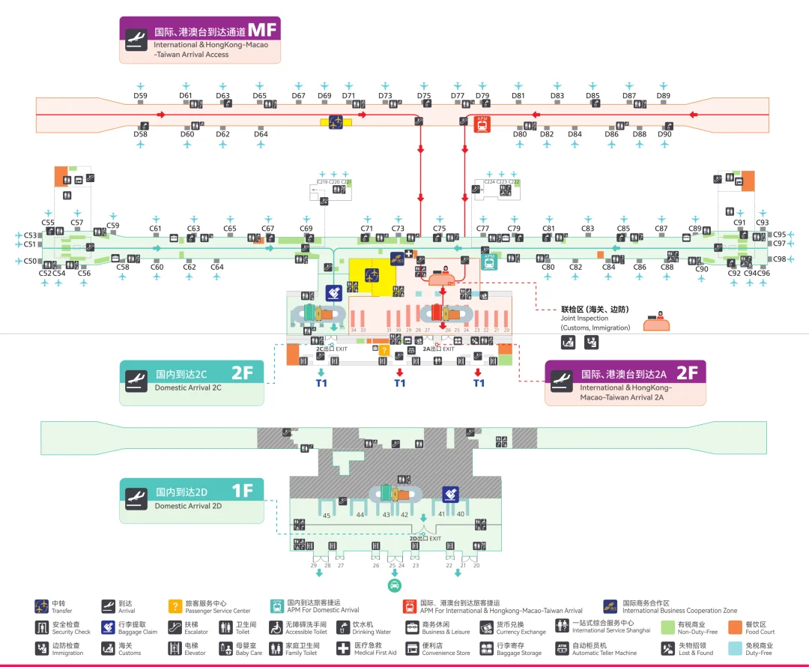
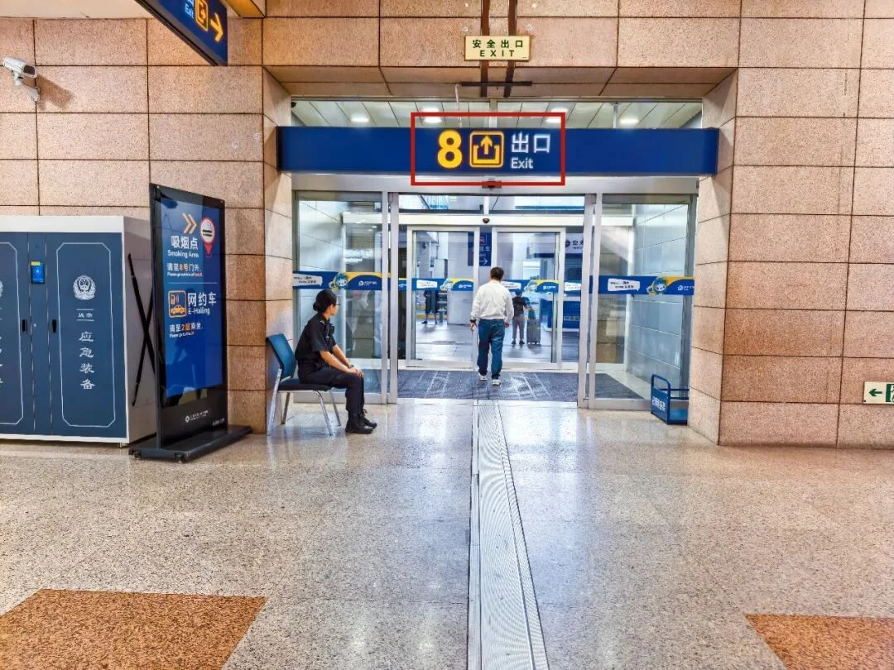

Likizo ya Siku ya Taifa inakaribia, hivyo yeyote anayepanga safari ya Shanghai, zingatia.

Unapowasili kwenye Uwanja wa Ndege wa Kimataifa wa Pudong, unafikaje haraka kutoka Terminali 1 au Terminali 2 hadi kwenye metro, ndani ya teksi au kwenye basi la kuelekea mjini? Hii hapa ni mwongozo wa usafiri — **toleo la Uwanja wa Ndege wa Kimataifa wa Pudong**. Tazama ↓

## Uwanja wa Ndege wa Kimataifa wa Pudong — Terminali 2

### Mahali vitu vilipo

Ngazi ya kuwasili ya Terminali 2 ina **njia tatu za kutoka**: **kwenye ghorofa ya pili**, njia ya kutoka ya kuwasili kwa ndege za kimataifa / Hong Kong, Macau na Taiwan na njia ya kutoka ya kuwasili kwa ndege za ndani; **kwenye ghorofa ya kwanza**, njia ya kutoka ya kuwasili kwa ndege za ndani.

Mchoro ↓

Njia ya kutoka ya kuwasili kwa ndege za kimataifa / Hong Kong, Macau na Taiwan kwenye ghorofa ya pili ↓

Njia ya kutoka ya kuwasili kwa ndege za ndani kwenye ghorofa ya pili ↓

Njia ya kutoka ya kuwasili kwa ndege za ndani kwenye ghorofa ya kwanza ↓

### Metro na reli

**Ukitoka kwenye njia ya kimataifa / Hong Kong, Macau na Taiwan ya ghorofa ya pili au njia ya ndege za ndani**

Fuata alama na tembea moja kwa moja kuelekea Wuzhou Middle Road ↓

Fuata alama kuingia kwenye ukumbi wa kubadilishia: upande mmoja kuna kiingilio cha **Metro Line 2**, upande mwingine kiingilio cha **Maglev** ↓

Ikiwa unachukua reli ya mjini ya **Airport Link**, fuata alama moja kwa moja mbele na panda lifti hadi ukumbi wa kubadilishia ↓

**Ukitoka kwenye njia ya kuwasili ya ndege za ndani ya ghorofa ya kwanza**

**Panda lifti kwanza hadi ghorofa ya pili**, kisha fuata njia hiyo hiyo hadi Metro Line 2, Maglev au Airport Link ↓

### Teksi

Eneo la kuchukua teksi la Terminali 2 liko **nje ya terminali kwenye ghorofa ya kwanza**, likiwa na maeneo 26 ya kupandisha abiria.

**Ukitoka kwenye njia ya kimataifa / Hong Kong, Macau na Taiwan ya ghorofa ya pili au njia ya ndege za ndani**

Fuata alama na shuka kwa lifti hadi ghorofa ya kwanza ↓

Pitia **Lango la 26** kufikia eneo la kuchukua teksi ↓

**Ukitoka kwenye njia ya kuwasili ya ndege za ndani ya ghorofa ya kwanza**

Pitia **Lango la 26** kufikia eneo la kuchukua teksi ↓

### Mabasi

**Ukitoka kwenye njia ya kimataifa / Hong Kong, Macau na Taiwan ya ghorofa ya pili au njia ya ndege za ndani**

Fuata alama na tembea moja kwa moja kuelekea Wuzhou Middle Road ↓

Fuata alama na panda lifti hadi eneo la kusubiri mabasi ↓

Eneo la kusubiri mabasi la Terminali 2 linahudumia Airport Line 4, Airport Line 7, Airport Line 8, Airport Ring Line 1 na huduma ya usiku ya Shouhang (Terminali 2 hadi Hongqiao Hub East Transport Centre, kuondoka kwa kwanza na kwa mwisho saa 23:03 hadi 05:33 asubuhi iliyofuata).

**Ukitoka kwenye njia ya kuwasili ya ndege za ndani ya ghorofa ya kwanza**

**Panda lifti kwanza hadi ghorofa ya pili**, kisha fuata njia iliyo juu hadi eneo la kusubiri mabasi ↓

## Uwanja wa Ndege wa Kimataifa wa Pudong — Terminali 1

### Mahali vitu vilipo

Ngazi ya kuwasili ya Terminali 1 ina **njia mbili za kutoka**, zote **kwenye ghorofa ya kwanza**: njia ya kutoka ya kuwasili kwa ndege za kimataifa / Hong Kong, Macau na Taiwan na njia ya kutoka ya kuwasili kwa ndege za ndani.

Mchoro ↓

Njia ya kutoka ya kuwasili kwa ndege za kimataifa / Hong Kong, Macau na Taiwan kwenye ghorofa ya kwanza ↓

Njia ya kutoka ya kuwasili kwa ndege za ndani kwenye ghorofa ya kwanza ↓

### Metro na reli

Ukiwasili Terminali 1 na unataka Metro Line 2, Maglev au Airport Link, panda lifti **hadi ghorofa ya pili** ↓

Fuata alama na tembea moja kwa moja kupitia mlango ↓

Ingia kwenye ukumbi wa kubadilishia: upande mmoja kuna kiingilio cha **Metro Line 2**, upande mwingine kiingilio cha **Maglev** ↓

Ikiwa unachukua reli ya mjini ya **Airport Link**, fuata alama na panda lifti hadi ukumbi wa kubadilishia ↓

### Teksi

Eneo la kuchukua teksi la Terminali 1 liko **nje ya terminali kwenye ghorofa ya kwanza**, likiwa na maeneo 20 ya kupandisha abiria.

Ukitoka kwa **njia ya kuwasili ya ndege za ndani**, vuka hadi **Lango la 4** kufikia eneo la kuchukua teksi ↓

Ukitoka kwa **njia ya kuwasili ya ndege za kimataifa / Hong Kong, Macau na Taiwan**, vuka hadi **Lango la 8** kufikia eneo la kuchukua teksi ↓

### Mabasi

Eneo la kusubiri mabasi la Terminali 1 liko **nje ya terminali kwenye ghorofa ya kwanza**, likihudumia Airport Line 4, Airport Line 7, Airport Line 8, Airport Ring Line 1 na huduma ya usiku ya Shouhang (Terminali 1 hadi Hongqiao Hub East Transport Centre, kuondoka kwa kwanza na kwa mwisho saa 23:00 hadi 05:30 asubuhi iliyofuata).

Ukitoka kwa **njia ya kuwasili ya ndege za ndani**, vuka hadi **Lango la 4** kufikia eneo la kusubiri mabasi ↓

Ukitoka kwa **njia ya kuwasili ya ndege za kimataifa / Hong Kong, Macau na Taiwan**, vuka hadi **Lango la 8** kufikia eneo la kusubiri mabasi ↓

Kumbuka: taarifa zilizo juu ni za kumbukumbu — tafadhali angalia hali halisi pale mahali.

Vyanzo vingine: Mamlaka ya Viwanja vya Ndege vya Shanghai, Uwanja wa Ndege wa Kimataifa wa Pudong

## Viungo vinavyohusiana

- **Kwenye tovuti hii**: [Uwanja wa Ndege wa Kimataifa wa Shanghai Pudong (PVG)](/airport/PVG), [China (CN)](/country/CN)
- **Wikipedia**: [Uwanja wa Ndege wa Kimataifa wa Shanghai Pudong](https://en.wikipedia.org/wiki/Shanghai_Pudong_International_Airport)
- **Baidu Baike**: [Uwanja wa Ndege wa Kimataifa wa Shanghai Pudong](https://baike.baidu.com/item/%E4%B8%8A%E6%B5%B7%E6%B5%A6%E4%B8%9C%E5%9B%BD%E9%99%85%E6%9C%BA%E5%9C%BA)
