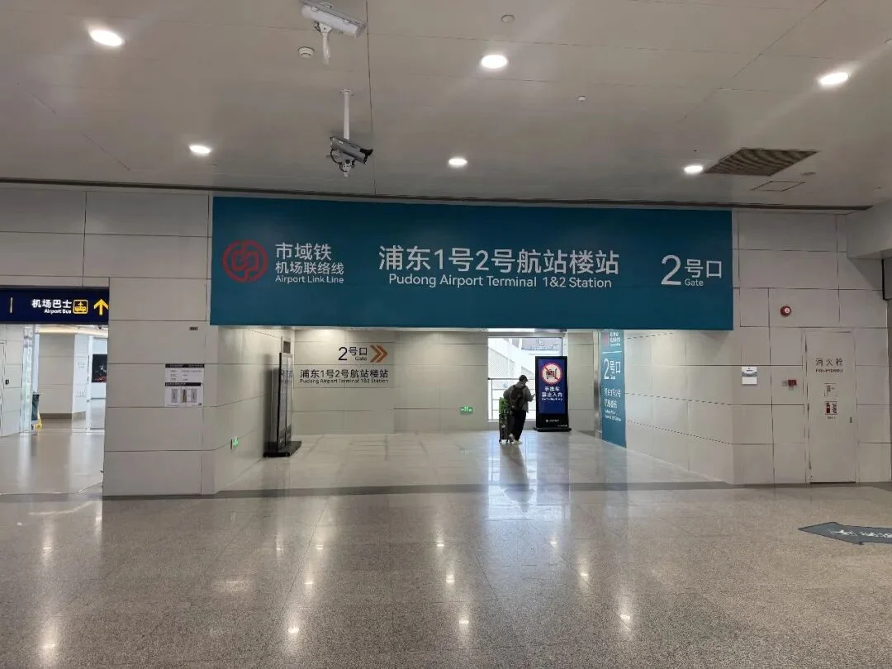
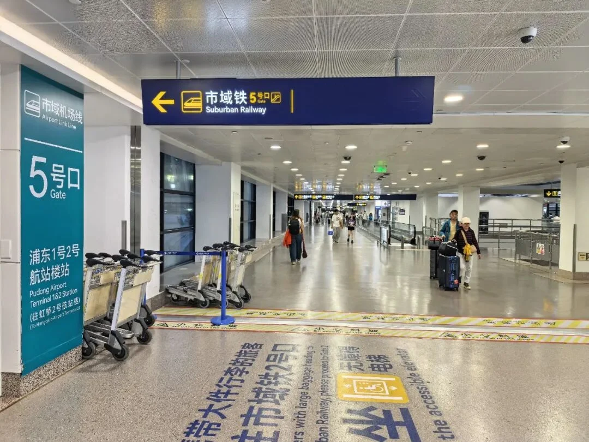
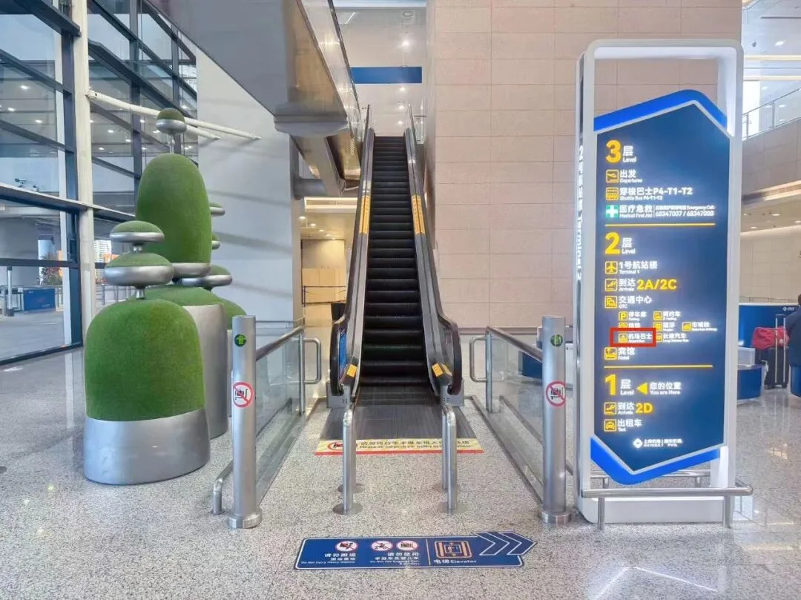

วันหยุดชาติใกล้มาถึงแล้ว ใครที่วางแผนเที่ยวเซี่ยงไฮ้โปรดฟัง

มาถึงสนามบินนานาชาติผู่ตง จะไปจากอาคารผู้โดยสาร 1 หรือ 2 สู่รถไฟใต้ดิน แท็กซี่ หรือรถบัสเข้าตัวเมืองอย่างรวดเร็วได้อย่างไร นี่คือคู่มือการเดินทาง — **ฉบับสนามบินนานาชาติผู่ตง** ลองดู ↓

## สนามบินนานาชาติผู่ตง — อาคารผู้โดยสาร 2

### ตำแหน่งต่าง ๆ

ชั้นผู้โดยสารขาเข้าของอาคารผู้โดยสาร 2 มี **สามทางออก**: **ชั้นสอง** มีทางออกผู้โดยสารขาเข้าระหว่างประเทศ / ฮ่องกง มาเก๊า และไต้หวัน กับทางออกผู้โดยสารขาเข้าภายในประเทศ; **ชั้นหนึ่ง** มีทางออกผู้โดยสารขาเข้าภายในประเทศ

แผนผัง ↓

ทางออกผู้โดยสารขาเข้าระหว่างประเทศ / ฮ่องกง มาเก๊า และไต้หวัน ชั้นสอง ↓

ทางออกผู้โดยสารขาเข้าภายในประเทศ ชั้นสอง ↓

ทางออกผู้โดยสารขาเข้าภายในประเทศ ชั้นหนึ่ง ↓

### รถไฟใต้ดินและรถไฟ

**ออกจากทางออกระหว่างประเทศ / ฮ่องกง มาเก๊า และไต้หวัน ชั้นสอง หรือทางออกภายในประเทศ**

ตามป้ายแล้วเดินตรงไปทางถนนอู่โจวกลาง ↓

ตามป้ายเข้าโถงเปลี่ยนถ่าย: ด้านหนึ่งเป็นทางเข้า **รถไฟใต้ดินสาย 2** อีกด้านเป็นทางเข้า **Maglev** ↓

หากใช้รถไฟในเมืองสาย **Airport Link** ให้ตามป้ายตรงไปแล้วขึ้นลิฟต์ไปโถงเปลี่ยนถ่าย ↓

**ออกจากทางออกผู้โดยสารขาเข้าภายในประเทศชั้นหนึ่ง**

**ขึ้นลิฟต์ไปชั้นสองก่อน** แล้วตามเส้นทางเดียวกันไปรถไฟใต้ดินสาย 2, Maglev หรือ Airport Link ↓

### แท็กซี่

จุดรับแท็กซี่ของอาคารผู้โดยสาร 2 อยู่ **นอกอาคารบนชั้นหนึ่ง** มีช่องจอด 26 ช่อง

**ออกจากทางออกระหว่างประเทศ / ฮ่องกง มาเก๊า และไต้หวัน ชั้นสอง หรือทางออกภายในประเทศ**

ตามป้ายแล้วนั่งลิฟต์ลงมาชั้นหนึ่ง ↓

ผ่าน **ประตู 26** ไปยังจุดรับแท็กซี่ ↓

**ออกจากทางออกผู้โดยสารขาเข้าภายในประเทศชั้นหนึ่ง**

ผ่าน **ประตู 26** ไปยังจุดรับแท็กซี่ ↓

### รถบัส

**ออกจากทางออกระหว่างประเทศ / ฮ่องกง มาเก๊า และไต้หวัน ชั้นสอง หรือทางออกภายในประเทศ**

ตามป้ายแล้วเดินตรงไปทางถนนอู่โจวกลาง ↓

ตามป้ายแล้วนั่งลิฟต์ไปพื้นที่รอรถบัส ↓

พื้นที่รอรถบัสของอาคารผู้โดยสาร 2 ให้บริการ Airport Line 4, Airport Line 7, Airport Line 8, Airport Ring Line 1 และบริการข้ามคืน Shouhang (อาคารผู้โดยสาร 2 ไปศูนย์ขนส่งตะวันออกฮับหงเฉียว เที่ยวแรกถึงเที่ยวสุดท้าย 23:03–05:33 เช้าวันถัดไป)

**ออกจากทางออกผู้โดยสารขาเข้าภายในประเทศชั้นหนึ่ง**

**ขึ้นลิฟต์ไปชั้นสองก่อน** แล้วตามเส้นทางข้างต้นไปพื้นที่รอรถบัส ↓

## สนามบินนานาชาติผู่ตง — อาคารผู้โดยสาร 1

### ตำแหน่งต่าง ๆ

ชั้นผู้โดยสารขาเข้าของอาคารผู้โดยสาร 1 มี **สองทางออก** ทั้งคู่อยู่ **บนชั้นหนึ่ง**: ทางออกผู้โดยสารขาเข้าระหว่างประเทศ / ฮ่องกง มาเก๊า และไต้หวัน กับทางออกผู้โดยสารขาเข้าภายในประเทศ

แผนผัง ↓

ทางออกผู้โดยสารขาเข้าระหว่างประเทศ / ฮ่องกง มาเก๊า และไต้หวัน ชั้นหนึ่ง ↓

ทางออกผู้โดยสารขาเข้าภายในประเทศ ชั้นหนึ่ง ↓

### รถไฟใต้ดินและรถไฟ

หากมาถึงอาคารผู้โดยสาร 1 และต้องการรถไฟใต้ดินสาย 2, Maglev หรือ Airport Link ให้นั่งลิฟต์ **ขึ้นไปชั้นสอง** ↓

ตามป้ายแล้วเดินตรงผ่านประตู ↓

ก้าวเข้าโถงเปลี่ยนถ่าย: ด้านหนึ่งเป็นทางเข้า **รถไฟใต้ดินสาย 2** อีกด้านเป็นทางเข้า **Maglev** ↓

หากใช้รถไฟในเมืองสาย **Airport Link** ให้ตามป้ายแล้วนั่งลิฟต์ไปโถงเปลี่ยนถ่าย ↓

### แท็กซี่

จุดรับแท็กซี่ของอาคารผู้โดยสาร 1 อยู่ **นอกอาคารบนชั้นหนึ่ง** มีช่องจอด 20 ช่อง

ออกทาง **ทางออกผู้โดยสารขาเข้าภายในประเทศ** ข้ามไป **ประตู 4** เพื่อไปยังจุดรับแท็กซี่ ↓

ออกทาง **ทางออกผู้โดยสารขาเข้าระหว่างประเทศ / ฮ่องกง มาเก๊า และไต้หวัน** ข้ามไป **ประตู 8** เพื่อไปยังจุดรับแท็กซี่ ↓

### รถบัส

พื้นที่รอรถบัสของอาคารผู้โดยสาร 1 อยู่ **นอกอาคารบนชั้นหนึ่ง** ให้บริการ Airport Line 4, Airport Line 7, Airport Line 8, Airport Ring Line 1 และบริการข้ามคืน Shouhang (อาคารผู้โดยสาร 1 ไปศูนย์ขนส่งตะวันออกฮับหงเฉียว เที่ยวแรกถึงเที่ยวสุดท้าย 23:00–05:30 เช้าวันถัดไป)

ออกทาง **ทางออกผู้โดยสารขาเข้าภายในประเทศ** ข้ามไป **ประตู 4** เพื่อไปยังพื้นที่รอรถบัส ↓

ออกทาง **ทางออกผู้โดยสารขาเข้าระหว่างประเทศ / ฮ่องกง มาเก๊า และไต้หวัน** ข้ามไป **ประตู 8** เพื่อไปยังพื้นที่รอรถบัส ↓

PS: ข้อมูลข้างต้นใช้ประกอบการอ้างอิง — โปรดตรวจสอบสถานการณ์หน้างาน

แหล่งข้อมูลบางส่วน: Shanghai Airport Authority, Pudong International Airport

## ลิงก์ที่เกี่ยวข้อง

- **ในเว็บไซต์นี้**: [สนามบินนานาชาติเซี่ยงไฮ้ผู่ตง (PVG)](/airport/PVG), [จีน (CN)](/country/CN)
- **Wikipedia**: [สนามบินนานาชาติเซี่ยงไฮ้ผู่ตง](https://en.wikipedia.org/wiki/Shanghai_Pudong_International_Airport)
- **Baidu Baike**: [สนามบินนานาชาติเซี่ยงไฮ้ผู่ตง](https://baike.baidu.com/item/%E4%B8%8A%E6%B5%B7%E6%B5%A6%E4%B8%9C%E5%9B%BD%E9%99%85%E6%9C%BA%E5%9C%BA)
