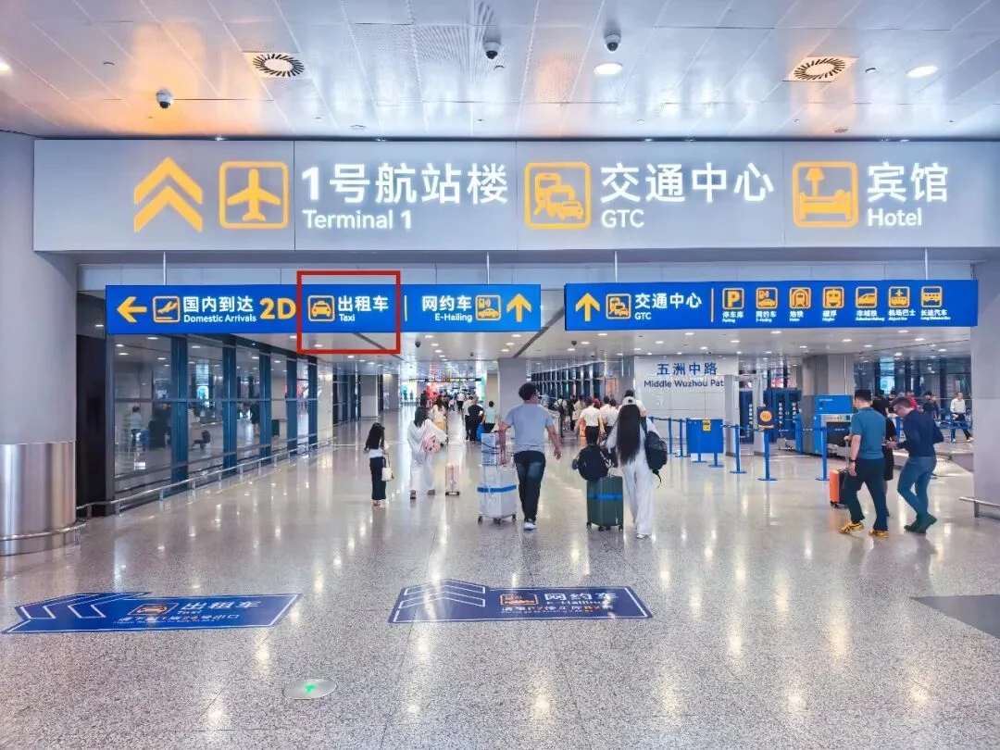
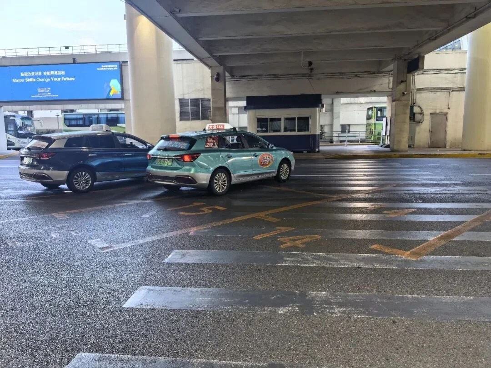

Ulusal Gün tatili neredeyse geldi; Şanghay'a seyahat planlayan herkes dikkat etsin.

Pudong Uluslararası Havalimanı'na vardığınızda Terminal 1 veya Terminal 2'den şehre metroya, taksiye ya da otobüse nasıl hızlıca geçersiniz? İşte ulaşım rehberi — **Pudong Uluslararası Havalimanı sürümü**. Göz atın ↓

## Pudong Uluslararası Havalimanı — Terminal 2

### Nerede ne var

Terminal 2'nin varış katında **üç çıkış** vardır: **ikinci katta** dış hat / Hong Kong, Makao ve Tayvan varışları çıkışı ile iç hat varışları çıkışı; **birinci katta** iç hat varışları çıkışı.

Şema ↓

İkinci kattaki dış hat / Hong Kong, Makao ve Tayvan varışları çıkışı ↓

İkinci kattaki iç hat varışları çıkışı ↓

Birinci kattaki iç hat varışları çıkışı ↓

### Metro ve raylı sistem

**İkinci kattaki dış hat / Hong Kong, Makao ve Tayvan çıkışından veya iç hat çıkışından çıkarken**

Tabelaları izleyin ve Wuzhou Orta Yolu'na doğru düz yürüyün ↓

Tabelaları izleyerek aktarma salonuna girin: bir tarafta **Metro 2. Hattı** girişi, diğer tarafta **Maglev** girişi ↓

**Airport Link** şehir raylı sistemini kullanacaksanız tabelaları düz ilerleyerek izleyin ve asansörle aktarma salonuna çıkın ↓

**Birinci kattaki iç hat varışları çıkışından çıkarken**

**Önce asansörle ikinci kata çıkın**, ardından Metro 2. Hattı, Maglev veya Airport Link için aynı güzergâhı izleyin ↓

### Taksi

Terminal 2'nin taksi alma noktası **terminalin dışında, birinci katta**dır ve 26 yolcu alma peronu vardır.

**İkinci kattaki dış hat / Hong Kong, Makao ve Tayvan çıkışından veya iç hat çıkışından çıkarken**

Tabelaları izleyin ve asansörle birinci kata inin ↓

Taksi alma noktasına ulaşmak için **26. Kapı**dan geçin ↓

**Birinci kattaki iç hat varışları çıkışından çıkarken**

Taksi alma noktasına ulaşmak için **26. Kapı**dan geçin ↓

### Otobüsler

**İkinci kattaki dış hat / Hong Kong, Makao ve Tayvan çıkışından veya iç hat çıkışından çıkarken**

Tabelaları izleyin ve Wuzhou Orta Yolu'na doğru düz yürüyün ↓

Tabelaları izleyin ve asansörle otobüs bekleme alanına gidin ↓

Terminal 2'nin otobüs bekleme alanı, Havalimanı 4. Hattı, Havalimanı 7. Hattı, Havalimanı 8. Hattı, Havalimanı Çevre 1. Hattı ve Shouhang gece servisine hizmet verir (Terminal 2'den Hongqiao Merkezi Doğu Ulaşım Merkezi'ne, ilk ve son kalkış 23:03–ertesi sabah 05:33).

**Birinci kattaki iç hat varışları çıkışından çıkarken**

**Önce asansörle ikinci kata çıkın**, ardından otobüs bekleme alanı için yukarıdaki güzergâhı izleyin ↓

## Pudong Uluslararası Havalimanı — Terminal 1

### Nerede ne var

Terminal 1'in varış katında **iki çıkış** vardır; ikisi de **birinci kattadır**: dış hat / Hong Kong, Makao ve Tayvan varışları çıkışı ve iç hat varışları çıkışı.

Şema ↓

Birinci kattaki dış hat / Hong Kong, Makao ve Tayvan varışları çıkışı ↓

Birinci kattaki iç hat varışları çıkışı ↓

### Metro ve raylı sistem

Terminal 1'e varıp Metro 2. Hattı, Maglev veya Airport Link'i kullanmak istiyorsanız asansörle **ikinci kata çıkın** ↓

Tabelaları izleyin ve kapıdan düz geçin ↓

Aktarma salonuna girin: bir tarafta **Metro 2. Hattı** girişi, diğer tarafta **Maglev** girişi ↓

**Airport Link** şehir raylı sistemini kullanacaksanız tabelaları izleyin ve asansörle aktarma salonuna gidin ↓

### Taksi

Terminal 1'in taksi alma noktası **terminalin dışında, birinci katta**dır ve 20 yolcu alma peronu vardır.

**İç hat varışları çıkışından** çıkıp **4. Kapı**ya geçerek taksi alma noktasına ulaşın ↓

**Dış hat / Hong Kong, Makao ve Tayvan varışları çıkışından** çıkıp **8. Kapı**ya geçerek taksi alma noktasına ulaşın ↓

### Otobüsler

Terminal 1'in otobüs bekleme alanı **terminalin dışında, birinci katta**dır; Havalimanı 4. Hattı, Havalimanı 7. Hattı, Havalimanı 8. Hattı, Havalimanı Çevre 1. Hattı ve Shouhang gece servisine hizmet verir (Terminal 1'den Hongqiao Merkezi Doğu Ulaşım Merkezi'ne, ilk ve son kalkış 23:00–ertesi sabah 05:30).

**İç hat varışları çıkışından** çıkıp **4. Kapı**ya geçerek otobüs bekleme alanına ulaşın ↓

**Dış hat / Hong Kong, Makao ve Tayvan varışları çıkışından** çıkıp **8. Kapı**ya geçerek otobüs bekleme alanına ulaşın ↓

Not: Yukarıdaki bilgiler referans içindir — lütfen sahada durumu kontrol edin.

Kaynaklar: Şanghay Havalimanı İdaresi, Pudong Uluslararası Havalimanı

## İlgili bağlantılar

- **Bu sitede**: [Şanghay Pudong Uluslararası Havalimanı (PVG)](/airport/PVG), [Çin (CN)](/country/CN)
- **Wikipedia**: [Shanghai Pudong International Airport](https://en.wikipedia.org/wiki/Shanghai_Pudong_International_Airport)
- **Baidu Baike**: [Shanghai Pudong International Airport](https://baike.baidu.com/item/%E4%B8%8A%E6%B5%B7%E6%B5%A6%E4%B8%9C%E5%9B%BD%E9%99%85%E6%9C%BA%E5%9C%BA)
