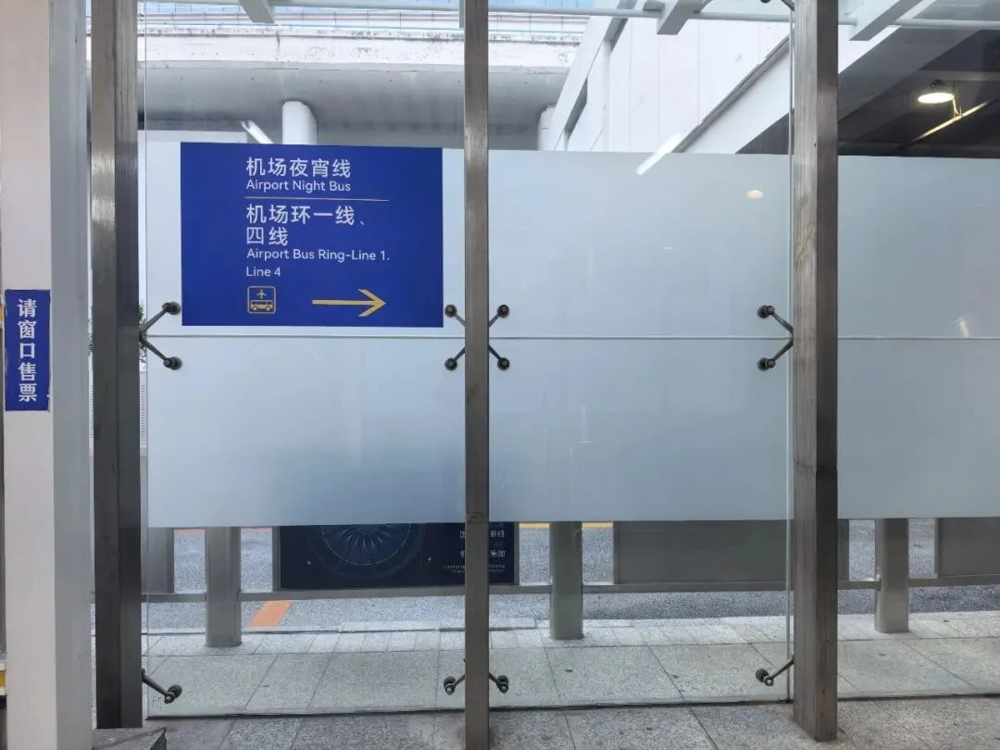

Свято Національного дня вже близько, тож усі, хто планує поїздку до Шанхаю, зверніть увагу.

Прилетіли до міжнародного аеропорту Пудун — як швидко з Терміналу 1 або Терміналу 2 потрапити в метро, у таксі чи в автобус до міста? Ось транспортний путівник — **випуск про міжнародний аеропорт Пудун**. Дивіться ↓

## Міжнародний аеропорт Пудун — Термінал 2

### Що де розташовано

На рівні прибуття Терміналу 2 є **три виходи**: **на другому поверсі** — вихід для прильоту міжнародних рейсів і рейсів із Гонконгу, Макао та Тайваню, а також вихід для внутрішніх рейсів; **на першому поверсі** — вихід для внутрішніх рейсів.

Схема ↓

Вихід для прильоту міжнародних рейсів і рейсів із Гонконгу, Макао та Тайваню на другому поверсі ↓

Вихід для внутрішніх рейсів на другому поверсі ↓

Вихід для внутрішніх рейсів на першому поверсі ↓

### Метро та залізниця

**Якщо ви виходите з виходу для міжнародних рейсів і рейсів із Гонконгу, Макао та Тайваню на другому поверсі або з виходу для внутрішніх рейсів**

Ідіть за вказівниками прямо у напрямку Wuzhou Middle Road ↓

Ідіть за вказівниками до пересадкової зали: з одного боку — вхід до **лінії 2 метро**, з іншого — вхід до **маглева** ↓

Якщо ви їдете міською залізничною лінією **Airport Link**, ідіть за вказівниками прямо й підніміться ліфтом до пересадкової зали ↓

**Якщо ви виходите з виходу для внутрішніх рейсів на першому поверсі**

**Спершу підніміться ліфтом на другий поверх**, а далі йдіть тим самим маршрутом до лінії 2 метро, маглева або Airport Link ↓

### Таксі

Пункт посадки в таксі Терміналу 2 розташований **зовні біля терміналу на першому поверсі** і має 26 смуг для посадки.

**Якщо ви виходите з виходу для міжнародних рейсів і рейсів із Гонконгу, Макао та Тайваню на другому поверсі або з виходу для внутрішніх рейсів**

Ідіть за вказівниками й спустіться ліфтом на перший поверх ↓

Пройдіть через **ворота 26**, щоб потрапити до пункту посадки в таксі ↓

**Якщо ви виходите з виходу для внутрішніх рейсів на першому поверсі**

Пройдіть через **ворота 26**, щоб потрапити до пункту посадки в таксі ↓

### Автобуси

**Якщо ви виходите з виходу для міжнародних рейсів і рейсів із Гонконгу, Макао та Тайваню на другому поверсі або з виходу для внутрішніх рейсів**

Ідіть за вказівниками прямо у напрямку Wuzhou Middle Road ↓

Ідіть за вказівниками й скористайтеся ліфтом, щоб дістатися до зони очікування автобусів ↓

Зона очікування автобусів Терміналу 2 обслуговує аеропортовий маршрут 4, аеропортовий маршрут 7, аеропортовий маршрут 8, аеропортове кільцеве сполучення 1 і нічний маршрут Shouhang (від Терміналу 2 до Східного транспортного центру хаба Хунцяо, перше та останнє відправлення з 23:03 до 05:33 наступного ранку).

**Якщо ви виходите з виходу для внутрішніх рейсів на першому поверсі**

**Спершу підніміться ліфтом на другий поверх**, а далі йдіть маршрутом, описаним вище, до зони очікування автобусів ↓

## Міжнародний аеропорт Пудун — Термінал 1

### Що де розташовано

На рівні прибуття Терміналу 1 є **два виходи**, обидва **на першому поверсі**: вихід для прильоту міжнародних рейсів і рейсів із Гонконгу, Макао та Тайваню та вихід для внутрішніх рейсів.

Схема ↓

Вихід для прильоту міжнародних рейсів і рейсів із Гонконгу, Макао та Тайваню на першому поверсі ↓

Вихід для внутрішніх рейсів на першому поверсі ↓

### Метро та залізниця

Якщо ви прилетіли до Терміналу 1 і хочете скористатися лінією 2 метро, маглевом або Airport Link, підніміться ліфтом **на другий поверх** ↓

Ідіть за вказівниками й пройдіть прямо через двері ↓

Зайдіть до пересадкової зали: з одного боку — вхід до **лінії 2 метро**, з іншого — вхід до **маглева** ↓

Якщо ви їдете міською залізничною лінією **Airport Link**, ідіть за вказівниками й підніміться ліфтом до пересадкової зали ↓

### Таксі

Пункт посадки в таксі Терміналу 1 розташований **зовні біля терміналу на першому поверсі** і має 20 смуг для посадки.

Якщо ви виходите через **вихід для внутрішніх рейсів**, перейдіть до **воріт 4**, щоб потрапити до пункту посадки в таксі ↓

Якщо ви виходите через **вихід для прильоту міжнародних рейсів і рейсів із Гонконгу, Макао та Тайваню**, перейдіть до **воріт 8**, щоб потрапити до пункту посадки в таксі ↓

### Автобуси

Зона очікування автобусів Терміналу 1 розташована **зовні біля терміналу на першому поверсі** та обслуговує аеропортовий маршрут 4, аеропортовий маршрут 7, аеропортовий маршрут 8, аеропортове кільцеве сполучення 1 і нічний маршрут Shouhang (від Терміналу 1 до Східного транспортного центру хаба Хунцяо, перше та останнє відправлення з 23:00 до 05:30 наступного ранку).

Якщо ви виходите через **вихід для внутрішніх рейсів**, перейдіть до **воріт 4**, щоб потрапити до зони очікування автобусів ↓

Якщо ви виходите через **вихід для прильоту міжнародних рейсів і рейсів із Гонконгу, Макао та Тайваню**, перейдіть до **воріт 8**, щоб потрапити до зони очікування автобусів ↓

PS: наведена вище інформація — для довідки; будь ласка, перевіряйте ситуацію на місці.

Джерела: Адміністрація аеропортів Шанхаю, міжнародний аеропорт Пудун.

## Пов’язані посилання

- **На цьому сайті**: [Міжнародний аеропорт Шанхай Пудун (PVG)](/airport/PVG), [Китай (CN)](/country/CN)
- **Вікіпедія**: [Міжнародний аеропорт Шанхай Пудун](https://en.wikipedia.org/wiki/Shanghai_Pudong_International_Airport)
- **Baidu Baike**: [Міжнародний аеропорт Шанхай Пудун](https://baike.baidu.com/item/%E4%B8%8A%E6%B5%B7%E6%B5%A6%E4%B8%9C%E5%9B%BD%E9%99%85%E6%9C%BA%E5%9C%BA)
