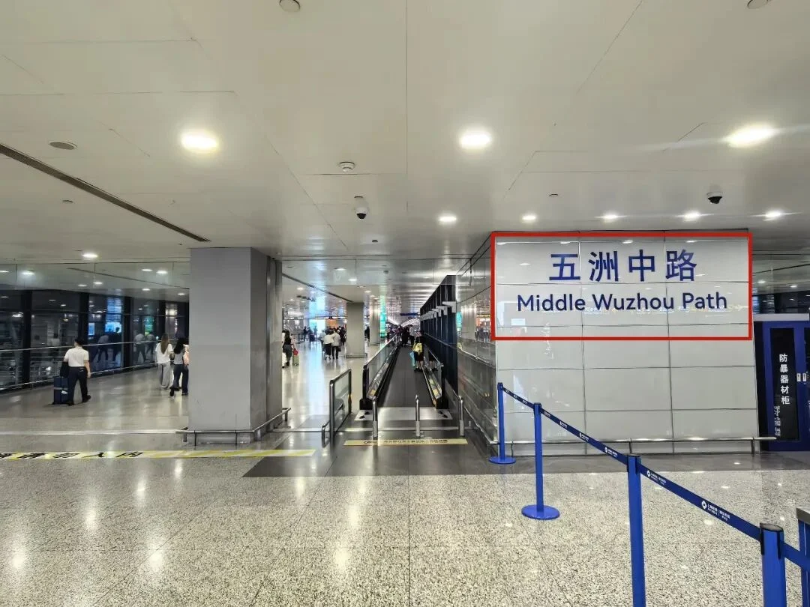
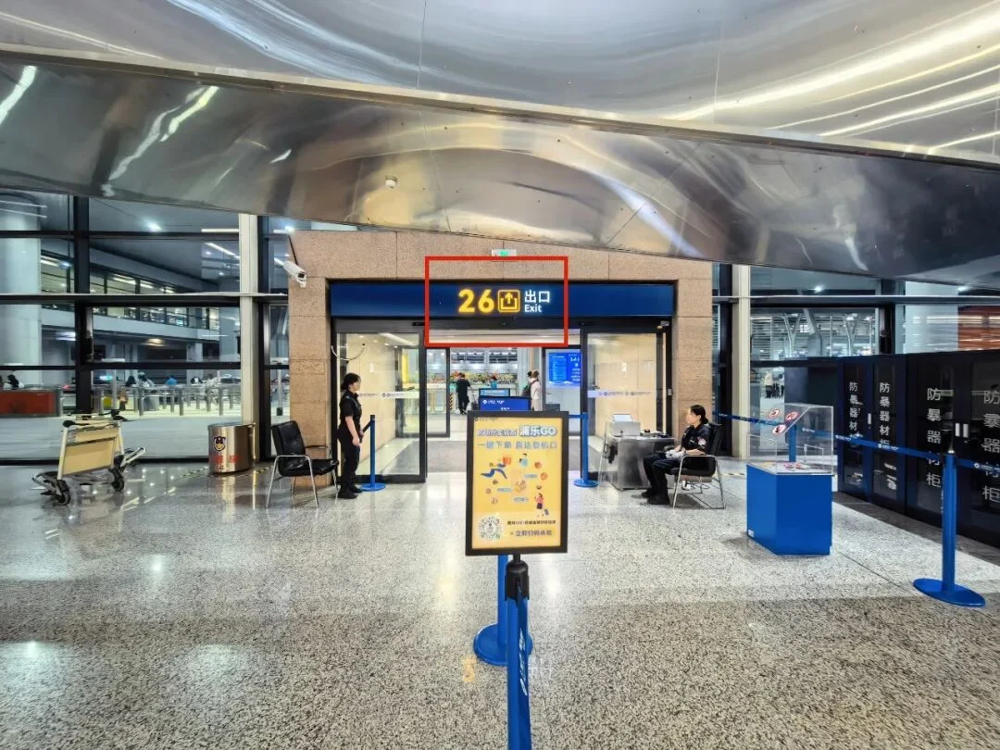
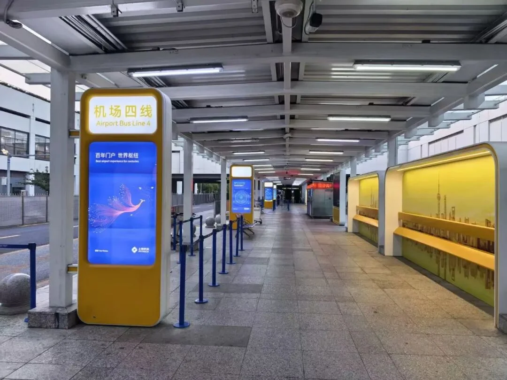
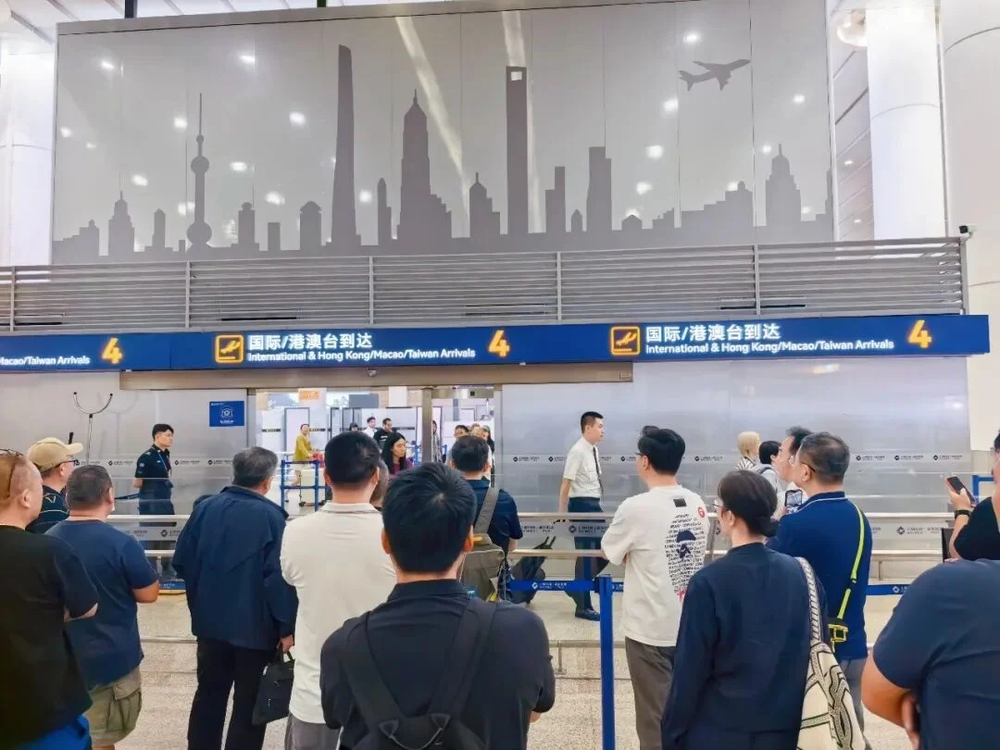
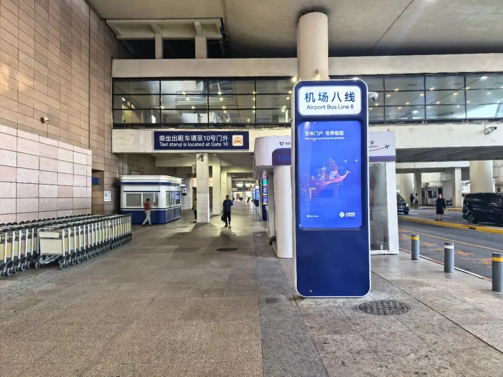

Kỳ nghỉ Quốc khánh đang đến gần, nên ai đang lên kế hoạch đến Thượng Hải hãy chú ý.

Hạ cánh tại Sân bay Quốc tế Phố Đông, làm sao để nhanh chóng từ Nhà ga 1 hoặc Nhà ga 2 ra tàu điện ngầm, lên taxi hoặc bắt xe buýt vào thành phố? Đây là hướng dẫn giao thông — **phiên bản Sân bay Quốc tế Phố Đông**. Cùng xem ↓

## Sân bay Quốc tế Phố Đông — Nhà ga 2

### Mọi thứ nằm ở đâu

Tầng đến của Nhà ga 2 có **ba lối ra**: **ở tầng hai**, lối ra của khách nhập cảnh quốc tế / Hồng Kông, Ma Cao và Đài Loan và lối ra của khách nội địa; **ở tầng một**, lối ra của khách nội địa.

Sơ đồ ↓

Lối ra của khách nhập cảnh quốc tế / Hồng Kông, Ma Cao và Đài Loan ở tầng hai ↓

Lối ra của khách nội địa ở tầng hai ↓

Lối ra của khách nội địa ở tầng một ↓

### Tàu điện ngầm và đường sắt

**Xuất phát từ lối ra quốc tế / Hồng Kông, Ma Cao và Đài Loan hoặc lối ra nội địa ở tầng hai**

Đi theo biển chỉ dẫn và đi thẳng về phía đường Wuzhou Middle ↓

Đi theo biển chỉ dẫn vào sảnh trung chuyển: một bên là lối vào **Tuyến tàu điện ngầm 2**, bên kia là lối vào **tàu Maglev** ↓

Nếu bạn đi tuyến đường sắt đô thị **Airport Link**, hãy đi theo biển chỉ dẫn thẳng phía trước và đi thang máy lên sảnh trung chuyển ↓

**Xuất phát từ lối ra nội địa ở tầng một**

**Trước tiên hãy đi thang máy lên tầng hai**, sau đó đi theo cùng lộ trình tới Tuyến tàu điện ngầm 2, tàu Maglev hoặc Airport Link ↓

### Taxi

Điểm đón taxi của Nhà ga 2 nằm **bên ngoài nhà ga ở tầng một**, với 26 làn đón khách.

**Xuất phát từ lối ra quốc tế / Hồng Kông, Ma Cao và Đài Loan hoặc lối ra nội địa ở tầng hai**

Đi theo biển chỉ dẫn và đi thang máy xuống tầng một ↓

Đi qua **Cổng 26** để tới điểm đón taxi ↓

**Xuất phát từ lối ra nội địa ở tầng một**

Đi qua **Cổng 26** để tới điểm đón taxi ↓

### Xe buýt

**Xuất phát từ lối ra quốc tế / Hồng Kông, Ma Cao và Đài Loan hoặc lối ra nội địa ở tầng hai**

Đi theo biển chỉ dẫn và đi thẳng về phía đường Wuzhou Middle ↓

Đi theo biển chỉ dẫn và đi thang máy tới khu chờ xe buýt ↓

Khu chờ xe buýt của Nhà ga 2 phục vụ Tuyến sân bay 4, Tuyến sân bay 7, Tuyến sân bay 8, Tuyến vòng sân bay 1 và dịch vụ chạy đêm Shouhang (Nhà ga 2 đến Trung tâm Giao thông phía Đông trung tâm Hồng Kiều, chuyến đầu và chuyến cuối từ 23:03 đến 05:33 sáng hôm sau).

**Xuất phát từ lối ra nội địa ở tầng một**

**Trước tiên hãy đi thang máy lên tầng hai**, sau đó đi theo lộ trình trên tới khu chờ xe buýt ↓

## Sân bay Quốc tế Phố Đông — Nhà ga 1

### Mọi thứ nằm ở đâu

Tầng đến của Nhà ga 1 có **hai lối ra**, cả hai đều **ở tầng một**: lối ra của khách nhập cảnh quốc tế / Hồng Kông, Ma Cao và Đài Loan và lối ra của khách nội địa.

Sơ đồ ↓

Lối ra của khách nhập cảnh quốc tế / Hồng Kông, Ma Cao và Đài Loan ở tầng một ↓

Lối ra của khách nội địa ở tầng một ↓

### Tàu điện ngầm và đường sắt

Nếu bạn đến Nhà ga 1 và muốn đi Tuyến tàu điện ngầm 2, tàu Maglev hoặc Airport Link, hãy đi thang máy **lên tầng hai** ↓

Đi theo biển chỉ dẫn và đi thẳng qua cửa ↓

Bước vào sảnh trung chuyển: một bên là lối vào **Tuyến tàu điện ngầm 2**, bên kia là lối vào **tàu Maglev** ↓

Nếu bạn đi tuyến đường sắt đô thị **Airport Link**, hãy đi theo biển chỉ dẫn và đi thang máy tới sảnh trung chuyển ↓

### Taxi

Điểm đón taxi của Nhà ga 1 nằm **bên ngoài nhà ga ở tầng một**, với 20 làn đón khách.

Ra bằng **lối ra nội địa**, đi ngang sang **Cổng 4** để tới điểm đón taxi ↓

Ra bằng **lối ra của khách nhập cảnh quốc tế / Hồng Kông, Ma Cao và Đài Loan**, đi ngang sang **Cổng 8** để tới điểm đón taxi ↓

### Xe buýt

Khu chờ xe buýt của Nhà ga 1 nằm **bên ngoài nhà ga ở tầng một**, phục vụ Tuyến sân bay 4, Tuyến sân bay 7, Tuyến sân bay 8, Tuyến vòng sân bay 1 và dịch vụ chạy đêm Shouhang (Nhà ga 1 đến Trung tâm Giao thông phía Đông trung tâm Hồng Kiều, chuyến đầu và chuyến cuối từ 23:00 đến 05:30 sáng hôm sau).

Ra bằng **lối ra nội địa**, đi ngang sang **Cổng 4** để tới khu chờ xe buýt ↓

Ra bằng **lối ra của khách nhập cảnh quốc tế / Hồng Kông, Ma Cao và Đài Loan**, đi ngang sang **Cổng 8** để tới khu chờ xe buýt ↓

Tái bút: thông tin trên chỉ để tham khảo — hãy kiểm tra tình hình thực tế tại chỗ.

Một số nguồn: Cơ quan Sân bay Thượng Hải, Sân bay Quốc tế Phố Đông

## Liên kết liên quan

- **Trên trang này**: [Sân bay Quốc tế Phố Đông Thượng Hải (PVG)](/airport/PVG), [Trung Quốc (CN)](/country/CN)
- **Wikipedia**: [Sân bay Quốc tế Phố Đông Thượng Hải](https://en.wikipedia.org/wiki/Shanghai_Pudong_International_Airport)
- **Baidu Baike**: [Sân bay Quốc tế Phố Đông Thượng Hải](https://baike.baidu.com/item/%E4%B8%8A%E6%B5%B7%E6%B5%A6%E4%B8%9C%E5%9B%BD%E9%99%85%E6%9C%BA%E5%9C%BA)
