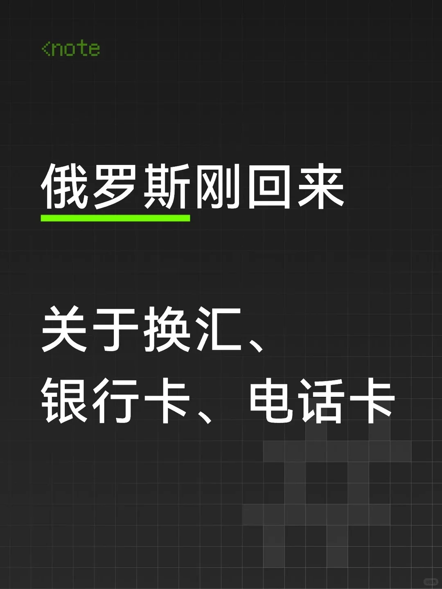

Tout juste rentrés de Russie, nous avons réuni notre expérience sur les trois sujets qui reviennent le plus souvent : **le change, les cartes bancaires et les cartes SIM**.

## 1. Le change

### Avant le départ

1. **Les banques de votre pays ne vendent pratiquement pas de roubles** (à Shenzhen, aucune banque ne le faisait). À deux, nous avions **1800 yuans et 600 dollars américains** en liquide, et cela **n'a pas suffi** : nous ajouterions au moins 1000 yuans de plus.
2. Si le taux est correct chez vous, changez **au moins 1000 roubles** pour payer le transport à la sortie de l'aéroport.

### À l'aéroport

Les guichets de change de l'aéroport pratiquent un **taux très défavorable, environ 1 : 8.5**. Donc :

> **À l'aéroport, ne changez que de quoi rejoindre la ville** ; gardez les grosses sommes pour la ville.

### En ville (bureaux de change officiels)

- **Le grand magasin GUM, sur la place Rouge** : un bureau de change officiel se trouve au troisième étage ; le taux était alors d'environ **1 : 11.5**.
- Nous n'avons pas eu le temps d'essayer les adresses aux taux encore plus avantageux, nous n'en recommandons donc aucune ici.

> Rappel : passez toujours par un **bureau de change officiel** et jamais par un particulier — vous n'êtes pas protégé, et les faux billets ou les litiges arrivent vite.

## 2. Cartes bancaires : YooMoney (une véritable carte bancaire russe)

### S'inscrire avant le départ

Inscrivez-vous à l'avance sur le **site officiel** : un **numéro de portable de votre pays** suffit, la procédure est rapide.

### Retirer et activer la carte après l'arrivée

1. **Où la retirer** : en sortant de l'aéroport, **tournez à gauche** ; le **panneau violet** est impossible à manquer.
2. **Délivrance** : si vous avez déjà rempli vos informations depuis chez vous, il suffit de les montrer au personnel pour recevoir la carte sur place.
3. **Activation** : **le code à trois chiffres s'active dans l'application** — très simple, et le personnel vous montre comment faire.
4. **Rechargement** : la borne de rechargement se trouve juste à côté du guichet — **choisissez une borne avec un ✓ vert** (c'est pareil en dehors de l'aéroport). Après le rechargement, **500 roubles de frais sont débités automatiquement**.
5. **Utilisation** : une fois activée et rechargée, la carte fonctionne normalement.

### Quelques pièges à l'usage

- **Les virements par numéro de portable échouent souvent** : nous avons essayé plusieurs fois, l'argent n'arrivait jamais sur le compte du destinataire — **mieux vaut virer directement par numéro de carte**.
- **Attention aux frais** : officiellement 3 %, mais en pratique **un virement de 100 roubles par numéro de carte a coûté 148 roubles**. Avant un vrai virement, **envoyez 2 roubles pour tester**.
- **Métro** : on peut valider deux fois pour deux personnes, sans problème.
- **Bus** : après la première validation, **repassez la carte et appuyez sur le bouton sur le côté** pour ajouter une personne.

## 3. Cartes SIM et données mobiles

Nous avions des **cartes SIM achetées en ligne dans notre pays, sans itinérance activée**. Résultat :

| Situation | Signal |
| --- | --- |
| Espace de repos du musée de l'Ermitage | Aucun signal |
| Aéroport de Mourmansk | Aucun signal |
| Certaines routes de Teriberka | Aucun signal |
| Autres moments et lieux | Normal |

> Nous avons aussi croisé des voyageurs dont la carte SIM n'avait aucun signal du tout. Par prudence, **prévoyez les deux : carte SIM locale et itinérance internationale** — l'une pour les données, l'autre en secours.

## En résumé

| Point | Conseil |
| --- | --- |
| Liquide | Emportez des yuans et des dollars, plus souple qu'une seule devise |
| Change à l'aéroport | Juste de quoi payer le transport, taux d'environ 1 : 8.5 |
| Change en ville | Bureaux officiels comme le 3e étage du GUM, environ 1 : 11.5 |
| Carte bancaire | YooMoney à préenregistrer en ligne, retrait au panneau violet de l'aéroport |
| Virements | Numéro de carte plutôt que de portable, testez d'abord un petit montant |
| Communications | Carte SIM locale et itinérance en secours |
