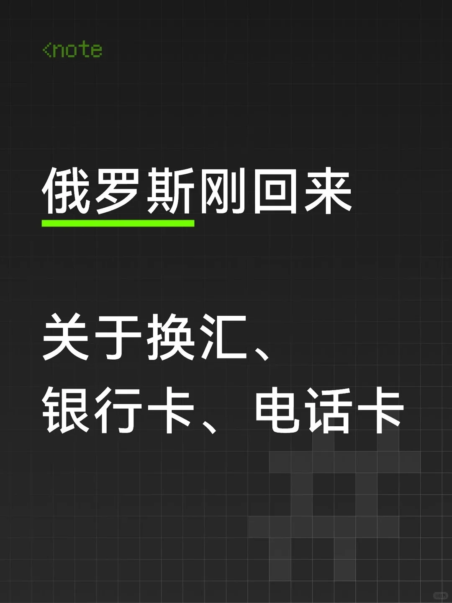

Щойно повернувшись із Росії, ми зібрали все, що дізналися про три теми, які цікавлять людей найбільше: **обмін валюти, банківські картки та SIM-картки**.

## 1. Обмін валюти

### Перед від’їздом

1. **Банки вдома зазвичай не можуть продати вам рублі** (принаймні в Шеньчжені жоден банк цього не робив). Ми взяли з собою **1800 юанів і 600 доларів США** готівкою й виявили, що цього **недостатньо**, — зверху ми додали б щонайменше ще 1000 юанів.
2. Якщо курс удома прийнятний, заздалегідь обміняйте **щонайменше 1000 рублів**, щоб вистачило на дорогу з аеропорту.

### В аеропорту

Обмінні стійки в аеропорту пропонують **жахливий курс — приблизно 1 : 8,5**. Тож:

> **В аеропорту обміняйте лише стільки, щоб дістатися до міста**, а великі суми залиште для міста.

### У місті (офіційні обмінні пункти)

- **Універмаг ГУМ на Красній площі**: на третьому поверсі є офіційна обмінна стійка; курс на той момент становив приблизно **1 : 11,5**.
- Ми не встигли випробувати місця з ще кращим курсом, тому жодних рекомендацій тут не даємо.

> Нагадування: завжди користуйтеся **офіційним обмінним пунктом** і ніколи не майте справ із приватниками — ви не захищені, а фальшиві банкноти чи суперечки цілком реальні.

## 2. Банківські картки: YooMoney (легальна російська банківська картка)

### Реєстрація перед від’їздом

Заздалегідь зареєструйтеся на **офіційному сайті**. Достатньо **номера мобільного телефону з вашої країни**, а сама процедура швидка.

### Отримання й активація картки після прильоту

1. **Де її отримати**: **вийдіть з аеропорту та поверніть ліворуч**; шукайте **фіолетову вивіску** — її добре видно.
2. **Випуск**: якщо ви вже заповнили реєстраційні дані вдома, достатньо показати їх співробітникам, і картку випустять на місці.
3. **Активація**: **тризначний код вводиться в застосунку** — усе дуже просто, і співробітники покажуть, як це зробити.
4. **Поповнення**: автомат для поповнення стоїть одразу біля стійки — **виберіть автомат, позначений зеленою галочкою ✓** (те саме стосується автоматів поза аеропортом). Після поповнення **автоматично стягується комісія 500 рублів**.
5. **Використання**: після активації та поповнення картка працює як звичайна.

### Кілька практичних підводних каменів

- **Перекази за номером телефону часто не проходять**: ми пробували кілька разів, і гроші, надіслані на номер телефону, так і не надійшли на інший рахунок — **переказуйте безпосередньо за номером картки**.
- **Стежте за комісіями**: офіційно комісія становить 3%, але на практиці **переказ на 100 рублів за номером картки фактично коштував 148 рублів**. Перед справжнім переказом **надішліть 2 рублі для перевірки**.
- **Метро**: картку можна прикласти двічі для двох людей — жодних проблем.
- **Автобуси**: після того як перша людина приклала картку, **прикладіть її ще раз і натисніть кнопку збоку**, щоб додати пасажира.

## 3. SIM-картки та мобільний інтернет

Ми обоє користувалися **SIM-картками, купленими заздалегідь онлайн у продавця у своїй країні, без підключеного роумінгу**. Ось що ми з’ясували:

| Ситуація | Сигнал |
| --- | --- |
| Зона відпочинку в Ермітажі | Немає сигналу |
| Аеропорт Мурманська | Немає сигналу |
| Деякі дороги в Теріберці | Немає сигналу |
| В інших місцях і в інший час | Нормальний |

> Ми також зустрічали інших мандрівників, чиї SIM-картки взагалі не мали сигналу. Для певності **підготуйте і місцеву SIM-картку, і міжнародний роумінг**: одну для мобільного інтернету, другу як резерв.

## Підсумок

| Пункт | Порада |
| --- | --- |
| Готівка | Майте із собою і юані, і долари США — це гнучкіше, ніж одна валюта |
| Обмін в аеропорту | Обмінюйте лише на транспорт; курс приблизно 1 : 8,5 |
| Обмін у місті | Офіційні стійки, як-от третій поверх ГУМ, приблизно 1 : 11,5 |
| Банківська картка | Заздалегідь зареєструйте YooMoney онлайн; отримайте картку за фіолетовою вивіскою в аеропорту |
| Перекази | Використовуйте номер картки, а не номер телефону; спершу перевірте малою сумою |
| Зв’язок | Місцева SIM-картка плюс роумінг як резерв |
