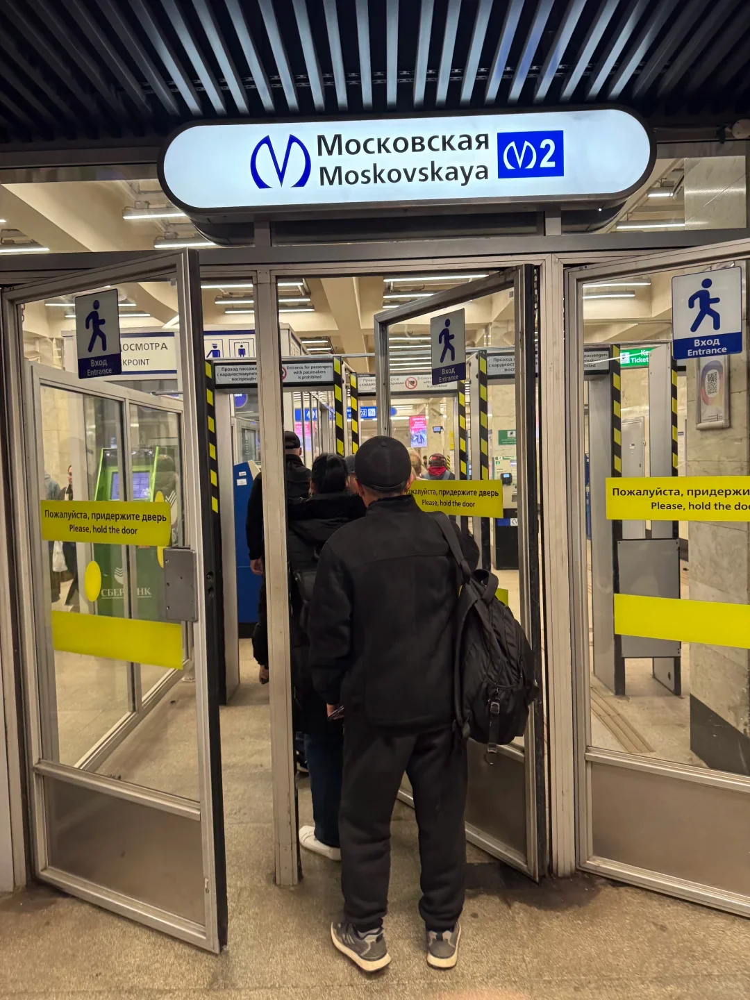

সাম্প্রতিক বছরগুলোতে মস্কো ও সেন্ট পিটার্সবার্গে ট্যাক্সিভাড়া তীব্রভাবে বেড়েছে—গত তিন বছরে প্রায় দ্বিগুণ—এবং বিমানবন্দর থেকে সরাসরি নেওয়া ট্যাক্সি প্রায়ই নিজের দেশের ট্যাক্সির চেয়ে বেশি খরচসাপেক্ষ। পুলকোভো বিমানবন্দর (LED) থেকে শহরের কেন্দ্রে সস্তায় ও দ্রুত পৌঁছাতে শুধু নিচের দুই ধাপ অনুসরণ করুন।

## ধাপ এক: মোস্কোভস্কায়া যেতে 39 বা 39A বাস নিন

আপনার লক্ষ্য নীল M2 মেট্রো লাইনের **মোস্কোভস্কায়া স্টেশন (Московская)**।

### টার্মিনাল থেকে বেরোনো

- **আন্তর্জাতিক ফ্লাইট**: ভবন থেকে বেরিয়ে **52 মিটার ডানে যান**
- **অভ্যন্তরীণ ফ্লাইট**: টার্মিনাল থেকে বেরিয়ে **52 মিটার বাঁয়ে যান**

বাসে ওঠার সময়ই ভাড়া দিয়ে দিন।

### দুটি রুটের মধ্যে কোনটি নেবেন

| রুট | যাত্রার সময় | যা জানা দরকার |
| --- | --- | --- |
| **বাস 39** | মোস্কোভস্কায়া পর্যন্ত প্রায় 25 মিনিট | প্রতিটি স্টপে থামে; বাসের প্রায় সবাই এখানেই নামে |
| **39A এক্সপ্রেস** | টার্মিনাস পর্যন্ত সরাসরি প্রায় 20 মিনিট | মাঝে কোনো স্টপ নেই |

বাসগুলোতে **রুশ-ইংরেজি দ্বিভাষিক ডিসপ্লে স্ক্রিন** থাকে, যেখানে গতি, রুট, সময় ও বাইরের তাপমাত্রা দেখায়, তাই এক শব্দ রুশ না জেনেও আপনি সবকিছু অনুসরণ করতে পারবেন এবং নিজের স্টপ আসতে দেখবেন।

> **ল্যান্ডমার্ক টিপ**: যখন আপনি **ভিক্টরি স্কয়ার** পেরোবেন (মাঝখানে বিজয় স্মৃতিস্তম্ভ), পরের স্টপই মোস্কোভস্কায়া মেট্রো স্টেশন (বাস 39)। 39A এক্সপ্রেস সেখানে থামে না এবং ট্রাফিকভেদে প্রায় 1–2 মিনিট পরে স্টপে পৌঁছায়।

## ধাপ দুই: মেট্রো লাইন 2-এ বদলান

নেমে গিয়ে শুধু ভিড়ের পিছনে চললেই সরাসরি মেট্রো স্টেশনে ঢুকে যাবেন; নীল লাইনে কেন্দ্রে যেতে প্রায় **15–20 মিনিট** লাগে।

**বদলসহ পুরো যাত্রা প্রায় 1 ঘণ্টা** লাগে শহরের কেন্দ্রে পৌঁছাতে।

## চলার সময় ও ভাড়া

| বিষয় | সময় |
| --- | --- |
| বাস 39 | প্রতিদিন 05:15–01:41, দিনে প্রতি 5–7 মিনিটে |
| বাস 39E (এক্সপ্রেস) | প্রতিদিন 06:00–01:49, প্রতি 13–20 মিনিটে |
| মেট্রো | প্রতিদিন 05:35–00:41 |

| বিষয় | ভাড়া |
| --- | --- |
| বাস | 88 রুবল (প্রায় 7 ইউয়ান) |
| মেট্রো | 95 রুবল (প্রায় 8 ইউয়ান) |

## পেমেন্ট কীভাবে করবেন

বাসে **রাশিয়ান ব্যাংক কার্ড (YooMoney সহ) বা নগদে** পেমেন্ট করতে পারবেন, কন্ডাক্টরের কাছ থেকে সরাসরি টিকিট কিনুন।

> **যাত্রার আগে 5,000 রুবলের নোট ভাঙিয়ে নেওয়া ভালো**—কন্ডাক্টরের কাছে খুচরো নাও থাকতে পারে, আর স্থানীয়রা প্রায় সবসময় কার্ডে পেমেন্ট করে।

## ব্যবহারিক টিপস

- বাসে লাগেজ র্যাক আছে, তাই স্যুটকেস নিয়ে কোনো সমস্যা নেই।
- **2GIS-এ বাসের লাইভ সময় দেখুন** (রুশভাষী বিশ্বের সেরা ম্যাপ অ্যাপ); রওনার আগেই ডাউনলোড করে নিন।
- **বিমানবন্দরে কখনো অননুমোদিত ট্যাক্সি নেবেন না**—এটি বিশ্বজুড়ে বিমানবন্দরগুলোর একটি সাধারণ সমস্যা, আর দাম সরকারি ভাড়ার চেয়ে অনেক বেশি।
