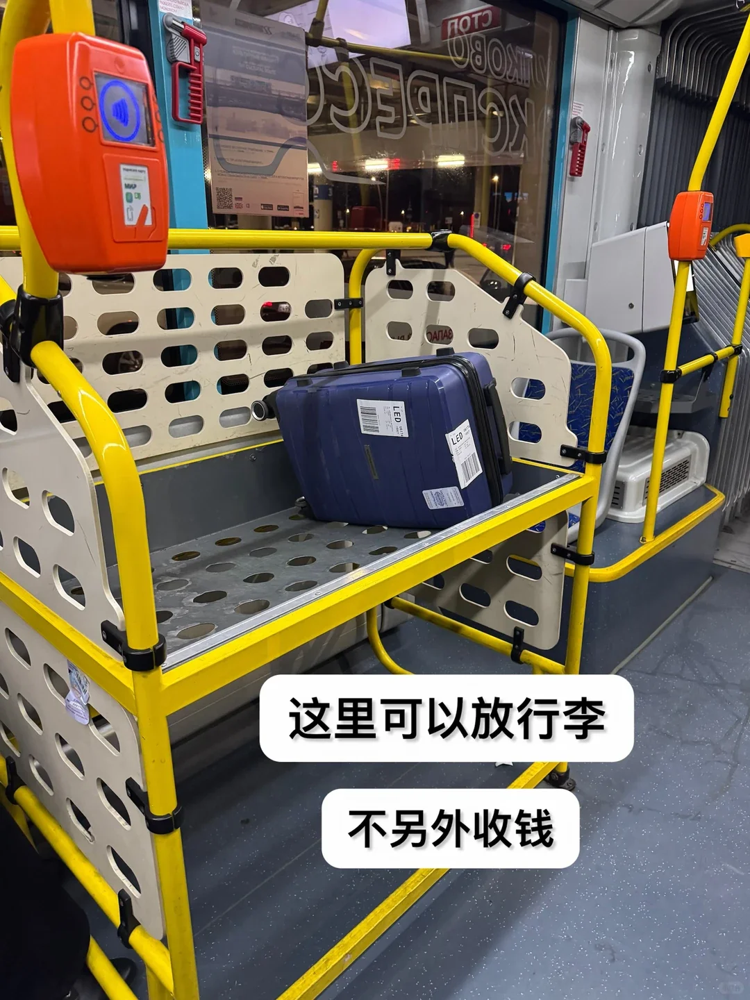
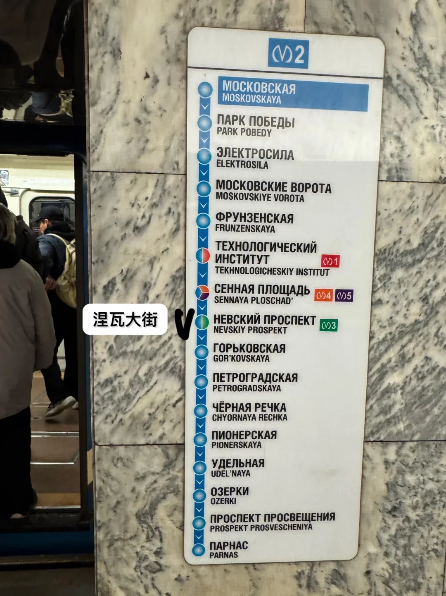

Ceny taxi v Moskvě a Petrohradu v posledních letech prudce vzrostly — za poslední tři roky téměř na dvojnásobek — a taxi přímo z letiště je často dražší než doma. Abyste se z letiště Pulkovo (LED) dostali do centra levně a rychle, stačí dodržet dva kroky níže.

## První krok: jeďte autobusem 39 nebo 39A na Moskovskaju

Vaším cílem je **stanice Moskovskaja (Московская) na modré lince metra M2**.

### Jak opustit terminál

- **Mezinárodní lety**: opusťte budovu a **zahněte doprava na 52 m**
- **Vnitrostátní lety**: opusťte terminál a **zahněte doleva na 52 m**

Jízdné prostě zaplaťte při nástupu.

### Kterou ze dvou tras zvolit

| Trasa | Doba jízdy | Co je dobré vědět |
| --- | --- | --- |
| **Autobus 39** | Asi 25 minut na Moskovskaju | Zastavuje na všech zastávkách; skoro všichni ve voze zde vystoupí |
| **Expres 39A** | Asi 20 minut přímo na konečnou | Bez zastávek mezi tím |

Autobusy mají také **dvojjazyčné obrazovky v ruštině a angličtině**, které ukazují rychlost, trasu, čas a venkovní teplotu, takže můžete všechno sledovat i bez znalosti jediného slova rusky a vždy vidíte, že se blíží vaše zastávka.

> **Tip na orientační bod**: když projedete **Vítězné náměstí** (uprostřed stojí památník vítězství), další zastávka je stanice metra Moskovskaja (autobus 39). Expres 39A tam nezastavuje a na zastávku dorazí asi o 1–2 minuty později, podle provozu.

## Druhý krok: přestupte na linku metra 2

Po vystoupení se prostě držte davu a dojdete přímo do stanice metra; modrá linka vás do centra doveze asi za **15–20 minut**.

**Celá cesta včetně přestupu trvá asi 1 hodinu**, než se dostanete do centra.

## Provozní doba a jízdné

| Položka | Provozní doba |
| --- | --- |
| Autobus 39 | Denně 05:15–01:41, přes den každých 5–7 minut |
| Autobus 39E (expres) | Denně 06:00–01:49, každých 13–20 minut |
| Metro | Denně 05:35–00:41 |

| Položka | Jízdné |
| --- | --- |
| Autobus | 88 rublů (asi 7 jüanů) |
| Metro | 95 rublů (asi 8 jüanů) |

## Jak platit

V autobuse můžete platit **ruskou bankovní kartou (včetně YooMoney) nebo v hotovosti** a lístek si koupíte přímo u průvodčího.

> **Před cestou se vyplatí rozměnit pětitisícovou bankovku** — průvodčí nemusí mít drobné a místní téměř vždy platí kartou.

## Praktické tipy

- Ve voze jsou zavazadlové police, takže s kufrem není problém.
- **Aktuální časy autobusů si ověřte v 2GIS** (nejlepší mapová aplikace v rusky mluvícím světě); stáhněte si ji před odjezdem.
- **Nikdy nevyužívejte neoficiální taxi na letišti** — je to běžný problém na letištích po celém světě a cena je mnohem vyšší než u oficiálního.
