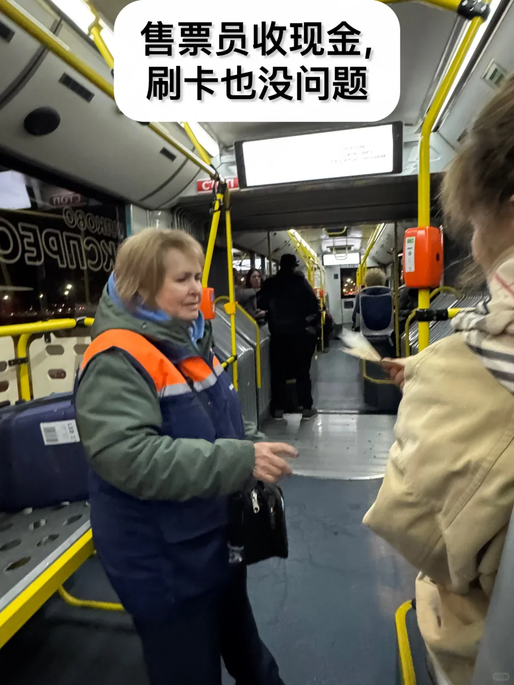

Las tarifas de taxi en Moscú y San Petersburgo han subido mucho en los últimos años —casi el doble en tres años— y un taxi tomado directamente en el aeropuerto suele ser más caro que uno en tu país. Para ir del aeropuerto de Pulkovo (LED) al centro de forma barata y rápida, basta con seguir los dos pasos siguientes.

## Paso uno: toma el autobús 39 o 39A hasta Moskovskaya

Tu objetivo es la **estación Moskovskaya (Московская), en la línea azul M2 del metro**.

### Cómo salir de la terminal

- **Vuelos internacionales**: sal del edificio y **gira a la derecha 52 m**
- **Vuelos nacionales**: sal de la terminal y **gira a la izquierda 52 m**

Solo tienes que pagar el billete al subir.

### Cuál de las dos rutas tomar

| Ruta | Duración del trayecto | Qué conviene saber |
| --- | --- | --- |
| **Autobús 39** | Unos 25 minutos hasta Moskovskaya | Para en todas las paradas; casi todos los que van a bordo se bajan aquí |
| **39A exprés** | Unos 20 minutos directo a la terminal | Sin paradas intermedias |

Los autobuses también tienen **pantallas bilingües en ruso e inglés** que muestran la velocidad, la ruta, la hora y la temperatura exterior, así que puedes seguirlo todo sin saber una palabra de ruso y ver siempre venir tu parada.

> **Truco del monumento**: cuando pases por la **Plaza de la Victoria** (con el monumento a la victoria en el centro), la siguiente parada es la estación de metro Moskovskaya (autobús 39). El 39A exprés no para allí y llega a la parada unos 1–2 minutos después, según el tráfico.

## Paso dos: cambia a la línea 2 del metro

Al bajarte, solo tienes que seguir a la gente y entrarás directamente en la estación de metro; la línea azul tarda unos **15–20 minutos** hasta el centro.

**Todo el trayecto, incluido el transbordo, dura alrededor de 1 hora** hasta el centro de la ciudad.

## Horarios y tarifas

| Elemento | Horario |
| --- | --- |
| Autobús 39 | Todos los días de 05:15 a 01:41, cada 5–7 minutos durante el día |
| Autobús 39E (exprés) | Todos los días de 06:00 a 01:49, cada 13–20 minutos |
| Metro | Todos los días de 05:35 a 00:41 |

| Elemento | Tarifa |
| --- | --- |
| Autobús | 88 rublos (unos 7 yuanes) |
| Metro | 95 rublos (unos 8 yuanes) |

## Cómo pagar

En el autobús puedes pagar con **tarjeta bancaria rusa (YooMoney incluido) o en efectivo**, comprando el billete directamente al revisor.

> **Vale la pena cambiar un billete de 5.000 rublos antes de viajar**: puede que el revisor no tenga cambio, y los locales casi siempre pagan con tarjeta.

## Consejos prácticos

- Hay portaequipajes a bordo, así que una maleta no es problema.
- **Consulta los horarios de los autobuses en tiempo real en 2GIS** (la mejor app de mapas del mundo rusófono); descárgala antes de salir.
- **Nunca tomes los taxis no oficiales del aeropuerto**: es un problema habitual en los aeropuertos de todo el mundo y el precio es mucho más alto que el oficial.
