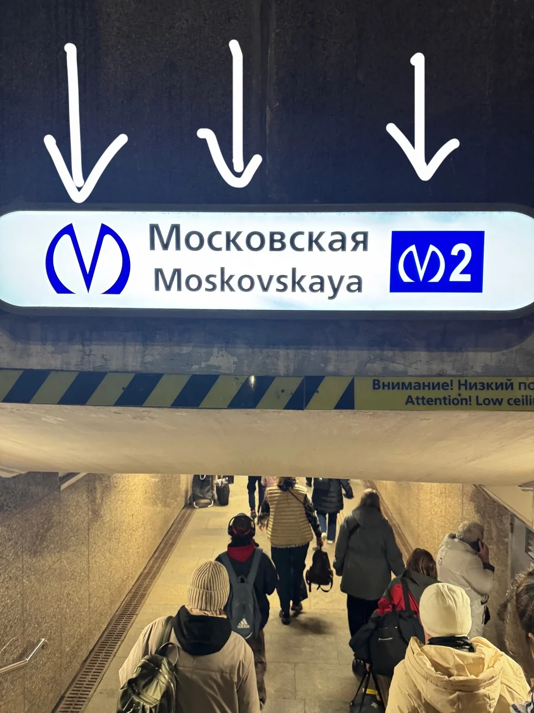

मॉस्को और सेंट पीटर्सबर्ग में टैक्सी किराए पिछले कुछ वर्षों में तेज़ी से बढ़े हैं — पिछले तीन सालों में लगभग दोगुने — और सीधे एयरपोर्ट से ली गई टैक्सी अक्सर घर की टैक्सी से भी महँगी पड़ती है। पुल्कोवो एयरपोर्ट (LED) से शहर के केंद्र तक सस्ते और तेज़ तरीके से पहुँचने के लिए बस नीचे दिए दो कदम अपनाएँ।

## पहला कदम: बस 39 या 39A से मोस्कोव्स्काया जाएँ

आपका लक्ष्य है **नीली M2 मेट्रो लाइन पर मोस्कोव्स्काया स्टेशन (Московская)**।

### टर्मिनल से बाहर निकलना

- **अंतरराष्ट्रीय उड़ानें**: इमारत से बाहर निकलकर **दाएँ मुड़ें, 52 मीटर**
- **घरेलू उड़ानें**: टर्मिनल से बाहर निकलकर **बाएँ मुड़ें, 52 मीटर**

बस में चढ़ते समय ही किराया दे दें।

### दोनों में से कौन-सा रास्ता लें

| रास्ता | यात्रा समय | जानने योग्य बात |
| --- | --- | --- |
| **बस 39** | मोस्कोव्स्काया तक करीब 25 मिनट | हर स्टॉप पर रुकती है; बस में लगभग सभी यहीं उतरते हैं |
| **39A एक्सप्रेस** | सीधे अंतिम स्टॉप तक करीब 20 मिनट | बीच में कोई स्टॉप नहीं |

बसों में **रूसी-अंग्रेज़ी दोभाषी डिस्प्ले स्क्रीन** भी हैं जो गति, रास्ता, समय और बाहर का तापमान दिखाती हैं, इसलिए रूसी का एक शब्द जाने बिना भी आप सब कुछ समझ सकते हैं और अपना स्टॉप आते देख सकते हैं।

> **लैंडमार्क टिप**: जब आप **विक्ट्री स्क्वायर** (बीच में विजय स्मारक वाला) पार करें, तो अगला स्टॉप मोस्कोव्स्काया मेट्रो स्टेशन है (बस 39)। 39A एक्सप्रेस वहाँ नहीं रुकती और ट्रैफ़िक के हिसाब से करीब 1–2 मिनट बाद उस स्टॉप पर पहुँचती है।

## दूसरा कदम: मेट्रो लाइन 2 बदलें

उतरने के बाद भीड़ के पीछे-पीछे चलें, आप सीधे मेट्रो स्टेशन में पहुँच जाएँगे; नीली लाइन से केंद्र तक करीब **15–20 मिनट** लगते हैं।

**बदलाव सहित पूरी यात्रा में करीब 1 घंटा** लगता है शहर के केंद्र तक पहुँचने में।

## खुलने का समय और किराया

| मद | समय |
| --- | --- |
| बस 39 | रोज़ 05:15–01:41, दिन में हर 5–7 मिनट |
| बस 39E (एक्सप्रेस) | रोज़ 06:00–01:49, हर 13–20 मिनट |
| मेट्रो | रोज़ 05:35–00:41 |

| मद | किराया |
| --- | --- |
| बस | 88 रूबल (करीब 7 युआन) |
| मेट्रो | 95 रूबल (करीब 8 युआन) |

## भुगतान कैसे करें

बस में आप **रूसी बैंक कार्ड (YooMoney सहित) या नकद** से भुगतान कर सकते हैं, टिकट सीधे कंडक्टर से खरीदें।

> **सफ़र से पहले 5,000 रूबल का नोट तुड़वा लेना बेहतर है** — कंडक्टर के पास छुट्टे न हों, और स्थानीय लोग लगभग हमेशा कार्ड से ही भुगतान करते हैं।

## व्यावहारिक सुझाव

- बस में सामान रखने की रैक हैं, इसलिए सूटकेस को कोई दिक्कत नहीं।
- **2GIS पर बसों का लाइव समय देखें** (रूसी भाषी दुनिया का सबसे अच्छा मैप ऐप); निकलने से पहले इसे डाउनलोड कर लें।
- **एयरपोर्ट पर कभी अनौपचारिक टैक्सी न लें** — यह दुनिया भर के एयरपोर्ट की आम समस्या है, और कीमत आधिकारिक से कहीं ज़्यादा होती है।
