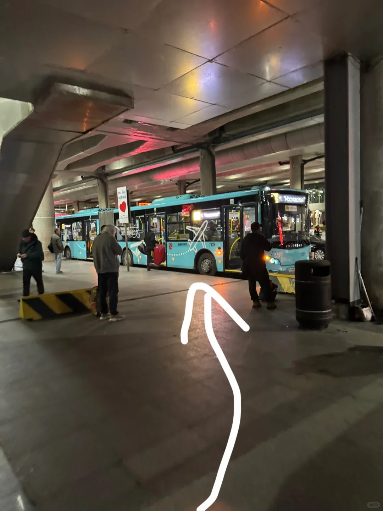
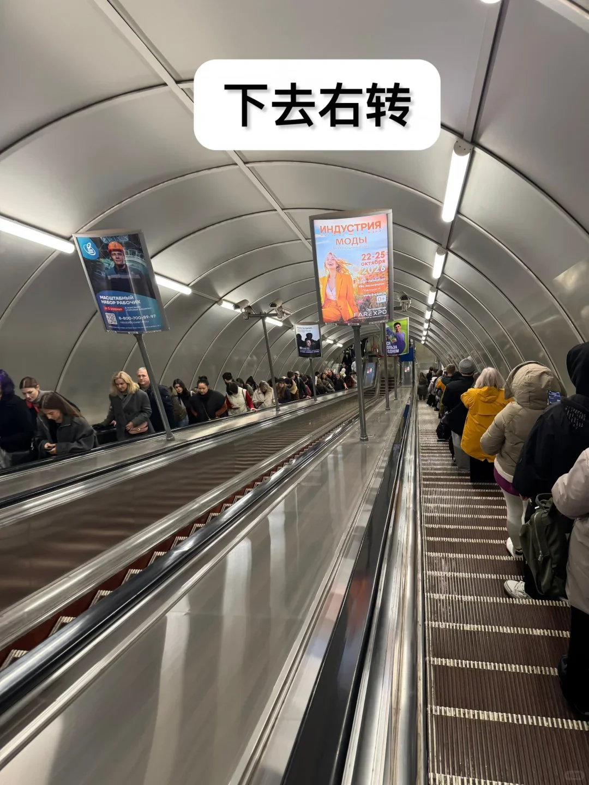

Tarif taksi di Moskow dan St Petersburg naik tajam dalam beberapa tahun terakhir — hampir dua kali lipat dalam tiga tahun — dan taksi yang diambil langsung dari bandara sering lebih mahal daripada di negara asal Anda. Untuk mencapai pusat kota dari Bandara Pulkovo (LED) dengan murah dan cepat, cukup ikuti dua langkah di bawah ini.

## Langkah pertama: naik bus 39 atau 39A ke Moskovskaya

Target Anda adalah **stasiun Moskovskaya (Московская) di jalur metro M2 berwarna biru**.

### Keluar dari terminal

- **Penerbangan internasional**: keluar dari gedung dan **belok kanan sejauh 52 m**
- **Penerbangan domestik**: keluar dari terminal dan **belok kiri sejauh 52 m**

Cukup bayar tarif saat naik.

### Rute mana dari keduanya yang harus dipilih

| Rute | Waktu perjalanan | Yang perlu diketahui |
| --- | --- | --- |
| **Bus 39** | Sekitar 25 menit ke Moskovskaya | Berhenti di setiap halte; hampir semua penumpang turun di sini |
| **39A ekspres** | Sekitar 20 menit langsung ke terminal | Tidak ada perhentian di antaranya |

Bus juga memiliki **layar tampilan dwibahasa Rusia-Inggris** yang menunjukkan kecepatan, rute, waktu, dan suhu luar, sehingga Anda dapat mengikutinya tanpa sepatah kata pun bahasa Rusia dan selalu tahu halte Anda sudah dekat.

> **Petunjuk patokan**: saat melewati **Alun-Alun Kemenangan** (dengan monumen kemenangan di tengahnya), halte berikutnya adalah stasiun metro Moskovskaya (bus 39). Bus ekspres 39A tidak berhenti di sana dan mencapai halte sekitar 1–2 menit kemudian, tergantung lalu lintas.

## Langkah kedua: berganti ke metro Jalur 2

Setelah turun, cukup ikuti kerumunan dan Anda akan langsung berjalan masuk ke stasiun metro; jalur biru memakan waktu sekitar **15–20 menit** menuju pusat kota.

**Seluruh perjalanan, termasuk pergantian, memakan waktu sekitar 1 jam** untuk mencapai pusat kota.

## Jam operasional dan tarif

| Item | Jam |
| --- | --- |
| Bus 39 | Setiap hari 05.15–01.41, setiap 5–7 menit pada siang hari |
| Bus 39E (ekspres) | Setiap hari 06.00–01.49, setiap 13–20 menit |
| Metro | Setiap hari 05.35–00.41 |

| Item | Tarif |
| --- | --- |
| Bus | 88 rubel (sekitar 7 yuan) |
| Metro | 95 rubel (sekitar 8 yuan) |

## Cara membayar

Di bus, Anda dapat membayar dengan **kartu bank Rusia (termasuk YooMoney) atau tunai**, dengan membeli tiket langsung dari konduktor.

> **Sebaiknya pecahkan uang kertas 5.000 rubel sebelum berangkat** — konduktor mungkin tidak memiliki uang kembalian, dan penduduk lokal hampir selalu membayar dengan kartu.

## Tips praktis

- Ada rak bagasi di dalam bus, jadi membawa koper tidak masalah.
- **Periksa waktu bus secara langsung di 2GIS** (aplikasi peta terbaik di dunia berbahasa Rusia); unduh sebelum Anda berangkat.
- **Jangan pernah naik taksi tidak resmi di bandara** — ini masalah umum di bandara seluruh dunia, dan harganya jauh lebih tinggi daripada yang resmi.
