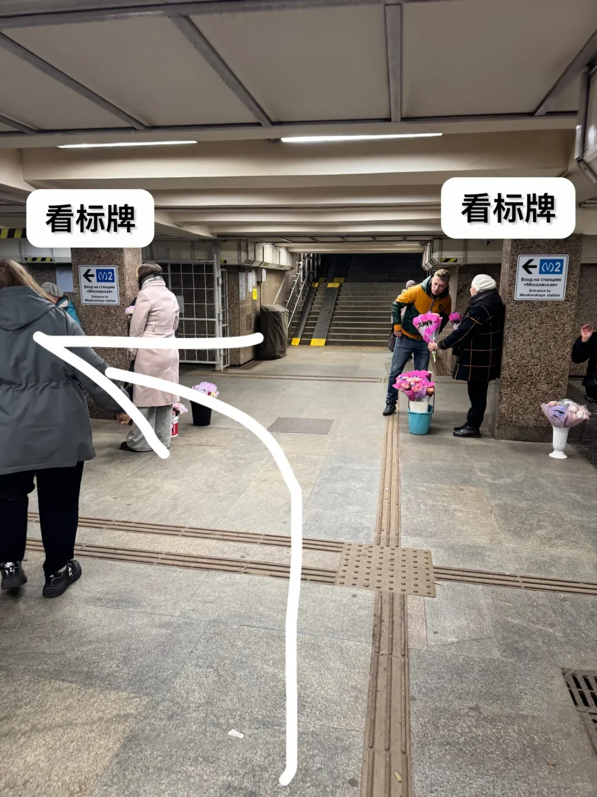

モスクワとサンクトペテルブルクのタクシー運賃は近年急騰し、この3年でほぼ2倍になりました。空港からそのまま乗るタクシーは、母国より高いことがよくあります。プルコヴォ空港（LED）から市内中心部へ安く速く行くには、次の2ステップに従うだけです。

## ステップ1：39番または39A番バスでモスコフスカヤへ

目指すのは**青い地下鉄M2号線のモスコフスカヤ駅（Московская）**です。

### ターミナルを出る

- **国際線**：建物を出て**右へ52 m**
- **国内線**：ターミナルを出て**左へ52 m**

乗車時に運賃を払うだけです。

### 2つのルートのどちらを選ぶか

| ルート | 所要時間 | ポイント |
| --- | --- | --- |
| **39番バス** | モスコフスカヤまで約25分 | 各停留所に停車。乗客のほとんどがここで降ります |
| **39A番急行** | 終点まで直行で約20分 | 途中停車なし |

バスには**ロシア語・英語の二言語表示画面**があり、速度、ルート、時刻、外気温が表示されます。ロシア語が一言もわからなくても状況を把握でき、降りる停留所も見逃しません。

> **目印のコツ**：**勝利広場**（中央に戦勝記念碑があります）を過ぎると、次の停留所がモスコフスカヤ地下鉄駅です（39番バス）。39A番急行はそこに停まらず、交通状況によりますが1〜2分後に到着します。

## ステップ2：地下鉄2号線に乗り換える

降りたら人の流れに従うだけで、そのまま地下鉄駅に入れます。青い路線で中心部まで約**15〜20分**です。

**乗り換えを含めた全体で約1時間**で市内中心部に着きます。

## 運行時間と運賃

| 項目 | 時間 |
| --- | --- |
| 39番バス | 毎日05:15〜01:41、日中は5〜7分間隔 |
| 39E番バス（急行） | 毎日06:00〜01:49、13〜20分間隔 |
| 地下鉄 | 毎日05:35〜00:41 |

| 項目 | 運賃 |
| --- | --- |
| バス | 88ルーブル（約7元） |
| 地下鉄 | 95ルーブル（約8元） |

## 支払い方法

バスでは**ロシアのバンクカード（YooMoneyを含む）または現金**で払えます。車掌から直接切符を買ってください。

> **旅行前に5,000ルーブル札を崩しておくと安心です**。車掌が釣り銭を持っていないことがあり、地元の人はほとんどカードで払います。

## 実用的なヒント

- 車内に荷物棚があるので、スーツケースも問題ありません。
- **2GISでバスのリアルタイム時刻を確認**しましょう（ロシア語圏で最も優秀な地図アプリ）。出発前にダウンロードしておいてください。
- **空港の非公式タクシーには絶対に乗らないでください**。世界中の空港でよくある問題で、料金は公式よりはるかに高くなります。
