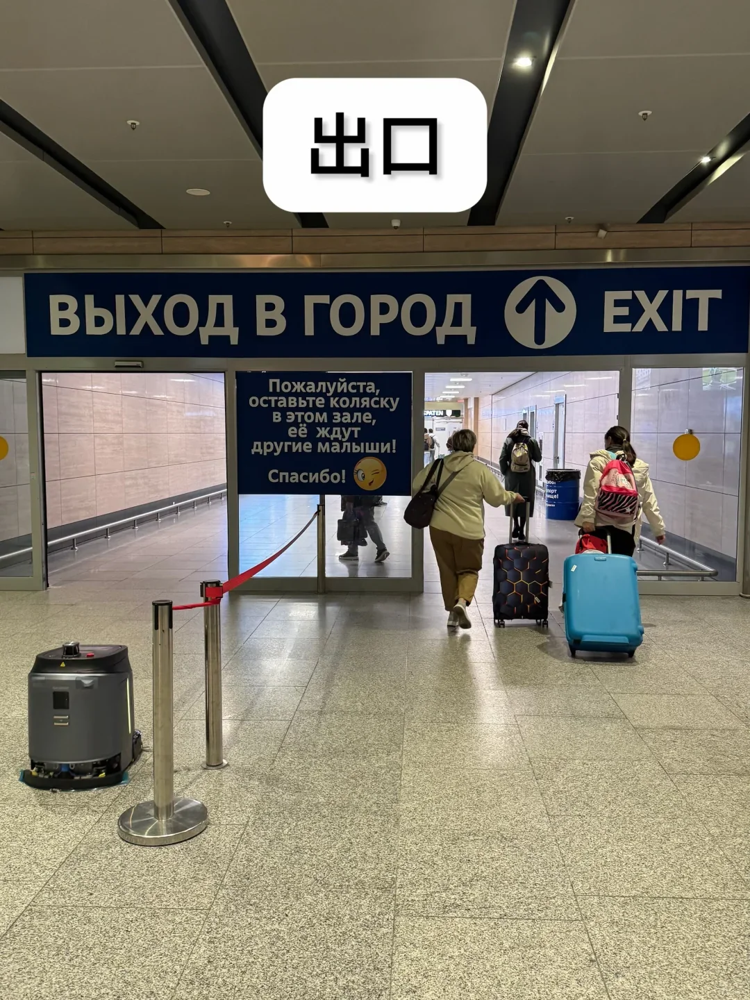

Taxitarieven in Moskou en Sint-Petersburg zijn de afgelopen jaren steil gestegen — in drie jaar tijd bijna verdubbeld — en een taxi die je rechtstreeks van de luchthaven neemt, is vaak duurder dan thuis. Om goedkoop en snel van de luchthaven Pulkovo (LED) naar het centrum te komen, volg je gewoon de twee onderstaande stappen.

## Stap één: neem bus 39 of 39A naar Moskovskaya

Je doel is **station Moskovskaya (Московская) aan de blauwe metrolijn M2**.

### De terminal uit

- **Internationale vluchten**: verlaat het gebouw en **sla 52 m rechtsaf**
- **Binnenlandse vluchten**: verlaat de terminal en **sla 52 m linksaf**

Betaal gewoon de ritprijs wanneer je instapt.

### Welke van de twee routes je neemt

| Route | Reistijd | Waar je op moet letten |
| --- | --- | --- |
| **Bus 39** | Ongeveer 25 minuten naar Moskovskaya | Stopt bij elke halte; bijna iedereen aan boord stapt hier uit |
| **39A-express** | Ongeveer 20 minuten rechtstreeks naar de eindhalte | Geen haltes onderweg |

De bussen hebben ook **tweetalige Russisch-Engelse displays** die snelheid, route, tijd en de buitentemperatuur tonen, zodat je alles kunt volgen zonder een woord Russisch en altijd ziet wanneer je halte eraan komt.

> **Tip voor het herkenningspunt**: wanneer je **Plosjtsjad Pobedy** passeert (met het overwinningsmonument in het midden), is de volgende halte metrostation Moskovskaya (bus 39). De 39A-express stopt daar niet en komt, afhankelijk van het verkeer, ongeveer 1–2 minuten later bij de halte.

## Stap twee: overstappen op metrolijn 2

Als je uitstapt, volg je gewoon de menigte en loop je zo het metrostation binnen; de blauwe lijn doet er ongeveer **15–20 minuten** over naar het centrum.

**De hele reis, inclusief de overstap, duurt ongeveer 1 uur** tot je in het centrum bent.

## Openingstijden en tarieven

| Onderdeel | Tijden |
| --- | --- |
| Bus 39 | Dagelijks 05:15–01:41, overdag elke 5–7 minuten |
| Bus 39E (express) | Dagelijks 06:00–01:49, elke 13–20 minuten |
| Metro | Dagelijks 05:35–00:41 |

| Onderdeel | Tarief |
| --- | --- |
| Bus | 88 roebel (ongeveer 7 yuan) |
| Metro | 95 roebel (ongeveer 8 yuan) |

## Hoe je betaalt

In de bus kun je betalen met een **Russische bankkaart (YooMoney inbegrepen) of contant**, door het kaartje rechtstreeks bij de conducteur te kopen.

> **Het loont om voor je reis een biljet van 5.000 roebel te wisselen** — de conducteur heeft misschien geen wisselgeld, en de lokale bevolking betaalt bijna altijd met kaart.

## Praktische tips

- Aan boord zijn bagagerekken, dus een koffer is geen probleem.
- **Bekijk de actuele bustijden op 2GIS** (de beste kaartenapp in de Russischsprekende wereld); download hem voordat je vertrekt.
- **Neem nooit de onofficiële taxi's op de luchthaven** — het is een veelvoorkomend probleem op luchthavens wereldwijd, en de prijs ligt veel hoger dan de officiële.
