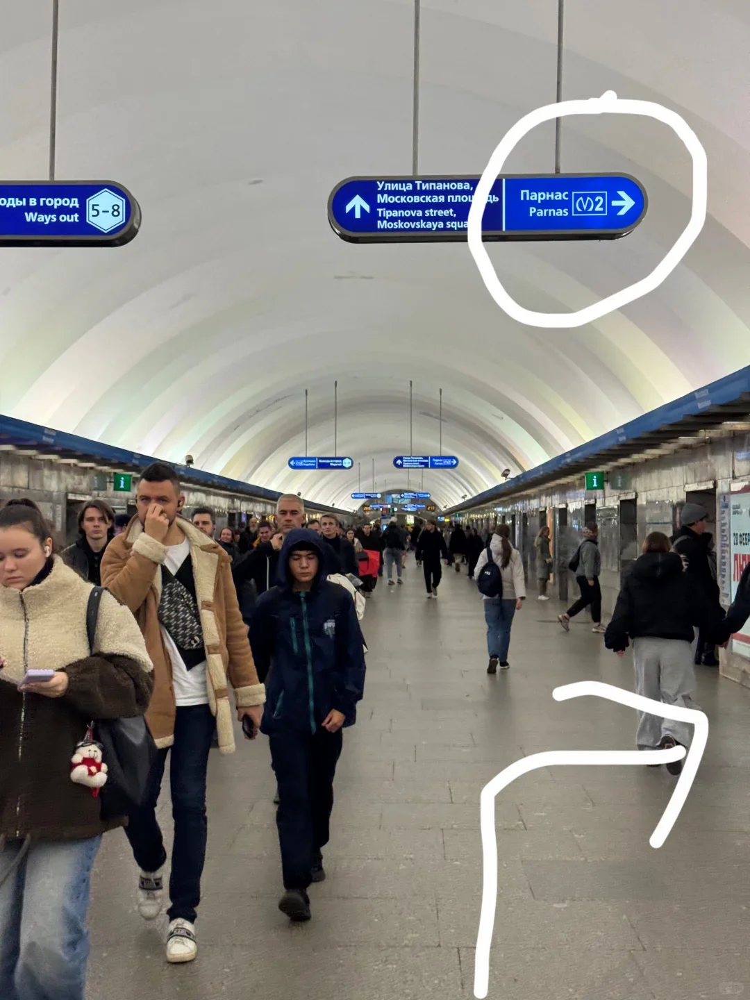

Ceny przejazdów taksówką w Moskwie i Sankt Petersburgu mocno wzrosły w ostatnich latach — w ciągu ostatnich trzech lat niemal dwukrotnie — a taksówka zamówiona bezpośrednio na lotnisku jest często droższa niż u siebie. Aby tanio i szybko dostać się z lotniska Pułkowo (LED) do centrum miasta, wystarczy wykonać dwa kroki opisane poniżej.

## Krok pierwszy: autobusem 39 lub 39A do stacji Moskowskaja

Twoim celem jest **stacja Moskowskaja (Московская) na niebieskiej linii metra M2**.

### Wyjście z terminala

- **Loty międzynarodowe**: wyjdź z budynku i **skręć w prawo, idź 52 m**
- **Loty krajowe**: wyjdź z terminala i **skręć w lewo, idź 52 m**

Bilet wystarczy opłacić przy wsiadaniu.

### Którą z dwóch tras wybrać

| Trasa | Czas jazdy | Warto wiedzieć |
| --- | --- | --- |
| **Autobus 39** | Około 25 minut do stacji Moskowskaja | Zatrzymuje się na każdym przystanku; prawie wszyscy wysiadają tutaj |
| **39A ekspres** | Około 20 minut prosto do pętli | Żadnych przystanków po drodze |

Autobusy mają też **dwujęzyczne wyświetlacze rosyjsko-angielskie**, pokazujące prędkość, trasę, godzinę i temperaturę na zewnątrz, więc bez znajomości rosyjskiego możesz śledzić całą podróż i zawsze widzieć, że zbliża się Twój przystanek.

> **Wskazówka z punktem orientacyjnym**: gdy mijasz **Plac Zwycięstwa** (z pomnikiem zwycięstwa pośrodku), następny przystanek to stacja metra Moskowskaja (autobus 39). Ekspres 39A się tam nie zatrzymuje i dociera na przystanek około 1–2 minuty później, w zależności od ruchu.

## Krok drugi: przesiadka na linię metra 2

Po wysiadaniu wystarczy iść za tłumem, a prosto wejdziesz do stacji metra; niebieska linia jedzie do centrum około **15–20 minut**.

**Cała podróż, łącznie z przesiadką, zajmuje około 1 godziny** do centrum miasta.

## Godziny kursowania i bilety

| Element | Godziny |
| --- | --- |
| Autobus 39 | Codziennie 05:15–01:41, w dzień co 5–7 minut |
| Autobus 39E (ekspres) | Codziennie 06:00–01:49, co 13–20 minut |
| Metro | Codziennie 05:35–00:41 |

| Element | Cena biletu |
| --- | --- |
| Autobus | 88 rubli (około 7 juanów) |
| Metro | 95 rubli (około 8 juanów) |

## Jak płacić

W autobusie możesz zapłacić **rosyjską kartą bankową (w tym YooMoney) lub gotówką**, kupując bilet bezpośrednio u konduktora.

> **Przed podróżą warto rozmienić banknot 5000 rubli** — konduktor może nie mieć wydać, a miejscowi prawie zawsze płacą kartą.

## Wskazówki praktyczne

- W autobusie są półki bagażowe, więc walizka nie stanowi problemu.
- **Sprawdzaj aktualne godziny autobusów w 2GIS** (najlepszej aplikacji mapowej w rosyjskojęzycznym świecie); pobierz ją przed wyjazdem.
- **Nigdy nie korzystaj z nieoficjalnych taksówek na lotnisku** — to powszechny problem na lotniskach na całym świecie, a cena jest znacznie wyższa niż oficjalna.
