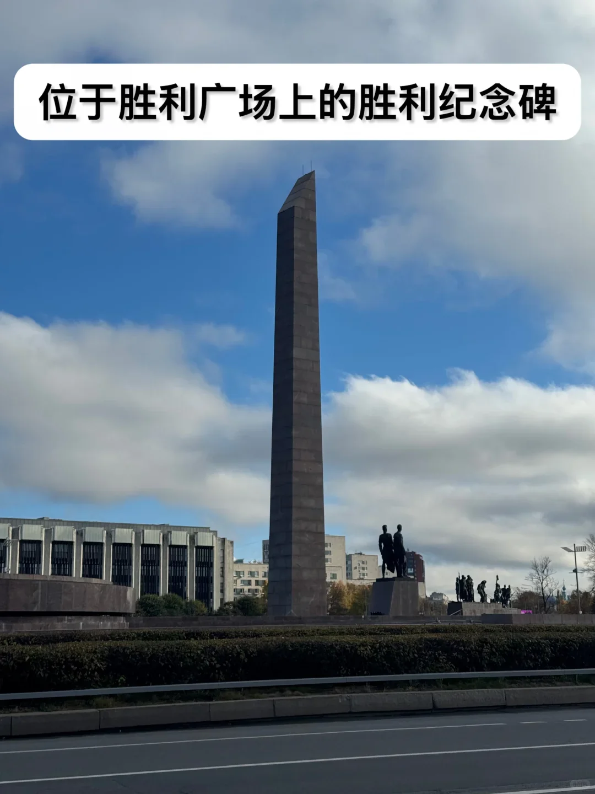

Tarifele la taxi în Moscova și Sankt Petersburg au crescut abrupt în ultimii ani — aproape s-au dublat în ultimii trei ani —, iar un taxi luat direct de la aeroport este adesea mai scump decât unul de acasă. Ca să ajungeți de la aeroportul Pulkovo (LED) în centrul orașului ieftin și repede, urmați pur și simplu cei doi pași de mai jos.

## Pasul unu: luați autobuzul 39 sau 39A până la Moskovskaia

Ținta este **stația Moskovskaia (Московская) de pe linia albastră M2 de metrou**.

### Ieșirea din terminal

- **Zboruri internaționale**: ieșiți din clădire și **virați la dreapta 52 m**
- **Zboruri interne**: ieșiți din terminal și **virați la stânga 52 m**

Plătiți pur și simplu tariful când urcați.

### Pe care dintre cele două rute să o alegeți

| Rută | Durata călătoriei | Ce trebuie să știți |
| --- | --- | --- |
| **Autobuzul 39** | Circa 25 de minute până la Moskovskaia | Oprește la fiecare stație; aproape toată lumea de la bord coboară aici |
| **Express 39A** | Circa 20 de minute direct până la capăt de linie | Fără opriri intermediare |

Autobuzele au și **ecrane bilingve ruso-engleze** care arată viteza, ruta, ora și temperatura de afară, așa că puteți urmări totul fără nicio vorbă de rusă și vedeți mereu când se apropie stația.

> **Indiciu de orientare**: când treceți de **Piața Victoriei** (cu monumentul victoriei în mijloc), următoarea stație este stația de metrou Moskovskaia (autobuzul 39). Expressul 39A nu oprește acolo și ajunge la stație cam 1–2 minute mai târziu, în funcție de trafic.

## Pasul doi: schimbați pe metroul linia 2

După ce coborâți, urmați pur și simplu mulțimea și veți intra direct în stația de metrou; linia albastră ajunge în centru în circa **15–20 de minute**.

**Întreaga călătorie, inclusiv schimbarea, durează circa 1 oră** până în centrul orașului.

## Program și tarife

| Element | Program |
| --- | --- |
| Autobuzul 39 | Zilnic 05:15–01:41, la fiecare 5–7 minute ziua |
| Autobuzul 39E (express) | Zilnic 06:00–01:49, la fiecare 13–20 de minute |
| Metroul | Zilnic 05:35–00:41 |

| Element | Tarif |
| --- | --- |
| Autobuzul | 88 de ruble (circa 7 yuani) |
| Metroul | 95 de ruble (circa 8 yuani) |

## Cum să plătiți

În autobuz puteți plăti cu **card bancar rusesc (inclusiv YooMoney) sau în numerar**, cumpărând biletul direct de la controlor.

> **Merită să spargeți o bancnotă de 5.000 de ruble înainte de plecare** — controlorul poate să nu aibă rest, iar localnicii plătesc aproape întotdeauna cu cardul.

## Sfaturi practice

- La bord există rafturi pentru bagaje, așa că o valiză nu este o problemă.
- **Verificați orele de autobuz în timp real pe 2GIS** (cea mai bună aplicație de hărți din lumea rusofonă); descărcați-o înainte de plecare.
- **Nu luați niciodată taxiurile neoficiale de la aeroport** — este o problemă frecventă în aeroporturile din întreaga lume, iar prețul este mult mai mare decât cel oficial.
