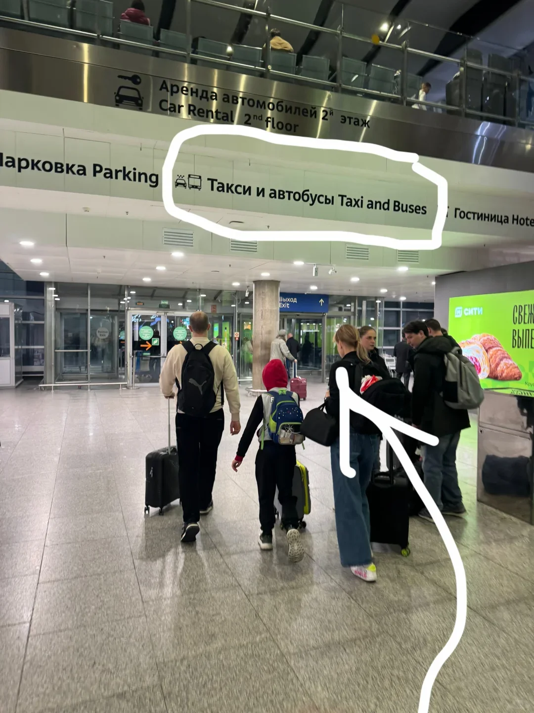
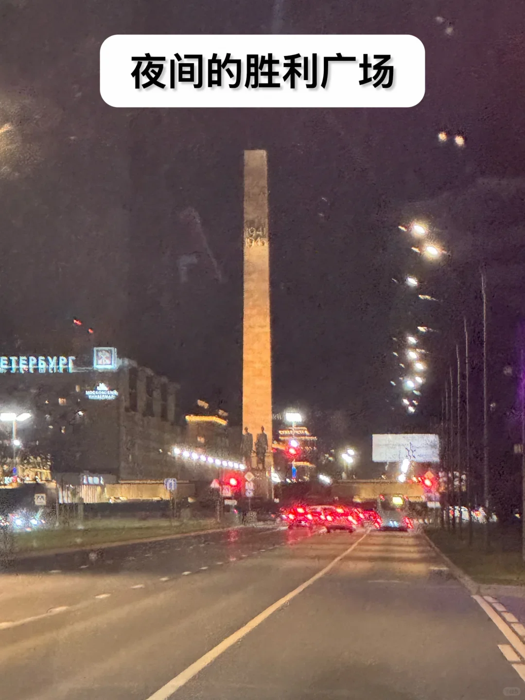
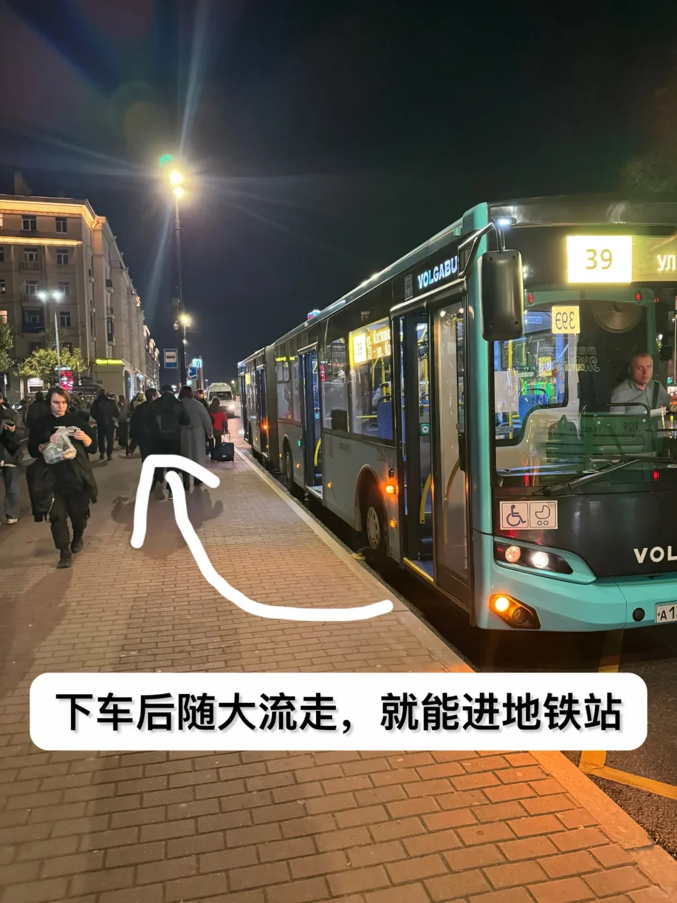

Taxipriserna i Moskva och Sankt Petersburg har stigit kraftigt de senaste åren – nästan fördubblats under de senaste tre åren – och en taxi direkt från flygplatsen är ofta dyrare än en hemma. För att ta dig från Pulkovo flygplats (LED) till centrum billigt och snabbt behöver du bara följa de två stegen nedan.

## Steg ett: ta buss 39 eller 39A till Moskovskaja

Ditt mål är **stationen Moskovskaja (Московская) på den blå tunnelbanelinjen M2**.

### Ta dig ut från terminalen

- **Internationella flyg**: lämna byggnaden och **sväng höger i 52 m**
- **Inrikes flyg**: lämna terminalen och **sväng vänster i 52 m**

Betala bara biljetten när du stiger på.

### Vilken av de två linjerna du ska ta

| Linje | Restid | Bra att veta |
| --- | --- | --- |
| **Buss 39** | Cirka 25 minuter till Moskovskaja | Stannar vid varje hållplats; nästan alla ombord stiger av här |
| **39A express** | Cirka 20 minuter direkt till slutstationen | Inga stopp däremellan |

Bussarna har också **tvåspråkiga rysk-engelska skärmar** som visar hastighet, rutt, tid och utetemperatur, så du kan följa allt utan att kunna ett ord ryska och alltid se när din hållplats närmar sig.

> **Tips om landmärket**: när du passerar **Segerplatsen** (med segeremonumentet i mitten) är nästa hållplats tunnelbanestationen Moskovskaja (buss 39). 39A express stannar inte där utan når hållplatsen cirka 1–2 minuter senare, beroende på trafiken.

## Steg två: byt till tunnelbanans linje 2

När du stiger av är det bara att följa folkmassan så går du rakt in i tunnelbanestationen; den blå linjen tar cirka **15–20 minuter** in till centrum.

**Hela resan, inklusive bytet, tar ungefär 1 timme** till centrum.

## Öppettider och biljettpriser

| Punkt | Tider |
| --- | --- |
| Buss 39 | Dagligen 05:15–01:41, var 5–7:e minut under dagen |
| Buss 39E (express) | Dagligen 06:00–01:49, var 13–20:e minut |
| Tunnelbana | Dagligen 05:35–00:41 |

| Punkt | Pris |
| --- | --- |
| Buss | 88 rubel (cirka 7 yuan) |
| Tunnelbana | 95 rubel (cirka 8 yuan) |

## Hur du betalar

På bussen kan du betala med **ryskt bankkort (YooMoney ingår) eller kontant** genom att köpa biljetten direkt av konduktören.

> **Det kan vara värt att växla en sedel på 5 000 rubel innan du reser** – konduktören har kanske inte växel, och lokalbefolkningen betalar nästan alltid med kort.

## Praktiska tips

- Det finns bagagehyllor ombord, så en resväska är inga problem.
- **Kolla bussarnas realtider i 2GIS** (den bästa kartappen i den ryskspråkiga världen); ladda ner den innan du reser.
- **Ta aldrig de inofficiella taxibilarna på flygplatsen** – det är ett vanligt problem på flygplatser världen över, och priset är mycket högre än det officiella.
